# PA3 Part C — Use-Case Model (SCRUM-36)
Performed: Trần Lê Anh Tuấn (24125107), AI Orchestrator & Analysis Lead. Reviewed: Nguyễn Hồng Tấn Tài (24125078), Backend & Real-Time Media Lead — pending. Edited: Trần Lê Anh Tuấn (24125107).

Prepared: 2026-11-09. Status: complete local model prepared for human review; no reviewer approval, Git commit, push, Jira transition or product implementation is claimed.

## 1. Scope and sources
Performed: Trần Lê Anh Tuấn (24125107), AI Orchestrator & Analysis Lead. Reviewed: Nguyễn Hồng Tấn Tài (24125078), Backend & Real-Time Media Lead — pending. Edited: Trần Lê Anh Tuấn (24125107).

This model covers the complete intended DebateSpeak product, including all 60 functional requirements. It is an analysis deliverable for PA3; the presence of a use case does not mean that its feature is implemented in PA3. The implemented sprint boundary remains the current roadmap and sprint scope.

| Authority | Use in this model |
|---|---|
| [PA3 assignment](../assignments/PA3-2026.pdf), Parts C and D | Actors, use cases, relationships where applicable; every use case proceeds to a detailed specification and UI evidence |
| [Vision Document](../requirements/VISION_DOCUMENT.md), §5 | User-facing goals across all ten functional groups |
| [Architecture](../architecture/SOFTWARE_ARCHITECTURE_SPEC.md), §§2–3 and 6–10 | Actor permissions, FR-01–60, room lifecycle, consent, grounding and evaluation rules |
| [PA3 scope](README.md) and [Changes](Changes.md) | Build 1 reduction, later audio/analysis boundaries and stretch items |
| [Roadmap](../ROADMAP.md) | Current build sequence; older sprint-number annotations in individual FR rows do not redefine this sequence |
| [G1 room contract](../architecture/G1_SPEC_BUILD1.md), §§2–3 | Two-person capacity, join idempotency, allowed state graph and API/service boundaries |

The JSON [catalogue](use_cases.json) is the shared index for this model, the [detailed specifications](USE_CASE_SPECIFICATIONS.md) and prototype screenshots. IDs remain stable when wording changes. Requirement mapping is many-to-many: several goals can implement one FR, and one goal can satisfy several related FRs.

## 2. Actors and authorization boundary
Performed: Trần Lê Anh Tuấn (24125107), AI Orchestrator & Analysis Lead. Reviewed: Nguyễn Hồng Tấn Tài (24125078), Backend & Real-Time Media Lead — pending. Edited: Trần Lê Anh Tuấn (24125107).

| ID | Actor | Scope and permitted interaction |
|---|---|---|
| USER | Authenticated user | abstract: Shared authenticated identity; general actor only, not a permission to access every role. |
| VISITOR | Visitor | core: Registers, signs in, or requests password recovery. |
| LEARNER | Learner / Debater | core: Practises with a partner and controls own learning data. |
| ADMIN | Moderator / Admin | core: Performs authorized moderation and operational tasks. |
| EVALUATOR | Human evaluator | should: Grades only assigned, ended debates under dual sharing consent. |
| TEACHER | Teacher | post-mvp: Reads explicitly shared student dashboards; no class-management workflows are designed. |
| AUDIENCE | Audience member | post-mvp: Receives only authorized room media; never publishes or grades. |
| MEDIA | LiveKit Cloud | external: Routes independent participant audio tracks. |
| STT | STT / diarization provider | external: Transcribes authorized audio through STTAdapter. |
| LLM | LLM provider | external: Returns schema-validated analysis through LLMAdapter; not the authorizing actor. |
| SEARCH | Search / evidence provider | external: Returns evidence snippets through SearchAdapter. |
| PRONUNCIATION | Pronunciation provider | stretch: Optional separate assessment provider. |

An actor is a role outside the DebateSpeak application boundary. Internal Language Coach, Argument Coach, Judge, Consensus Engine, ARQ worker and Grounding Guard modules are not external actors. LLM, STT, media and search providers are supporting external systems; they cannot authorize a learner action or grant consent. One person can hold multiple roles, but each operation is checked against the active role and resource authorization.

Generalization denotes shared authenticated identity only: Learner, Admin, Evaluator and Teacher specialize Authenticated user. It never grants an Evaluator administrator powers or access to an unassigned transcript. The AI opponent in a future solo mode is application behavior, never a second consenting human. The required TTS adapter for that mode has not been specified for production and must be designed before implementation.

## 3. Notation, relations and overview
Performed: Trần Lê Anh Tuấn (24125107), AI Orchestrator & Analysis Lead. Reviewed: Nguyễn Hồng Tấn Tài (24125078), Backend & Real-Time Media Lead — pending. Edited: Trần Lê Anh Tuấn (24125107).

Mermaid flowcharts approximate UML use-case notation: rounded stadium nodes are use cases, rectangular nodes outside the boundary are actors, and a `DebateSpeak` subgraph is the system boundary. A solid undirected line is actor participation. Dotted arrows labelled `<<include>>` go from a base use case to mandatory reused behavior. Dotted arrows labelled `<<extend>>` go from the optional use case to its base, under the stated extension condition. Solid arrows labelled `generalization` point from specialized actor to general actor. Mermaid does not provide the native UML hollow-triangle actor symbol; the explicit label defines the semantics.

A signed-in session is normally a precondition, not an `include Sign in` relationship: already-authenticated users do not sign in again on every action. Chronological order alone does not establish include or extend. Supporting subcases UC-03-13 and UC-06-05 run inside other use cases; their prototype views explain visible gate results and rejected feedback, rather than add public endpoints or standalone navigation.

The overview below uses rectangular FG nodes as a coverage map, not as additional use cases. Detailed diagrams follow for each FG. Actor associations indicate participation, not unrestricted read access.

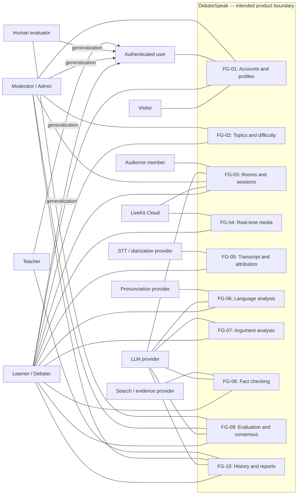

## 4. Relationship catalogue
Performed: Trần Lê Anh Tuấn (24125107), AI Orchestrator & Analysis Lead. Reviewed: Nguyễn Hồng Tấn Tài (24125078), Backend & Real-Time Media Lead — pending. Edited: Trần Lê Anh Tuấn (24125107).

| Base or extension | Related use case | Relation and condition |
|---|---|---|
| UC-03-05 | UC-03-13 | include: Every start request executes authoritative gate validation. |
| UC-06-01 | UC-06-05 | include: Every retained language feedback item must pass citation validation. |
| UC-07-01 | UC-06-05 | include: Every retained argument critique must pass citation validation. |
| UC-07-02 | UC-06-05 | include: Every retained potential-fallacy critique must pass citation validation. |
| UC-02-03 | UC-02-01 | extend: At topic discovery, when the learner requests personalized recommendations. |
| UC-04-04 | UC-04-02 | extend: At media setup, when optional video is enabled and separately authorized. |
| UC-08-02 | UC-04-02 | extend: During LIVE audio, when the learner opts into supported live evidence overlays. |
| UC-09-06 | UC-09-01 | extend: At the evaluation view, when a human grade is submitted and both debaters still authorize sharing. |
| UC-10-05 | UC-10-01 | extend: At report review, when the learner requests a supported PDF export. |

For UC-03-05 the start request always runs UC-03-13 against current authoritative state, even if the UI previously showed ready. UC-06-05 validates speaker and segment identity in the authorized transcript collection as well as exact quote text. It does not prove that the criticism itself is correct. Optional live video and live fact checking remain unavailable unless their feature, consent and operational contracts have been implemented. Human-grade visibility is reevaluated on each access; an earlier consent record is not an unrestricted future grant.

## 5. Functional-group diagrams and use-case inventory
Performed: Trần Lê Anh Tuấn (24125107), AI Orchestrator & Analysis Lead. Reviewed: Nguyễn Hồng Tấn Tài (24125078), Backend & Real-Time Media Lead — pending. Edited: Trần Lê Anh Tuấn (24125107).

### FG-01 — Accounts and profiles
Performed: Trần Lê Anh Tuấn (24125107), AI Orchestrator & Analysis Lead. Reviewed: Nguyễn Hồng Tấn Tài (24125078), Backend & Real-Time Media Lead — pending. Edited: Trần Lê Anh Tuấn (24125107).

FR-01 maps to registration and sign-in. UC-01-02 also specifies the full-product refresh-session lifecycle (renewal, expiry, revocation, replay and lost responses) in [specification Section 2.5](USE_CASE_SPECIFICATIONS.md#25-authentication-session-lifecycle-and-scope). Refresh is supporting session behavior, not an additional user goal or an include from registration. Reduced PA3 implements access-token register/login only; full refresh rotation remains deferred. Recovery links from registration/sign-in are available only when UC-01-05 is implemented and enabled. Both auth flows inherit the detailed error contract in specification Section 2.4.

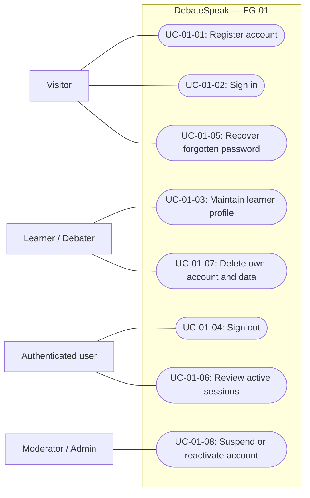

| ID | User goal / supporting behavior | FRs | Delivery scope |
|---|---|---|---|
| UC-01-01 | Register account | FR-01 | PA3 |
| UC-01-02 | Sign in | FR-01 | PA3 |
| UC-01-03 | Maintain learner profile | FR-02 | future-mvp |
| UC-01-04 | Sign out | FR-03 | PA3 |
| UC-01-05 | Recover forgotten password | FR-03 | should |
| UC-01-06 | Review active sessions | FR-03 | should |
| UC-01-07 | Delete own account and data | FR-04 | future-mvp |
| UC-01-08 | Suspend or reactivate account | FR-05 | should |

Account deletion immediately disables access, followed by hard deletion within seven days. A reset request must not reveal whether an email is registered. Profile CEFR is a self-assessment. Sign-out is needed by the room/account slice; full session management, password recovery and profile editing are not silently added to the reduced Build 1 scope.

### FG-02 — Topics and difficulty
Performed: Trần Lê Anh Tuấn (24125107), AI Orchestrator & Analysis Lead. Reviewed: Nguyễn Hồng Tấn Tài (24125078), Backend & Real-Time Media Lead — pending. Edited: Trần Lê Anh Tuấn (24125107).

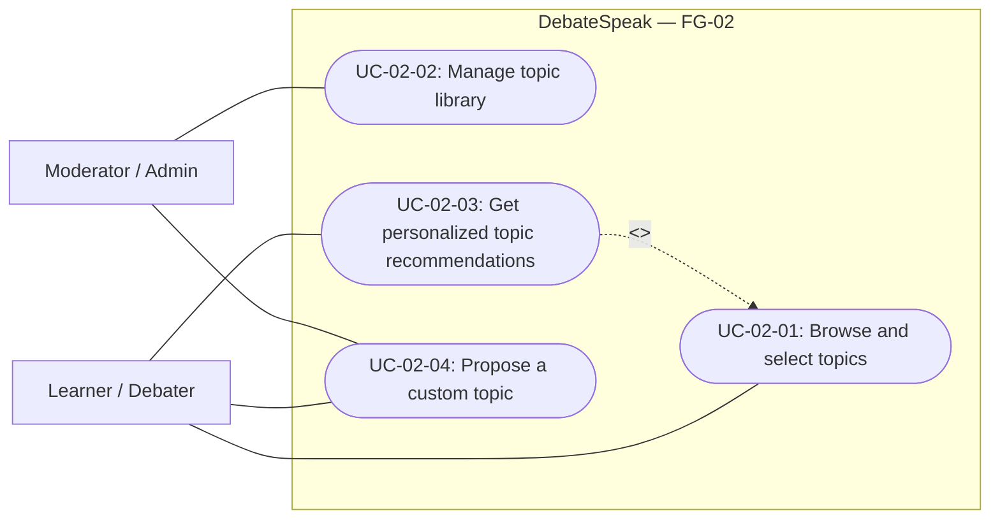

| ID | User goal / supporting behavior | FRs | Delivery scope |
|---|---|---|---|
| UC-02-01 | Browse and select topics | FR-06 | PA3 |
| UC-02-02 | Manage topic library | FR-07 | future-mvp |
| UC-02-03 | Get personalized topic recommendations | FR-08 | should |
| UC-02-04 | Propose a custom topic | FR-09 | stretch |

PA3 may use the agreed seeded topic catalogue until a topic API is available. Topic recommendation is a conditional extension of discovery, not a mandatory search step. Retiring a topic must not rewrite an existing debate's history.

### FG-03 — Rooms and sessions
Performed: Trần Lê Anh Tuấn (24125107), AI Orchestrator & Analysis Lead. Reviewed: Nguyễn Hồng Tấn Tài (24125078), Backend & Real-Time Media Lead — pending. Edited: Trần Lê Anh Tuấn (24125107).

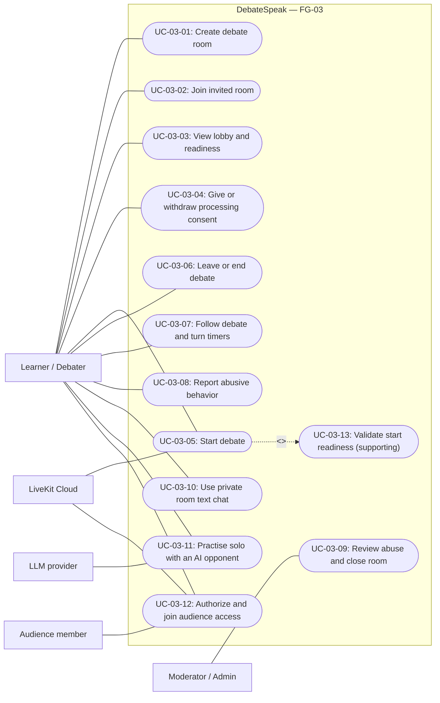

| ID | User goal / supporting behavior | FRs | Delivery scope |
|---|---|---|---|
| UC-03-01 | Create debate room | FR-10, FR-12 | PA3 |
| UC-03-02 | Join invited room | FR-11, FR-12 | PA3 |
| UC-03-03 | View lobby and readiness | FR-12 | PA3 |
| UC-03-04 | Give or withdraw processing consent | FR-13 | future-mvp |
| UC-03-05 | Start debate | FR-12, FR-13, FR-19 | future-mvp |
| UC-03-06 | Leave or end debate | FR-12, FR-15 | future-mvp |
| UC-03-07 | Follow debate and turn timers | FR-14 | future-mvp |
| UC-03-08 | Report abusive behavior | FR-16 | should |
| UC-03-09 | Review abuse and close room | FR-17 | should |
| UC-03-10 | Use private room text chat | FR-58 | post-mvp |
| UC-03-11 | Practise solo with an AI opponent | FR-59 | post-mvp |
| UC-03-12 | Authorize and join audience access | FR-60 | post-mvp |
| UC-03-13 | Validate start readiness | FR-12, FR-13, FR-19 | future-mvp; supporting |

Exactly two debaters count toward capacity. LOBBY becoming READY indicates membership only. Dual consent and explicit local mic tests are separate start gates. Join retries return the same membership; a third distinct user is rejected even under concurrent joins. CANCELLED and ENDED are terminal. Build 1 stops at READY; the model must not activate media or a generic status-patching endpoint.

### FG-04 — Real-time media
Performed: Trần Lê Anh Tuấn (24125107), AI Orchestrator & Analysis Lead. Reviewed: Nguyễn Hồng Tấn Tài (24125078), Backend & Real-Time Media Lead — pending. Edited: Trần Lê Anh Tuấn (24125107).

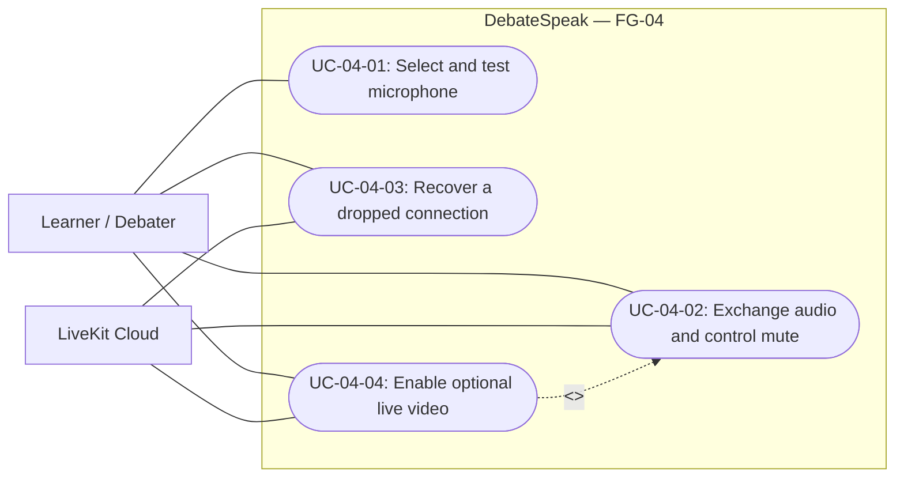

| ID | User goal / supporting behavior | FRs | Delivery scope |
|---|---|---|---|
| UC-04-01 | Select and test microphone | FR-19 | future-mvp |
| UC-04-02 | Exchange audio and control mute | FR-18, FR-20 | future-mvp |
| UC-04-03 | Recover a dropped connection | FR-15, FR-21 | future-mvp |
| UC-04-04 | Enable optional live video | FR-22 | stretch |

No network audio publication or STT starts without dual consent. The local mic test begins only by explicit action and stays local. Audio has priority over optional video, overlays and analysis. A dropped connection retains the existing identity during a visible 60-second grace period.

### FG-05 — Transcript and attribution
Performed: Trần Lê Anh Tuấn (24125107), AI Orchestrator & Analysis Lead. Reviewed: Nguyễn Hồng Tấn Tài (24125078), Backend & Real-Time Media Lead — pending. Edited: Trần Lê Anh Tuấn (24125107).

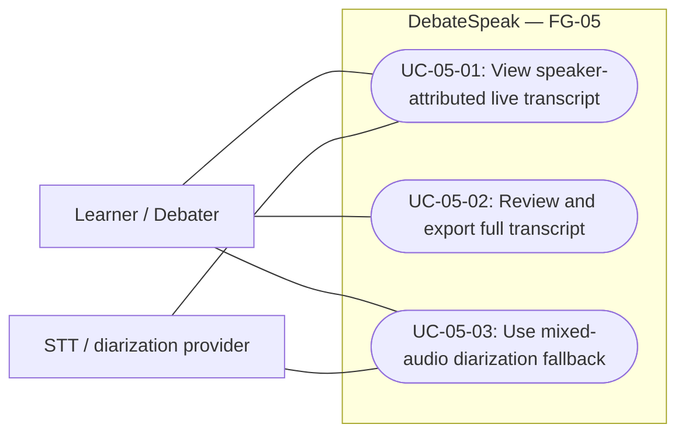

| ID | User goal / supporting behavior | FRs | Delivery scope |
|---|---|---|---|
| UC-05-01 | View speaker-attributed live transcript | FR-23, FR-24, FR-25, FR-26 | future-mvp |
| UC-05-02 | Review and export full transcript | FR-27 | should |
| UC-05-03 | Use mixed-audio diarization fallback | FR-28 | stretch |

Independent LiveKit track identity is the primary attribution source. Partial segments are replaced by final text and final segment persistence is idempotent. Low-confidence or missing text is displayed honestly. Mixed-audio diarization is an optional separately consented fallback, not permission to infer speaker identity in the normal path.

### FG-06 — Language analysis
Performed: Trần Lê Anh Tuấn (24125107), AI Orchestrator & Analysis Lead. Reviewed: Nguyễn Hồng Tấn Tài (24125078), Backend & Real-Time Media Lead — pending. Edited: Trần Lê Anh Tuấn (24125107).

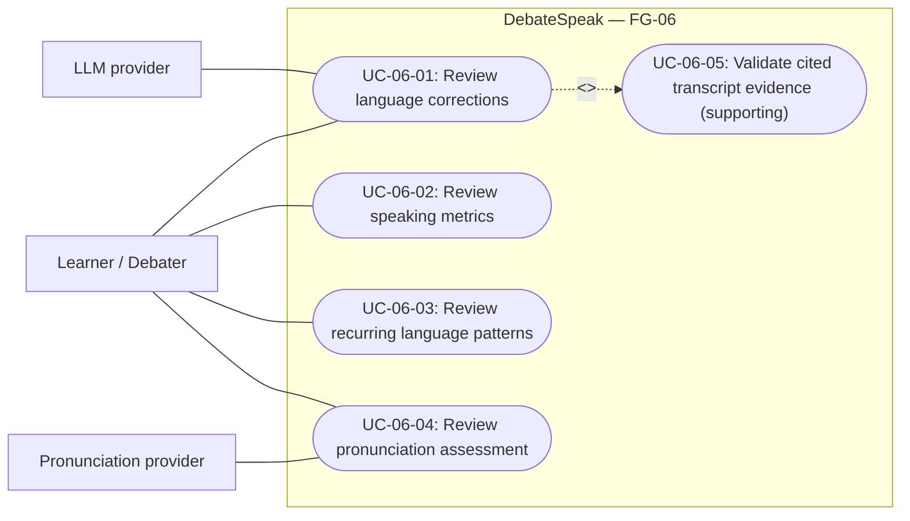

| ID | User goal / supporting behavior | FRs | Delivery scope |
|---|---|---|---|
| UC-06-01 | Review language corrections | FR-30, FR-31 | future-mvp |
| UC-06-02 | Review speaking metrics | FR-29 | future-mvp |
| UC-06-03 | Review recurring language patterns | FR-32 | should |
| UC-06-04 | Review pronunciation assessment | FR-33 | stretch |
| UC-06-05 | Validate cited transcript evidence | FR-30, FR-37 | future-mvp; supporting |

Language criticism is direct, evidence-based and paired with a correction or practice action. The grounding subcase checks exact speaker/segment quotes; uncertain STT cannot become a confirmed learner error. Deterministic metrics expose their units and missing-data limitations. Pronunciation is a separate optional provider flow.

### FG-07 — Argument analysis
Performed: Trần Lê Anh Tuấn (24125107), AI Orchestrator & Analysis Lead. Reviewed: Nguyễn Hồng Tấn Tài (24125078), Backend & Real-Time Media Lead — pending. Edited: Trần Lê Anh Tuấn (24125107).

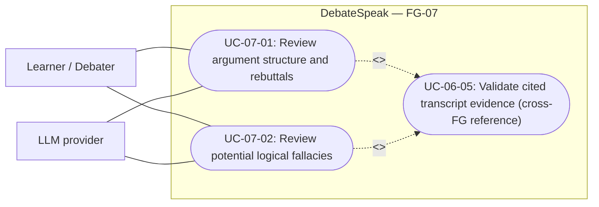

| ID | User goal / supporting behavior | FRs | Delivery scope |
|---|---|---|---|
| UC-07-01 | Review argument structure and rebuttals | FR-34, FR-35, FR-36 | future-mvp |
| UC-07-02 | Review potential logical fallacies | FR-37 | should |

Argument quality is judged independently of accent and grammar. Potential fallacies require a quoted example and context, not a label generated without evidence. Each retained critique invokes the same deterministic citation guard as language feedback.

### FG-08 — Fact checking
Performed: Trần Lê Anh Tuấn (24125107), AI Orchestrator & Analysis Lead. Reviewed: Nguyễn Hồng Tấn Tài (24125078), Backend & Real-Time Media Lead — pending. Edited: Trần Lê Anh Tuấn (24125107).

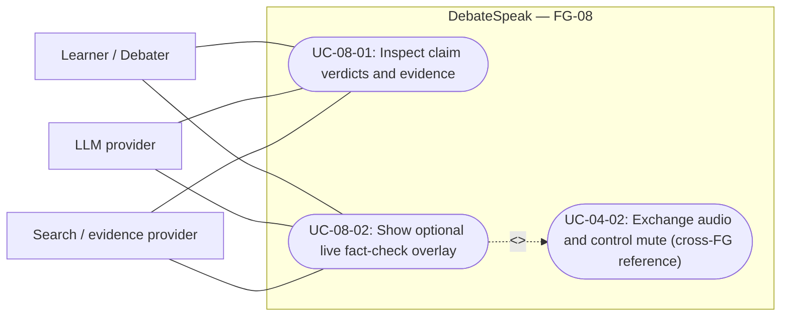

| ID | User goal / supporting behavior | FRs | Delivery scope |
|---|---|---|---|
| UC-08-01 | Inspect claim verdicts and evidence | FR-38, FR-39, FR-40, FR-41, FR-43 | future-mvp |
| UC-08-02 | Show optional live fact-check overlay | FR-42 | stretch |

Default fact-check workload is capped at eight selected claims. External evidence is untrusted data. Five verdicts and uncertainty are preserved; disagreement between Evidence Evaluator and Skeptic remains visible. A live overlay is optional and cannot block audio.

### FG-09 — Evaluation and consensus
Performed: Trần Lê Anh Tuấn (24125107), AI Orchestrator & Analysis Lead. Reviewed: Nguyễn Hồng Tấn Tài (24125078), Backend & Real-Time Media Lead — pending. Edited: Trần Lê Anh Tuấn (24125107).

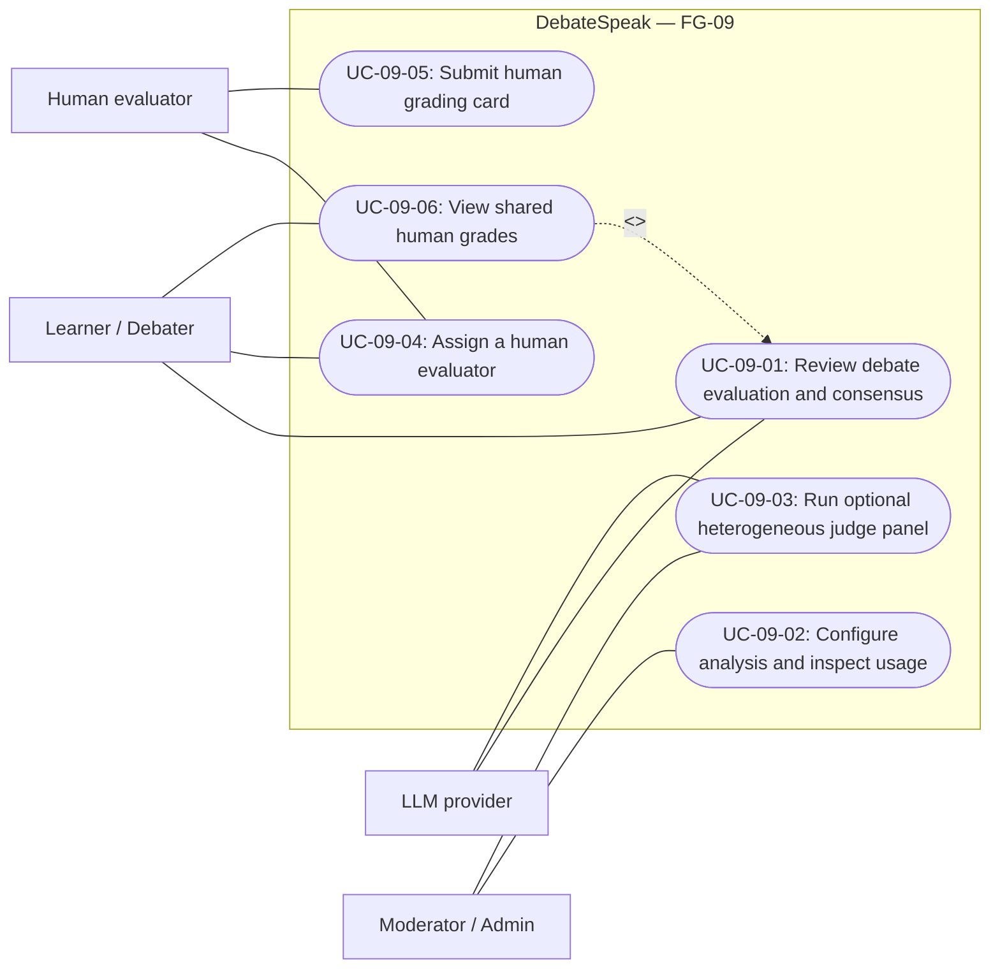

| ID | User goal / supporting behavior | FRs | Delivery scope |
|---|---|---|---|
| UC-09-01 | Review debate evaluation and consensus | FR-44, FR-45 | future-mvp |
| UC-09-02 | Configure analysis and inspect usage | FR-46 | should |
| UC-09-03 | Run optional heterogeneous judge panel | FR-47 | stretch |
| UC-09-04 | Assign a human evaluator | FR-55, FR-56 | should |
| UC-09-05 | Submit human grading card | FR-55, FR-56 | should |
| UC-09-06 | View shared human grades | FR-55, FR-56 | should |

The baseline debate score is a single-judge evaluation with self-reported confidence capped at 0.8. Multiple claim evaluators do not imply a heterogeneous debate-judge panel. Optional human grades are separate records available only for an assigned ENDED debate under dual sharing consent; the UI identifies the evaluator and rubric/card versions.

### FG-10 — History and reports
Performed: Trần Lê Anh Tuấn (24125107), AI Orchestrator & Analysis Lead. Reviewed: Nguyễn Hồng Tấn Tài (24125078), Backend & Real-Time Media Lead — pending. Edited: Trần Lê Anh Tuấn (24125107).

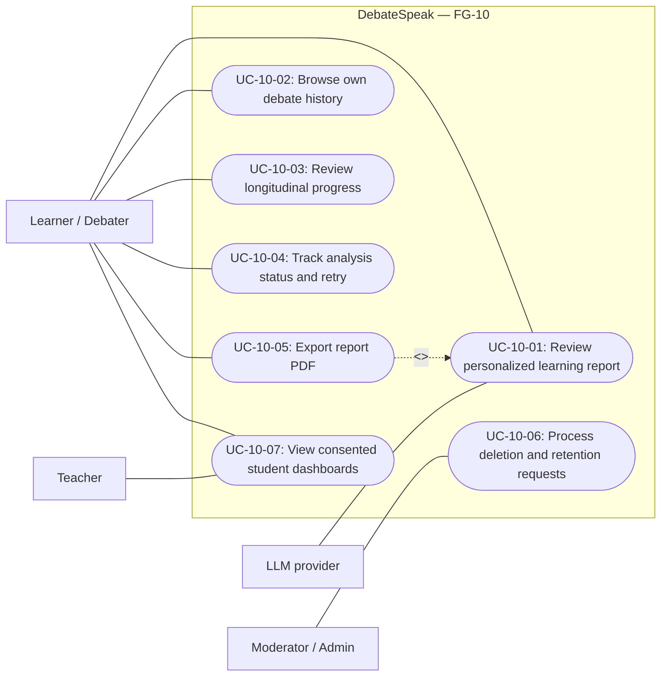

| ID | User goal / supporting behavior | FRs | Delivery scope |
|---|---|---|---|
| UC-10-01 | Review personalized learning report | FR-48, FR-49 | future-mvp |
| UC-10-02 | Browse own debate history | FR-50 | future-mvp |
| UC-10-03 | Review longitudinal progress | FR-51 | should |
| UC-10-04 | Track analysis status and retry | FR-52 | should |
| UC-10-05 | Export report PDF | FR-53 | stretch |
| UC-10-06 | Process deletion and retention requests | FR-54, FR-04 | future-mvp |
| UC-10-07 | View consented student dashboards | FR-57 | post-mvp |

Reports expose unavailable analysis rather than inventing sections or praising unsupported performance. Trends are observations, not certified proficiency gains. Teacher dashboards are read-only and revocable; class creation, invitations, rosters, assignments, group chat and multi-debater room design remain excluded long-term goals.

## 6. Requirement-to-use-case traceability
Performed: Trần Lê Anh Tuấn (24125107), AI Orchestrator & Analysis Lead. Reviewed: Nguyễn Hồng Tấn Tài (24125078), Backend & Real-Time Media Lead — pending. Edited: Trần Lê Anh Tuấn (24125107).

Every FR in the architecture's current FR-01–60 set appears below. A mapping means the behavior is modelled and specified; it is not evidence that the feature is implemented. Current build scheduling comes from the roadmap and PA3 scope.

| Requirement | Use cases |
|---|---|
| FR-01 | UC-01-01, UC-01-02 |
| FR-02 | UC-01-03 |
| FR-03 | UC-01-04, UC-01-05, UC-01-06 |
| FR-04 | UC-01-07, UC-10-06 |
| FR-05 | UC-01-08 |
| FR-06 | UC-02-01 |
| FR-07 | UC-02-02 |
| FR-08 | UC-02-03 |
| FR-09 | UC-02-04 |
| FR-10 | UC-03-01 |
| FR-11 | UC-03-02 |
| FR-12 | UC-03-01, UC-03-02, UC-03-03, UC-03-05, UC-03-06, UC-03-13 |
| FR-13 | UC-03-04, UC-03-05, UC-03-13 |
| FR-14 | UC-03-07 |
| FR-15 | UC-03-06, UC-04-03 |
| FR-16 | UC-03-08 |
| FR-17 | UC-03-09 |
| FR-18 | UC-04-02 |
| FR-19 | UC-03-05, UC-03-13, UC-04-01 |
| FR-20 | UC-04-02 |
| FR-21 | UC-04-03 |
| FR-22 | UC-04-04 |
| FR-23 | UC-05-01 |
| FR-24 | UC-05-01 |
| FR-25 | UC-05-01 |
| FR-26 | UC-05-01 |
| FR-27 | UC-05-02 |
| FR-28 | UC-05-03 |
| FR-29 | UC-06-02 |
| FR-30 | UC-06-01, UC-06-05 |
| FR-31 | UC-06-01 |
| FR-32 | UC-06-03 |
| FR-33 | UC-06-04 |
| FR-34 | UC-07-01 |
| FR-35 | UC-07-01 |
| FR-36 | UC-07-01 |
| FR-37 | UC-06-05, UC-07-02 |
| FR-38 | UC-08-01 |
| FR-39 | UC-08-01 |
| FR-40 | UC-08-01 |
| FR-41 | UC-08-01 |
| FR-42 | UC-08-02 |
| FR-43 | UC-08-01 |
| FR-44 | UC-09-01 |
| FR-45 | UC-09-01 |
| FR-46 | UC-09-02 |
| FR-47 | UC-09-03 |
| FR-48 | UC-10-01 |
| FR-49 | UC-10-01 |
| FR-50 | UC-10-02 |
| FR-51 | UC-10-03 |
| FR-52 | UC-10-04 |
| FR-53 | UC-10-05 |
| FR-54 | UC-10-06 |
| FR-55 | UC-09-04, UC-09-05, UC-09-06 |
| FR-56 | UC-09-04, UC-09-05, UC-09-06 |
| FR-57 | UC-10-07 |
| FR-58 | UC-03-10 |
| FR-59 | UC-03-11 |
| FR-60 | UC-03-12 |

## 7. Cross-cutting acceptance and human consequences
Performed: Trần Lê Anh Tuấn (24125107), AI Orchestrator & Analysis Lead. Reviewed: Nguyễn Hồng Tấn Tài (24125078), Backend & Real-Time Media Lead — pending. Edited: Trần Lê Anh Tuấn (24125107).

- Consent is explicit, uncoerced and separately controlled by each debater; signing in, joining, clicking READY or granting browser microphone permission does not grant transcription/analysis consent.
- Refusing consent preserves normal account use and an accessible leave path. Before dual consent, a microphone test remains local, without upload, storage or transcription.
- Live controls prioritize audibility, mute, presence and leaving. Detailed critique belongs in post-debate reflection; optional AI failures cannot stop healthy audio.
- Capture stops promptly on end or consent withdrawal. Reconnection never creates a duplicate seat or silently continues capture after authorization is lost.
- Participants can access only authorized room/transcript/report data. Human evaluators see assigned ended debates only; teachers have explicit revocable read-only access.
- Every retained language/argument feedback quote belongs to the correct speaker and segment. Feedback states a concrete issue and remediation without insulting the learner or assigning motives.
- Raw audio is not stored by default. Erasure/retention workflows cover derived analyses and optional chat as well as the primary transcript.

## 8. Review and completion evidence
Performed: Trần Lê Anh Tuấn (24125107), AI Orchestrator & Analysis Lead. Reviewed: Nguyễn Hồng Tấn Tài (24125078), Backend & Real-Time Media Lead — pending. Edited: Trần Lê Anh Tuấn (24125107).

The inventory contains **54 use cases across ten functional groups**, including two mandatory supporting subcases. All 60 FRs are mapped. There is one overview and ten detailed Mermaid diagrams. [Part D](USE_CASE_SPECIFICATIONS.md) describes every catalogue ID and links its prototype and alternative-flow evidence. [use_cases.json](use_cases.json) enables automated cross-checking of IDs, actor references, requirements and screenshot coverage.

Human reviewer: Nguyễn Hồng Tấn Tài (24125078), Backend & Real-Time Media Lead. Review remains pending. Diagram rendering, PDF compilation and document-validation results are recorded in the overall local work record after execution; no successful check is inferred solely from this model's existence. The user has prohibited commit and push, so this work remains local and no ticket is marked Done.
