# DebateSpeak — Use-Case Specifications and UI Prototypes
*Performed: Tuấn (24125107). Reviewed: Triết (24125047), 2026-11-14. Edited: Trần Lê Anh Tuấn (24125107).*

Ticket: **SCRUM-37**, PA3 Part D. Prepared locally on 2026-11-09 for human review.

Responsible owner: **Trần Lê Anh Tuấn (24125107), AI Orchestrator & Analysis Lead**. Co-owner: **Nguyễn Bảo Minh Triết (24125047), Frontend & WebRTC/Audio Lead**. Assigned reviewer: **Nguyễn Đình Thiên Lộc (24125093), DevOps & QA / Fact-Checking Lead**; review pending. This attribution does not assert that a teammate has reviewed, edited, or approved the work.

## 1. Scope and reading guide
*Performed: Tuấn (24125107). Reviewed: Triết (24125047), 2026-11-14. Edited: Trần Lê Anh Tuấn (24125107); Nguyễn Bảo Minh Triết (24125047), 2026-11-14.*

The [use-case model](USE_CASE_MODEL.md) and [machine-readable catalogue](use_cases.json) define the shared use-case identifiers. These specifications describe intended behavior across all ten functional groups; they do not claim that the complete product is implemented in PA3. `PA3` labels identify the first-slice design, `future-mvp` the later Must workflows, and `should`, `stretch`, or `post-mvp` explicitly conditional scope. The authoritative build progression is the [roadmap](../ROADMAP.md), not the older sprint-number column in the functional-requirement tables.

Each entry includes a goal, actor, trigger, preconditions, main success scenario, alternatives/exceptions, success guarantee, minimum guarantee, rules, traceability, and a prototype screenshot. Alternative labels refer to main-flow step numbers. A denial or failure is an outcome to describe, not permission to bypass a security or consent requirement. The prototype is a local design artifact with illustrative data. Its navigation and controls do not implement authentication, persistence, audio, transcription, or AI processing.

Sources: [architecture requirements and privacy rules](../architecture/SOFTWARE_ARCHITECTURE_SPEC.md), [Vision](../requirements/VISION_DOCUMENT.md), [Build 1 contract](../architecture/G1_SPEC_BUILD1.md), and [PA3 scope](README.md). PA3 scope reductions in [Changes.md](Changes.md) take precedence over older Build 1 refresh-token/profile expansion. On 2026-11-14 FG-01 became the PA3 Part E slice: `PA3` now covers all eight FG-01 use cases, and Sections 2.4–2.5 describe the implemented auth contract. FG-03 room use cases move to PA4. Live media is not asserted as completed.

## 2. Shared contracts
*Performed: Tuấn (24125107). Reviewed: Triết (24125047), 2026-11-14. Edited: Trần Lê Anh Tuấn (24125107).*

### 2.1 Identity, permissions, and persistence
*Performed: Tuấn (24125107). Reviewed: Triết (24125047), 2026-11-14. Edited: Trần Lê Anh Tuấn (24125107).*

Identity always comes from a verified server session, never a submitted `user_id`. Learners access their own profile and only debates they participate in. Moderator/Admin authorization is checked server-side for every restricted action; the role is not a general right to read private transcripts. An assigned human Evaluator has only assignment-scoped access. The post-MVP Teacher has read-only access only while the student's explicit sharing consent remains valid.

Atomic writes either commit all related changes or leave the pre-operation state intact. A loading view does not mean a write succeeded. On ambiguous network failure, fetch the authorized resource before retrying a mutation; retry-sensitive operations must deduplicate rather than create duplicate participants, jobs, grades, or reports. No secret, password, token, or invite code enters application logs or error details. A permission denial never exposes another user's names, transcript, report, or account status.

### 2.2 Room and consent lifecycle
*Performed: Tuấn (24125107). Reviewed: Triết (24125047), 2026-11-14. Edited: Trần Lê Anh Tuấn (24125107).*

`LOBBY` means waiting for a second distinct authenticated learner; `READY` means both seats are occupied. Presence is not consent or microphone readiness. Legal edges are `LOBBY → READY/CANCELLED`, `READY → LOBBY/LIVE/CANCELLED`, and `LIVE → ENDED`; `ENDED` and `CANCELLED` are terminal. Self-transitions are invalid at the pure state-machine boundary; an idempotent read/retry does not invoke a self-transition. Build 1 exposes only create/join/read through READY, with expiry cancellation; session-start designs remain unavailable until the real consent/media prerequisites exist.

Before LIVE, each learner separately sees what is transcribed, sent to AI, retained, and deletable. Consent controls are unchecked by default; declining has no account penalty. A user explicitly starts a local microphone test and grants browser permission. The test is local, with no upload, storage, STT, or remote publication. Only when both learners have given current consent, passed the local mic check, and the media capability is available may the server authorize LIVE and network transmission. Either learner can stop participation; consent withdrawal during LIVE stops capture and ends the session. A future audience grant or chat-analysis grant is separate from ordinary debate consent.

The lobby expires after 30 minutes. Room capacity is two, enforced transactionally. Invite codes are eight uppercase characters; normalize trimming/case without logging them. A LIVE disconnect has a visible 60-second grace period; reconnecting restores the same identity and seat. At grace expiry the server ends the session and stops transmission. Analysis of an early-ended partial debate requires at least 60 seconds of speech, not merely 60 seconds of wall-clock room time.

### 2.3 Evidence, feedback, and reports
*Performed: Tuấn (24125107). Reviewed: Triết (24125047), 2026-11-14. Edited: Trần Lê Anh Tuấn (24125107).*

Speaker attribution comes from the participant's independent media track. Partial STT text may change; final segment persistence is idempotent and includes speaker, timing, and confidence. Feedback references an existing segment of the correct speaker and quotes a nonempty exact substring. Grounding validates provenance only; it does not prove that a criticism is correct. Low-confidence recognition is not presented as a confirmed learner error. Every retained sharp critique includes evidence and a concrete correction or practice action; do not insult learners, invent motives, or confuse accent with reasoning quality.

Default fact-checking selects at most eight claims. Verdicts are Supported, Partially supported, Contradicted, Insufficient evidence, and Not verifiable. Disagreement is visible as Contested. The MVP debate score has one evaluator, is labelled accordingly, and its self-reported confidence is capped at 0.8. Analysis failure produces a visibly partial or unavailable section rather than a fabricated score. Reports are post-debate; optional analysis must not block audio or overwhelm the live conversation.

### 2.4 Shared error and UI behavior
*Performed: Tuấn (24125107). Reviewed: Triết (24125047), 2026-11-14. Edited: Trần Lê Anh Tuấn (24125107); Nguyễn Bảo Minh Triết (24125047), 2026-11-14.*

The PA3 `/api/v1` resources are the FG-01 endpoints in `web/API_INTEGRATION.md` (`/auth/*`, `/users/me`, `/auth/sessions`, `/admin/users`). Room resources (`/rooms`, `/rooms/join`, `/rooms/{id}`) belong to FG-03 in PA4. Do not create future routes merely to make a prototype work. Expired identity requires sign-in; unavailable/nonmember room reads return a non-disclosing 404; full or nonjoinable rooms and invalid exposed transitions use 409; invalid fields use 422. When rate limited, preserve nonsensitive input and respect Retry-After; when a dependency is unavailable, show a recoverable state without exposing traces.

All screens require visible keyboard focus, labelled controls, meaningful loading/empty/error states, and text status rather than color alone. Destructive actions have a separate confirmation. Live controls keep mute, connection status, and end/leave readily accessible. The prototype navigation supplies the design screenshots referenced below; it is not an end-to-end product acceptance test.

The following authentication error contract applies to UC-01-01 and UC-01-02, including their validation and service-failure branches. It follows the architecture's API-ready authentication frontend contract. Retain nonsensitive input, clear passwords after failure, and never render raw server messages, submitted secrets or traces.

| Response / condition | Required outcome and recovery |
|---|---|
| Unreachable service | Explain that the service could not be reached; allow a deliberate retry when connectivity returns. |
| 404 / 405 | Distinguish an unavailable authentication route from an unsupported action; do not describe either as invalid credentials or account creation success. |
| 400 / 422 | Show safe validation guidance for invalid input. |
| 401 on sign-in | Show the same invalid-credentials message for unknown email, wrong password or a deleted account; grant no access. |
| 403 | Use neutral access-denial wording, including rejected Origin/client headers. Exception: sign-in with the correct password to a suspended account returns `{"code":"account_suspended"}` and the form says the account is suspended. The server checks the password first, so suspension is never revealed to someone without the password. |
| 409 on registration | Report the registration conflict; offer sign-in, and offer UC-01-05 recovery only when implemented and enabled. |
| 429 | Show retry timing, respect Retry-After and prevent immediate repeated submission. |
| 500 / 502 / 503 | Distinguish a server error from temporary service unavailability; show a recoverable outcome without claiming the operation succeeded. |
| 408 / 504 / local 15-second deadline | Explain that the request timed out; registration may have committed, so reconcile through sign-in before retrying account creation. |
| Unreadable or malformed success response | Show an unexpected-response error; do not claim registration or sign-in succeeded without a valid response. |

An ambiguous registration response follows UC-01-01 E3. An ambiguous login response follows UC-01-02 E3; the PA3 flow remains signed out until a valid login response is received. Recovery is never presented as available merely because a failure occurred.

### 2.5 Authentication session lifecycle and scope
*Performed: Tuấn (24125107). Reviewed: Triết (24125047), 2026-11-14. Edited: Trần Lê Anh Tuấn (24125107); Nguyễn Bảo Minh Triết (24125047), 2026-11-14.*

FR-01's full-product session behavior is part of UC-01-02, not a separate user goal or a mandatory include from registration. Registration always finishes signed out. The following design follows G1 sections 5 and 7; PA3 implements it (Changes.md row 1.12).

- **PA3 build:** Implements the full-product lifecycle below. The access JWT stays in runtime memory. On page load the app calls `/auth/refresh` once to restore the session; on access expiry it tries one refresh before asking the user to sign in.
- **Full-product sign-in:** A valid login returns a short-lived access JWT (15 minutes under G1) and sets a host-only HttpOnly refresh cookie, Secure on HTTPS and SameSite=Lax. Neither access nor refresh credentials enter localStorage/sessionStorage; JavaScript never receives the refresh value. Auth requests use the configured trusted Origin, client header and credentialed fetch.
- **Renewal:** When access expires, serialize refresh attempts and allow at most one refresh attempt for an ordinary protected-request recovery. The server atomically consumes the current refresh credential and issues its successor plus a new access JWT. Rotation preserves the family's original seven-day absolute expiry. Retry the protected request only after confirmed renewal and only when its retry contract permits it.
- **Expiry, revocation or replay:** A missing, expired, revoked or replayed refresh credential produces a generic invalid-session outcome. Replay revokes the entire family. Clear in-memory credentials and return to sign-in without a retry loop; server checks prevent revoked families or ineligible accounts from retaining access.
- **Lost renewal response:** Do not automatically repeat a potentially consumed refresh credential. Clear in-memory access and require sign-in. Concurrent-tab replay likewise requires re-authentication.
- **Sign-out:** UC-01-04 revokes the identifiable current family and clears the refresh cookie; an already absent/revoked session is an idempotent success. This does not sign out every device. Network failure leaves revocation unconfirmed as specified in UC-01-04 E1.

Refresh-session behavior is implemented in PA3 (`specs/002-fg01-accounts`). Password recovery remains conditional on UC-01-05 being implemented and enabled; otherwise offer sign-in only and do not expose an actionable recovery link.

## 3. Use-case specifications
*Performed: Tuấn (24125107). Reviewed: Triết (24125047), 2026-11-14. Edited: Trần Lê Anh Tuấn (24125107).*

The 54 entries below follow the shared catalogue order. Each specification links its basic-flow screen and an alternative/exception contact sheet. Conditions and recovery outcomes in those sheets match the numbered branches below. Shared security/availability failures in Section 2 also apply to every operation.

## FG-01 — Account and profile
*Performed: Tuấn (24125107). Reviewed: Triết (24125047), 2026-11-14. Edited: Trần Lê Anh Tuấn (24125107).*

### UC-01-01 — Register account
*Performed: Tuấn (24125107). Reviewed: Triết (24125047), 2026-11-14. Edited: Trần Lê Anh Tuấn (24125107); Nguyễn Bảo Minh Triết (24125047), 2026-11-14.*

**Description / goal:** Create an account without granting media or AI-processing consent.

| Field | Specification |
|---|---|
| Actors | Visitor |
| Scope / kind | `PA3`; user-goal; design status, not implementation evidence |
| Requirements | FR-01 |
| Trigger | Visitor selects Create account. |
| Preconditions | Visitor is signed out and can reach the registration page. |

**Basic flow — main success scenario**

1. Visitor enters an email, password and optional display name and self-assessed CEFR level.
2. System validates the fields and explains that account creation grants no media or analysis consent.
3. Visitor submits; system normalizes email comparison and atomically creates the account and default profile.
4. System confirms registration and directs the visitor to sign in; no session or microphone is started.

**Alternative and exception flows**

| Branch | Condition / extension point | Outcome and recovery |
|---|---|---|
| A1 | At step 1, optional profile values are omitted. | System uses Learner and B1 defaults; registration may continue. |
| A2 | After step 4, the visitor verifies their email. | Visitor enters the emailed code on Verify email, or requests a new one. Verification never signs in, and a verification code is never accepted as a reset code. |
| E1 | At step 2, email/password/display name/CEFR is invalid. | Show field errors, retain nonsensitive fields, clear the password, and create no account. |
| E2 | At step 3, email already exists. | Return EMAIL_EXISTS without creating another account; offer sign-in, and recovery only when UC-01-05 is implemented and enabled. |
| E3 | At step 3, throttling or a failed/ambiguous response occurs. | Apply Section 2.4 error handling: respect Retry-After or reconcile by sign-in before retrying; offer recovery only when UC-01-05 is implemented and enabled. Never claim success without confirmation. |

**Postconditions — success:** One account and its profile exist; the visitor remains signed out.

**Postconditions — minimum guarantee:** A failed atomic write leaves neither a partial account nor a partial profile.

**Special requirements:** Email at most 254 characters; password 12–128 without trimming; display name 1–80; CEFR A2/B1/B2/C1. Password hashing occurs server-side (Argon2id specified; the PA3 build uses BCrypt, Changes.md row 1.13). No passwords in screenshots/logs. Shared permission, consent, accessibility and failure contracts in Section 2 apply.

**UI prototype:** The first image represents the main workflow; the contact sheet contains every named alternative/exception outcome. Illustrative data is not a real learner record.

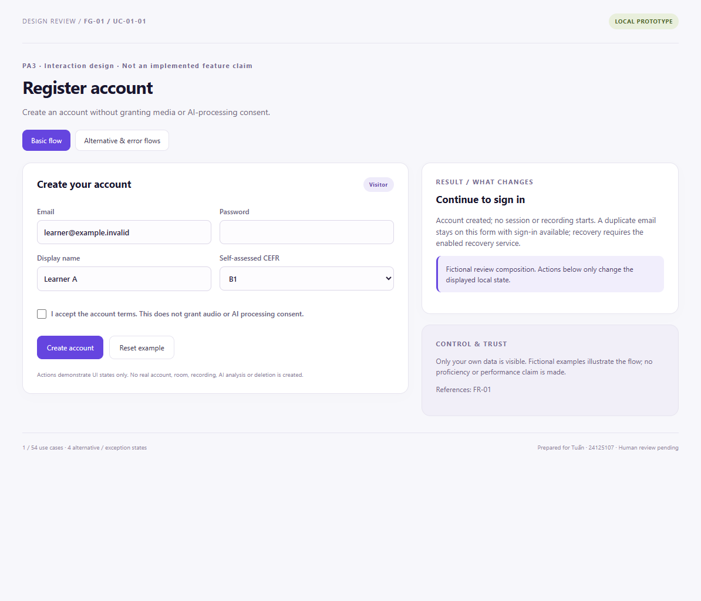

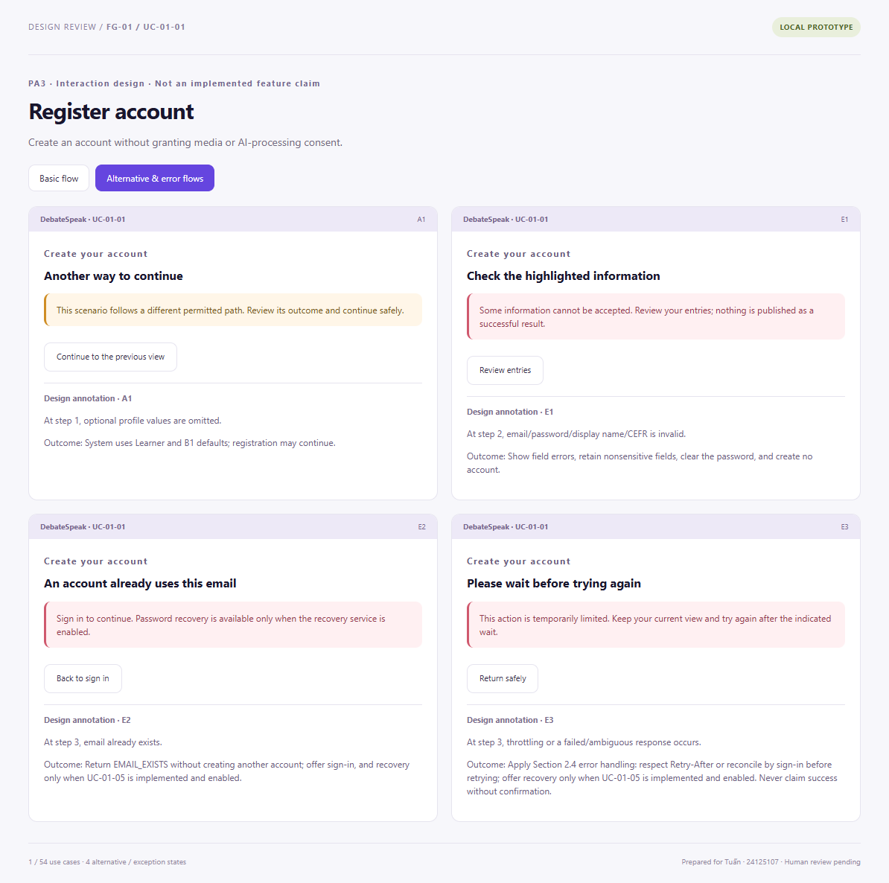

### UC-01-02 — Sign in
*Performed: Tuấn (24125107). Reviewed: Triết (24125047), 2026-11-14. Edited: Trần Lê Anh Tuấn (24125107); Nguyễn Bảo Minh Triết (24125047), 2026-11-14.*

**Description / goal:** Authenticate and recover an authorized application session.

| Field | Specification |
|---|---|
| Actors | Visitor |
| Scope / kind | `PA3`; user-goal; design status, not implementation evidence |
| Requirements | FR-01 |
| Trigger | Visitor selects Sign in. |
| Preconditions | Visitor has an account and is signed out. |

**Basic flow — main success scenario**

1. Visitor enters email and password and submits once.
2. System validates credentials and account eligibility without revealing which check failed.
3. System establishes the authorized session and returns the learner identity using the explicit reduced-PA3 or full-product contract in Section 2.5.
4. System opens the menu or a previously requested authorized page without creating a room or requesting microphone permission.

**Alternative and exception flows**

| Branch | Condition / extension point | Outcome and recovery |
|---|---|---|
| A1 | At step 4, an invite destination was preserved. | After sign-in, reopen invite entry; joining still requires its own capacity/state checks. |
| E1 | At step 2, credentials are wrong or the account is deleted. | Show the same generic invalid-credentials message; issue no session. |
| E2 | At step 2, fields are malformed or login is rate limited. | Show validation or retry timing; retain email, clear password. |
| E3 | At step 3, session creation or network confirmation fails. | Apply Section 2.4 error handling and remain signed out until a valid login response is received; do not show a fake logged-in screen. |
| E4 | At step 2, the password is correct but the account is suspended. | Say the account is suspended (403 `account_suspended`); issue no session. |

**Postconditions — success:** A verified session identifies the user and enables only their authorized actions.

**Postconditions — minimum guarantee:** Failed sign-in grants no access and discloses no account eligibility details.

**Special requirements:** Sections 2.4 and 2.5 define auth errors and the FR-01 session lifecycle, including renewal, expiry, replay and lost-response handling. Keep access tokens only in runtime memory; never expose server secrets. Refresh rotation is implemented in PA3. Shared permission, consent, accessibility and failure contracts in Section 2 apply.

**UI prototype:** The first image represents the main workflow; the contact sheet contains every named alternative/exception outcome. Illustrative data is not a real learner record.

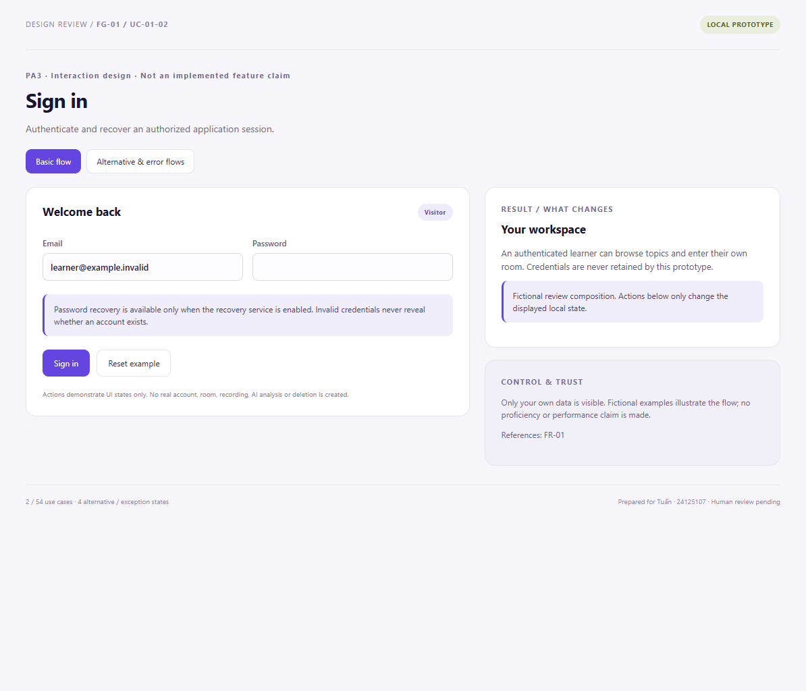

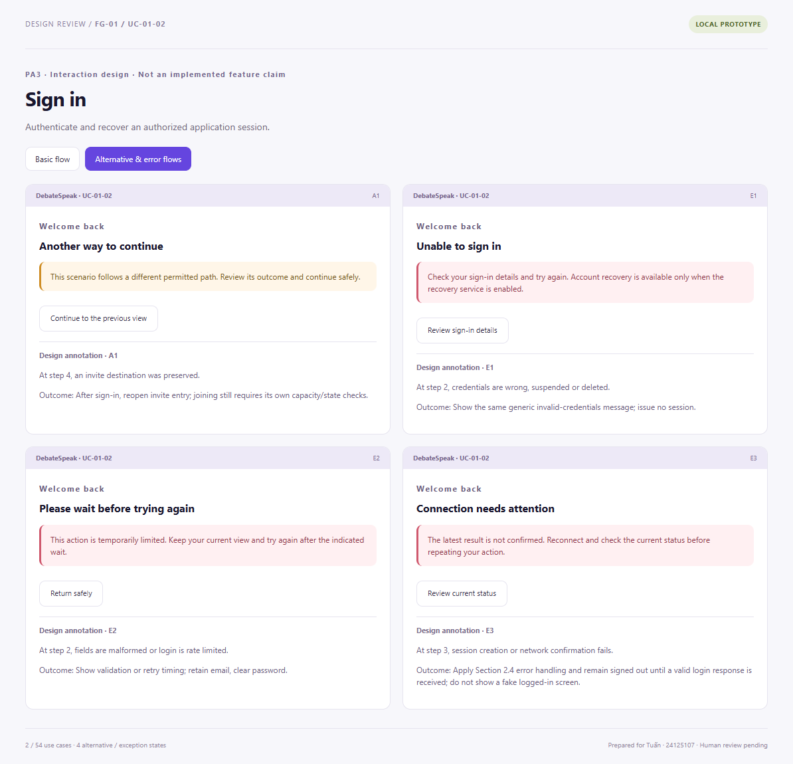

### UC-01-03 — Maintain learner profile
*Performed: Tuấn (24125107). Reviewed: Triết (24125047), 2026-11-14. Edited: Trần Lê Anh Tuấn (24125107); Nguyễn Bảo Minh Triết (24125047), 2026-11-14.*

**Description / goal:** Maintain display name, native language, self-assessed CEFR and goals.

| Field | Specification |
|---|---|
| Actors | Learner / Debater |
| Scope / kind | `PA3`; user-goal; design status, not implementation evidence |
| Requirements | FR-02 |
| Trigger | Learner opens Profile and chooses Edit. |
| Preconditions | Learner is authenticated and editing their own profile. |

**Basic flow — main success scenario**

1. System loads the learner current display name, native language, CEFR and goals.
2. Learner changes the supported fields and reviews the self-assessment explanation.
3. System validates the update against the authenticated identity and saves it atomically.
4. System displays the saved values and confirms the save; the header shows the new display name.

**Alternative and exception flows**

| Branch | Condition / extension point | Outcome and recovery |
|---|---|---|
| A1 | At step 2, learner cancels or makes no changes. | Leave the saved profile unchanged and return to the read view. |
| E1 | At step 3, fields are invalid or include identity/role changes. | Reject the update, show errors, and preserve the saved profile. |
| E2 | At step 3, identity expires or the save response is lost. | Require sign-in or reload the authorized profile to reconcile; keep nonsensitive draft values until resolved. |

**Postconditions — success:** Only permitted own-profile fields are updated.

**Postconditions — minimum guarantee:** No other account changes; invalid requests leave the saved profile unchanged.

**Special requirements:** CEFR is self-assessed, never certified. Native language is free text up to 64 characters; up to five goals, one per line, each up to 120 characters. Never accept user_id, role, email or password_hash as editable profile fields. Shared permission, consent, accessibility and failure contracts in Section 2 apply.

**UI prototype:** The first image represents the main workflow; the contact sheet contains every named alternative/exception outcome. Illustrative data is not a real learner record.

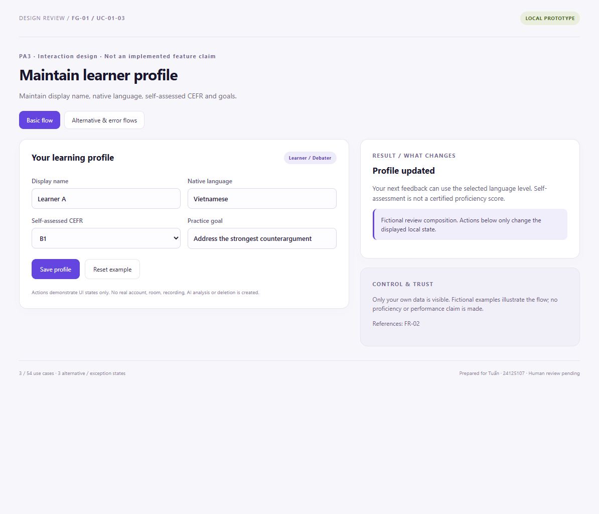

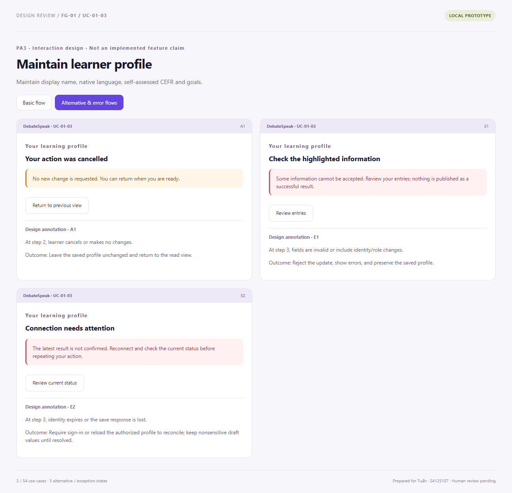

### UC-01-04 — Sign out
*Performed: Tuấn (24125107). Reviewed: Triết (24125047), 2026-11-14. Edited: Trần Lê Anh Tuấn (24125107); Nguyễn Bảo Minh Triết (24125047), 2026-11-14.*

**Description / goal:** End the current session without keeping the account active in this browser.

| Field | Specification |
|---|---|
| Actors | Authenticated user |
| Scope / kind | `PA3`; user-goal; design status, not implementation evidence |
| Requirements | FR-03 |
| Trigger | User selects Sign out. |
| Preconditions | An authenticated user has a browser session; the sign-out auth contract is available. |

**Basic flow — main success scenario**

1. System stops local media if any and closes private subscriptions/polling for this browser.
2. System submits sign-out using the current auth session and clears local credential state.
3. Server invalidates the session according to its auth contract and clears any session cookie.
4. System returns to sign-in and prevents cached private views from remaining visible.

**Alternative and exception flows**

| Branch | Condition / extension point | Outcome and recovery |
|---|---|---|
| A1 | At step 2, session already expired or was revoked. | Treat sign-out as idempotent and show the signed-out page. |
| E1 | At step 3, the network is unavailable. | Clear local access immediately, disclose that server revocation is unconfirmed, and advise signing in again to check Active sessions (UC-01-06). |
| A2 | At step 1, a LIVE room is open. | Stop this browser capture promptly and follow leave/end rules; sign-out does not authorize background recording. |

**Postconditions — success:** This browser is signed out; confirmed server revocation is reflected honestly.

**Postconditions — minimum guarantee:** Local capture and private views stop even if the server cannot be reached.

**Special requirements:** Do not claim all devices signed out. Back navigation must not reveal cached private data; no-store applies to private resources. Shared permission, consent, accessibility and failure contracts in Section 2 apply.

**UI prototype:** The first image represents the main workflow; the contact sheet contains every named alternative/exception outcome. Illustrative data is not a real learner record.

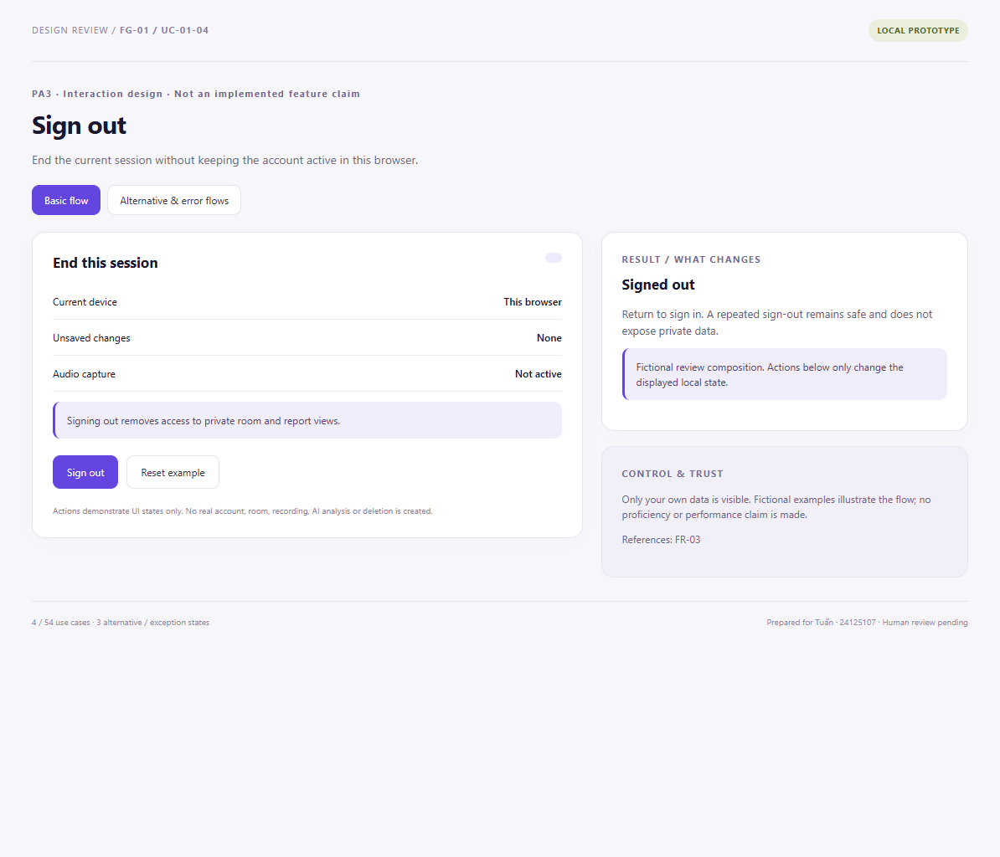

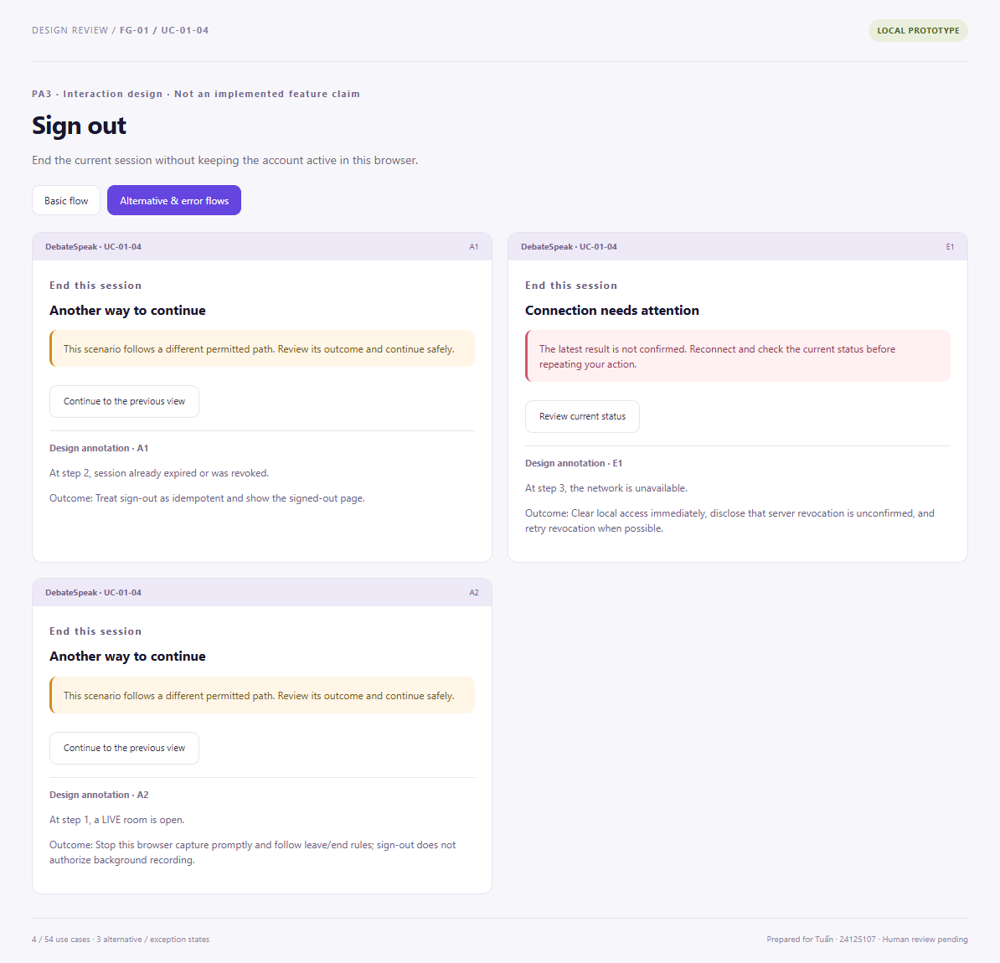

### UC-01-05 — Recover forgotten password
*Performed: Tuấn (24125107). Reviewed: Triết (24125047), 2026-11-14. Edited: Trần Lê Anh Tuấn (24125107); Nguyễn Bảo Minh Triết (24125047), 2026-11-14.*

**Description / goal:** Regain account access through a verified password-reset process.

| Field | Specification |
|---|---|
| Actors | Visitor; Learner (from Profile, Change password) |
| Scope / kind | `PA3`; user-goal; design status, not implementation evidence |
| Requirements | FR-03 |
| Trigger | Visitor selects Forgot password, or a signed-in learner selects Change password on Profile. |
| Preconditions | The recovery screens are enabled. The API implements them; the PA3 UI keeps them switched off until real email delivery is verified. |

**Basic flow — main success scenario**

1. Visitor submits an email address to the recovery form.
2. System returns a uniform acknowledgement and sends a single-use, expiring reset code if the account is eligible.
3. Visitor enters the email, the code and a new valid password on Reset password.
4. System verifies and consumes the reset credential atomically, changes the password, ends every existing session of the account and directs the visitor to sign in.

**Alternative and exception flows**

| Branch | Condition / extension point | Outcome and recovery |
|---|---|---|
| A1 | At step 2, email is unknown or ineligible. | Show the same acknowledgement; do not disclose account existence. |
| E1 | At step 3, the code is expired, invalid or already used. | Do not change the password; offer a fresh recovery request. |
| E2 | At step 4, password is invalid or delivery/service fails. | Keep the account unchanged; show a generic recovery error or retry path without displaying the reset credential. |

**Postconditions — success:** A verified reset changes the password once; visitor signs in separately.

**Postconditions — minimum guarantee:** No password change occurs without a verified, unused recovery credential.

**Special requirements:** The backend enforces code expiry and single use and stores only code hashes. A successful reset ends every session of the account. An email-verification code is never accepted as a reset code. Shared permission, consent, accessibility and failure contracts in Section 2 apply.

**UI prototype:** The first image represents the main workflow; the contact sheet contains every named alternative/exception outcome. Illustrative data is not a real learner record.

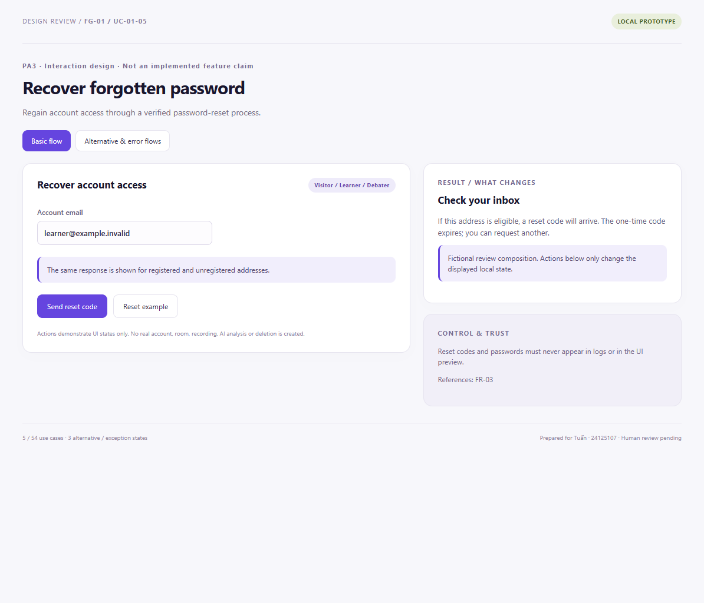

### UC-01-06 — Review active sessions
*Performed: Tuấn (24125107). Reviewed: Triết (24125047), 2026-11-14. Edited: Trần Lê Anh Tuấn (24125107); Nguyễn Bảo Minh Triết (24125047), 2026-11-14.*

**Description / goal:** Inspect own authenticated sessions without exposing session credentials.

| Field | Specification |
|---|---|
| Actors | Authenticated user |
| Scope / kind | `PA3`; user-goal; design status, not implementation evidence |
| Requirements | FR-03 |
| Trigger | User opens Active sessions. |
| Preconditions | User is authenticated. |

**Basic flow — main success scenario**

1. System authorizes the current account and retrieves only its sessions.
2. System displays nonsecret session metadata and marks the current browser.
3. User inspects each device, its sign-in time and its last activity.
4. System reconciles expired sessions and shows the current authorized list.

**Alternative and exception flows**

| Branch | Condition / extension point | Outcome and recovery |
|---|---|---|
| A1 | At step 2, no other active session exists. | Show an explicit current-session-only or empty state, not sample devices. |
| E1 | At step 1, the session expires or another account is requested. | Require sign-in or deny access without returning another account session metadata. |
| E2 | At step 4, retrieval fails. | Show the error with Try again; do not imply a device was revoked. |
| A2 | At step 3, the user signs out another device. | After a separate confirmation the server ends that session, and that device must sign in again. On the current device the action is Sign out here (UC-01-04). |

**Postconditions — success:** User sees a current or explicitly stale list of their sessions.

**Postconditions — minimum guarantee:** Session credentials and other users sessions are never exposed.

**Special requirements:** Signing out one other device at a time is supported; there is no action that signs out all devices. Never show raw access/refresh tokens, token hashes or full secret cookie values. Shared permission, consent, accessibility and failure contracts in Section 2 apply.

**UI prototype:** The first image represents the main workflow; the contact sheet contains every named alternative/exception outcome. Illustrative data is not a real learner record.

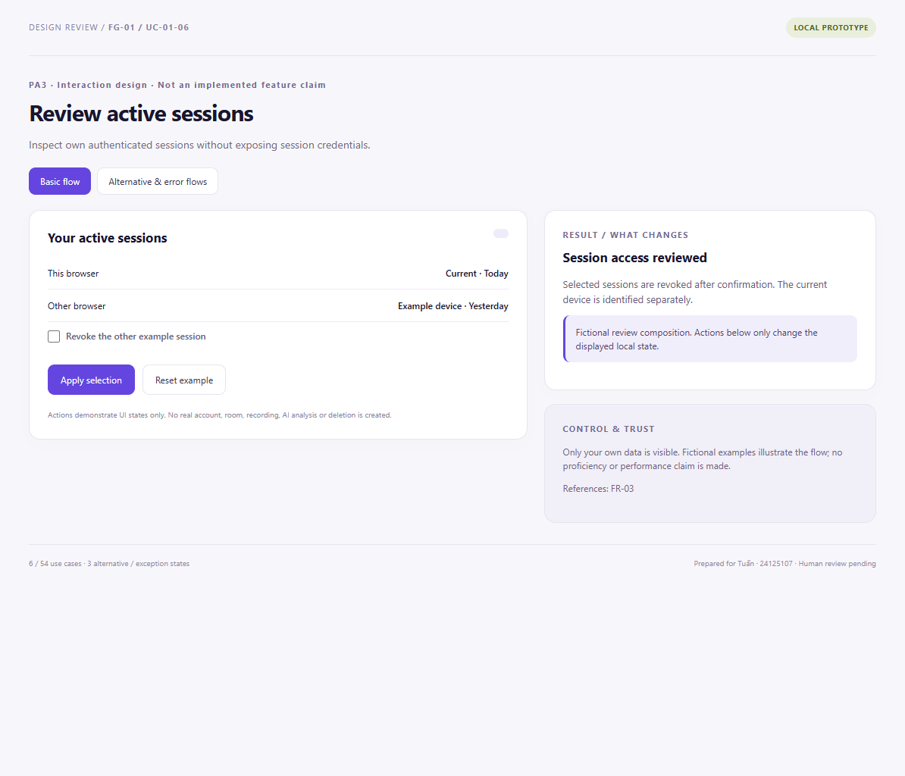

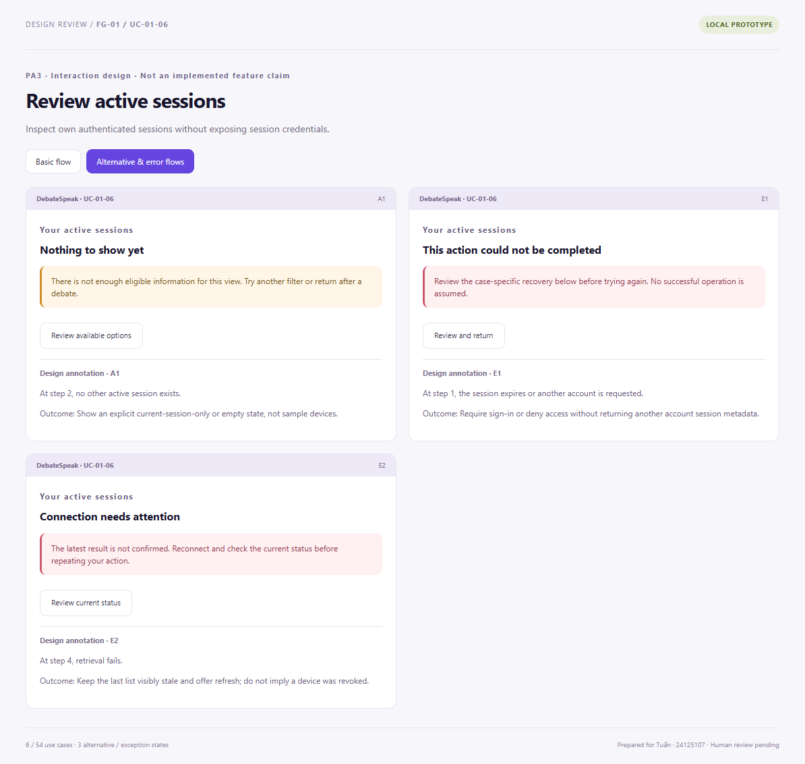

### UC-01-07 — Delete own account and data
*Performed: Tuấn (24125107). Reviewed: Triết (24125047), 2026-11-14. Edited: Trần Lê Anh Tuấn (24125107); Nguyễn Bảo Minh Triết (24125047), 2026-11-14.*

**Description / goal:** Immediately disable the account and erase associated learning data within seven days.

| Field | Specification |
|---|---|
| Actors | Learner / Debater |
| Scope / kind | `PA3`; user-goal; design status, not implementation evidence |
| Requirements | FR-04 |
| Trigger | Learner selects Delete account. |
| Preconditions | Learner is authenticated as the account to delete. |

**Basic flow — main success scenario**

1. System explains immediate loss of access and deletion of associated learning data within seven days.
2. Learner reviews the affected data, enters their password and ticks a separate confirmation.
3. System verifies identity, atomically soft-deletes the account and invalidates access.
4. System schedules cascading erasure of transcripts, analysis, reports and optional chat, then shows a nonsecret confirmation.

**Alternative and exception flows**

| Branch | Condition / extension point | Outcome and recovery |
|---|---|---|
| A1 | At step 2, learner cancels. | Close the confirmation; account and data remain unchanged. |
| E1 | At step 3, identity is stale, the password is wrong or confirmation is missing. | Reject deletion and require authorized confirmation; do not enqueue erasure. |
| E2 | At step 4, erasure processing is temporarily unavailable. | Keep the account disabled, retain a retryable deletion job and expose outstanding status to authorized administration. |
| A2 | At step 3, deletion was already accepted. | Return the existing deletion outcome rather than scheduling duplicate jobs. |

**Postconditions — success:** Account access is disabled immediately and associated hard deletion is due within seven days.

**Postconditions — minimum guarantee:** Cancellation changes nothing; accepted deletion never silently restores access when a worker fails.

**Special requirements:** Confirm erasure scope across derived artifacts and future chat. The PA3 build soft-deletes the account and signs out every device at once; the scheduled hard-delete job is not built yet. Do not promise instant physical deletion or preserve shareable report links after revocation. Shared permission, consent, accessibility and failure contracts in Section 2 apply.

**UI prototype:** The first image represents the main workflow; the contact sheet contains every named alternative/exception outcome. Illustrative data is not a real learner record.

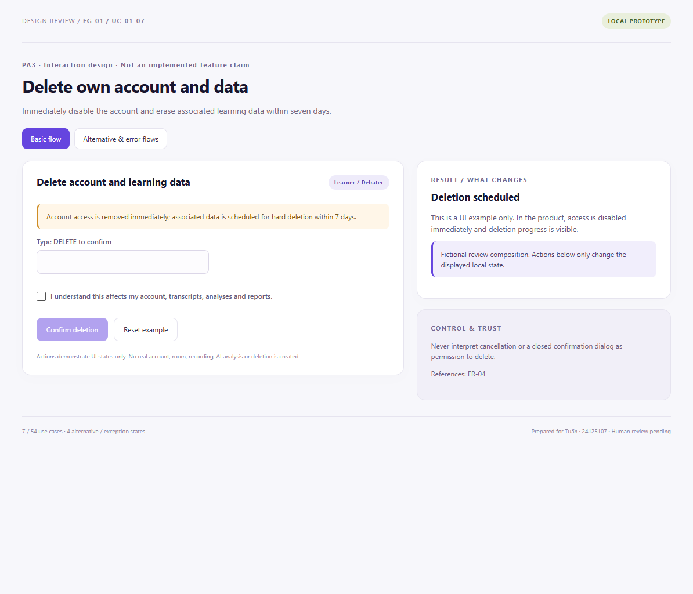

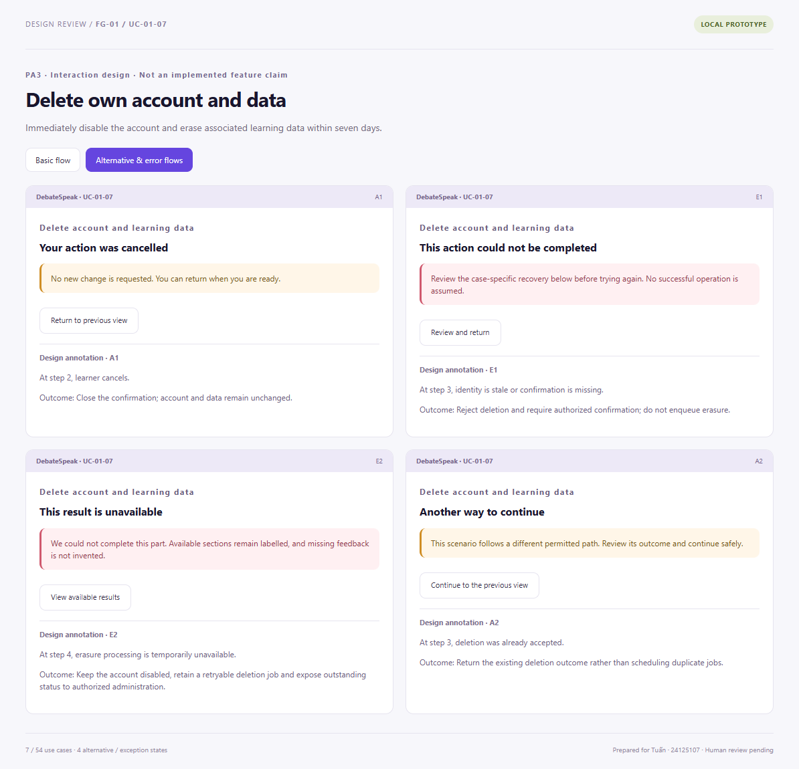

### UC-01-08 — Suspend or reactivate account
*Performed: Tuấn (24125107). Reviewed: Triết (24125047), 2026-11-14. Edited: Trần Lê Anh Tuấn (24125107); Nguyễn Bảo Minh Triết (24125047), 2026-11-14.*

**Description / goal:** Restrict or restore account access using authorized moderation.

| Field | Specification |
|---|---|
| Actors | Admin (role `ADMIN`) |
| Scope / kind | `PA3`; user-goal; design status, not implementation evidence |
| Requirements | FR-05 |
| Trigger | Admin opens Manage accounts and looks up an account by its exact email. |
| Preconditions | Moderator/Admin is authenticated with account-moderation permission. |

**Basic flow — main success scenario**

1. System verifies role and loads the authorized moderation status.
2. Admin selects Suspend, enters a reason and confirms; or selects Reactivate.
3. System validates the transition, applies the access restriction/restoration and records the actor and reason.
4. System refreshes the account status without exposing private learning content.

**Alternative and exception flows**

| Branch | Condition / extension point | Outcome and recovery |
|---|---|---|
| A1 | At step 2, admin cancels or requests an already-applied status. | Leave status unchanged or return the existing result without duplicate action. |
| E1 | At step 1, caller lacks permission. | Deny the action without loading sensitive account details. |
| E2 | At step 3, the record changed or the write fails. | Reload the current moderation status; do not show an unconfirmed suspension/reactivation. |
| E3 | At step 1, the account found is the admin's own. | Offer no suspend or reactivate action; the server also rejects self-suspension. |
| E4 | At step 1, no account uses the email. | Say that no account uses this email; change nothing. |

**Postconditions — success:** An authorized moderation decision changes account access with an attributable record.

**Postconditions — minimum guarantee:** Unauthorized or failed requests cannot change account access.

**Special requirements:** Suspension is distinct from account deletion; reactivation does not undo a pending erasure or authorize transcript browsing. Shared permission, consent, accessibility and failure contracts in Section 2 apply.

**UI prototype:** The first image represents the main workflow; the contact sheet contains every named alternative/exception outcome. Illustrative data is not a real learner record.

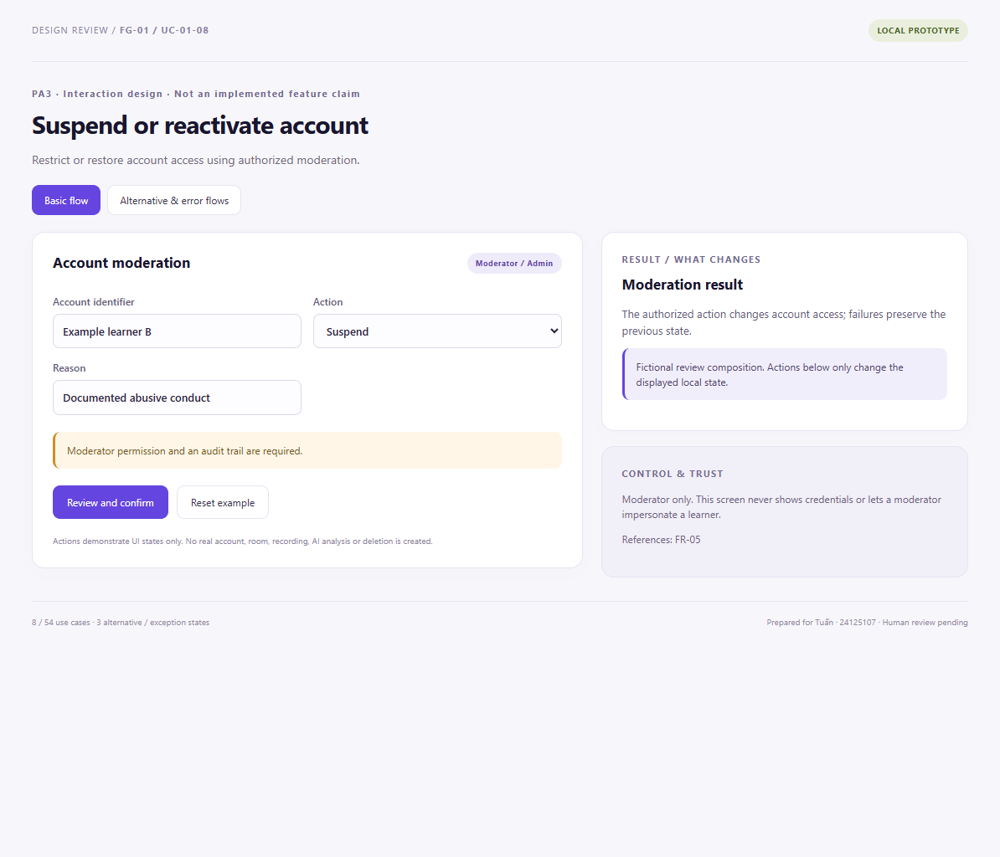

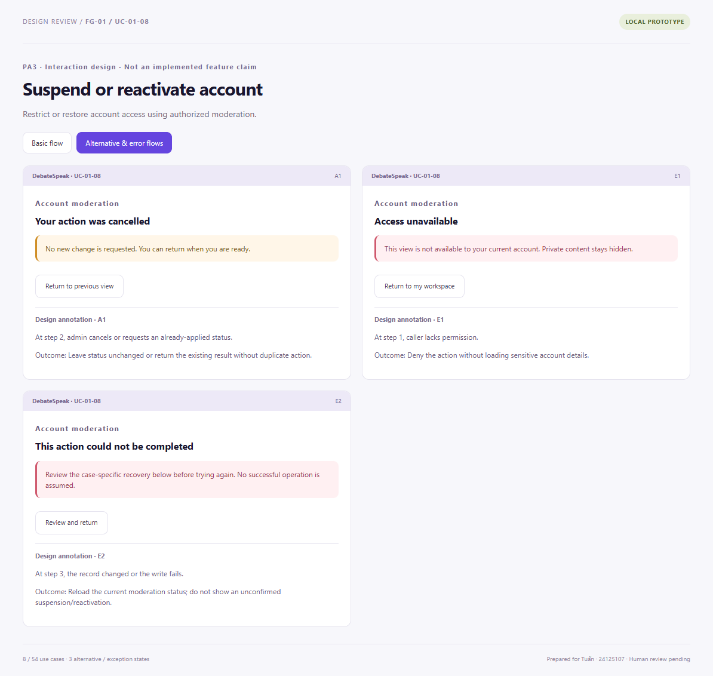

## FG-02 — Topics and difficulty
*Performed: Tuấn (24125107). Reviewed: Triết (24125047), 2026-11-14. Edited: Trần Lê Anh Tuấn (24125107).*

### UC-02-01 — Browse and select topics
*Performed: Tuấn (24125107). Reviewed: Triết (24125047), 2026-11-14. Edited: Trần Lê Anh Tuấn (24125107).*

**Description / goal:** Find a curated topic by category, text and CEFR before creating a room.

| Field | Specification |
|---|---|
| Actors | Learner / Debater |
| Scope / kind | `PA3`; user-goal; design status, not implementation evidence |
| Requirements | FR-06 |
| Trigger | Learner opens Topics or chooses a topic while creating a room. |
| Preconditions | Learner is authenticated; curated topics or the explicitly documented seed-topic list are available. |

**Basic flow — main success scenario**

1. System displays active curated topics with category and CEFR difficulty.
2. Learner enters search text and optionally changes category/difficulty filters.
3. System returns matching active topics and shows the selected filters.
4. Learner opens a motion, reviews its detail and selects it for the room-creation form.

**Alternative and exception flows**

| Branch | Condition / extension point | Outcome and recovery |
|---|---|---|
| A1 | At step 3, there are no matches. | Show an empty state and Clear filters; preserve the query without inventing topics. |
| A2 | At step 2, personalized recommendations are requested. | Run UC-02-03 only when enabled; normal browsing remains available. |
| E1 | At step 4, the topic was retired after loading. | Reject selection for a new room, refresh the list and keep unrelated form choices. |
| E2 | At step 3, catalog retrieval fails. | Show a retry state; use documented seed options only when that build explicitly supports them. |

**Postconditions — success:** An active topic is selected; no room or audio is created merely by browsing.

**Postconditions — minimum guarantee:** No unavailable topic is silently substituted and no unauthorized catalog mutation occurs.

**Special requirements:** PA3 topic API/filter is extra scope; a static seed list must be labelled accurately. CEFR choices are A2/B1/B2/C1. Shared permission, consent, accessibility and failure contracts in Section 2 apply.

**UI prototype:** The first image represents the main workflow; the contact sheet contains every named alternative/exception outcome. Illustrative data is not a real learner record.

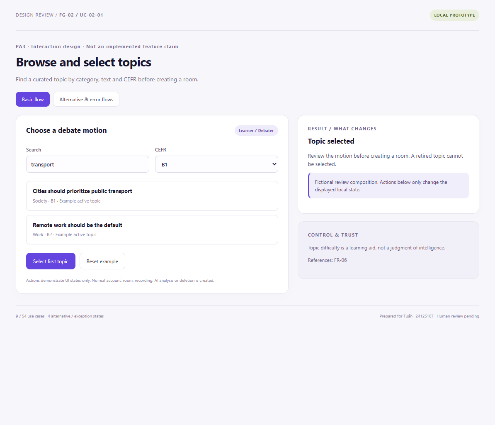

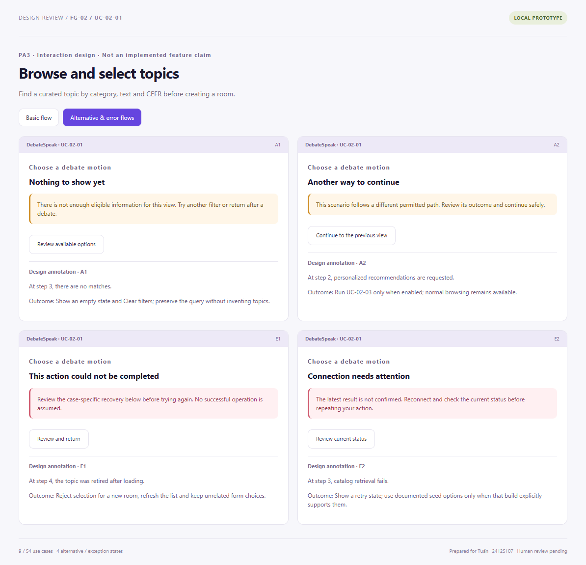

### UC-02-02 — Manage topic library
*Performed: Tuấn (24125107). Reviewed: Triết (24125047), 2026-11-14. Edited: Trần Lê Anh Tuấn (24125107).*

**Description / goal:** Create, edit, tag and retire public topics without corrupting existing debate history.

| Field | Specification |
|---|---|
| Actors | Moderator / Admin |
| Scope / kind | `future-mvp`; user-goal; design status, not implementation evidence |
| Requirements | FR-07 |
| Trigger | Admin selects Create, Edit or Retire topic. |
| Preconditions | Admin is authenticated and authorized to curate topics. |

**Basic flow — main success scenario**

1. System loads the authorized topic editor with motion, category, difficulty and suggested-vocabulary fields.
2. Admin enters a new motion or edits an existing topic, or selects Retire.
3. System validates the fields and asks confirmation before retiring an active topic.
4. System saves the decision and updates availability for new rooms while preserving historical debate references.

**Alternative and exception flows**

| Branch | Condition / extension point | Outcome and recovery |
|---|---|---|
| A1 | At step 3, retirement is cancelled. | Keep the topic active and return to the editor. |
| E1 | At step 3, required fields or CEFR tags are invalid. | Show inline errors and preserve the last committed topic. |
| E2 | At step 4, another edit won or saving fails. | Reload the current version and retain the admin draft for reconciliation. |
| E3 | At step 1, role is insufficient. | Deny access; do not expose editing controls as authorization. |

**Postconditions — success:** The validated topic change is saved and reflected in future catalog results.

**Postconditions — minimum guarantee:** Failed edits do not corrupt historical rooms or partially modify public topics.

**Special requirements:** Retirement is a state change, not a destructive delete of motions referenced by finished debates. Shared permission, consent, accessibility and failure contracts in Section 2 apply.

**UI prototype:** The first image represents the main workflow; the contact sheet contains every named alternative/exception outcome. Illustrative data is not a real learner record.

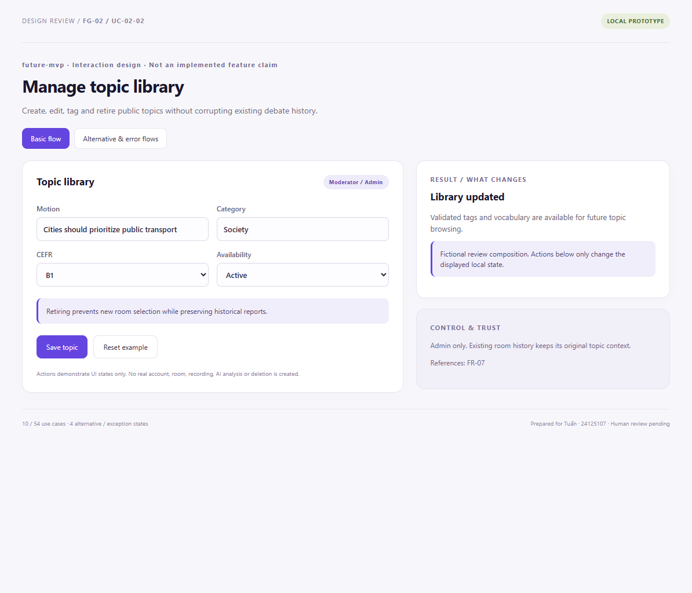

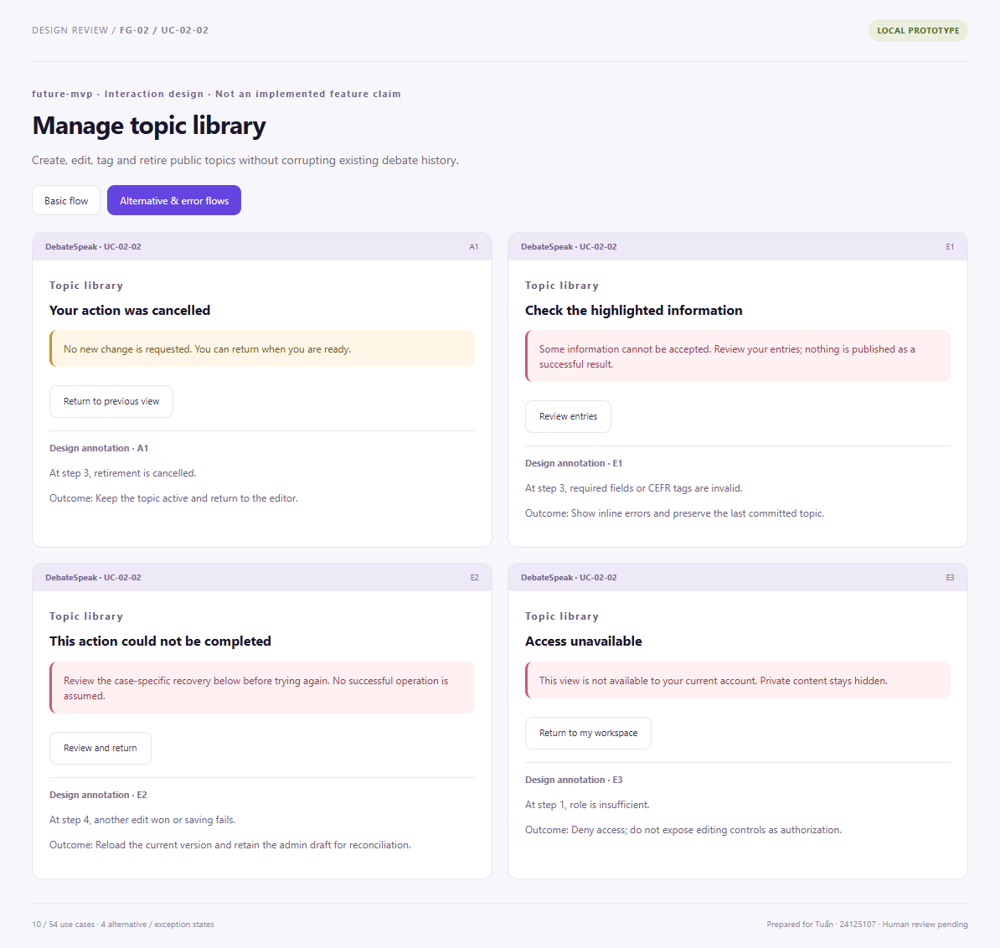

### UC-02-03 — Get personalized topic recommendations
*Performed: Tuấn (24125107). Reviewed: Triết (24125047), 2026-11-14. Edited: Trần Lê Anh Tuấn (24125107).*

**Description / goal:** Find topics appropriate to self-assessed CEFR and observed practice needs.

| Field | Specification |
|---|---|
| Actors | Learner / Debater |
| Scope / kind | `should`; user-goal; design status, not implementation evidence |
| Requirements | FR-08 |
| Trigger | At topic discovery, learner requests Recommended topics. |
| Preconditions | Learner is authenticated; recommendations are enabled and the curated catalog is available. |

**Basic flow — main success scenario**

1. System reads the learner self-assessed CEFR and available, authorized practice observations.
2. System ranks active topics using those inputs and explains the matching reason.
3. Learner reviews or dismisses a recommendation.
4. A selected topic returns to ordinary room creation; learner may instead browse without personalization.

**Alternative and exception flows**

| Branch | Condition / extension point | Outcome and recovery |
|---|---|---|
| A1 | At step 1, no history exists. | Use the self-assessed level only and disclose the limited basis. |
| A2 | At step 2, no suitable topic is active. | Show no recommendations and offer the complete curated catalog. |
| E1 | At step 2, ranking is unavailable. | Keep browsing usable and avoid a fabricated personal rationale. |

**Postconditions — success:** Learner receives transparent optional topic suggestions or an honest fallback.

**Postconditions — minimum guarantee:** No recommendation changes the learner CEFR or forces topic selection.

**Special requirements:** This extends UC-02-01; it does not block browsing, certify ability, or infer weaknesses from another learner data. Shared permission, consent, accessibility and failure contracts in Section 2 apply.

**UI prototype:** The first image represents the main workflow; the contact sheet contains every named alternative/exception outcome. Illustrative data is not a real learner record.

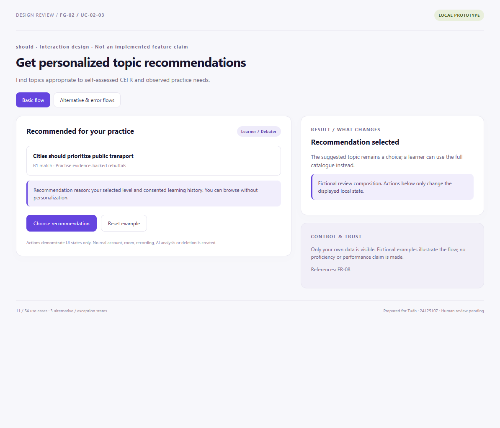

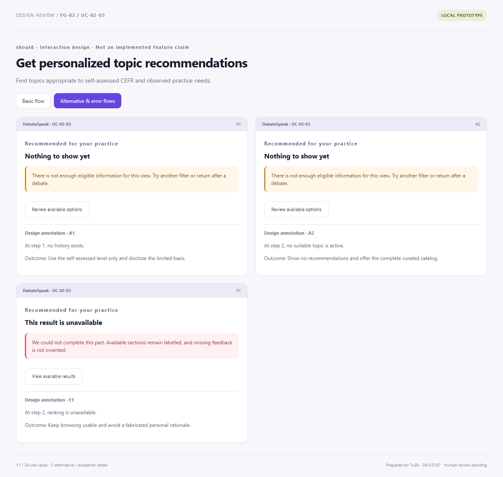

### UC-02-04 — Propose a custom topic
*Performed: Tuấn (24125107). Reviewed: Triết (24125047), 2026-11-14. Edited: Trần Lê Anh Tuấn (24125107).*

**Description / goal:** Submit a topic for moderation before it becomes publicly available.

| Field | Specification |
|---|---|
| Actors | Learner / Debater, Moderator / Admin |
| Scope / kind | `stretch`; user-goal; design status, not implementation evidence |
| Requirements | FR-09 |
| Trigger | Learner chooses Propose topic. |
| Preconditions | Learner is authenticated; custom-topic moderation is enabled. |

**Basic flow — main success scenario**

1. Learner enters a proposed motion, category and suggested difficulty.
2. System validates the submission and records it as pending moderation.
3. Admin reviews the pending proposal using authorized moderation controls.
4. System publishes only an approved curated topic, or records a rejection and shows the proposer its status.

**Alternative and exception flows**

| Branch | Condition / extension point | Outcome and recovery |
|---|---|---|
| A1 | At step 1, learner cancels. | Discard the unsent draft without creating a public topic. |
| E1 | At step 2, content is empty, invalid or rate limited. | Show the reason and preserve safe draft text; no queue item is created. |
| A2 | At step 3, admin rejects or requests revision. | Keep the proposal nonpublic and show the moderation outcome to its proposer. |
| E2 | At step 4, publication fails. | Keep the proposal pending/retryable; do not list it publicly as approved. |

**Postconditions — success:** The proposal has an attributable pending, approved or rejected moderation outcome.

**Postconditions — minimum guarantee:** A learner submission is never automatically a public topic.

**Special requirements:** Stretch design only. The public-topic editor and this submission queue have different permissions. Shared permission, consent, accessibility and failure contracts in Section 2 apply.

**UI prototype:** The first image represents the main workflow; the contact sheet contains every named alternative/exception outcome. Illustrative data is not a real learner record.

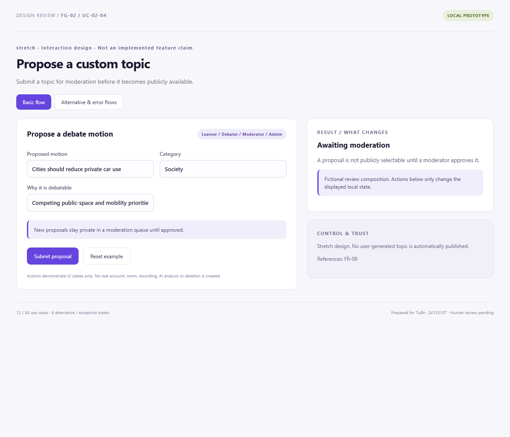

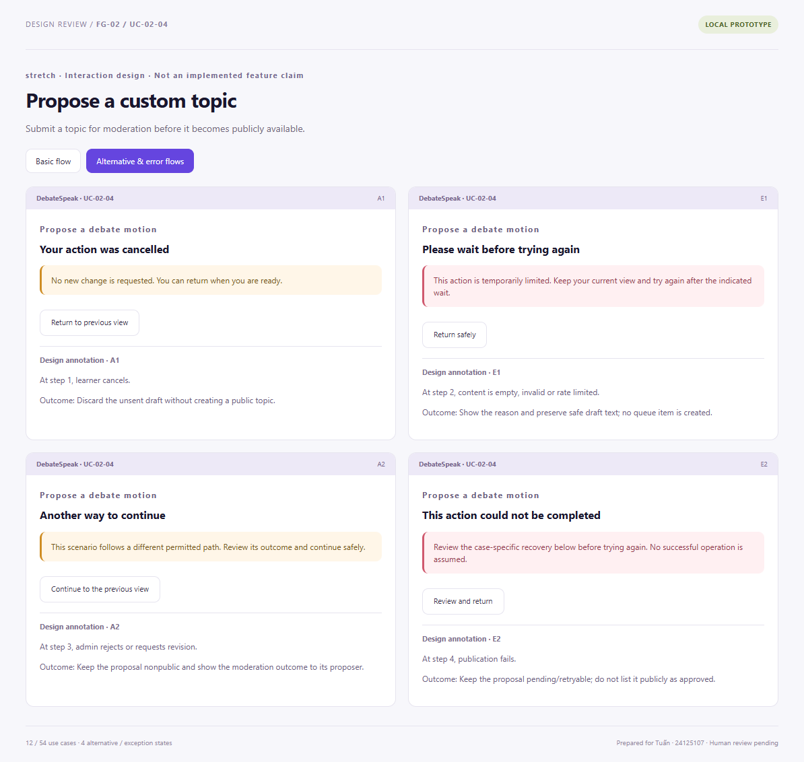

## FG-03 — Room and session management
*Performed: Tuấn (24125107). Reviewed: Triết (24125047), 2026-11-14. Edited: Trần Lê Anh Tuấn (24125107).*

### UC-03-01 — Create debate room
*Performed: Tuấn (24125107). Reviewed: Triết (24125047), 2026-11-14. Edited: Trần Lê Anh Tuấn (24125107); Nguyễn Bảo Minh Triết (24125047), 2026-11-14.*

**Description / goal:** Create a two-person LOBBY with a topic, stance mode, format, duration and invite.

| Field | Specification |
|---|---|
| Actors | Learner / Debater |
| Scope / kind | `PA4` (PA3 UI preview only); user-goal; design status, not implementation evidence |
| Requirements | FR-10, FR-12 |
| Trigger | Learner selects Create room. |
| Preconditions | Learner is authenticated and has selected an active topic. |

**Basic flow — main success scenario**

1. System shows topic, stance mode, format and duration with supported defaults.
2. Learner reviews options and submits; creator stance is provided only for CREATOR_PICKS.
3. System validates the topic/options and atomically creates the LOBBY and creator membership A.
4. System displays the invite code/link, lobby expiry and waiting status; no microphone, media or STT starts.

**Alternative and exception flows**

| Branch | Condition / extension point | Outcome and recovery |
|---|---|---|
| A1 | At step 2, optional settings are unchanged. | Use FREE_FLOW, 600 seconds and RANDOM. |
| E1 | At step 3, topic is unavailable or duration/stance/format is invalid. | Return field errors and create neither room nor membership. |
| E2 | At step 3, generated invite code collides. | Generate another secure code within a bounded server retry; never expose a duplicate code. |
| E3 | At step 4, response is lost or creation fails. | Reconcile the created resource before repeating creation; do not announce a room that was not confirmed. |

**Postconditions — success:** One LOBBY and creator seat A exist with an expiring invite.

**Postconditions — minimum guarantee:** A failed transaction leaves no orphan room or membership.

**Special requirements:** Exactly two debater seats; duration integer 60–1800 seconds; lobby 30 minutes; eight-character secure invite. Build 1 uses /rooms, not an arbitrary status endpoint. Shared permission, consent, accessibility and failure contracts in Section 2 apply.

**UI prototype:** The first image represents the main workflow; the contact sheet contains every named alternative/exception outcome. Illustrative data is not a real learner record.

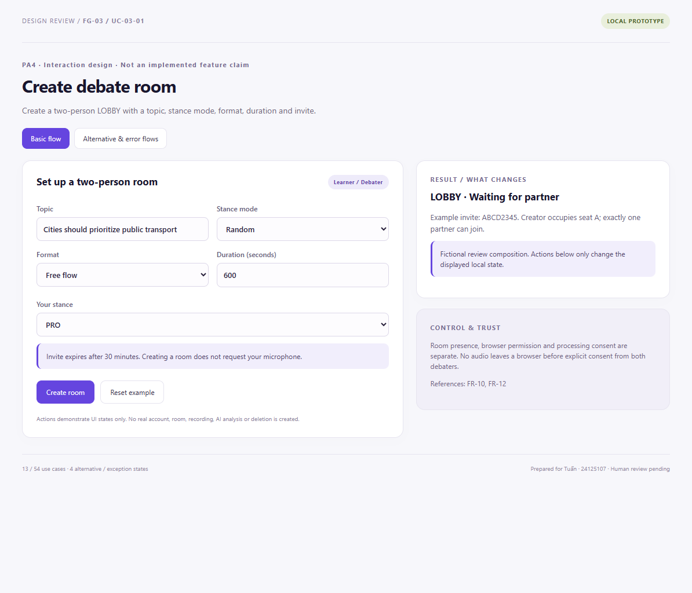

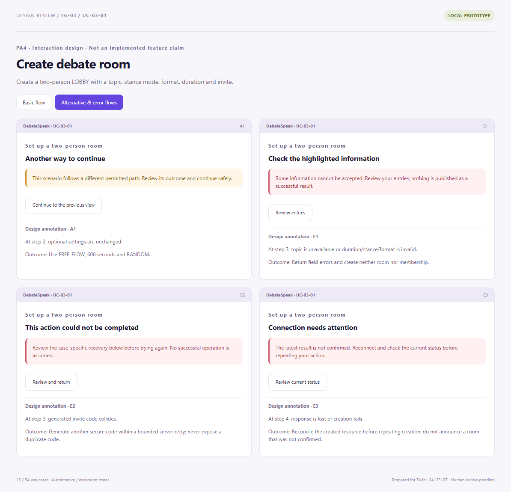

### UC-03-02 — Join invited room
*Performed: Tuấn (24125107). Reviewed: Triết (24125047), 2026-11-14. Edited: Trần Lê Anh Tuấn (24125107); Nguyễn Bảo Minh Triết (24125047), 2026-11-14.*

**Description / goal:** Join by code or link while the server enforces two distinct debaters and room availability.

| Field | Specification |
|---|---|
| Actors | Learner / Debater |
| Scope / kind | `PA4` (PA3 UI preview only); user-goal; design status, not implementation evidence |
| Requirements | FR-11, FR-12 |
| Trigger | Learner submits Join room. |
| Preconditions | Learner is authenticated and has an invite code or link. |

**Basic flow — main success scenario**

1. Learner opens an invite link or enters the eight-character code.
2. System normalizes the code, resolves and locks the room, and checks expiry and joinable state.
3. System returns an existing member snapshot on retry; otherwise reserves the free second seat for this identity.
4. System assigns opposing stances and transitions LOBBY to READY atomically.
5. System displays the authoritative lobby to both learners without treating membership as consent.

**Alternative and exception flows**

| Branch | Condition / extension point | Outcome and recovery |
|---|---|---|
| A1 | At step 3, caller is already a participant. | Return their authorized snapshot; do not insert another seat or perform a READY self-transition. |
| E1 | At step 2, invite is unknown/expired or malformed. | Show unavailable/validation feedback without room contents; allow editing the invite. |
| E2 | At step 3, room already has two distinct learners, including a concurrent join winner. | Reject the third with ROOM_FULL; do not reveal participant details. |
| E3 | At step 2, room is LIVE, ENDED or CANCELLED. | Return ROOM_NOT_JOINABLE; keep membership unchanged. |
| E4 | At step 4, transaction/network fails. | Rollback or reload the authorized snapshot before retry; no duplicate participant or stance assignment. |

**Postconditions — success:** Caller occupies exactly one seat; the two-member room is READY with opposing stances.

**Postconditions — minimum guarantee:** Capacity never exceeds two, including concurrent requests.

**Special requirements:** Server identity comes from auth; lock plus unique seat/membership constraints enforce capacity. No consent value is inferred or copied from the partner. Shared permission, consent, accessibility and failure contracts in Section 2 apply.

**UI prototype:** The first image represents the main workflow; the contact sheet contains every named alternative/exception outcome. Illustrative data is not a real learner record.

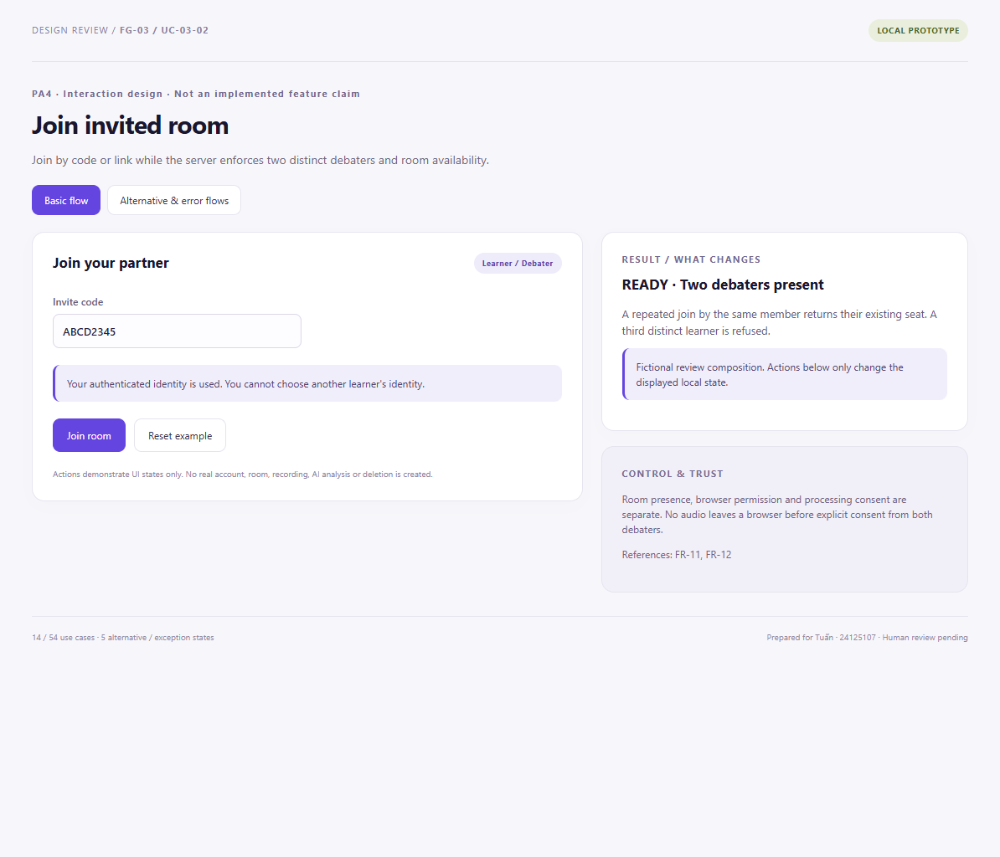

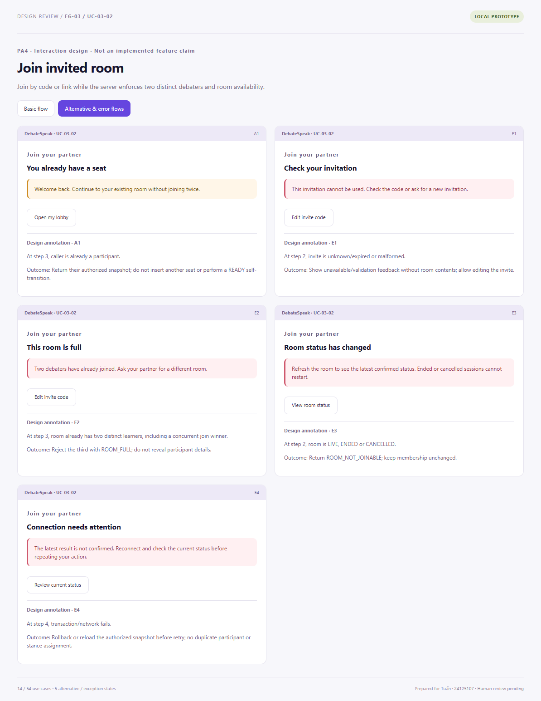

### UC-03-03 — View lobby and readiness
*Performed: Tuấn (24125107). Reviewed: Triết (24125047), 2026-11-14. Edited: Trần Lê Anh Tuấn (24125107); Nguyễn Bảo Minh Triết (24125047), 2026-11-14.*

**Description / goal:** See authoritative room state and participant presence without treating presence as consent.

| Field | Specification |
|---|---|
| Actors | Learner / Debater |
| Scope / kind | `PA4` (PA3 UI preview only); user-goal; design status, not implementation evidence |
| Requirements | FR-12 |
| Trigger | Learner opens or refreshes their lobby. |
| Preconditions | Learner is a current authenticated room participant. |

**Basic flow — main success scenario**

1. System checks membership and loads the room, applying expiry before returning state.
2. System shows topic, format, duration, invite access, seat occupancy and stances.
3. System updates authoritative state using the build supported transport; Build 1 polls every two seconds.
4. Learner sees LOBBY, READY or terminal state and the separate consent/microphone gates when those features are supported.

**Alternative and exception flows**

| Branch | Condition / extension point | Outcome and recovery |
|---|---|---|
| A1 | At step 3, second learner joins or leaves. | Refresh presence and state; READY reflects occupied seats, not recording permission. |
| A2 | At step 1, a LOBBY/READY room expired. | Apply CANCELLED and display expiry to members; the invite cannot admit anyone. |
| E1 | At step 1, caller is not a member or room is absent. | Return a non-disclosing unavailable view with no participants/invite. |
| E2 | At step 3, updates fail or arrive stale. | Mark the view stale and retry; do not enable start from stale readiness. |
| A3 | At step 3, learner leaves the page, signs out or reaches a terminal state. | Stop polling/subscriptions and any local test capture. |

**Postconditions — success:** Learner sees current authorized room state with distinct presence and processing gates.

**Postconditions — minimum guarantee:** No private snapshot leaks and a stale view does not authorize live capture.

**Special requirements:** A Build 1 Start control is disabled with a clear unavailable explanation; do not create media or future endpoints to animate the prototype. Shared permission, consent, accessibility and failure contracts in Section 2 apply.

**UI prototype:** The first image represents the main workflow; the contact sheet contains every named alternative/exception outcome. Illustrative data is not a real learner record.

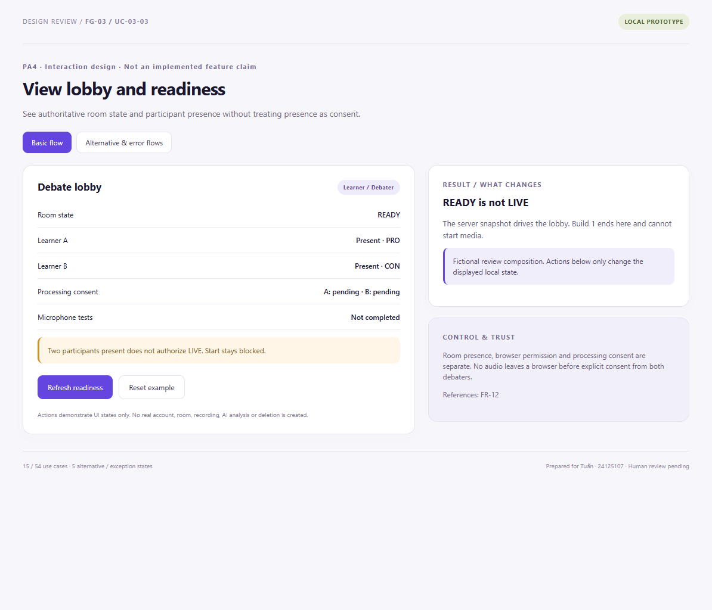

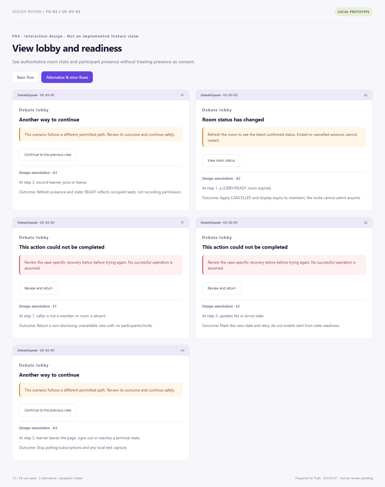

### UC-03-04 — Give or withdraw processing consent
*Performed: Tuấn (24125107). Reviewed: Triết (24125047), 2026-11-14. Edited: Trần Lê Anh Tuấn (24125107).*

**Description / goal:** Control own informed consent for transcription and AI processing without coercion.

| Field | Specification |
|---|---|
| Actors | Learner / Debater |
| Scope / kind | `future-mvp`; user-goal; design status, not implementation evidence |
| Requirements | FR-13 |
| Trigger | Learner opens the processing notice or changes their own consent. |
| Preconditions | Learner is authenticated, belongs to the room and processing consent controls are implemented. |

**Basic flow — main success scenario**

1. System explains transcript capture, AI processing, retention/deletion and how to decline or withdraw.
2. Learner independently selects Agree or Decline; controls are unchecked by default.
3. System records only this learner decision and current notice version/timestamp.
4. System updates readiness; withdrawal during LIVE immediately stops capture and ends the session safely.

**Alternative and exception flows**

| Branch | Condition / extension point | Outcome and recovery |
|---|---|---|
| A1 | At step 2, learner declines. | Keep LIVE unavailable without account penalty; allow leaving or ordinary account use. |
| A2 | At step 3, partner has not consented or the notice changed. | Keep start disabled and request a fresh personal decision where necessary. |
| E1 | At step 3, save fails or identity/membership is stale. | Show consent unconfirmed, keep start blocked and require retry or sign-in. |
| A3 | At step 4, learner withdraws while LIVE or loses network during withdrawal. | Stop local transmission immediately, request authoritative end, and reconcile server state before any resume. |

**Postconditions — success:** The learner own informed decision is recorded and enforced by the server.

**Postconditions — minimum guarantee:** Unconfirmed, declined or withdrawn consent cannot authorize further audio/STT transmission.

**Special requirements:** Room presence, account terms, browser permission and another learner decision are not substitutes for consent. New audience/chat processing grants remain separate. Shared permission, consent, accessibility and failure contracts in Section 2 apply.

**UI prototype:** The first image represents the main workflow; the contact sheet contains every named alternative/exception outcome. Illustrative data is not a real learner record.

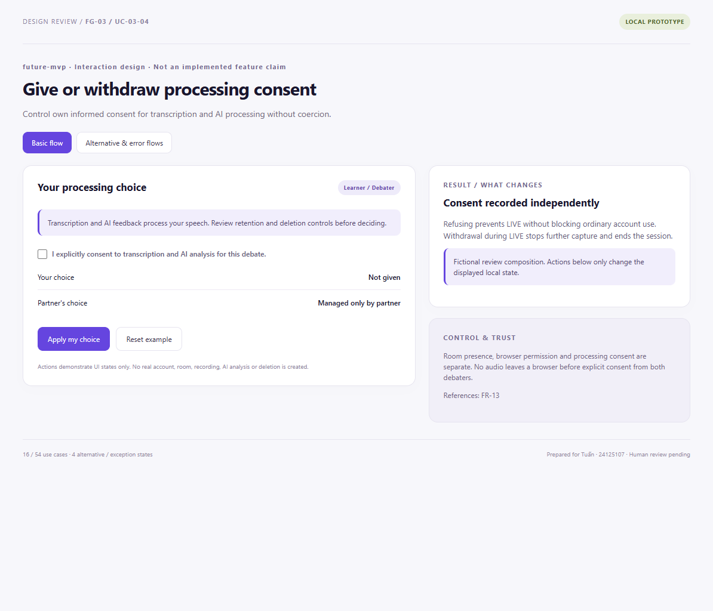

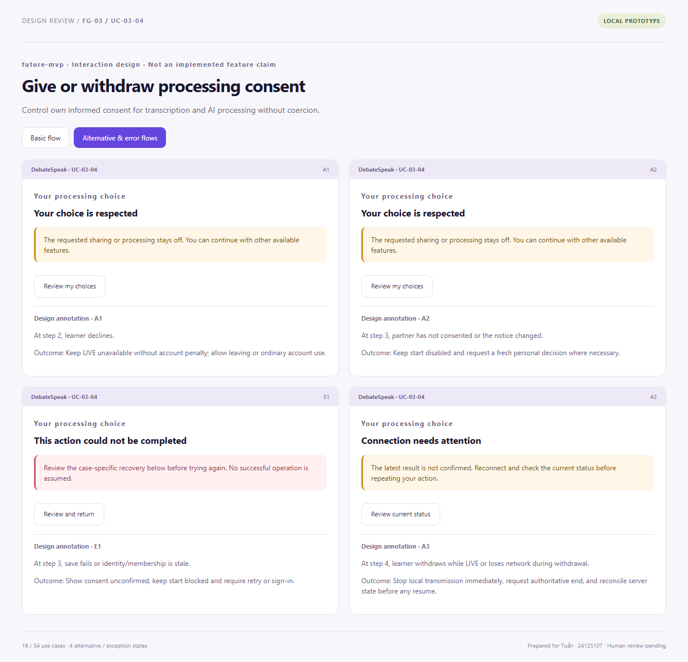

### UC-03-05 — Start debate
*Performed: Tuấn (24125107). Reviewed: Triết (24125047), 2026-11-14. Edited: Trần Lê Anh Tuấn (24125107).*

**Description / goal:** Enter LIVE only after server-side dual consent, mic readiness and actual media availability.

| Field | Specification |
|---|---|
| Actors | Learner / Debater, LiveKit Cloud |
| Scope / kind | `future-mvp`; user-goal; design status, not implementation evidence |
| Requirements | FR-12, FR-13, FR-19 |
| Trigger | A participant selects Start debate. |
| Preconditions | Two authenticated participants occupy READY; session start/media implementation is available. |

**Basic flow — main success scenario**

1. System invokes UC-03-13 to revalidate room state, both members, expiry, current dual consent, mic results and media capability.
2. System authorizes the start and atomically records LIVE and the authoritative timer origin.
3. System issues scoped media authorization and establishes independent tracks only after the gate succeeds.
4. System shows LIVE, timer, mute/end controls and visible transmission/transcription indicators to both participants.

**Alternative and exception flows**

| Branch | Condition / extension point | Outcome and recovery |
|---|---|---|
| E1 | At step 1, consent/mic/presence/expiry is missing or stale. | Reject start with a specific safe gate explanation; publish no audio. |
| E2 | At step 1, only the Build 1 lobby slice exists or media is unavailable. | Keep Start disabled/deny the operation; no simulated LIVE or hidden recording. |
| A1 | At step 2, simultaneous starts race. | Accept only one READY→LIVE transition and reconcile the existing authorized LIVE snapshot. |
| E3 | At step 3, media setup fails or consent is withdrawn. | Stop capture and perform safe session recovery/end; never leave a screen claiming healthy LIVE audio. |

**Postconditions — success:** A single authorized LIVE session exists with consent-gated media and synchronized timer origin.

**Postconditions — minimum guarantee:** No failed start bypasses consent or leaves background transmission active.

**Special requirements:** This future-media contract is not enabled by the SCRUM-28 pure transition function. Start requires actual media capability, not a hardcoded ready flag. Shared permission, consent, accessibility and failure contracts in Section 2 apply.

**UI prototype:** The default screen shows the safe Build 1 blocked-start state; the contact sheet contains every named alternative/exception outcome. The additional authorized scenario illustrates the future main success flow only. Illustrative data is not a real learner record.

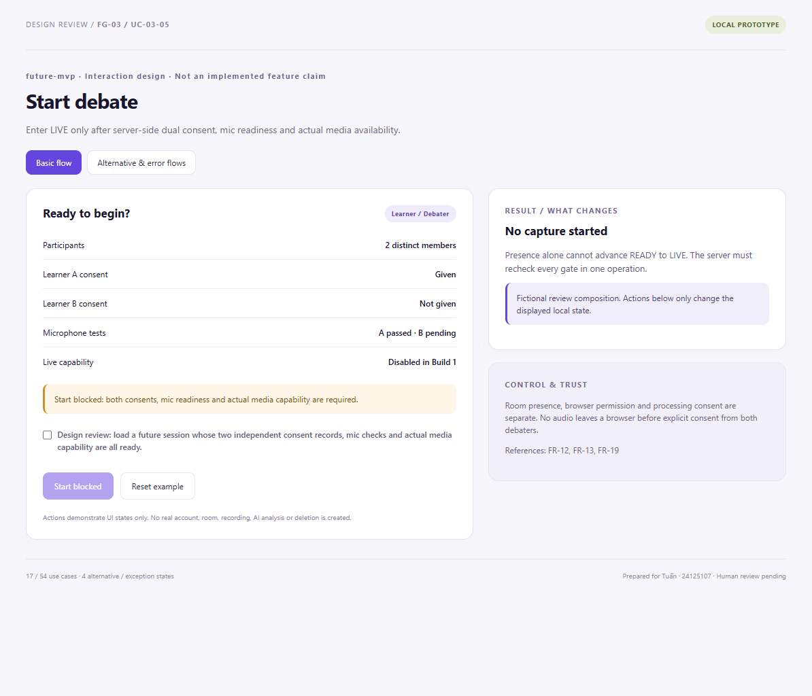

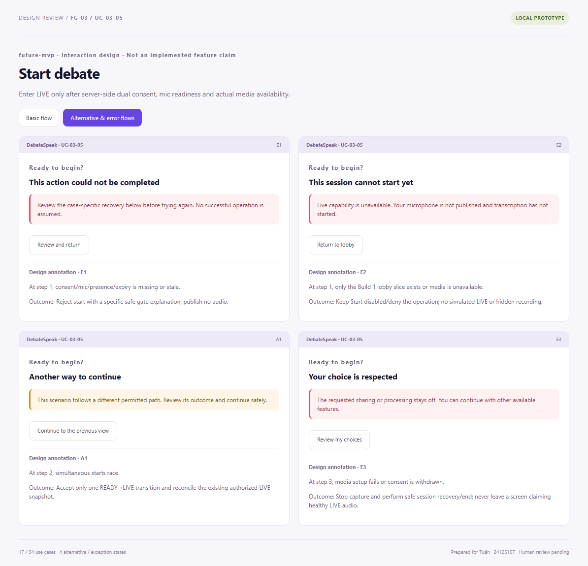

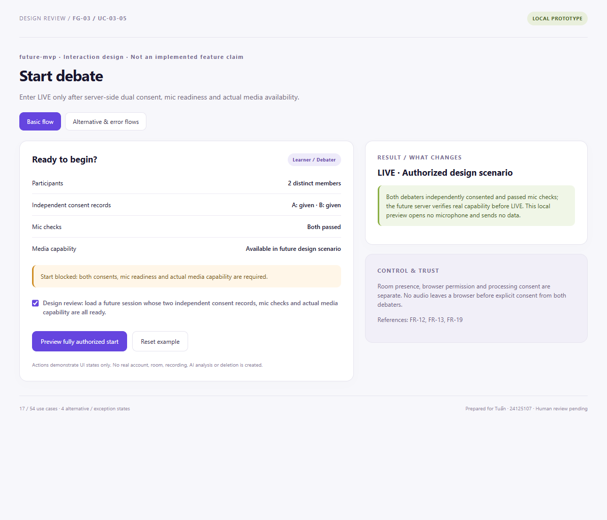

### UC-03-06 — Leave or end debate
*Performed: Tuấn (24125107). Reviewed: Triết (24125047), 2026-11-14. Edited: Trần Lê Anh Tuấn (24125107).*

**Description / goal:** Leave safely before LIVE or stop a live debate and all capture promptly.

| Field | Specification |
|---|---|
| Actors | Learner / Debater |
| Scope / kind | `future-mvp`; user-goal; design status, not implementation evidence |
| Requirements | FR-12, FR-15 |
| Trigger | Learner selects Leave before LIVE or End debate while LIVE. |
| Preconditions | Learner is an authenticated participant in a nonterminal room. |

**Basic flow — main success scenario**

1. System keeps the leave/end action accessible and stops this browser transmission promptly when leaving.
2. System validates the caller membership and current authoritative state.
3. Before LIVE, system removes the departing seat and clears relevant readiness/consent; READY returns to LOBBY, or authorized cancellation terminates the lobby.
4. During LIVE, system transitions to ENDED, stops all capture/STT, records end time and notifies the partner.
5. System offers the ended-session view and queues eligible post-debate analysis without delaying the exit.

**Alternative and exception flows**

| Branch | Condition / extension point | Outcome and recovery |
|---|---|---|
| A1 | At step 2, room is already ENDED/CANCELLED. | Return the terminal outcome; do not reopen or enqueue duplicate analysis. |
| E1 | At step 2, the server cannot be reached. | Stop local capture, show end confirmation pending and reconcile/retry the server request. |
| A2 | At step 5, fewer than 60 seconds of speech exist. | Show insufficient speech for assessment and do not invent scores. |
| E2 | At step 5, analysis enqueue fails. | Keep the room ended and capture stopped; show retryable analysis status separately. |

**Postconditions — success:** Departure or ending is persisted and transmission ceases; any eligible analysis has explicit status.

**Postconditions — minimum guarantee:** Exit never depends on AI availability and a terminal state never becomes LIVE again.

**Special requirements:** Both participants may end LIVE; a prompt must not trap someone in an unsafe debate. Creator cancellation uses CANCELLED only before LIVE. Shared permission, consent, accessibility and failure contracts in Section 2 apply.

**UI prototype:** The first image represents the main workflow; the contact sheet contains every named alternative/exception outcome. Illustrative data is not a real learner record.

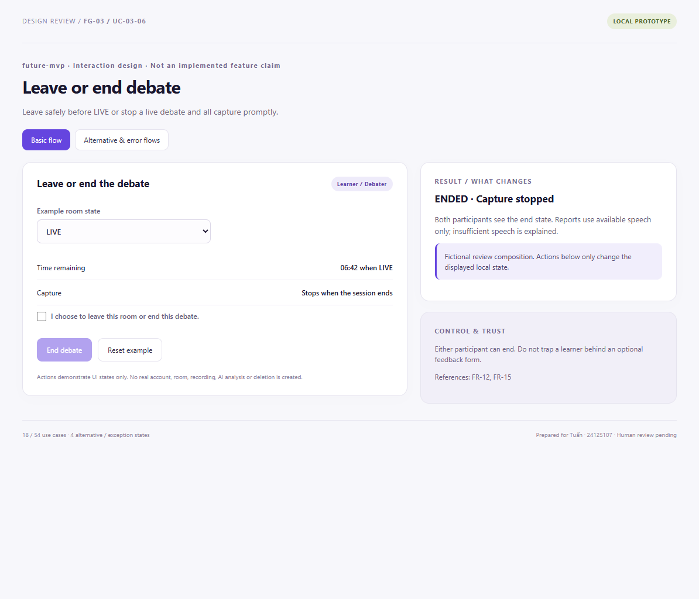

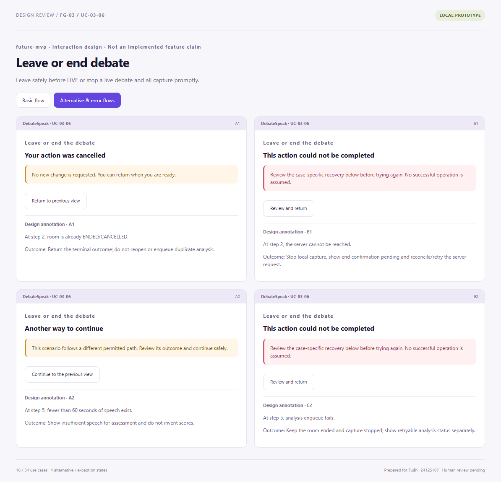

### UC-03-07 — Follow debate and turn timers
*Performed: Tuấn (24125107). Reviewed: Triết (24125047), 2026-11-14. Edited: Trần Lê Anh Tuấn (24125107).*

**Description / goal:** See authoritative session and turn timing without enforcing silence through AI.

| Field | Specification |
|---|---|
| Actors | Learner / Debater |
| Scope / kind | `future-mvp`; user-goal; design status, not implementation evidence |
| Requirements | FR-14 |
| Trigger | Session begins or learner opens the LIVE view. |
| Preconditions | Learner belongs to a LIVE session and timing transport is implemented. |

**Basic flow — main success scenario**

1. System loads authoritative start time, duration and debate format.
2. System displays the overall countdown; timed-turn mode also displays the active stage/speaker and turn countdown.
3. System reconciles updates with server time while preserving audibility and visible end controls.
4. At overall expiry, server ends the session and clients show ENDED rather than a locally extended timer.

**Alternative and exception flows**

| Branch | Condition / extension point | Outcome and recovery |
|---|---|---|
| A1 | At step 2, format is FREE_FLOW. | Show only the overall debate timer, without invented turn restrictions. |
| E1 | At step 3, timer events are lost or browser clock differs. | Mark timing stale and resynchronize from server state; do not restart or extend the debate. |
| A2 | At step 4, participant ends before expiry. | Stop the display at the authoritative ended state. |
| A3 | At step 2, a timed turn expires. | Advance the visible stage/turn marker; do not hard-mute the other participant. |

**Postconditions — success:** Displayed timing follows the session authority and final expiry ends the session once.

**Postconditions — minimum guarantee:** Client clock manipulation does not change room duration or consent.

**Special requirements:** Timed turns are guidance, not automatic audio enforcement. Browser suspension/reconnect must fetch the current stage rather than replaying old ticks. Shared permission, consent, accessibility and failure contracts in Section 2 apply.

**UI prototype:** The first image represents the main workflow; the contact sheet contains every named alternative/exception outcome. Illustrative data is not a real learner record.

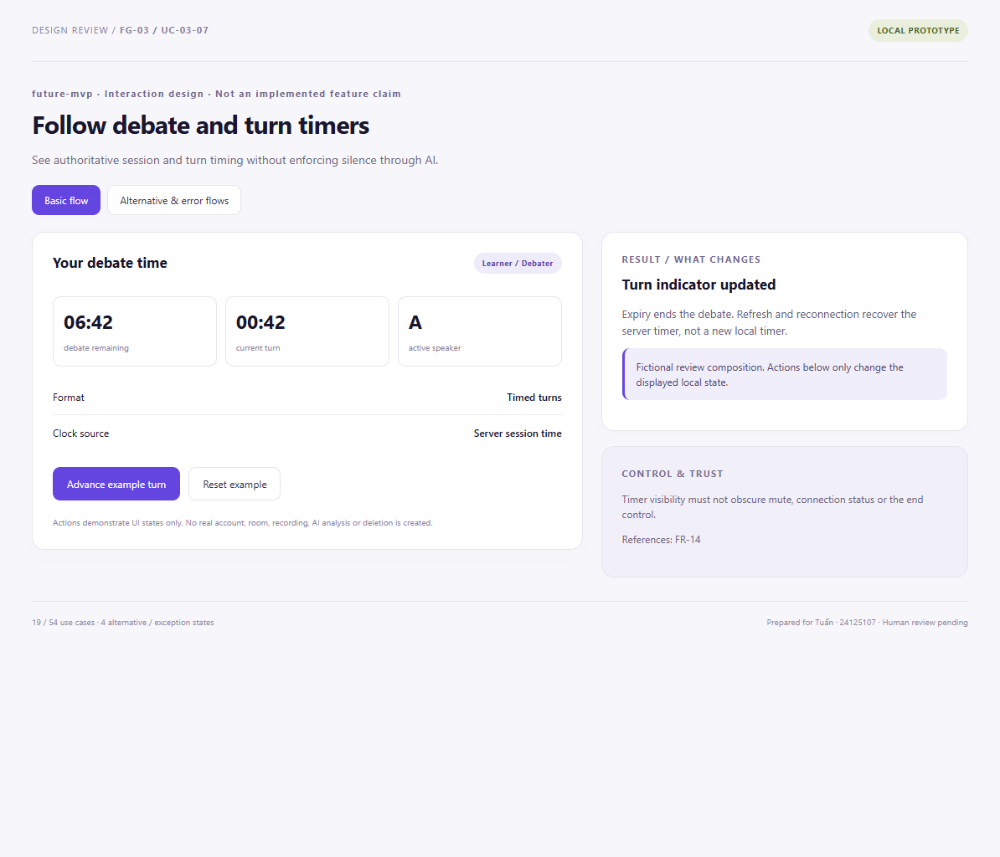

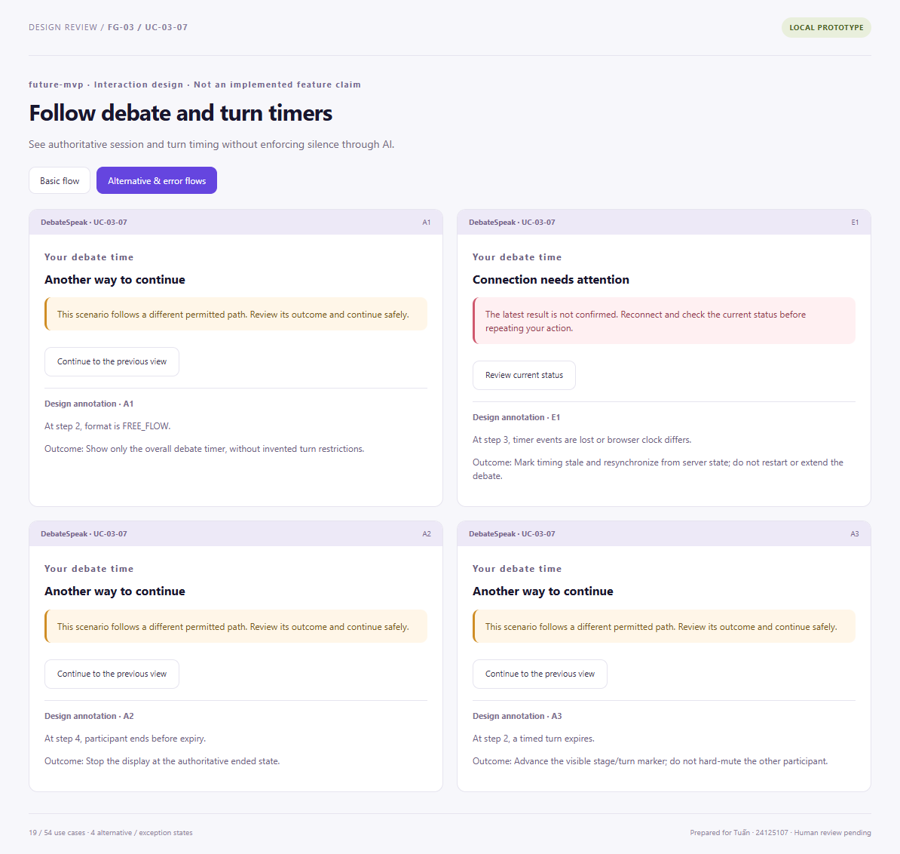

### UC-03-08 — Report abusive behavior
*Performed: Tuấn (24125107). Reviewed: Triết (24125047), 2026-11-14. Edited: Trần Lê Anh Tuấn (24125107).*

**Description / goal:** Submit a room or transcript abuse report while retaining accessible leave/end controls.

| Field | Specification |
|---|---|
| Actors | Learner / Debater |
| Scope / kind | `should`; user-goal; design status, not implementation evidence |
| Requirements | FR-16 |
| Trigger | Learner selects Report abuse. |
| Preconditions | Learner is an authenticated participant with access to the room or transcript being reported. |

**Basic flow — main success scenario**

1. System opens a report form while preserving a readily accessible leave/end action.
2. Learner selects a reason, optionally references an authorized transcript segment and enters factual context.
3. System validates membership and stores the report for the moderation queue.
4. System confirms receipt privately without promising a verdict or forcing continued participation.

**Alternative and exception flows**

| Branch | Condition / extension point | Outcome and recovery |
|---|---|---|
| A1 | At step 2, learner cancels or chooses Leave/End. | Discard the unsent report and permit immediate exit. |
| E1 | At step 3, reason/reference is invalid or outside room access. | Reject the report with safe field feedback; expose no other transcript. |
| E2 | At step 3, reporting is unavailable or rate limited. | Show pending/not sent with a retry option; leaving remains available. |
| A2 | At step 3, a retry duplicates the same submission. | Return the existing report receipt instead of spamming the queue. |

**Postconditions — success:** An authorized report is queued with an honest receipt.

**Postconditions — minimum guarantee:** Reporting failure never blocks exit or publicly labels a participant guilty.

**Special requirements:** Report details are not posted to the opponent or fed to a public leaderboard. Moderator access is limited to the evidence needed for the case. Shared permission, consent, accessibility and failure contracts in Section 2 apply.

**UI prototype:** The first image represents the main workflow; the contact sheet contains every named alternative/exception outcome. Illustrative data is not a real learner record.

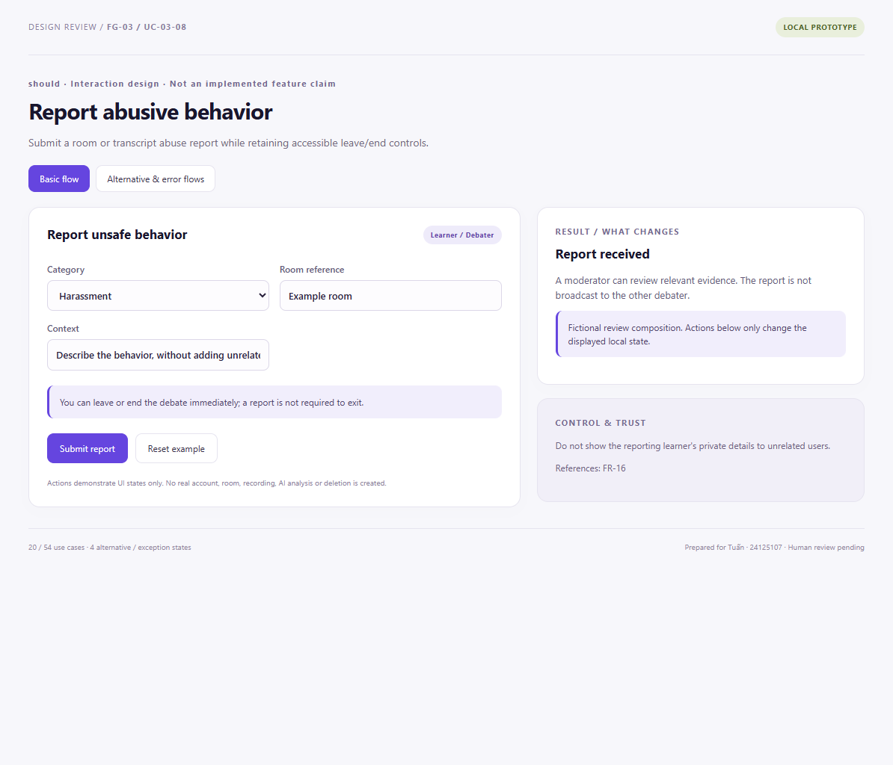

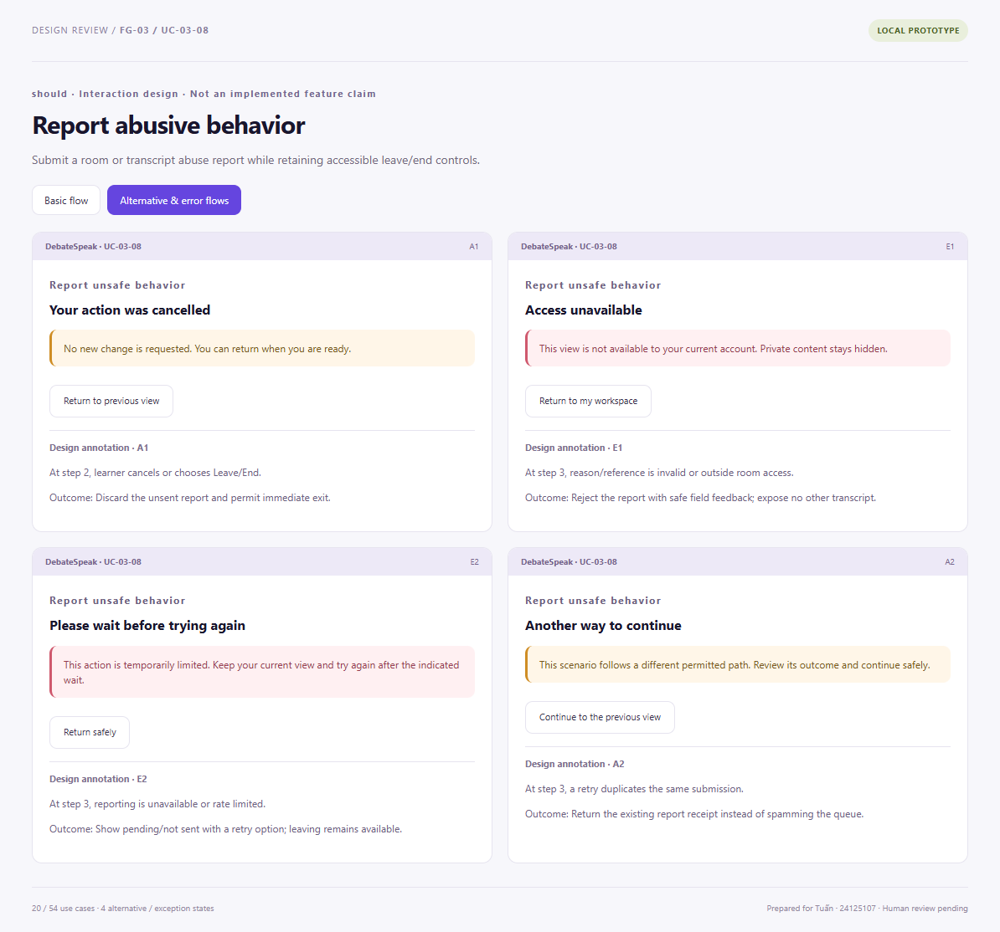

### UC-03-09 — Review abuse and close room
*Performed: Tuấn (24125107). Reviewed: Triết (24125047), 2026-11-14. Edited: Trần Lê Anh Tuấn (24125107).*

**Description / goal:** Review submitted reports and apply authorized room closure with an audit record.

| Field | Specification |
|---|---|
| Actors | Moderator / Admin |
| Scope / kind | `should`; user-goal; design status, not implementation evidence |
| Requirements | FR-17 |
| Trigger | Admin opens a pending abuse report. |
| Preconditions | Admin has report-review and room-closure permission. |

**Basic flow — main success scenario**

1. System loads the report and the minimum authorized supporting context.
2. Admin reviews it, chooses an outcome and records a reason.
3. For closure, system rechecks the current room and applies CANCELLED before LIVE or ENDED during LIVE.
4. System stops active transmission when needed, notifies participants neutrally and records the moderation outcome.

**Alternative and exception flows**

| Branch | Condition / extension point | Outcome and recovery |
|---|---|---|
| A1 | At step 2, report is dismissed or needs further review. | Record that outcome without changing room state or making a guilt claim. |
| A2 | At step 3, room already ended/was cancelled. | Keep the terminal state and record review without duplicate end jobs. |
| E1 | At step 1, caller lacks permission. | Deny access without disclosing evidence or participant details. |
| E2 | At step 3, closure fails. | Keep the moderation outcome pending and retry from current room state; do not announce confirmed closure. |

**Postconditions — success:** An attributable moderation outcome and any authorized closure are persisted.

**Postconditions — minimum guarantee:** No unauthorized closure or private-content disclosure occurs.

**Special requirements:** Do not add LIVE→CANCELLED to simplify closure. A moderation permission is not blanket permission to browse every learner transcript. Shared permission, consent, accessibility and failure contracts in Section 2 apply.

**UI prototype:** The first image represents the main workflow; the contact sheet contains every named alternative/exception outcome. Illustrative data is not a real learner record.

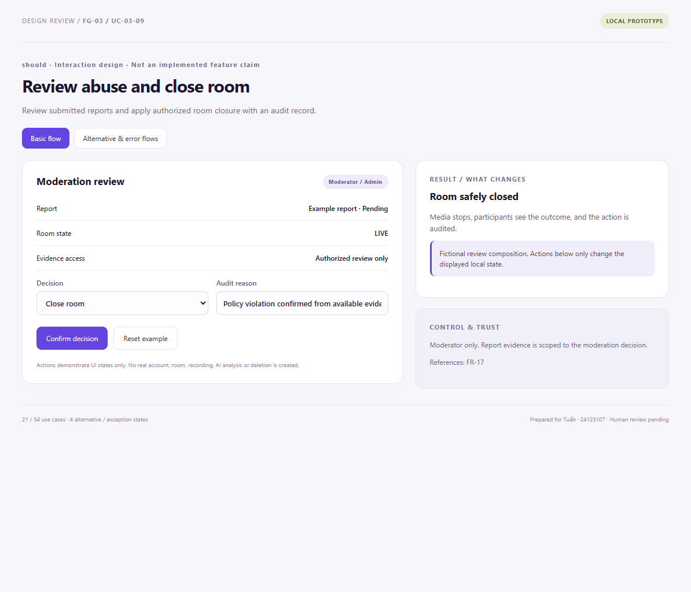

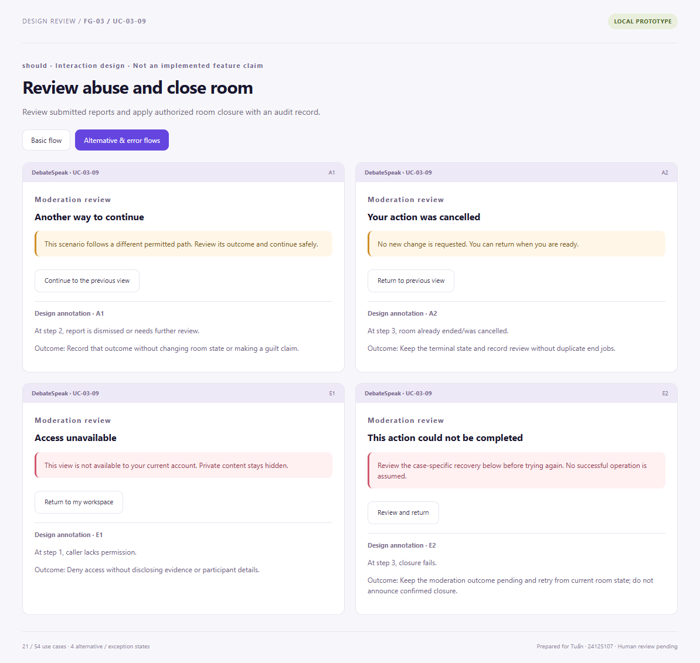

### UC-03-10 — Use private room text chat
*Performed: Tuấn (24125107). Reviewed: Triết (24125047), 2026-11-14. Edited: Trần Lê Anh Tuấn (24125107).*

**Description / goal:** Exchange room chat only when enabled; keep it separate from transcript and AI inputs by default.

| Field | Specification |
|---|---|
| Actors | Learner / Debater |
| Scope / kind | `post-mvp`; user-goal; design status, not implementation evidence |
| Requirements | FR-58 |
| Trigger | Creator enables room chat and a participant opens it. |
| Preconditions | Post-MVP feature is separately approved and enabled; two authenticated debaters occupy the room. |

**Basic flow — main success scenario**

1. System checks creator authority and enables the private two-debater text channel.
2. Participant composes and submits a message.
3. System validates room membership and stores the message separately from the speech transcript.
4. System delivers it to the other debater; chat stays excluded from AI processing unless both separately opted in.

**Alternative and exception flows**

| Branch | Condition / extension point | Outcome and recovery |
|---|---|---|
| A1 | At step 1, creator has not enabled chat. | Show chat unavailable and accept no messages. |
| E1 | At step 3, caller is an audience member/nonparticipant or the message is invalid. | Reject submission without exposing chat history. |
| E2 | At step 4, delivery confirmation is lost. | Show pending and reconcile the message identity before retry, avoiding duplicates. |
| A2 | At step 4, either debater declines chat analysis or account data is deleted. | Exclude chat from analysis and include its stored records in the applicable deletion cascade. |

**Postconditions — success:** An authorized private message is stored separately and delivered with processing restrictions.

**Postconditions — minimum guarantee:** Chat never silently becomes transcript or AI input.

**Special requirements:** Design only; no class/group chat, audience publishing, public messaging or moderation bot is added by this use case. Shared permission, consent, accessibility and failure contracts in Section 2 apply.

**UI prototype:** The first image represents the main workflow; the contact sheet contains every named alternative/exception outcome. Illustrative data is not a real learner record.

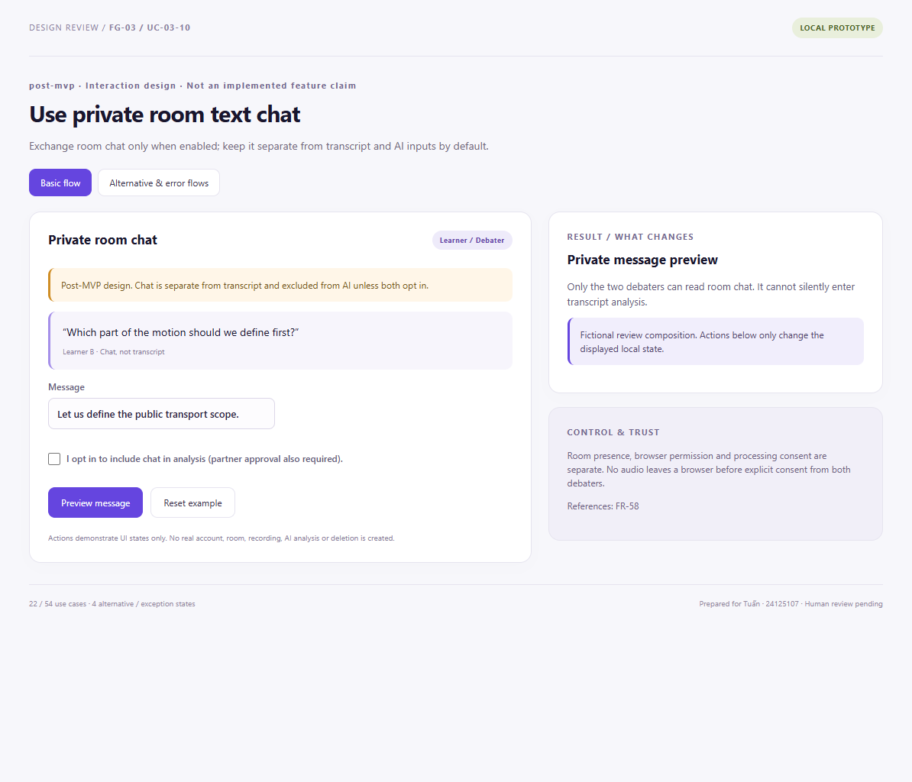

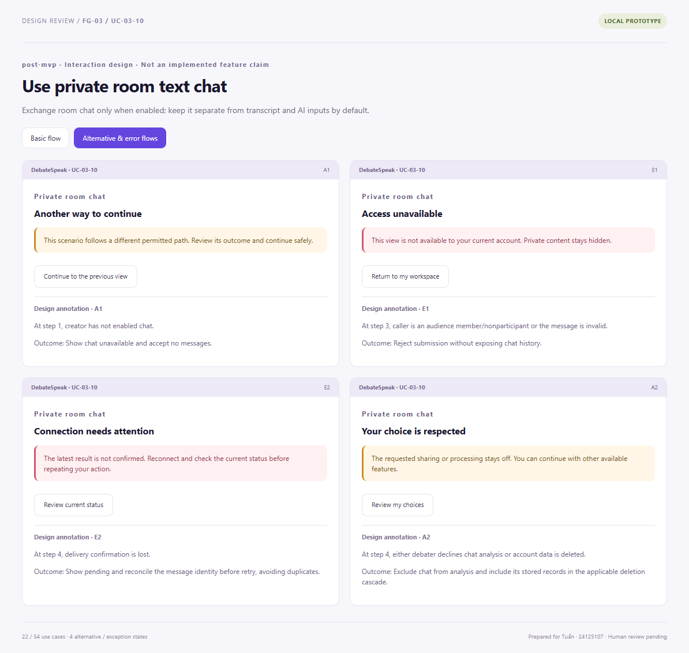

### UC-03-11 — Practise solo with an AI opponent
*Performed: Tuấn (24125107). Reviewed: Triết (24125047), 2026-11-14. Edited: Trần Lê Anh Tuấn (24125107).*

**Description / goal:** Practise with generated opponent turns after a separate TTS contract and personal capture-consent design.

| Field | Specification |
|---|---|
| Actors | Learner / Debater, LLM provider |
| Scope / kind | `post-mvp`; user-goal; design status, not implementation evidence |
| Requirements | FR-59 |
| Trigger | Learner chooses Solo practice. |
| Preconditions | Post-MVP solo-practice feature, a reviewed solo consent model and a TTS adapter contract exist; learner is authenticated. |

**Basic flow — main success scenario**

1. System labels the opponent as AI and explains text generation, speech synthesis and personal audio processing.
2. Learner explicitly grants their own processing consent and initiates a local mic test.
3. System creates the separately specified solo session and obtains a bounded generated opponent turn through LLMAdapter.
4. System speaks the AI turn through the future TTS adapter and exchanges turns with the consenting learner.
5. Learner ends practice; system stops capture and shows the permitted session outcome.

**Alternative and exception flows**

| Branch | Condition / extension point | Outcome and recovery |
|---|---|---|
| E1 | At step 1, solo/TTS/consent prerequisites are not implemented. | Show unavailable; do not repurpose a two-human room or fake a consenting second person. |
| A1 | At step 2, learner declines or withdraws consent. | Start no capture, or stop immediately and end an active solo session. |
| E2 | At step 3 or 4, LLM/TTS fails or exceeds budget. | Stop generated audio, disclose the unavailable turn and allow a safe retry/end without fabricated responses. |

**Postconditions — success:** A separately authorized solo session finishes with the AI identity and processing basis explicit.

**Postconditions — minimum guarantee:** No other human audio is used and an AI never counts as a consenting human.

**Special requirements:** This design intentionally does not weaken the current FR-11 two-debater invariant. Solo states, TTS and token/cost controls require future architectural approval. Shared permission, consent, accessibility and failure contracts in Section 2 apply.

**UI prototype:** The first image represents the main workflow; the contact sheet contains every named alternative/exception outcome. Illustrative data is not a real learner record.

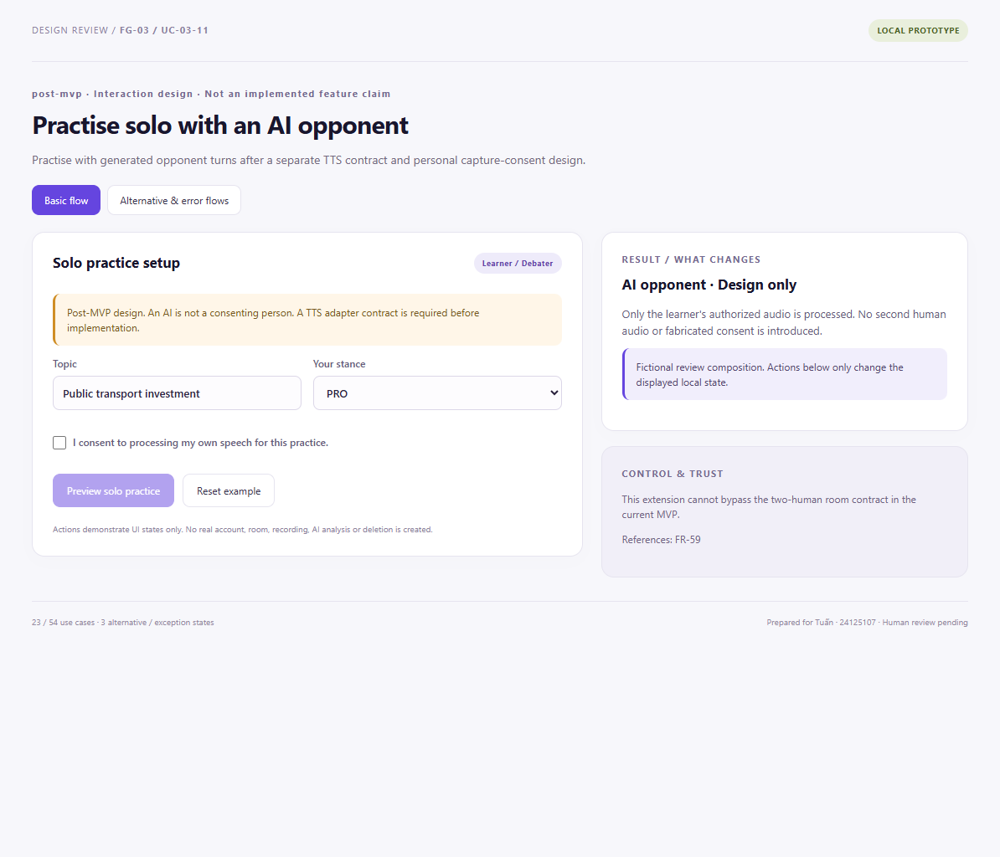

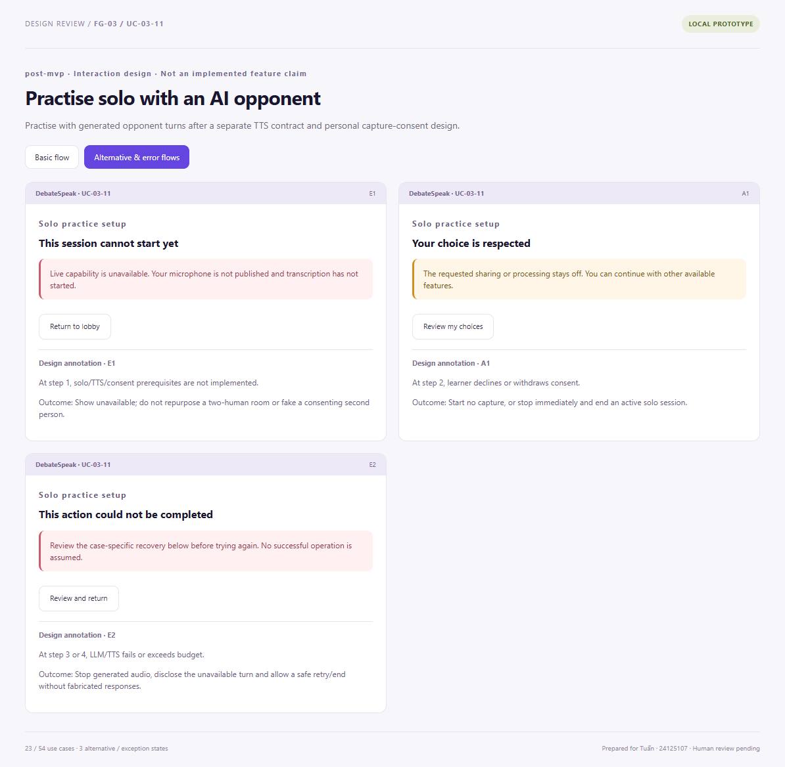

### UC-03-12 — Authorize and join audience access
*Performed: Tuấn (24125107). Reviewed: Triết (24125047), 2026-11-14. Edited: Trần Lê Anh Tuấn (24125107).*

**Description / goal:** Admit capped, non-publishing audience access only with both debaters' consent.

| Field | Specification |
|---|---|
| Actors | Learner / Debater, Audience member, LiveKit Cloud |
| Scope / kind | `post-mvp`; user-goal; design status, not implementation evidence |
| Requirements | FR-60 |
| Trigger | Creator requests audience access and an invited audience member attempts to join. |
| Preconditions | Post-MVP audience feature is enabled; creator and both debaters have current room access. |

**Basic flow — main success scenario**

1. Creator sets a bounded audience allowance and explains which media/transcript would be shared.
2. Each debater independently grants or declines audience sharing.
3. System verifies both grants and audience identity/capacity before issuing subscribe-only access.
4. Audience member views only authorized media/transcript while the system enforces no publishing and no grading rights.
5. System revokes audience subscriptions when consent is withdrawn or the room ends.

**Alternative and exception flows**

| Branch | Condition / extension point | Outcome and recovery |
|---|---|---|
| A1 | At step 2, either debater declines or has not answered. | Keep audience outside the room and expose no audio or transcript. |
| E1 | At step 3, audience cap is reached or invite/identity is invalid. | Deny entry without leaking room content. |
| E2 | At step 4, audience attempts to publish or grade. | Reject the operation; audience status does not grant evaluator or debater rights. |
| A2 | At step 5, either debater revokes sharing. | Revoke access promptly; a reconnect must revalidate current grants. |

**Postconditions — success:** Authorized audience can receive only permitted content under current dual sharing consent.

**Postconditions — minimum guarantee:** Audience never occupies either debater seat, publishes audio or receives unconsented content.

**Special requirements:** Audience capacity values and revocation latency need the future media contract; no unlimited audience or account-role bypass is assumed. Shared permission, consent, accessibility and failure contracts in Section 2 apply.

**UI prototype:** The default screen shows audience entry blocked while sharing authorization is pending; the contact sheet contains every named alternative/exception outcome. The additional authorized scenario illustrates future subscribe-only audience access only. Illustrative data is not a real learner record.

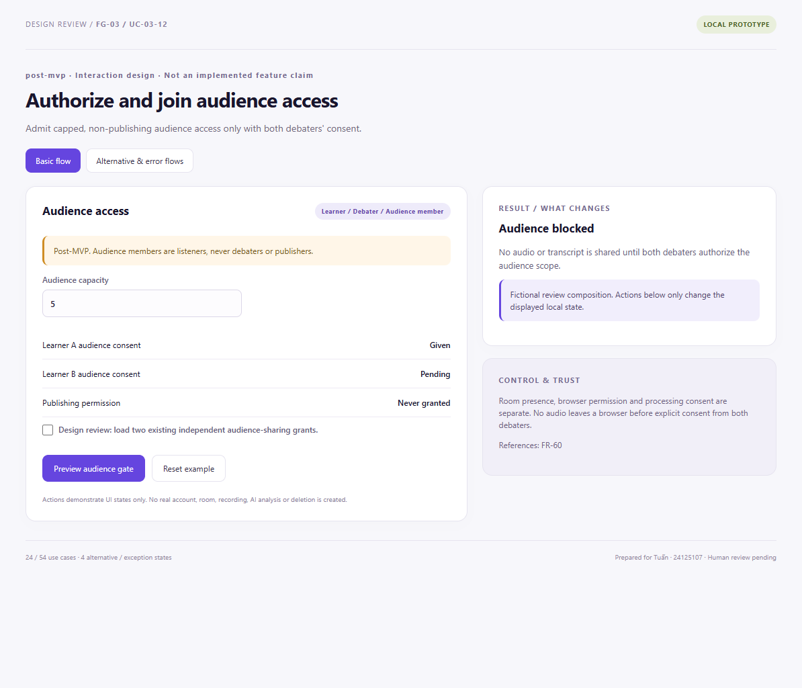

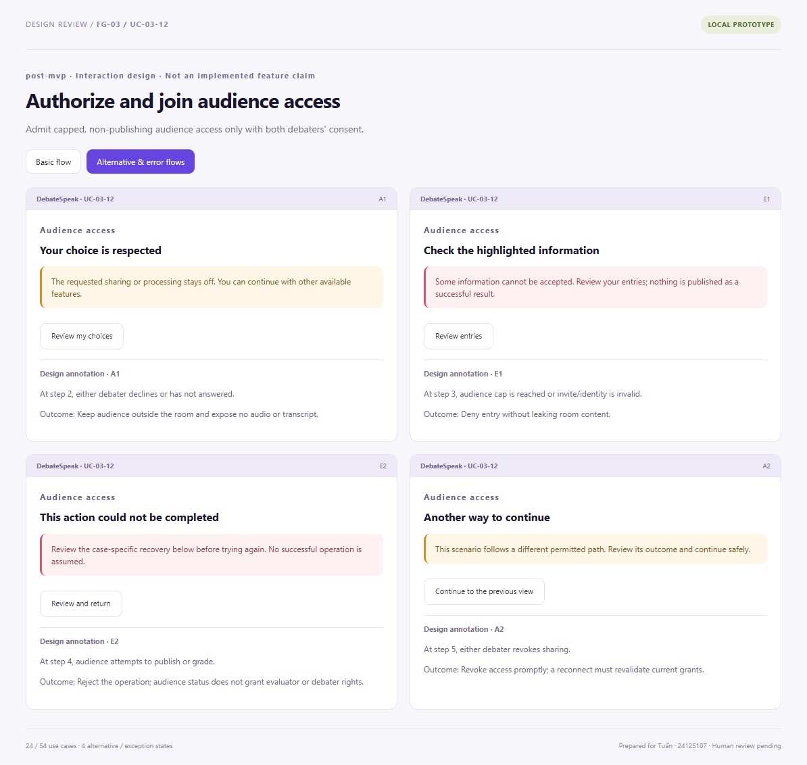

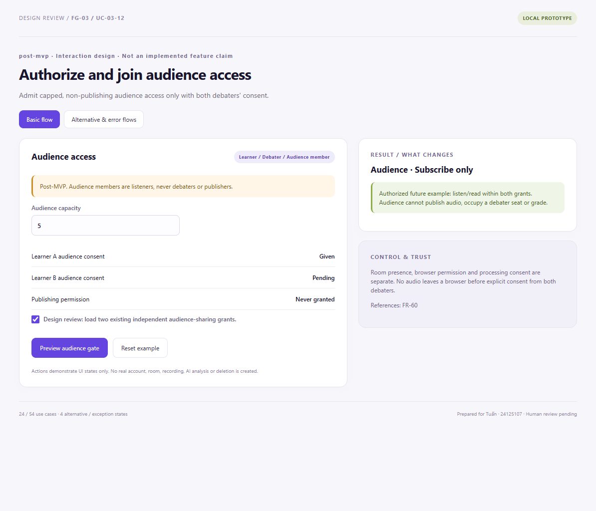

### UC-03-13 — Validate start readiness
*Performed: Tuấn (24125107). Reviewed: Triết (24125047), 2026-11-14. Edited: Trần Lê Anh Tuấn (24125107).*

**Description / goal:** As a mandatory start subcase, reject stale or missing membership, consent, mic, expiry or media-capability gates.

| Field | Specification |
|---|---|
| Actors | Learner / Debater |
| Scope / kind | `future-mvp`; supporting; design status, not implementation evidence |
| Requirements | FR-12, FR-13, FR-19 |
| Trigger | UC-03-05 requests mandatory start validation. |
| Preconditions | An authenticated participant start request invokes this supporting subcase; server can read current room authority. |

**Basic flow — main success scenario**

1. System reads the current locked/versioned room and authenticated participant membership.
2. System verifies READY, two distinct seats and a lobby deadline strictly after server time.
3. System checks current consent and local mic-readiness results separately for both learners.
4. System verifies actual media capability and returns a permit for the same atomic start decision.

**Alternative and exception flows**

| Branch | Condition / extension point | Outcome and recovery |
|---|---|---|
| E1 | At step 1 or 2, caller is not a participant, state is stale, capacity differs or deadline expired. | Return a non-disclosing denial or expiry outcome; no start permit. |
| E2 | At step 3, either consent or mic result is missing, revoked or stale. | Return the missing gate and keep publication disabled. |
| E3 | At step 4, media is unsupported/unavailable or state changed after checking. | Reject and revalidate current authority before any retry; no reusable stale permit. |

**Postconditions — success:** A start permit is valid only for the checked current transaction/context.

**Postconditions — minimum guarantee:** Every failed or unavailable gate fails closed without audio transmission.

**Special requirements:** Supporting behavior, not a public Validate endpoint. The readiness inspector prototype represents learner-visible gate status, not server-debug internals. Shared permission, consent, accessibility and failure contracts in Section 2 apply.

**UI prototype:** The first image represents the main workflow; the contact sheet contains every named alternative/exception outcome. Illustrative data is not a real learner record.

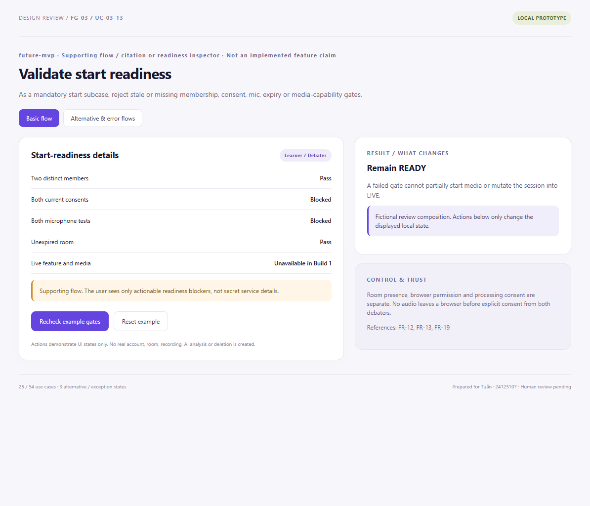

## FG-04 — Real-time audio
*Performed: Tuấn (24125107). Reviewed: Triết (24125047), 2026-11-14. Edited: Trần Lê Anh Tuấn (24125107).*

### UC-04-01 — Select and test microphone
*Performed: Tuấn (24125107). Reviewed: Triết (24125047), 2026-11-14. Edited: Trần Lê Anh Tuấn (24125107).*

**Description / goal:** Choose an input and explicitly run a local mic test with permission-recovery guidance.

| Field | Specification |
|---|---|
| Actors | Learner / Debater |
| Scope / kind | `future-mvp`; user-goal; design status, not implementation evidence |
| Requirements | FR-19 |
| Trigger | Learner explicitly selects Test microphone. |
| Preconditions | Learner has opened pre-debate setup in a browser with a supported microphone API. |

**Basic flow — main success scenario**

1. System explains that this is a local-only test and requests browser microphone permission after the click.
2. Learner selects an available input device and speaks a short sample.
3. System shows a local level meter and test result without uploading, storing, transcribing or publishing audio.
4. Learner confirms the result or selects another device; system releases the local test track when the test ends.

**Alternative and exception flows**

| Branch | Condition / extension point | Outcome and recovery |
|---|---|---|
| E1 | At step 1, microphone permission is denied. | Show browser recovery instructions and Keep mic test incomplete; no repeated permission loop or silent capture. |
| E2 | At step 2, no device exists, device is busy/unplugged or no signal is detected. | Show device-specific recovery, allow another input and leave mic readiness false. |
| A1 | At step 3, learner cancels or leaves setup. | Stop/release the local test track immediately without recording a passed test. |
| A2 | At step 4, learner changes input after passing. | Invalidate the old result and test the newly selected device before start. |

**Postconditions — success:** A usable selected input has a current local test result and no pre-consent network audio.

**Postconditions — minimum guarantee:** A failed/cancelled test cannot satisfy microphone readiness or initiate remote transmission.

**Special requirements:** Browser permission is distinct from processing consent. READY still represents presence; mic denial blocks LIVE rather than changing the occupied-seat definition. Shared permission, consent, accessibility and failure contracts in Section 2 apply.

**UI prototype:** The first image represents the main workflow; the contact sheet contains every named alternative/exception outcome. Illustrative data is not a real learner record.

### UC-04-02 — Exchange audio and control mute
*Performed: Tuấn (24125107). Reviewed: Triết (24125047), 2026-11-14. Edited: Trần Lê Anh Tuấn (24125107).*

**Description / goal:** Speak on independent tracks, hear the partner and control own mute after dual consent.

| Field | Specification |
|---|---|
| Actors | Learner / Debater, LiveKit Cloud |
| Scope / kind | `future-mvp`; user-goal; design status, not implementation evidence |
| Requirements | FR-18, FR-20 |
| Trigger | Authorized LIVE media connects and a participant speaks or selects Mute. |
| Preconditions | Room is authoritatively LIVE; both debaters have current consent and usable selected inputs. |

**Basic flow — main success scenario**

1. System obtains scoped media access and connects the two debaters using separate LiveKit audio tracks.
2. System displays both participants mic/speaking status and visible transmission/processing indicators.
3. Learner mutes or unmutes their own microphone; system changes only their publishing state and confirms the actual state.
4. System maintains audibility and accessible end/leave controls while optional analysis runs independently.
5. When the room ends or consent is withdrawn, system stops publication, subscriptions and capture.

**Alternative and exception flows**

| Branch | Condition / extension point | Outcome and recovery |
|---|---|---|
| A1 | At step 3, learner mutes. | Stop publishing own speech while preserving the partner audio; show Muted rather than Disconnected. |
| E1 | At step 1 or 3, media authorization fails or consent/state is no longer valid. | Publish no further audio; reconcile room authority and show recovery/end controls. |
| E2 | At step 4, STT/AI fails while audio remains healthy. | Continue consented audio and disclose the unavailable processing section without blocking conversation. |
| A2 | At step 4, optional video or overlays are requested. | Invoke only the enabled, separately authorized UC-04-04/UC-08-02 extensions. |
| E3 | At step 4, media connection drops. | Show recovery status and invoke UC-04-03; never display a successful unmute when no track is publishing. |

**Postconditions — success:** Consented independent tracks carry live speech; own mute and terminal stopping behavior are observable.

**Postconditions — minimum guarantee:** No participant controls the opponent microphone or continues publication after ending/withdrawal.

**Special requirements:** Prioritize audio latency over analysis. Raw audio is not persisted by default; independent tracks preserve deterministic speaker attribution. Shared permission, consent, accessibility and failure contracts in Section 2 apply.

**UI prototype:** The first image represents the main workflow; the contact sheet contains every named alternative/exception outcome. Illustrative data is not a real learner record.

### UC-04-03 — Recover a dropped connection
*Performed: Tuấn (24125107). Reviewed: Triết (24125047), 2026-11-14. Edited: Trần Lê Anh Tuấn (24125107).*

**Description / goal:** Rejoin the existing identity within a visible 60-second grace period or finish the session.

| Field | Specification |
|---|---|
| Actors | Learner / Debater, LiveKit Cloud |
| Scope / kind | `future-mvp`; user-goal; design status, not implementation evidence |
| Requirements | FR-15, FR-21 |
| Trigger | System detects loss of the participant media/event connection. |
| Preconditions | Learner was a member of a LIVE room and their connection becomes interrupted. |

**Basic flow — main success scenario**

1. System shows a connection-quality/reconnecting banner and starts the authoritative 60-second grace window.
2. Client attempts bounded reconnection using the same authenticated participant identity.
3. Server rechecks membership, consent, room state and current grace deadline before restoring media.
4. System loads the current timer/state and resumes missed transcript events without duplicate segments.

**Alternative and exception flows**

| Branch | Condition / extension point | Outcome and recovery |
|---|---|---|
| A1 | At step 3, reconnect succeeds before grace expiry. | Restore the existing seat/tracks and actual current timer; do not create a new room or consent record. |
| E1 | At step 3, grace expires or room already ended. | Transition/retain ENDED, stop capture and show the ended-session view. |
| E2 | At step 3, identity or consent no longer authorizes media. | Deny publication and require sign-in/consent recovery only where the current room lifecycle permits. |
| E3 | At step 2, connectivity remains unavailable. | Keep retry timing visible and allow safe local exit; never extend the server grace from the client. |

**Postconditions — success:** The same authorized participant resumes within grace or the room ends safely.

**Postconditions — minimum guarantee:** Reconnection cannot bypass consent, duplicate a seat, restart the timer or reopen a terminal room.

**Special requirements:** Default grace is 60 seconds. Early-end analysis requires at least 60 seconds of speech; show insufficient evidence otherwise. Shared permission, consent, accessibility and failure contracts in Section 2 apply.

**UI prototype:** The first image represents the main workflow; the contact sheet contains every named alternative/exception outcome. Illustrative data is not a real learner record.

### UC-04-04 — Enable optional live video
*Performed: Tuấn (24125107). Reviewed: Triết (24125047), 2026-11-14. Edited: Trần Lê Anh Tuấn (24125107).*

**Description / goal:** Add video only through a separately consented optional flow that preserves audio priority.

| Field | Specification |
|---|---|
| Actors | Learner / Debater, LiveKit Cloud |
| Scope / kind | `stretch`; user-goal; design status, not implementation evidence |
| Requirements | FR-22 |
| Trigger | Learner opts into video at media setup or during LIVE. |
| Preconditions | Optional video is explicitly enabled and separately specified; consented audio already works. |

**Basic flow — main success scenario**

1. System explains optional video sharing and requests a separate personal opt-in.
2. Learner explicitly grants camera permission and selects a device.
3. System verifies current audience/participant sharing permissions and publishes the authorized video track.
4. Learner can turn video off independently; system keeps audio controls and audio priority intact.

**Alternative and exception flows**

| Branch | Condition / extension point | Outcome and recovery |
|---|---|---|
| A1 | At step 1, learner declines or optional video is disabled. | Continue the audio-only debate with no penalty or camera request. |
| E1 | At step 2, camera permission/device fails. | Show recovery and remain audio-only; never infer permission from mic access. |
| E2 | At step 3, bandwidth degrades or sharing consent is revoked. | Stop video first and disclose its state while preserving authorized audio where possible. |

**Postconditions — success:** Only separately authorized optional video is visible and independently stoppable.

**Postconditions — minimum guarantee:** Video failure/decline never prevents the core audio workflow or activates hidden camera capture.

**Special requirements:** Stretch design; no video recording is implied. This is an extension of UC-04-02 and does not expand existing audience permissions. Shared permission, consent, accessibility and failure contracts in Section 2 apply.

**UI prototype:** The first image represents the main workflow; the contact sheet contains every named alternative/exception outcome. Illustrative data is not a real learner record.

## FG-05 — Transcription and attribution
*Performed: Tuấn (24125107). Reviewed: Triết (24125047), 2026-11-14. Edited: Trần Lê Anh Tuấn (24125107).*

### UC-05-01 — View speaker-attributed live transcript
*Performed: Tuấn (24125107). Reviewed: Triết (24125047), 2026-11-14. Edited: Trần Lê Anh Tuấn (24125107).*

**Description / goal:** Read partial and finalized timestamped transcript text linked deterministically to each speaker's track.

| Field | Specification |
|---|---|
| Actors | Learner / Debater, STT / diarization provider |
| Scope / kind | `future-mvp`; user-goal; design status, not implementation evidence |
| Requirements | FR-23, FR-24, FR-25, FR-26 |
| Trigger | Learner opens the live transcript while speech occurs. |
| Preconditions | Learner belongs to a consented LIVE room; authorized STT and transcript transport are available. |

**Basic flow — main success scenario**

1. System checks room membership and processing consent, then subscribes the worker to independent participant tracks.
2. STT returns timestamped partial text; system displays it with the deterministic track-linked speaker and provisional status.
3. When a final result arrives, system validates timing/confidence, persists the segment idempotently and replaces the partial text.
4. System updates both debaters views and lets the learner inspect low-confidence words or flag a mis-transcribed segment.

**Alternative and exception flows**

| Branch | Condition / extension point | Outcome and recovery |
|---|---|---|
| A1 | At step 2, both learners speak simultaneously. | Display two attributable streams with overlap metadata rather than merging speaker identities. |
| A2 | At step 3, a final/event is duplicated or replays after reconnect. | Upsert by session/speaker/sequence and de-duplicate client events; show one final segment. |
| E1 | At step 2 or 3, STT fails or timing/confidence is missing. | Mark transcription unavailable/uncertain; keep healthy audio running and do not invent text or metrics. |
| A3 | At step 4, learner flags recognition error or confidence is low. | Mark the affected span for exclusion from confirmed language criticism; preserve the original attributable evidence. |
| E2 | At step 1, consent or membership is revoked. | Stop the subscription/capture path and deny further transcript delivery. |

**Postconditions — success:** Authorized readers see speaker-linked partial/final text with honest confidence and no duplicate final segments.

**Postconditions — minimum guarantee:** No unconsented transcription or guessed speaker identity is used as confirmed learner evidence.

**Special requirements:** Partial hypotheses are not persisted. Final segments include word timing/confidence where required; preserve fillers rather than cleaning away learning signals. Shared permission, consent, accessibility and failure contracts in Section 2 apply.

**UI prototype:** The first image represents the main workflow; the contact sheet contains every named alternative/exception outcome. Illustrative data is not a real learner record.

### UC-05-02 — Review and export full transcript
*Performed: Tuấn (24125107). Reviewed: Triết (24125047), 2026-11-14. Edited: Trần Lê Anh Tuấn (24125107).*

**Description / goal:** Review an authorized finished transcript and download text or Markdown.

| Field | Specification |
|---|---|
| Actors | Learner / Debater |
| Scope / kind | `should`; user-goal; design status, not implementation evidence |
| Requirements | FR-27 |
| Trigger | Learner opens Transcript or selects Export text/Markdown. |
| Preconditions | Learner is authenticated and is a participant in the ended debate. |

**Basic flow — main success scenario**

1. System verifies participant access and loads finalized segments in stable time/speaker order.
2. System shows speaker labels, timestamps, recognition caveats and any flagged spans.
3. Learner selects text or Markdown export and reviews its content scope.
4. System generates the authorized export and starts a local download.

**Alternative and exception flows**

| Branch | Condition / extension point | Outcome and recovery |
|---|---|---|
| A1 | At step 1, no speech or only partial transcript exists. | Show an empty/partial view and label any export accordingly; do not manufacture missing turns. |
| E1 | At step 1 or 4, membership/data availability changed or debate was deleted. | Deny access without returning transcript bytes or another participant metadata. |
| E2 | At step 4, generation/download fails. | Keep the review view usable and offer retry; do not claim a file was downloaded. |

**Postconditions — success:** Learner can review and optionally download only the authorized transcript version.

**Postconditions — minimum guarantee:** An export failure changes neither transcript nor access permissions.

**Special requirements:** No raw audio download is implied. Exported filenames and Markdown text must be safe and must not include session credentials. Shared permission, consent, accessibility and failure contracts in Section 2 apply.

**UI prototype:** The first image represents the main workflow; the contact sheet contains every named alternative/exception outcome. Illustrative data is not a real learner record.

### UC-05-03 — Use mixed-audio diarization fallback
*Performed: Tuấn (24125107). Reviewed: Triết (24125047), 2026-11-14. Edited: Trần Lê Anh Tuấn (24125107).*

**Description / goal:** Recover speaker-attributed text for an explicitly supported mixed-audio input without replacing track attribution by default.

| Field | Specification |
|---|---|
| Actors | Learner / Debater, STT / diarization provider |
| Scope / kind | `stretch`; user-goal; design status, not implementation evidence |
| Requirements | FR-28 |
| Trigger | Learner is offered the supported mixed-audio fallback after the primary track path cannot be used. |
| Preconditions | Stretch mixed-audio path is enabled and separately authorized; participants have explicitly consented. |

**Basic flow — main success scenario**

1. System explains that mixed-audio diarization has lower speaker-attribution certainty and is outside MVP scoring.
2. Learner explicitly accepts the fallback; system validates membership and current processing consent.
3. System sends only the authorized mixed stream through the configured fallback/diarization service.
4. System displays timestamped fallback text and uncertain speaker labels without treating them as deterministic track identity.

**Alternative and exception flows**

| Branch | Condition / extension point | Outcome and recovery |
|---|---|---|
| A1 | At step 2, learner declines or fallback is disabled. | Send no mixed audio; allow a safe primary-path retry or ending the session. |
| E1 | At step 3, provider is unavailable or consent is withdrawn. | Stop fallback transmission and show unavailable status without recording by default. |
| E2 | At step 4, diarization cannot confidently identify the speaker. | Show unknown/uncertain speaker and exclude the span from speaker-specific MVP scoring. |

**Postconditions — success:** An explicitly authorized fallback produces transparently limited transcript text.

**Postconditions — minimum guarantee:** The primary deterministic attribution contract is never silently replaced by statistical labels.

**Special requirements:** The proposed mixed-audio WebSocket is future-only; this use case adds no working upload endpoint to PA3. Shared permission, consent, accessibility and failure contracts in Section 2 apply.

**UI prototype:** The first image represents the main workflow; the contact sheet contains every named alternative/exception outcome. Illustrative data is not a real learner record.

## FG-06 — English language analysis
*Performed: Tuấn (24125107). Reviewed: Triết (24125047), 2026-11-14. Edited: Trần Lê Anh Tuấn (24125107).*

### UC-06-01 — Review language corrections
*Performed: Tuấn (24125107). Reviewed: Triết (24125047), 2026-11-14. Edited: Trần Lê Anh Tuấn (24125107).*

**Description / goal:** Receive CEFR-appropriate grammar and vocabulary feedback quoting the learner's exact transcript.

| Field | Specification |
|---|---|
| Actors | Learner / Debater, LLM provider |
| Scope / kind | `future-mvp`; user-goal; design status, not implementation evidence |
| Requirements | FR-30, FR-31 |
| Trigger | Learner opens Language feedback. |
| Preconditions | Learner has authorized access to an ended debate with usable own finalized transcript and CEFR context. |

**Basic flow — main success scenario**

1. System loads eligible own-speaker segments and excludes flagged/low-confidence evidence from confirmed error claims.
2. Language Coach returns schema-validated grammar/vocabulary items with exact quote, correction and explanation.
3. System invokes UC-06-05 for every retained item and ranks valid findings by learning impact/frequency.
4. System displays a CEFR-appropriate number of priority items and links each to its original transcript context.

**Alternative and exception flows**

| Branch | Condition / extension point | Outcome and recovery |
|---|---|---|
| A1 | At step 1, usable speech is insufficient or no grounded issue is found. | Explain limited evidence/no retained findings; do not invent errors or issue false praise. |
| E1 | At step 2, provider times out or returns invalid schema. | Retry the schema repair once as specified; then mark the language section unavailable. |
| E2 | At step 3, quote/speaker/segment validation fails. | Discard the item with an internal reason; never display fabricated learner wording. |
| A2 | At step 4, learner inspects an uncertain or flagged transcription. | Show the recognition caveat and evidence flag workflow rather than treating the criticism as confirmed. |

**Postconditions — success:** Displayed corrections are attributable, CEFR-appropriate and paired with concrete remediation.

**Postconditions — minimum guarantee:** Unavailable analysis never becomes a fabricated correction or a zero score.

**Special requirements:** Default priority-item caps: A2 3, B1 5, B2 7, C1 10. Do not interrupt LIVE speech with dense feedback; a matched quote alone does not prove a grammar error. Shared permission, consent, accessibility and failure contracts in Section 2 apply.

**UI prototype:** The first image represents the main workflow; the contact sheet contains every named alternative/exception outcome. Illustrative data is not a real learner record.

### UC-06-02 — Review speaking metrics
*Performed: Tuấn (24125107). Reviewed: Triết (24125047), 2026-11-14. Edited: Trần Lê Anh Tuấn (24125107).*

**Description / goal:** Inspect deterministic pace, fillers, pauses, talk-time and lexical metrics with measurement limits.

| Field | Specification |
|---|---|
| Actors | Learner / Debater |
| Scope / kind | `future-mvp`; user-goal; design status, not implementation evidence |
| Requirements | FR-29 |
| Trigger | Learner opens Speaking metrics. |
| Preconditions | Learner can access own finalized transcript with sufficient validated word timing. |

**Basic flow — main success scenario**

1. System selects eligible speaker segments and validates word/speech-time inputs.
2. Deterministic code computes WPM, filler rate, pause profile, talk-time share, MATTR lexical diversity and mean sentence length.
3. System displays the measured values with units, sample size and short definitions.
4. Learner opens a metric explanation and the supporting transcript range.

**Alternative and exception flows**

| Branch | Condition / extension point | Outcome and recovery |
|---|---|---|
| A1 | At step 1, there is no speech or a denominator/window has insufficient data. | Display Not enough data for affected metrics; do not divide by zero or fabricate zero-performance scores. |
| E1 | At step 2, word timestamps are absent, unordered or invalid. | Mark timing-dependent metrics unavailable and expose the measurement limitation. |
| A2 | At step 3, overlapping speech occurs. | Compute each participant from their own track/timestamps and explain overlap rather than merging counts. |

**Postconditions — success:** Learner sees reproducible own-speaker measurements or explicitly unavailable values.

**Postconditions — minimum guarantee:** No LLM estimates replace missing deterministic measurements.

**Special requirements:** WPM excludes silences over 2 seconds; pauses use at least 0.8 seconds; MATTR uses window 50. Filler handling needs context for words such as like/so; metrics are formative, not proficiency certification. Shared permission, consent, accessibility and failure contracts in Section 2 apply.

**UI prototype:** The first image represents the main workflow; the contact sheet contains every named alternative/exception outcome. Illustrative data is not a real learner record.

### UC-06-03 — Review recurring language patterns
*Performed: Tuấn (24125107). Reviewed: Triết (24125047), 2026-11-14. Edited: Trần Lê Anh Tuấn (24125107).*

**Description / goal:** Inspect evidenced recurring errors within and across own debates.

| Field | Specification |
|---|---|
| Actors | Learner / Debater |
| Scope / kind | `should`; user-goal; design status, not implementation evidence |
| Requirements | FR-32 |
| Trigger | Learner opens Recurring language patterns. |
| Preconditions | Learner is authenticated; recurring-pattern analysis is enabled and grounded feedback exists. |

**Basic flow — main success scenario**

1. System loads only authorized retained findings from the selected debate/date range.
2. System groups comparable categories and counts distinct grounded examples.
3. System shows recurring patterns with source debate links, example quotes and a suggested practice focus.
4. Learner opens an example to inspect context or changes the comparison range.

**Alternative and exception flows**

| Branch | Condition / extension point | Outcome and recovery |
|---|---|---|
| A1 | At step 1, too few eligible findings exist. | Show insufficient history and the available examples without inventing recurrence. |
| A2 | At step 2, rubric/prompt versions or transcript eligibility differ. | Separate incompatible groups and disclose comparison limits. |
| E1 | At step 4, source evidence was deleted or flagged. | Remove/recompute the affected example/count and show unavailable evidence rather than a broken authoritative claim. |

**Postconditions — success:** Pattern summaries are backed by accessible, comparable own-speaker evidence.

**Postconditions — minimum guarantee:** No other learner history is exposed or used to infer personal weaknesses.

**Special requirements:** Avoid diagnosing a stable personal defect from one sentence. Counts are observations of retained evidence, not certified error rates. Shared permission, consent, accessibility and failure contracts in Section 2 apply.

**UI prototype:** The first image represents the main workflow; the contact sheet contains every named alternative/exception outcome. Illustrative data is not a real learner record.

### UC-06-04 — Review pronunciation assessment
*Performed: Tuấn (24125107). Reviewed: Triết (24125047), 2026-11-14. Edited: Trần Lê Anh Tuấn (24125107).*

**Description / goal:** Receive separately authorized pronunciation assessment without equating accent with reasoning quality.

| Field | Specification |
|---|---|
| Actors | Learner / Debater, Pronunciation provider |
| Scope / kind | `stretch`; user-goal; design status, not implementation evidence |
| Requirements | FR-33 |
| Trigger | Learner opts into Pronunciation assessment. |
| Preconditions | Stretch assessment provider and an explicit audio-processing consent contract are available. |

**Basic flow — main success scenario**

1. System explains the external provider, needed audio and indicative assessment limits.
2. Learner explicitly permits the assessment and initiates any required sample capture.
3. System sends only the authorized sample through the assessment adapter.
4. System shows provider-qualified word-level feedback and a concrete practice suggestion, then stops sample capture.

**Alternative and exception flows**

| Branch | Condition / extension point | Outcome and recovery |
|---|---|---|
| A1 | At step 2, learner declines or cancels. | Send no sample and keep ordinary transcript/language feedback usable. |
| E1 | At step 3, audio is unusable or provider fails. | Show insufficient audio/unavailable status, stop capture and allow a deliberate retry. |
| E2 | At step 4, provider result is unsupported/invalid. | Withhold the assessment rather than converting STT confidence into a pronunciation score. |

**Postconditions — success:** Learner receives separately authorized, clearly limited pronunciation feedback.

**Postconditions — minimum guarantee:** No undisclosed sample upload, raw-audio retention or accent-based reasoning judgment occurs.

**Special requirements:** STT confidence is not pronunciation accuracy. Provider selection, sample retention and limits require a future reviewed contract; no working provider is claimed here. Shared permission, consent, accessibility and failure contracts in Section 2 apply.

**UI prototype:** The first image represents the main workflow; the contact sheet contains every named alternative/exception outcome. Illustrative data is not a real learner record.

### UC-06-05 — Validate cited transcript evidence
*Performed: Tuấn (24125107). Reviewed: Triết (24125047), 2026-11-14. Edited: Trần Lê Anh Tuấn (24125107).*

**Description / goal:** As a mandatory feedback subcase, reject missing, empty, non-verbatim, cross-speaker or cross-segment citations.

| Field | Specification |
|---|---|
| Actors | Learner / Debater |
| Scope / kind | `future-mvp`; supporting; design status, not implementation evidence |
| Requirements | FR-30, FR-37 |
| Trigger | Language/Argument feedback invokes mandatory evidence validation. |
| Preconditions | A feedback consumer supplies authorized transcript segments and a candidate item with speaker, segment and quote. |

**Basic flow — main success scenario**

1. System validates the candidate schema and requires a nonblank quote and speaker/segment reference.
2. System resolves exactly the referenced segment within the authorized transcript and verifies its speaker.
3. System checks that the quote is an exact contiguous substring of that segment without fuzzy correction or cross-segment concatenation.
4. System returns accepted evidence or a structured rejection so the parent workflow keeps only valid items.

**Alternative and exception flows**

| Branch | Condition / extension point | Outcome and recovery |
|---|---|---|
| E1 | At step 1, the quote is empty/whitespace or references are missing. | Reject the candidate; require a new attributable item rather than guessing evidence. |
| E2 | At step 2, the segment is absent, unauthorized, or belongs to another speaker. | Reject without leaking the other transcript or remapping speaker identity. |
| E3 | At step 3, quote is paraphrased, normalized, reordered or stitched across segments. | Reject the nonverbatim quote; do not silently rewrite it to pass. |
| A1 | At step 4, exact words match but recognition is low-confidence/flagged. | Provenance may match, but the parent eligibility policy withholds confirmed learner-error claims. |

**Postconditions — success:** Accepted evidence has a nonempty verbatim quote in the correct authorized speaker segment.

**Postconditions — minimum guarantee:** Invalid evidence never reaches learner-facing feedback as a valid citation.

**Special requirements:** Supporting behavior; the learner-facing prototype is a citation/context inspector, not a private model-debug endpoint. Grounding is provenance validation and does not establish critique correctness. Shared permission, consent, accessibility and failure contracts in Section 2 apply.

**UI prototype:** The first image represents the main workflow; the contact sheet contains every named alternative/exception outcome. Illustrative data is not a real learner record.

## FG-07 — Argument analysis
*Performed: Tuấn (24125107). Reviewed: Triết (24125047), 2026-11-14. Edited: Trần Lê Anh Tuấn (24125107).*

### UC-07-01 — Review argument structure and rebuttals
*Performed: Tuấn (24125107). Reviewed: Triết (24125047), 2026-11-14. Edited: Trần Lê Anh Tuấn (24125107).*

**Description / goal:** Inspect claims, reasons, rebuttals, relevance and evidence quality using attributable transcript context.

| Field | Specification |
|---|---|
| Actors | Learner / Debater, LLM provider |
| Scope / kind | `future-mvp`; user-goal; design status, not implementation evidence |
| Requirements | FR-34, FR-35, FR-36 |
| Trigger | Learner opens Argument analysis. |
| Preconditions | Learner may access an ended debate with sufficient eligible dialogue and topic context. |

**Basic flow — main success scenario**

1. System loads the authorized dialogue and topic with speaker/turn attribution.
2. Argument Coach identifies main claims, reasons, counterarguments, concessions and rebuttal links.
3. System validates structured output and invokes UC-06-05 for every quoted critique.
4. System displays a context-linked argument map and explanations of relevance, evidence use and unanswered points, each paired with a concrete repair.

**Alternative and exception flows**

| Branch | Condition / extension point | Outcome and recovery |
|---|---|---|
| A1 | At step 1, transcript is incomplete or speech is insufficient. | Label the analysis partial/unavailable and avoid declaring an opponent point definitively unanswered without the needed context. |
| E1 | At step 2 or 3, provider/schema/evidence validation fails. | Repair once where specified, discard invalid findings and show the section status. |
| A2 | At step 4, evidence supports multiple interpretations. | Describe the uncertainty and show surrounding turns rather than assigning hidden motives. |
| A3 | At step 4, optional fallacy analysis is requested. | Open UC-07-02 only when enabled; basic argument review remains usable. |

**Postconditions — success:** Argument findings are attributable to the dialogue and offer specific reasoning improvements.

**Postconditions — minimum guarantee:** Grammar, accent and personal traits never substitute for argument-quality evidence.

**Special requirements:** A rebuttal assessment must identify the opponent point and the learner response, not simply label a speaker weak. Detailed analysis belongs after the debate. Shared permission, consent, accessibility and failure contracts in Section 2 apply.

**UI prototype:** The first image represents the main workflow; the contact sheet contains every named alternative/exception outcome. Illustrative data is not a real learner record.

### UC-07-02 — Review potential logical fallacies
*Performed: Tuấn (24125107). Reviewed: Triết (24125047), 2026-11-14. Edited: Trần Lê Anh Tuấn (24125107).*

**Description / goal:** Inspect a potential fallacy with exact evidence, context, explanation and a specific repair.

| Field | Specification |
|---|---|
| Actors | Learner / Debater, LLM provider |
| Scope / kind | `should`; user-goal; design status, not implementation evidence |
| Requirements | FR-37 |
| Trigger | Learner opens Potential logical fallacies. |
| Preconditions | Optional fallacy analysis is enabled and the learner can access eligible argument context. |

**Basic flow — main success scenario**

1. System selects a candidate reasoning pattern with speaker and surrounding turn context.
2. Argument Coach proposes a potential fallacy label, exact quote and explanation of the reasoning failure.
3. System invokes UC-06-05 and checks that the explanation is supported by the cited context.
4. System displays the potential label, transcript link and a concrete reformulation/remediation.

**Alternative and exception flows**

| Branch | Condition / extension point | Outcome and recovery |
|---|---|---|
| A1 | At step 1, no defensible pattern is found. | Show no retained fallacy findings without inventing a label or falsely praising the entire argument. |
| E1 | At step 3, quote fails provenance or context does not justify the label. | Suppress the finding; do not accuse the learner based on a keyword alone. |
| E2 | At step 2, provider fails. | Mark optional analysis unavailable while preserving the core argument review. |

**Postconditions — success:** Any visible fallacy finding is qualified, evidenced and paired with a reasoning repair.

**Postconditions — minimum guarantee:** No personal attack, motive attribution or ungrounded accusation is displayed.

**Special requirements:** Use potential when interpretation is uncertain. Ad hominem/strawman/false-dilemma labels need actual reasoning context, not isolated wording. Shared permission, consent, accessibility and failure contracts in Section 2 apply.

**UI prototype:** The first image represents the main workflow; the contact sheet contains every named alternative/exception outcome. Illustrative data is not a real learner record.

## FG-08 — Fact checking
*Performed: Tuấn (24125107). Reviewed: Triết (24125047), 2026-11-14. Edited: Trần Lê Anh Tuấn (24125107).*

### UC-08-01 — Inspect claim verdicts and evidence
*Performed: Tuấn (24125107). Reviewed: Triết (24125047), 2026-11-14. Edited: Trần Lê Anh Tuấn (24125107).*

**Description / goal:** Inspect bounded fact checks, five-way verdicts, source snippets, uncertainty and evaluator disagreement.

| Field | Specification |
|---|---|
| Actors | Learner / Debater, LLM provider, Search / evidence provider |
| Scope / kind | `future-mvp`; user-goal; design status, not implementation evidence |
| Requirements | FR-38, FR-39, FR-40, FR-41, FR-43 |
| Trigger | Learner opens Claim evidence. |
| Preconditions | Learner can access a debate with selected attributable factual claims; fact-checking is enabled. |

**Basic flow — main success scenario**

1. System ranks check-worthy factual claims, selects within the default eight-claim budget and shows which claims were checked.
2. SearchAdapter retrieves bounded source snippets for the selected claim; system sanitizes and de-duplicates external content.
3. Evidence Evaluator and Skeptic independently assess the same evidence and produce schema-valid five-way verdicts.
4. Deterministic rules preserve disagreement as Contested; system displays the verdict, uncertainty, source links and exact supporting snippets.
5. Learner inspects sources and the scope/limitations of the evidence search.

**Alternative and exception flows**

| Branch | Condition / extension point | Outcome and recovery |
|---|---|---|
| A1 | At step 1, claim is opinion, prediction, vague or below selection budget/rank. | Label Not verifiable or Not selected as appropriate; do not imply unchecked claims are true. |
| E1 | At step 2, no reliable source is found or search fails. | Show Insufficient evidence/no sources found or unavailable stage, not a source-free certainty claim. |
| A2 | At step 3, evaluators disagree. | Show both assessments and Contested rather than hiding the weaker/contradictory result. |
| E2 | At step 3, schema/provider output remains invalid after the allowed repair. | Mark that stage unavailable and keep any valid evidence explicitly partial. |
| E3 | At step 5, a source link is unavailable or content changed. | Retain the cited snippet/retrieval context with a limitation; do not claim a fresh verification. |

**Postconditions — success:** Selected claims have inspectable evidence/limitations and transparent verdict disagreement.

**Postconditions — minimum guarantee:** Search failure or model agreement never becomes proof of absolute truth.

**Special requirements:** External text is untrusted data, never instructions. Default limits: top eight claims, up to five results/query, snippets truncated to 1,000 characters. Exact snippet quotes and provenance remain visible. Shared permission, consent, accessibility and failure contracts in Section 2 apply.

**UI prototype:** The first image represents the main workflow; the contact sheet contains every named alternative/exception outcome. Illustrative data is not a real learner record.

### UC-08-02 — Show optional live fact-check overlay
*Performed: Tuấn (24125107). Reviewed: Triết (24125047), 2026-11-14. Edited: Trần Lê Anh Tuấn (24125107).*

**Description / goal:** Opt into bounded live evidence overlays without delaying audio or presenting uncertain claims as settled.

| Field | Specification |
|---|---|
| Actors | Learner / Debater, LLM provider, Search / evidence provider |
| Scope / kind | `stretch`; user-goal; design status, not implementation evidence |
| Requirements | FR-42 |
| Trigger | Learner opts into live fact-check overlays. |
| Preconditions | Optional live overlay is enabled and learner is in a consented LIVE audio session. |

**Basic flow — main success scenario**

1. System explains the optional overlay, bounded claim selection and uncertain results.
2. Learner enables it; system processes eligible final turns asynchronously under the claim budget.
3. System shows a compact nonblocking evidence/status card only when a valid result exists.
4. Learner expands the evidence or hides the overlay while audio/end controls remain accessible.

**Alternative and exception flows**

| Branch | Condition / extension point | Outcome and recovery |
|---|---|---|
| A1 | At step 2, learner declines or hides the overlay. | Continue the audio debate without live cards; post-debate evidence review remains available. |
| E1 | At step 3, processing is slow, rate limited or fails. | Delay/drop optional cards and show unavailable status; never buffer or pause audio for fact checking. |
| A2 | At step 3, evaluators disagree or evidence is absent. | Show Contested/insufficient evidence, not a confident live accusation. |

**Postconditions — success:** Optional compact cards expose evidence without disrupting the debate.

**Postconditions — minimum guarantee:** Overlay availability never becomes a prerequisite for speaking or ending.

**Special requirements:** Stretch extension of UC-04-02. Keep critical feedback post-debate by default and avoid repeated alerts during socially intense discussion. Shared permission, consent, accessibility and failure contracts in Section 2 apply.

**UI prototype:** The first image represents the main workflow; the contact sheet contains every named alternative/exception outcome. Illustrative data is not a real learner record.

## FG-09 — Evaluation and consensus
*Performed: Tuấn (24125107). Reviewed: Triết (24125047), 2026-11-14. Edited: Trần Lê Anh Tuấn (24125107).*

### UC-09-01 — Review debate evaluation and consensus
*Performed: Tuấn (24125107). Reviewed: Triết (24125047), 2026-11-14. Edited: Trần Lê Anh Tuấn (24125107).*

**Description / goal:** Inspect a versioned rubric, deterministic consensus and contested flags with an honest single-judge baseline.

| Field | Specification |
|---|---|
| Actors | Learner / Debater, LLM provider |
| Scope / kind | `future-mvp`; user-goal; design status, not implementation evidence |
| Requirements | FR-44, FR-45 |
| Trigger | Learner opens Evaluation and consensus. |
| Preconditions | Learner may access an ended debate and its available versioned analysis inputs. |

**Basic flow — main success scenario**

1. System loads the versioned debate rubric and the available argument/evidence summaries.
2. Debate Judge produces six schema-valid 0–100 dimension scores per speaker: ArgumentQuality, Relevance, Evidence, Reasoning, Rebuttal and Counterarguments, with quoted/contextual rationales and qualitative fallacy/clarity notes.
3. Deterministic consensus validates score ranges, records available evaluators and flags relevant disagreement.
4. System displays dimension explanations, uncertainty and the honest single-evaluator baseline alongside source findings.

**Alternative and exception flows**

| Branch | Condition / extension point | Outcome and recovery |
|---|---|---|
| A1 | At step 1, inputs are missing or speech is insufficient. | Label evaluation partial/unavailable and do not assign a fabricated overall zero or winner. |
| E1 | At step 2, schema/range validation fails. | Use the defined one repair attempt, then mark that stage failed. |
| A2 | At step 3, a future multi-judge score spread exceeds 15/100. | Flag Contested and show the disagreement; do not silently average it away. |
| A3 | At step 4, submitted human grades have current dual sharing permission. | Offer UC-09-06 beside AI evaluation without overwriting either result. |

**Postconditions — success:** Learner can inspect a qualified, versioned evaluation and its agreement limits.

**Postconditions — minimum guarantee:** A score is never presented as certified proficiency or an undisputed factual verdict.

**Special requirements:** Architecture Section 11.3 defines six numeric dimensions per speaker—ArgumentQuality, Relevance, Evidence, Reasoning, Rebuttal and Counterarguments—each 0–100; fallacy/clarity notes remain qualitative. Both speakers therefore have twelve numeric values in a complete evaluation. MVP uses one debate judge and self-reported confidence at most 0.8; claim Evaluator/Skeptic disagreement is separate from debate-score consensus. Shared permission, consent, accessibility and failure contracts in Section 2 apply.

**UI prototype:** The first image represents the main workflow; the contact sheet contains every named alternative/exception outcome. Illustrative data is not a real learner record.

### UC-09-02 — Configure analysis and inspect usage
*Performed: Tuấn (24125107). Reviewed: Triết (24125047), 2026-11-14. Edited: Trần Lê Anh Tuấn (24125107).*

**Description / goal:** Manage provider/model, prompt versions, flags and budgets without exposing secrets to the client.

| Field | Specification |
|---|---|
| Actors | Moderator / Admin |
| Scope / kind | `should`; user-goal; design status, not implementation evidence |
| Requirements | FR-46 |
| Trigger | Admin opens Analysis settings or Usage. |
| Preconditions | Admin is authenticated with configuration/usage permission; versioned settings exist. |

**Basic flow — main success scenario**

1. System loads nonsecret provider/model identifiers, prompt/rubric versions, flags, evaluator count and budget settings.
2. Admin reviews aggregated usage/cost estimates and edits permitted settings.
3. System validates supported combinations, limits and feature scope and asks confirmation for an impactful change.
4. System saves a versioned configuration and shows which future jobs use it; existing results keep their recorded versions.

**Alternative and exception flows**

| Branch | Condition / extension point | Outcome and recovery |
|---|---|---|
| A1 | At step 2, admin only inspects usage or cancels editing. | Leave settings unchanged and distinguish estimates from measured token usage. |
| E1 | At step 3, provider/model/limit combination is invalid. | Reject the change with field guidance; retain the last valid configuration. |
| E2 | At step 1 or 4, role is invalid or a concurrent save/failure occurs. | Deny or reload/reconcile the current version; do not announce an unconfirmed rollout. |
| A2 | At step 2, usage data is incomplete. | Show missing periods/unknown costs rather than fabricated totals. |

**Postconditions — success:** Authorized settings are versioned and usage is inspectable without secret disclosure.

**Postconditions — minimum guarantee:** Failed configuration writes do not change the active valid settings or historical rubric provenance.

**Special requirements:** API keys belong only in server-side environment/secret management, never browser fields or screenshots. Configuring a feature cannot bypass consent or approve a deferred capability. Shared permission, consent, accessibility and failure contracts in Section 2 apply.

**UI prototype:** The first image represents the main workflow; the contact sheet contains every named alternative/exception outcome. Illustrative data is not a real learner record.

### UC-09-03 — Run optional heterogeneous judge panel
*Performed: Tuấn (24125107). Reviewed: Triết (24125047), 2026-11-14. Edited: Trần Lê Anh Tuấn (24125107).*

**Description / goal:** Enable three or more different judge models only under reviewed budget and consensus rules.

| Field | Specification |
|---|---|
| Actors | Moderator / Admin, LLM provider |
| Scope / kind | `stretch`; user-goal; design status, not implementation evidence |
| Requirements | FR-47 |
| Trigger | Admin chooses a heterogeneous judge panel for an eligible ended debate. |
| Preconditions | Stretch panel feature is approved; Admin has permission and a reviewed multi-model budget/consensus policy. |

**Basic flow — main success scenario**

1. Admin selects at least three different supported judge models and a bounded budget.
2. System validates feature approval, model diversity, schemas and available quota.
3. System runs independent versioned judgments on the same eligible summaries.
4. Deterministic aggregation displays per-model outcomes, score spread, confidence policy and Contested status where required.

**Alternative and exception flows**

| Branch | Condition / extension point | Outcome and recovery |
|---|---|---|
| E1 | At step 2, fewer than three distinct models or unsupported configuration is selected. | Reject panel activation and preserve the baseline setting. |
| E2 | At step 3, a provider fails or budget is exhausted. | Stop bounded work, expose the actual completed panel size and label the result partial. |
| A1 | At step 4, scores differ by more than 15/100. | Mark Contested and show individual scores instead of claiming consensus. |

**Postconditions — success:** A reviewed optional panel produces transparent per-model and aggregate results.

**Postconditions — minimum guarantee:** Incomplete panels never masquerade as three independent completed judges.

**Special requirements:** Not the MVP default; approval and provider configuration are prerequisites. Different prompts to one model do not meet the heterogeneous-model requirement. Shared permission, consent, accessibility and failure contracts in Section 2 apply.

**UI prototype:** The first image represents the main workflow; the contact sheet contains every named alternative/exception outcome. Illustrative data is not a real learner record.

### UC-09-04 — Assign a human evaluator
*Performed: Tuấn (24125107). Reviewed: Triết (24125047), 2026-11-14. Edited: Trần Lê Anh Tuấn (24125107).*

**Description / goal:** Assign a reviewer to an ended debate only after both debaters authorize transcript and grade sharing.

| Field | Specification |
|---|---|
| Actors | Learner / Debater, Human evaluator |
| Scope / kind | `should`; user-goal; design status, not implementation evidence |
| Requirements | FR-55, FR-56 |
| Trigger | Creator requests assignment of a human evaluator. |
| Preconditions | Creator is a debater in an ENDED room; conditional human evaluation is enabled. |

**Basic flow — main success scenario**

1. Creator selects an eligible human evaluator for the finished debate.
2. System explains transcript/grade sharing and obtains explicit current approval from both debaters.
3. System verifies ENDED, creator authority, both grants and evaluator eligibility.
4. System records the assignment and grants that evaluator access only to this debate and the versioned grading card.

**Alternative and exception flows**

| Branch | Condition / extension point | Outcome and recovery |
|---|---|---|
| A1 | At step 2, either debater declines or has not approved. | Keep assignment inactive; evaluator receives no transcript or grade access. |
| E1 | At step 3, room is LIVE, caller is not creator or evaluator is ineligible. | Reject assignment without exposing private content. |
| E2 | At step 4, save fails or a sharing grant is revoked. | Keep access disabled/revoke it promptly and reconcile the assignment before retry. |

**Postconditions — success:** A named evaluator is assigned only under current dual sharing authorization for an ended debate.

**Postconditions — minimum guarantee:** No assignment preview leaks transcripts before both debaters agree.

**Special requirements:** Evaluator is a separate role from Admin. Record assignment and consent provenance; this use case does not create classes or give global learner access. Shared permission, consent, accessibility and failure contracts in Section 2 apply.

**UI prototype:** The first image represents the main workflow; the contact sheet contains every named alternative/exception outcome. Illustrative data is not a real learner record.

### UC-09-05 — Submit human grading card
*Performed: Tuấn (24125107). Reviewed: Triết (24125047), 2026-11-14. Edited: Trần Lê Anh Tuấn (24125107).*

**Description / goal:** Score only an assigned ended debate using the versioned shared rubric while preserving AI grades separately.

| Field | Specification |
|---|---|
| Actors | Human evaluator |
| Scope / kind | `should`; user-goal; design status, not implementation evidence |
| Requirements | FR-55, FR-56 |
| Trigger | Evaluator opens the assigned grading card. |
| Preconditions | Human evaluator is authenticated, assigned to this ENDED debate and sharing grants remain valid. |

**Basic flow — main success scenario**

1. System rechecks assignment, ended state and current sharing grants before loading the permitted transcript.
2. System displays the versioned card with the Debate Judge's six 0–100 dimensions for each speaker: ArgumentQuality, Relevance, Evidence, Reasoning, Rebuttal and Counterarguments.
3. Evaluator enters all twelve numeric values, adds evidence-based comments and qualitative fallacy/clarity notes, and explicitly submits.
4. System validates and stores the human grade separately, recording evaluator, timestamp, card version and rubric version.

**Alternative and exception flows**

| Branch | Condition / extension point | Outcome and recovery |
|---|---|---|
| A1 | At step 3, evaluator saves no submission or leaves the card. | Keep any unsubmitted work private; debaters see no draft grade. |
| E1 | At step 1 or 4, assignment/consent was revoked or room is not ENDED. | Deny read/write access and expose no transcript or draft grade. |
| E2 | At step 4, required dimensions or score ranges are invalid. | Show field errors and do not publish a partial grading card. |
| E3 | At step 4, response is lost or submission repeats. | Reconcile the existing submission identity rather than creating duplicate grades. |

**Postconditions — success:** A complete attributable human grade is submitted separately from AI evaluation.

**Postconditions — minimum guarantee:** No unauthorized grade, draft disclosure or overwrite of AI scores occurs.

**Special requirements:** All six dimensions from Architecture Section 11.3 are required for each speaker, with individual values in 0–100; fallacy/clarity notes are qualitative rather than additional numeric dimensions. Rubric/card versions and evaluator identity remain visible to authorized debaters. Submit is explicit; drafting never implies publication. Shared permission, consent, accessibility and failure contracts in Section 2 apply.

**UI prototype:** The first image represents the main workflow; the contact sheet contains every named alternative/exception outcome. Illustrative data is not a real learner record.

### UC-09-06 — View shared human grades
*Performed: Tuấn (24125107). Reviewed: Triết (24125047), 2026-11-14. Edited: Trần Lê Anh Tuấn (24125107).*

**Description / goal:** See submitted human and AI evaluations side by side only while dual sharing authorization permits access.

| Field | Specification |
|---|---|
| Actors | Learner / Debater |
| Scope / kind | `should`; user-goal; design status, not implementation evidence |
| Requirements | FR-55, FR-56 |
| Trigger | Learner opens Human grade from the evaluation view. |
| Preconditions | Learner is a debater in the ended room; a human grade was submitted and both sharing grants remain valid. |

**Basic flow — main success scenario**

1. System checks debate membership, submitted status and current dual sharing consent.
2. System loads the human grade with evaluator identity, submission time and card/rubric versions.
3. System displays human and AI evaluations side by side with their separate provenance.
4. Learner inspects dimension comments and supporting permitted transcript context.

**Alternative and exception flows**

| Branch | Condition / extension point | Outcome and recovery |
|---|---|---|
| A1 | At step 1, grading is assigned but not submitted. | Show Awaiting submission without exposing scores or comments from drafts. |
| E1 | At step 1 or 4, either sharing grant is revoked or membership is unauthorized. | Hide the human-grade content and deny further retrieval. |
| A2 | At step 3, human and AI scores differ. | Show both with their distinct rationale/versions; do not silently replace one with an average. |
| E2 | At step 2, retrieval fails. | Show unavailable/retry without leaking cached grades to an unauthorized session. |

**Postconditions — success:** Authorized learners see only submitted, currently shared human grades beside independent AI results.

**Postconditions — minimum guarantee:** No draft or revoked human grade becomes visible.

**Special requirements:** Extension of UC-09-01; human grading is not required for the core AI evaluation view to work. Shared permission, consent, accessibility and failure contracts in Section 2 apply.

**UI prototype:** The first image represents the main workflow; the contact sheet contains every named alternative/exception outcome. Illustrative data is not a real learner record.

## FG-10 — History and learning reports
*Performed: Tuấn (24125107). Reviewed: Triết (24125047), 2026-11-14. Edited: Trần Lê Anh Tuấn (24125107).*

### UC-10-01 — Review personalized learning report
*Performed: Tuấn (24125107). Reviewed: Triết (24125047), 2026-11-14. Edited: Trần Lê Anh Tuấn (24125107).*

**Description / goal:** Review a post-debate summary, evidenced feedback and a concrete practice plan without fabricated completeness.

| Field | Specification |
|---|---|
| Actors | Learner / Debater, LLM provider |
| Scope / kind | `future-mvp`; user-goal; design status, not implementation evidence |
| Requirements | FR-48, FR-49 |
| Trigger | Learner opens Learning report. |
| Preconditions | Learner can access their ended debate and the available transcript/analysis stages. |

**Basic flow — main success scenario**

1. System checks participation and loads stage statuses plus the learner own eligible findings.
2. System combines available summary, language metrics, argument findings, claim evidence and evaluation with explicit section provenance.
3. Learning Coach proposes a short CEFR-appropriate practice plan whose recommendations refer to grounded examples.
4. System displays the report with priority actions, transcript links and any incomplete/unavailable sections.

**Alternative and exception flows**

| Branch | Condition / extension point | Outcome and recovery |
|---|---|---|
| A1 | At step 1, processing is queued/running. | Show real stage progress and only completed sections; offer UC-10-04 when appropriate. |
| E1 | At step 2 or 3, a provider/stage fails or evidence is insufficient. | Publish a clearly partial report or insufficient-speech explanation; never invent missing findings/scores. |
| E2 | At step 3, a practice recommendation has no valid supporting evidence. | Discard/revise the recommendation rather than fabricating learner weaknesses. |
| A2 | At step 4, optional PDF export is requested. | Invoke UC-10-05 only if enabled and authorized. |

**Postconditions — success:** Learner sees an honest personalized report with evidence-linked, actionable practice.

**Postconditions — minimum guarantee:** A partial report never appears complete and private opponent details are not included beyond the authorized shared debate context.

**Special requirements:** Report generation is post-debate and asynchronous. Clinical critique requires a precise repair; do not give participation-trophy praise or certified CEFR advancement claims. Shared permission, consent, accessibility and failure contracts in Section 2 apply.

**UI prototype:** The first image represents the main workflow; the contact sheet contains every named alternative/exception outcome. Illustrative data is not a real learner record.

### UC-10-02 — Browse own debate history
*Performed: Tuấn (24125107). Reviewed: Triết (24125047), 2026-11-14. Edited: Trần Lê Anh Tuấn (24125107).*

**Description / goal:** Find past authorized debates and open their transcript and report.

| Field | Specification |
|---|---|
| Actors | Learner / Debater |
| Scope / kind | `future-mvp`; user-goal; design status, not implementation evidence |
| Requirements | FR-50 |
| Trigger | Learner opens My debates. |
| Preconditions | Learner is authenticated. |

**Basic flow — main success scenario**

1. System retrieves only the learner participant-scoped debate history.
2. System lists topic, date, session state and report availability using stable pagination.
3. Learner selects a debate and chooses its report or transcript.
4. System rechecks resource access and opens the selected authorized detail view.

**Alternative and exception flows**

| Branch | Condition / extension point | Outcome and recovery |
|---|---|---|
| A1 | At step 1, learner has no debates. | Show an empty state and a path to topic/room creation rather than example personal history. |
| A2 | At step 2, a debate has incomplete analysis. | Show processing/partial status; opening it follows UC-10-04/UC-10-01. |
| E1 | At step 4, debate was deleted or access changed. | Remove the stale entry/show unavailable without exposing content. |
| E2 | At step 1 or 2, history loading fails. | Preserve the selected position/filter and offer retry; do not show stale history as current. |

**Postconditions — success:** Learner navigates only their authorized prior debate records.

**Postconditions — minimum guarantee:** History and detail queries cannot be widened by changing a supplied user or debate ID.

**Special requirements:** No public leaderboard, opponent profile browsing or teacher access is implied. Empty history remains empty until actual sessions exist. Shared permission, consent, accessibility and failure contracts in Section 2 apply.

**UI prototype:** The first image represents the main workflow; the contact sheet contains every named alternative/exception outcome. Illustrative data is not a real learner record.

### UC-10-03 — Review longitudinal progress
*Performed: Tuấn (24125107). Reviewed: Triết (24125047), 2026-11-14. Edited: Trần Lê Anh Tuấn (24125107).*

**Description / goal:** Compare observed metrics and recurring patterns while exposing missing data and non-certified proficiency limits.

| Field | Specification |
|---|---|
| Actors | Learner / Debater |
| Scope / kind | `should`; user-goal; design status, not implementation evidence |
| Requirements | FR-51 |
| Trigger | Learner opens Progress and selects a time range. |
| Preconditions | Learner is authenticated; longitudinal analysis is enabled and eligible own history exists. |

**Basic flow — main success scenario**

1. System selects own eligible reports and checks metric/rubric versions for comparability.
2. System aggregates observed score/metric trends and recurring grounded patterns.
3. System plots dated observations with sample counts, missing periods and version boundaries.
4. Learner opens a point/pattern to inspect the underlying debate evidence and chooses a practice focus.

**Alternative and exception flows**

| Branch | Condition / extension point | Outcome and recovery |
|---|---|---|
| A1 | At step 1, too few comparable observations exist. | Show available sessions and Not enough comparable data; draw no fabricated trend. |
| A2 | At step 2, rubric/metric versions changed. | Separate series or label a comparison boundary; do not connect incompatible scores as continuous improvement. |
| E1 | At step 4, source data was deleted or a finding invalidated. | Recompute/remove affected observations and explain gaps. |

**Postconditions — success:** Learner can inspect measured historical patterns and their evidence limits.

**Postconditions — minimum guarantee:** No trend certifies proficiency gains or infers nonexistent past performance.

**Special requirements:** Privacy/deletion rules apply to aggregates too. Missing/failed reports are gaps, not zero scores; avoid implying statistical certainty from small samples. Shared permission, consent, accessibility and failure contracts in Section 2 apply.

**UI prototype:** The first image represents the main workflow; the contact sheet contains every named alternative/exception outcome. Illustrative data is not a real learner record.

### UC-10-04 — Track analysis status and retry
*Performed: Tuấn (24125107). Reviewed: Triết (24125047), 2026-11-14. Edited: Trần Lê Anh Tuấn (24125107).*

**Description / goal:** Inspect queued/running/failed stages and request a bounded retry while keeping partial results clearly labelled.

| Field | Specification |
|---|---|
| Actors | Learner / Debater |
| Scope / kind | `should`; user-goal; design status, not implementation evidence |
| Requirements | FR-52 |
| Trigger | Learner opens analysis status or selects Retry failed stages. |
| Preconditions | Learner is authenticated and authorized for the ended debate report. |

**Basic flow — main success scenario**

1. System loads actual queued, running, completed and failed stage records with permitted progress detail.
2. System marks the report partial and identifies retryable failed stages without exposing provider traces.
3. Learner requests a retry; server rechecks permission, current job state and remaining attempt/budget limits.
4. System enqueues only permitted failed work, preserves valid completed results and updates status until completion/failure.

**Alternative and exception flows**

| Branch | Condition / extension point | Outcome and recovery |
|---|---|---|
| A1 | At step 1, all stages completed. | Open the complete report and do not create another job. |
| A2 | At step 3, a retry is already queued/running or request repeats. | Return the existing job/status rather than duplicate costly work. |
| E1 | At step 3, retry is exhausted, rate limited or provider remains unavailable. | Explain the bounded retry state and preserve the labelled partial report. |
| E2 | At step 4, enqueue fails or source data was deleted. | Keep the old valid sections, show the failed retry accurately and do not claim regeneration completed. |

**Postconditions — success:** A bounded retry has an actual job/status and completed valid results remain available.

**Postconditions — minimum guarantee:** Repeated clicks cannot create unbounded provider calls or turn an incomplete report into a fake success.

**Special requirements:** Stage retry policy and usage are server-controlled. Deletion wins over regeneration; never recreate erased learner data from stale jobs. Shared permission, consent, accessibility and failure contracts in Section 2 apply.

**UI prototype:** The first image represents the main workflow; the contact sheet contains every named alternative/exception outcome. Illustrative data is not a real learner record.

### UC-10-05 — Export report PDF
*Performed: Tuấn (24125107). Reviewed: Triết (24125047), 2026-11-14. Edited: Trần Lê Anh Tuấn (24125107).*

**Description / goal:** Download an authorized report without silently including other learners' private details.

| Field | Specification |
|---|---|
| Actors | Learner / Debater |
| Scope / kind | `stretch`; user-goal; design status, not implementation evidence |
| Requirements | FR-53 |
| Trigger | Learner selects Export PDF from report review. |
| Preconditions | Learner can access a report; optional report-PDF export has been implemented. |

**Basic flow — main success scenario**

1. System rechecks report ownership/membership and loads the selected report version.
2. System displays which sections and limitations will be included, with any partial status retained.
3. Learner confirms export; system creates the authorized PDF with evidence links and version/date context.
4. System starts the download without creating a public sharing link.

**Alternative and exception flows**

| Branch | Condition / extension point | Outcome and recovery |
|---|---|---|
| A1 | At step 2, report is partial. | Offer a clearly labelled partial export or wait; never title it complete. |
| E1 | At step 1 or 3, access was revoked or data deleted. | Cancel export and deliver no report bytes. |
| E2 | At step 3 or 4, rendering/download fails. | Show retryable export failure; the saved report stays unchanged. |

**Postconditions — success:** An authorized local PDF preserves report provenance and limitations.

**Postconditions — minimum guarantee:** No export leaks secrets, unshared human grades or unrelated opponent data.

**Special requirements:** Stretch product feature; distinct from compiling PA3 submission documents with latexmk. A local download is not consent to publish the report. Shared permission, consent, accessibility and failure contracts in Section 2 apply.

**UI prototype:** The first image represents the main workflow; the contact sheet contains every named alternative/exception outcome. Illustrative data is not a real learner record.

### UC-10-06 — Process deletion and retention requests
*Performed: Tuấn (24125107). Reviewed: Triết (24125047), 2026-11-14. Edited: Trần Lê Anh Tuấn (24125107).*

**Description / goal:** Apply authorized erasure and retention policies across transcripts, analyses, reports and optional chat.

| Field | Specification |
|---|---|
| Actors | Moderator / Admin |
| Scope / kind | `future-mvp`; user-goal; design status, not implementation evidence |
| Requirements | FR-54, FR-04 |
| Trigger | Admin opens the deletion queue or a retention item becomes due. |
| Preconditions | Admin has deletion/retention permission and an authorized request or due retention record exists. |

**Basic flow — main success scenario**

1. System verifies request provenance, affected identity and applicable retention/deletion policy.
2. Admin reviews the scoped records and confirms the authorized erasure/policy action.
3. System disables affected access and schedules/removes transcript, analysis, report, derived aggregates and optional chat according to the request.
4. System verifies progress, records noncontent audit status and shows completed or outstanding deletion work.

**Alternative and exception flows**

| Branch | Condition / extension point | Outcome and recovery |
|---|---|---|
| A1 | At step 2, admin cancels a not-yet-accepted manual action. | Do not widen erasure scope; an existing accepted account-deletion deadline still applies. |
| E1 | At step 1, requester/role/scope is invalid. | Deny action without exposing unrelated private records. |
| E2 | At step 3 or 4, a store/worker fails. | Keep access revoked, retain retryable scoped work and expose the outstanding deadline rather than claiming completion. |
| A2 | At step 3, records are already erased. | Treat the erasure idempotently and confirm absence without recreating data. |

**Postconditions — success:** Authorized erasure/retention is applied with verifiable completion or explicit outstanding work.

**Postconditions — minimum guarantee:** A deletion failure never restores access or silently leaves derived private artifacts visible.

**Special requirements:** Default transcript retention is 90 days and user-configurable; accepted account hard deletion is due within seven days. Audit status must not retain erased transcript/quote contents. Shared permission, consent, accessibility and failure contracts in Section 2 apply.

**UI prototype:** The first image represents the main workflow; the contact sheet contains every named alternative/exception outcome. Illustrative data is not a real learner record.

### UC-10-07 — View consented student dashboards
*Performed: Tuấn (24125107). Reviewed: Triết (24125047), 2026-11-14. Edited: Trần Lê Anh Tuấn (24125107).*

**Description / goal:** Give read-only access only for students who already joined a class and explicitly shared; revoke access at any time. Class creation, rosters and assignments remain undesigned.

| Field | Specification |
|---|---|
| Actors | Teacher, Learner / Debater |
| Scope / kind | `post-mvp`; user-goal; design status, not implementation evidence |
| Requirements | FR-57 |
| Trigger | Student chooses dashboard sharing or Teacher opens a consented student dashboard. |
| Preconditions | Post-MVP dashboard sharing is separately approved; student already joined a class and authenticated Teacher has an existing relationship. |

**Basic flow — main success scenario**

1. Student reviews the read-only sharing scope and explicitly grants or revokes dashboard access.
2. System verifies the existing relationship and current student sharing decision for each Teacher request.
3. System shows only the allowed dashboard/report summary in a read-only view with student identity and sharing status.
4. Student can revoke access at any time; system blocks subsequent reads and clears the Teacher view on refresh/update.

**Alternative and exception flows**

| Branch | Condition / extension point | Outcome and recovery |
|---|---|---|
| A1 | At step 1, student declines or has not joined the relevant class. | Show no accessible dashboard; do not infer sharing from institutional membership. |
| E1 | At step 2 or 4, consent is revoked, relation absent or Teacher identity is invalid. | Deny access and expose no student report data. |
| E2 | At step 3, Teacher attempts edit/delete/comment. | Reject the write; dashboard sharing grants read-only authority. |
| A2 | At step 3, no report exists or loading fails. | Show empty/unavailable data, never example student performance. |

**Postconditions — success:** Only a currently authorized Teacher can read the explicitly shared existing dashboard.

**Postconditions — minimum guarantee:** No class membership alone exposes student learning data and no write authority is granted.

**Special requirements:** Design-only FR-57 boundary. Class creation, rosters, invitations and assignments remain undesigned long-term goals; this use case neither implements nor models those workflows. Shared permission, consent, accessibility and failure contracts in Section 2 apply.

**UI prototype:** The first image represents the main workflow; the contact sheet contains every named alternative/exception outcome. Illustrative data is not a real learner record.

## 4. Review and acceptance checklist
*Performed: Tuấn (24125107). Reviewed: Triết (24125047), 2026-11-14. Edited: Trần Lê Anh Tuấn (24125107).*

- Every catalogue use case has one specification with the same identifier, actors and functional-requirement mapping.
- Every main flow has explicit preconditions and success/minimum guarantees; every declared branch has a visible prototype outcome and a recovery or safe denial.
- Shared error classes are inherited by every use case. Optional, disabled, denied, expired, insufficient-data and partial-analysis outcomes stay explicit.
- Model `include` relationships correspond to mandatory supporting behavior; `extend` relationships preserve an independently meaningful base workflow.
- Prototype controls are local simulations. Screenshots demonstrate design completeness, not API/database/media implementation.
- Triết's co-owner review is recorded on 2026-11-14. Lộc's assigned review remains pending.

**Traceability:** [Use-case model and FR-to-UC coverage](USE_CASE_MODEL.md), [catalogue](use_cases.json), [prototype state manifest](prototype_states.json), [prototype source and reproduction](screenshots/).
