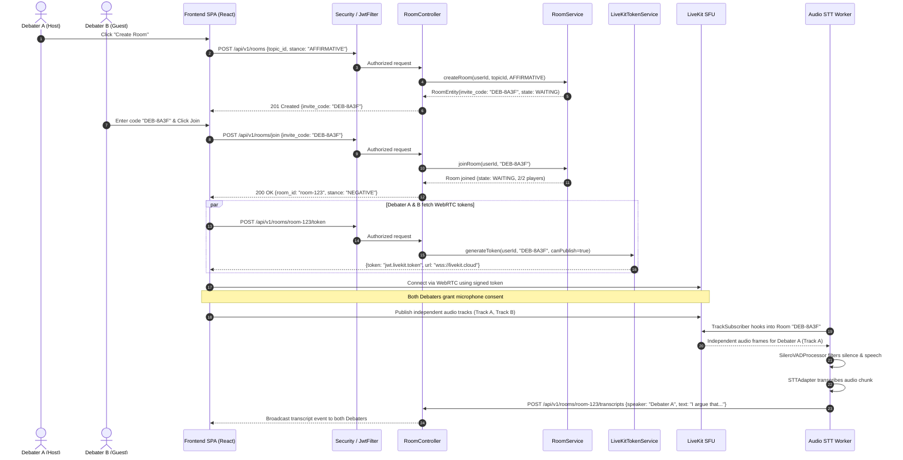

# C4 Architecture Model — Level 3: Backend Component Diagram
*Performed: Nguyễn Anh Khoa (24125058) | Reviewed: Nguyễn Hồng Tấn Tài (24125078) | Edited: Nguyễn Anh Khoa (24125058)*

> **Context:** Project Assignment 4 (PA4-2026) — Part C: Software Architecture: Container & Component Diagrams (20 Points)  
> **Target Container:** Backend API Server (`api/authify/`) & Audio Processing Pipeline Worker (`api/app/`, `workers/`)  
> **Source Code Basis:** Verified against repository state (`api/authify/src/main/java/...`, `api/app/adapters/stt.py`, `docker-compose.yml`)

---

## 1. Overview & Component Scope

The C4 Level 3 Component Diagram zooms directly into the **Backend System Containers** of DebateSpeak AI, detailing their internal structural components, service boundaries, data flows, and interactions.

In strict compliance with the PA4 grading criteria (*"The architecture diagrams must accurately reflect your actual implementation at the time of submission. Any inconsistency between the documented architecture and the source code will result in a grade penalty"*), this specification details the two backend execution units:
1. **Spring Boot API Server Container (`api/authify/`)**: The core transactional service handling identity, JWT security, Room & Debate Session state machines (FG-01, FG-03), and LiveKit access-token provisioning (FG-04).
2. **Audio & STT Pipeline Worker Container (`api/app/adapters/`, `workers/`)**: The asynchronous Python 3.12 service handling WebRTC track audio consumption, Silero VAD segmentation, and streaming Speech-to-Text through the `STTAdapter` protocol (FG-05).

---

## 2. C4 Level 3 Component Diagram (Mermaid)

```mermaid
graph TB
    subgraph ClientAndSFU ["Upstream Callers & Infrastructure"]
        FrontendSPA["Frontend Web Application<br/>[React 18 / LiveKit SDK]"]
        LiveKitSFU["LiveKit SFU<br/>[Real-Time Media Server]"]
        PostgresDB[("PostgreSQL 16 Database<br/>[Relational Storage]")]
        RedisCache[("Redis 7<br/>[Session Cache & Job Queue]")]
        ExternalSTT["External Cloud STT<br/>[Google Cloud Speech / Deepgram]"]
        SMTPRelay["External SMTP Server<br/>[Gmail SMTP Service]"]
    end

    subgraph SpringBootContainer ["Backend API Container (Java 17 / Spring Boot 3) — api/authify/"]
        subgraph SecurityLayer ["Security & Routing Layer"]
            SecConfig["SecurityConfig<br/>[Spring Configuration]<br/>Configures CORS, disables CSRF, enforces stateless sessions & role-based route filters"]
            JwtFilter["JwtAuthenticationFilter<br/>[OncePerRequestFilter]<br/>Extracts Bearer tokens, validates JWT claims, populates SecurityContext"]
            GlobalExHandler["GlobalExceptionHandler<br/>[@RestControllerAdvice]<br/>Transforms ApiException & ValidationException into uniform JSON error payloads"]
        end

        subgraph ControllerLayer ["REST Controller Layer"]
            AuthController["AuthController<br/>[@RestController: /api/v1/auth/*]<br/>Exposes endpoints for register, login, profile, verify email, reset password, delete account"]
            RoomController["RoomController<br/>[@RestController: /api/v1/rooms/*]<br/>Exposes endpoints for create room, join by invite code, player ready, and room status"]
            LiveKitController["LiveKitController<br/>[@RestController: /api/v1/rooms/{id}/token]<br/>Issues cryptographically signed LiveKit room tokens with granular audio permissions"]
        end

        subgraph ServiceLayer ["Domain & Business Service Layer"]
            AuthService["AuthService<br/>[@Service]<br/>Implements authentication flows, Argon2id/BCrypt hashing, account locking & suspension enforcement"]
            JwtService["JwtService<br/>[@Service]<br/>Generates, signs, and parses HMAC-SHA256 access and refresh tokens"]
            EmailService["EmailService<br/>[@Service]<br/>Formats and dispatches verification and recovery emails via JavaMailSender"]
            RoomService["RoomService<br/>[@Service]<br/>Manages room lifecycle state machine (WAITING → READY → IN_DEBATE), room codes, & debater matching"]
            LiveKitTokenService["LiveKitTokenService<br/>[@Service]<br/>Constructs LiveKit AccessTokens, binds participant identity, room name & audio publish grants"]
        end

        subgraph RepositoryLayer ["Data Persistence Layer (Spring Data JPA)"]
            UserRepo["UserRepository<br/>[JpaRepository]<br/>CRUD operations on UserEntity, queries by email/username"]
            SessionRepo["AuthSessionRepository<br/>[JpaRepository]<br/>Persists active refresh token sessions & revocation status"]
            VerifyRepo["VerificationCodeRepository<br/>[JpaRepository]<br/>Persists time-bounded OTP verification codes"]
            SuspendRepo["AccountSuspensionRepository<br/>[JpaRepository]<br/>Tracks administrative suspensions & security actions"]
            RoomRepo["RoomRepository<br/>[JpaRepository]<br/>Persists RoomEntity, invite_codes, player assignments & state"]
        end
    end

    subgraph PythonWorkerContainer ["Audio & Speech Pipeline Worker (Python 3.12) — api/app/, workers/"]
        TrackSubscriber["LiveKitTrackSubscriber<br/>[LiveKit Agents SDK]<br/>Connects as participant, listens to per-speaker audio tracks by participant_identity"]
        VADProcessor["SileroVADProcessor<br/>[PyTorch / ONNX Runtime]<br/>Detects voice activity chunks, isolates pauses, segments raw PCM16 audio"]
        STTProtocol["STTAdapter Protocol<br/>[Protocol Interface: api/app/adapters/stt.py]<br/>Standardized async streaming contract for speech transcription"]
        LocalMockSTT["LocalMockSTTAdapter<br/>[Deterministic Local Fallback]<br/>Replays topic-grounded transcripts with realistic timing for tests and offline fallback"]
        CloudStreamingSTT["CloudStreamingSTTAdapter<br/>[Streaming Cloud Driver]<br/>Bi-directional streaming transcription via external cloud speech API"]
        TranscriptBroadcaster["TranscriptBroadcaster<br/>[HTTP / REST Client]<br/>Transmits final speaker-attributed segments back to Backend API"]
    end

    %% Client and Gateway Calls
    FrontendSPA -->|"HTTPS POST /api/v1/auth/* [Bearer JWT]"| SecConfig
    FrontendSPA -->|"HTTPS POST /api/v1/rooms/* [Bearer JWT]"| SecConfig
    FrontendSPA -->|"HTTPS GET /api/v1/rooms/{id}/token"| SecConfig

    SecConfig --> JwtFilter
    JwtFilter -->|"Delegates validated requests"| ControllerLayer
    ControllerLayer --> GlobalExHandler

    %% Controller to Service
    AuthController -->|"Invokes credentials verification & profile logic"| AuthService
    AuthController -->|"Requests token creation & validation"| JwtService
    RoomController -->|"Invokes room state mutations & member joins"| RoomService
    LiveKitController -->|"Requests signed room media token"| LiveKitTokenService

    %% Service to Service
    AuthService --> JwtService
    AuthService --> EmailService
    RoomService --> LiveKitTokenService

    %% Service to Repository
    AuthService --> UserRepo
    AuthService --> SessionRepo
    AuthService --> VerifyRepo
    AuthService --> SuspendRepo
    RoomService --> RoomRepo
    RoomService --> UserRepo

    %% Repository to Database
    UserRepo -->|"SQL Queries [HikariCP / JDBC]"| PostgresDB
    SessionRepo -->|"SQL Queries [HikariCP / JDBC]"| PostgresDB
    VerifyRepo -->|"SQL Queries [HikariCP / JDBC]"| PostgresDB
    SuspendRepo -->|"SQL Queries [HikariCP / JDBC]"| PostgresDB
    RoomRepo -->|"SQL Queries [HikariCP / JDBC]"| PostgresDB

    %% External Infrastructure
    EmailService -->|"Sends transactional emails [SMTP / TLS 587]"| SMTPRelay
    LiveKitTokenService -->|"Reads API Key & Secret [HMAC-SHA256 Signing]"| LiveKitSFU

    %% Python Worker Connections
    TrackSubscriber -->|"Subscribes to audio tracks by identity [WebRTC Engine]"| LiveKitSFU
    TrackSubscriber -->|"Passes continuous PCM16 chunks"| VADProcessor
    VADProcessor -->|"Passes vocalized audio segments"| STTProtocol
    STTProtocol -.->|"Implements"| LocalMockSTT
    STTProtocol -.->|"Implements"| CloudStreamingSTT
    CloudStreamingSTT -->|"Bi-directional streaming gRPC"| ExternalSTT
    STTProtocol -->|"Emits STTEvent(is_final, speaker, text)"| TranscriptBroadcaster
    TranscriptBroadcaster -->|"POST /api/v1/rooms/{id}/transcripts"| RoomController
```

---

## 3. Spring Boot Backend Component Descriptions

### 3.1. Security & Filter Layer
* **`SecurityConfig`** (`org.debatespeak.authify.config.SecurityConfig`):
  * **Responsibility**: Central Spring Security 6 declaration. Configures strict CORS origins (allowing requests from `FRONTEND_URL`), disables CSRF (safe for stateless Bearer tokens), configures session management to `SessionCreationPolicy.STATELESS`, and enforces path security rules (`/api/v1/auth/**` permitted, `/api/v1/rooms/**` authenticated).
  * **Interactions**: Registers `JwtAuthenticationFilter` before `UsernamePasswordAuthenticationFilter`.
* **`JwtAuthenticationFilter`**:
  * **Responsibility**: Inspects incoming HTTP requests for the `Authorization: Bearer <token>` header. Extracts the JWT, calls `JwtService` to validate signature and expiration, extracts user claims, and sets an authenticated `UsernamePasswordAuthenticationToken` in Spring's `SecurityContextHolder`.
  * **Interactions**: Intercepts requests destined for `AuthController`, `RoomController`, and `LiveKitController`.
* **`GlobalExceptionHandler`** (`org.debatespeak.authify.exception.GlobalExceptionHandler`):
  * **Responsibility**: Centralized controller advice (`@RestControllerAdvice`). Catches custom `ApiException`, validation errors (`ValidationException`), and unexpected runtime exceptions, converting them into structured RFC 7807 problem responses with standard HTTP status codes (`400`, `401`, `403`, `404`, `409`, `500`).
  * **Interactions**: Intercepts exceptions thrown by all REST controllers and services.

### 3.2. REST Controller Layer
* **`AuthController`** (`org.debatespeak.authify.controller.AuthController`):
  * **Responsibility**: Handles user registration, authentication, email verification, password reset, and profile management endpoints (`/api/v1/auth/register`, `/api/v1/auth/login`, `/api/v1/auth/me`, `/api/v1/auth/verify-email`, `/api/v1/auth/reset-password`).
  * **Interactions**: Calls `AuthService` and `JwtService`. Returns standardized DTO responses (`TokenResponse`, `UserResponse`, `ProfileResponse`).
* **`RoomController`** (`org.debatespeak.authify.room.RoomController`):
  * **Responsibility**: Manages room operations: `POST /api/v1/rooms` (create debate room), `POST /api/v1/rooms/join` (join via 8-character invite code), `POST /api/v1/rooms/{id}/ready` (indicate debater readiness), `GET /api/v1/rooms/{id}` (fetch room state).
  * **Interactions**: Invokes `RoomService` for business validation and room state transitions.
* **`LiveKitController`** (`org.debatespeak.authify.livekit.LiveKitController`):
  * **Responsibility**: Exposes `POST /api/v1/rooms/{id}/token` to deliver room-scoped, cryptographically signed WebRTC tokens to authenticated debaters.
  * **Interactions**: Invokes `RoomService` (to verify user membership and room status) and `LiveKitTokenService` (to issue the JWT token).

### 3.3. Service Layer
* **`AuthService`** (`org.debatespeak.authify.service.AuthService`):
  * **Responsibility**: Implements user creation, password verification using password encoders, account lockout and suspension checks, and token revocation.
  * **Interactions**: Reads and writes via `UserRepository`, `AuthSessionRepository`, `VerificationCodeRepository`, and triggers `EmailService`.
* **`JwtService`** (`org.debatespeak.authify.service.JwtService`):
  * **Responsibility**: Encapsulates all JWT operations. Signs access tokens (30-minute validity) and refresh tokens (7-day validity) using HMAC-SHA256 (`APP_JWT_SECRET`). Parses tokens, extracts `userId` and roles, and validates token expiration.
  * **Interactions**: Injected into `AuthService` and `JwtAuthenticationFilter`.
* **`EmailService`** (`org.debatespeak.authify.service.EmailService`):
  * **Responsibility**: Constructs HTML email templates for OTP verification and password reset links. Sends emails asynchronously via Spring's `JavaMailSender` over SMTP TLS (port 587).
  * **Interactions**: Called by `AuthService` during registration and recovery workflows.
* **`RoomService`** (`org.debatespeak.authify.room.RoomService`):
  * **Responsibility**: Implements the deterministic 5-state room lifecycle (`WAITING` $\rightarrow$ `READY` $\rightarrow$ `IN_DEBATE` $\rightarrow$ `CONCLUDED` / `ABANDONED`). Generates collision-resistant 8-character uppercase alphanumeric invite codes, assigns Affirmative/Negative stances, enforces the 2-participant limit (returning HTTP 409 Conflict if a 3rd user attempts to join), and triggers session start when both participants signal ready.
  * **Interactions**: Reads and writes `RoomRepository` and coordinates with `LiveKitTokenService`.
* **`LiveKitTokenService`** (`org.debatespeak.authify.livekit.LiveKitTokenService`):
  * **Responsibility**: Uses the LiveKit Server SDK / JWT claims builder to construct signed LiveKit Access Tokens. Embeds room name (the room's `invite_code`), debater identity (`userId`), participant display name, and video grants (`canPublish: true`, `canSubscribe: true`, `canPublishData: true`). Signs the token using `LIVEKIT_API_SECRET`.
  * **Interactions**: Called by `LiveKitController` and `RoomService`.

### 3.4. Repository Layer
* **`UserRepository`**: Performs Spring Data JPA CRUD queries on `UserEntity` (`findByEmail`, `findByUsername`, `existsByEmail`).
* **`AuthSessionRepository`**: Manages active sessions and refresh tokens in `AuthSessionEntity`.
* **`VerificationCodeRepository`**: Persists time-bounded OTP verification codes in `VerificationCodeEntity`.
* **`AccountSuspensionRepository`**: Tracks administrative suspensions in `AccountSuspensionEntity`.
* **`RoomRepository`**: Manages persistent debate rooms in `RoomEntity` (`findByInviteCode`, `findActiveRoomsByUserId`).

---

## 4. Python Audio & STT Worker Component Descriptions

The Python Worker (`api/app/`, `workers/`) operates as a decoupled micro-service that consumes media streams and produces structured text transcripts:

### 4.1. `LiveKitTrackSubscriber`
* **Responsibility**: Connects to the LiveKit Room as an automated participant using the LiveKit Python Agents SDK. Hooks into `on_track_subscribed` events, specifically selecting independent audio tracks.
* **Deterministic Speaker Attribution Invariant**: Because each audio track is tied directly to a single debater's `participant_identity`, the subscriber maintains separate buffer queues for debater Affirmative and debater Negative. It **never mixes audio channels**, ensuring 100% deterministic speaker attribution without relying on unreliable post-hoc clustering diarization.

### 4.2. `SileroVADProcessor`
* **Responsibility**: Processes 16 kHz mono 16-bit PCM audio frames from the buffer using the Silero Voice Activity Detector (VAD). Suppresses background noise and isolates non-speech pauses (silence > 400ms), segmenting continuous vocalization into discrete utterance chunks for the transcription pipeline.

### 4.3. `STTAdapter` Protocol & Implementations
* **Responsibility**: Defined in `api/app/adapters/stt.py`, specifies a provider-agnostic asynchronous streaming protocol:
  * `STTStream.push_audio(pcm16_bytes)`: Pushes audio frames.
  * `STTStream.close()`: Concludes the stream.
  * Returns an `AsyncIterator[STTEvent]`, yielding structured events containing `text`, `speaker`, `start_time`, `end_time`, `confidence`, and `is_final`.
* **Implementations**:
  1. **`LocalMockSTTAdapter`**: A lightweight local transcription engine that replays ground-truth topic sentences with realistic timing intervals. Used for unit tests, local offline development, and zero-dependency fallbacks.
  2. **`CloudStreamingSTTAdapter`**: Cloud production driver using bi-directional streaming gRPC (Google Cloud Speech-to-Text / Deepgram). Emits real-time partial transcript events and finalized segments.

### 4.4. `TranscriptBroadcaster`
* **Responsibility**: Receives finalized `STTEvent` objects from the adapter and pushes speaker-attributed transcript records via HTTP REST (`POST /api/v1/rooms/{id}/transcripts`) or WebSocket back to the Spring Boot API for persistence and display on the debaters' client UIs.

---

## 5. Component Interaction Flow: Room Creation to Live Audio STT

---

## 6. Architectural Invariant Conformance Matrix

| Invariant | System Component | Enforcement Mechanism |
|---|---|---|
| **Zero Hardcoded Paths (AGENTS.md §1)** | All Backend Components | Database credentials, JWT secrets, and LiveKit endpoints are loaded via Spring `@Value("${ENV_VAR}")` and Python `os.getenv()`. |
| **Clean Architecture & No Stubs (AGENTS.md §5)** | `RoomService`, `STTAdapter` | Pure state machine with deterministic transitions and fully tested `LocalMockSTTAdapter` with zero placeholder stubs. |
| **Deterministic Speaker Attribution (AGENTS.md §4.3)** | `LiveKitTrackSubscriber` | Transcripts are attributed strictly via WebRTC track metadata (`participant_identity`), never by multi-speaker audio separation. |
| **Provider-Agnostic STT Adapter (AGENTS.md §4.4)** | `STTProtocol` (`api/app/adapters/stt.py`) | Cloud providers and local mocks share the exact same `STTStream` async generator interface. |
| **Dual-Consent Safety (AGENTS.md §7.3)** | `RoomController`, `LiveKitController` | Audio tokens and track publications remain inactive until both debaters signal `READY` in the lobby. |
