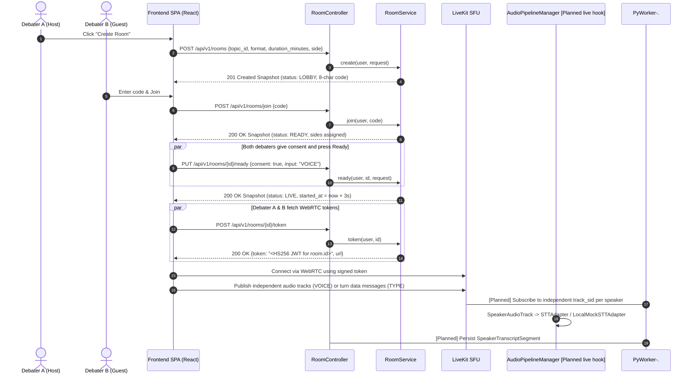

# C4 Architecture Model — Level 3: Backend Component Diagram
*Performed: Nguyễn Anh Khoa (24125058) | Reviewed: Nguyễn Hồng Tấn Tài (24125078) | Edited: Nguyễn Anh Khoa (24125058), Nguyễn Đình Thiên Lộc (24125093)*

> **Context:** Project Assignment 4 (PA4-2026) — Part C: Software Architecture: Container & Component Diagrams (20 Points)  
> **Target Container:** Backend API Server (`api/authify/`) & Audio Processing Pipeline Worker (`api/app/`, `workers/`)  
> **Source Code Basis:** Verified against repository state (`api/authify/src/main/java/...`, `api/app/adapters/stt.py`, `workers/audio_pipeline.py`, `docker-compose.yml`)

---

## 1. Overview & Component Scope

The C4 Level 3 Component Diagram zooms directly into the **Backend System Containers** of DebateSpeak AI, detailing their internal structural components, service boundaries, data flows, and interactions.

In strict compliance with the PA4 grading criteria (*"The architecture diagrams must accurately reflect your actual implementation at the time of submission"*), this specification distinguishes **currently implemented components** on `pa4` from **`[Planned]`** components not yet wired in runtime code:
1. **Spring Boot API Server Container (`api/authify/`)**: Handles identity & JWT auth (FG-01), Room & Debate Session state machine (FG-03), typed debate turns, and LiveKit HS256 token minting (FG-04).
2. **Audio & STT Pipeline Worker (`api/app/adapters/`, `workers/`)**: Python 3.12 modules implementing per-speaker track isolation (`AudioPipelineManager`, `SpeakerAudioTrack`) and provider-agnostic `STTAdapter` streaming with deterministic `LocalMockSTTAdapter` failover. Live LiveKit track subscription, Silero VAD, and Cloud STT streaming are marked `[Planned]`.

---

## 2. C4 Level 3 Component Diagram (Mermaid)

```mermaid
graph TB
    subgraph ClientAndInfra ["Upstream Callers & Infrastructure"]
        FrontendSPA["Frontend Web Application<br/>[React 18 / LiveKit Client SDK]"]
        LiveKitSFU["LiveKit SFU<br/>[Real-Time Media Server]"]
        PostgresDB[("PostgreSQL 16 Database<br/>[Relational Storage]")]
        RedisCache[("Redis 7<br/>[Provisioned Queue/Cache, Planned wiring]")]
        ExternalSTT["External Cloud STT<br/>[Planned: Google Cloud / Deepgram]"]
        SMTPRelay["External SMTP Server<br/>[Gmail SMTP Service]"]
    end

    subgraph SpringBootContainer ["Backend API Container (Java 17 / Spring Boot 4) — api/authify/"]
        subgraph SecurityLayer ["Security & Exception Handling"]
            SecConfig["SecurityConfig<br/>[config.SecurityConfig]<br/>CORS (GET/POST/PUT/PATCH/DELETE), stateless sessions, BCrypt PasswordEncoder"]
            GlobalExHandler["GlobalExceptionHandler<br/>[exception.GlobalExceptionHandler]<br/>Maps ApiException & ValidationException to uniform JSON errors"]
        end

        subgraph ControllerLayer ["REST Controller Layer (controller/)"]
            AuthController["AuthController<br/>[@RestController: /api/v1/auth/*]<br/>Register, login, refresh, profile, verify email, reset password, delete account"]
            RoomController["RoomController<br/>[@RestController: /api/v1/topics, /rooms/*]<br/>Topics, create, lookup, join, get, cancel, leave, ready/unready, end, token, turns"]
        end

        subgraph ServiceLayer ["Domain & Business Service Layer (service/)"]
            AuthService["AuthService<br/>[@Service]<br/>User auth, requireCurrentUser Bearer check, session rotation, lockouts"]
            JwtService["JwtService<br/>[@Service]<br/>HMAC-SHA256 JWT signing & parsing (15-min default ACCESS_TOKEN_EXPIRE_SECONDS)"]
            EmailService["EmailService<br/>[@Service]<br/>Sends verification & recovery codes via JavaMailSender"]
            RoomService["RoomService<br/>[@Service]<br/>Room lifecycle (LOBBY -> READY -> LIVE -> ENDED/CANCELLED), turns, LiveKit HS256 tokens"]
        end

        subgraph RepositoryLayer ["Data Persistence Layer (Spring Data JPA — repository/)"]
            AuthRepos["Auth Repositories<br/>UserRepository, AuthSessionRepository,<br/>VerificationCodeRepository, AccountSuspensionRepository"]
            RoomRepos["Room Repositories<br/>RoomRepository, RoomParticipantRepository, TopicRepository,<br/>DebateSessionRepository, TranscriptSegmentRepository"]
        end
    end

    subgraph PythonWorkerContainer ["Audio & Speech Pipeline Worker (Python 3.12) — api/app/, workers/"]
        PipelineMgr["AudioPipelineManager & SpeakerAudioTrack<br/>[workers/audio_pipeline.py]<br/>Isolated per-track sessions keyed by track_sid & speaker_id, automatic fallback"]
        STTProtocol["STTAdapter Protocol<br/>[api/app/adapters/stt.py]<br/>Async streaming contract (open_stream, send_audio, events, close)"]
        LocalMockSTT["LocalMockSTTAdapter<br/>[api/app/adapters/stt.py]<br/>Deterministic local fallback emitting timed word/segment STTEvents"]
        PlannedWorker["Planned Live Audio Modules<br/>[Planned: LiveKitTrackSubscriber, SileroVADProcessor,<br/>CloudStreamingSTTAdapter, TranscriptBroadcaster]"]
    end

    %% Client to API
    FrontendSPA -->|"HTTPS /api/v1/auth/* [Bearer / Cookie]"| SecConfig
    FrontendSPA -->|"HTTPS /api/v1/rooms/* & /turns [Bearer JWT]"| SecConfig
    FrontendSPA -->|"HTTPS POST /api/v1/rooms/{id}/token [Bearer JWT]"| SecConfig

    SecConfig --> ControllerLayer
    ControllerLayer --> GlobalExHandler

    %% Controller to Service
    AuthController --> AuthService
    RoomController -->|"Authenticates caller via requireCurrentUser"| AuthService
    RoomController -->|"Delegates room, turn & LiveKit token calls"| RoomService

    %% Service to Service & Repo
    AuthService --> JwtService
    AuthService --> EmailService
    AuthService --> AuthRepos
    RoomService --> RoomRepos
    RoomService --> AuthRepos

    %% Repository to Database
    AuthRepos -->|"SQL / JDBC :5432"| PostgresDB
    RoomRepos -->|"SQL / JDBC :5432"| PostgresDB

    %% External Infrastructure
    EmailService -->|"SMTP / TLS :587"| SMTPRelay
    RoomService -->|"Signs 5-min LiveKit JWT with LIVEKIT_API_SECRET"| LiveKitSFU

    %% Python Worker Connections
    PipelineMgr -->|"Streams PCM16 via STTAdapter"| STTProtocol
    STTProtocol -.->|"Implements"| LocalMockSTT
    PlannedWorker -.->|"Subscribes WebRTC tracks [Planned]"| LiveKitSFU
    PlannedWorker -.->|"Consumes queue [Planned]"| RedisCache
    PlannedWorker -.->|"Streams cloud STT [Planned]"| ExternalSTT
    PlannedWorker -.->|"Feeds AudioPipelineManager [Planned]"| PipelineMgr
    PlannedWorker -.->|"Posts transcripts [Planned]"| RoomController
```

---

## 3. Spring Boot Backend Component Descriptions

### 3.1. Security & Exception Handling
* **`SecurityConfig`** (`org.debatespeak.authify.config.SecurityConfig`):
  * **Responsibility**: Configures CORS for `FRONTEND_URL` (methods `GET`, `POST`, `PUT`, `PATCH`, `DELETE`, `OPTIONS`; headers `Content-Type`, `Authorization`, `X-DebateSpeak-Client`, `Accept`; `allowCredentials = true`), disables CSRF for stateless REST, sets `SessionCreationPolicy.STATELESS`, and exposes `BCryptPasswordEncoder`.
  * **Request Auth Pattern**: Rather than a separate `OncePerRequestFilter`, controllers pass the `Authorization` header to `AuthService.requireCurrentUser(header)`, which validates the Bearer JWT via `JwtService` (`[Planned]`: extracting a dedicated `JwtAuthenticationFilter`).
* **`GlobalExceptionHandler`** (`org.debatespeak.authify.exception.GlobalExceptionHandler`):
  * **Responsibility**: `@RestControllerAdvice` mapping `ApiException` and `ValidationException` into uniform JSON error payloads (`400`, `401`, `403`, `404`, `409`, `422`, `500`, `503`).

### 3.2. REST Controller Layer (`org.debatespeak.authify.controller`)
* **`AuthController`**: Handles `/api/v1/auth/*` (register, login, refresh, logout, profile, email verification, password reset, admin moderation, delete account).
* **`RoomController`**: Exposes all FG-03 and FG-04 REST endpoints under `/api/v1`:
  * `GET /topics`, `POST /rooms`, `POST /rooms/lookup`, `POST /rooms/join`, `GET /rooms/{id}`
  * `POST /rooms/{id}/cancel`, `POST /rooms/{id}/leave`, `PUT /rooms/{id}/ready`, `DELETE /rooms/{id}/ready`, `POST /rooms/{id}/end`
  * `POST /rooms/{id}/token` (LiveKit token endpoint — `LiveKitController` is `[Planned]` if split out later)
  * `POST /rooms/{id}/turns`, `GET /rooms/{id}/turns?after={seq}` (typed debate turns)

### 3.3. Service Layer (`org.debatespeak.authify.service`)
* **`AuthService`**: Implements user registration, BCrypt verification, account lockout/suspension checks, refresh session rotation, and `requireCurrentUser(header)`.
* **`JwtService`**: Signs and parses HMAC-SHA256 access tokens (`JWT_SECRET`, default `ACCESS_TOKEN_EXPIRE_SECONDS=900`, i.e., 15 minutes; `application.properties` also defines `app.jwt.expiration-seconds=3600`).
* **`EmailService`**: Dispatches verification and recovery OTP emails via `JavaMailSender` (SMTP TLS port `587`).
* **`RoomService`**: Implements the room lifecycle (`LOBBY` -> `READY` -> `LIVE` -> `ENDED` / `CANCELLED`), collision-resistant 8-character invite codes, row-locked `join`/`ready` transitions, `TIMED_TURNS` (390 s) vs. `FREE_FLOW` durations, lazy `EXPIRED`/`TIMER` enforcement, `TYPED` turn persistence, and LiveKit HS256 JWT minting in `token()` / `liveKitToken()` (5-minute TTL, room name = `room.getId()`, `canPublish` enabled only for `VOICE` participants, serialized via Jackson `ObjectMapper`). Dedicated `LiveKitTokenService` extraction is `[Planned]`.

### 3.4. Repository Layer (`org.debatespeak.authify.repository`)
* **Auth Repositories**: `UserRepository`, `AuthSessionRepository`, `VerificationCodeRepository`, `AccountSuspensionRepository`.
* **Room & Debate Repositories**: `RoomRepository` (with pessimistic write locks `findLockedById`, `findLockedByCode`), `RoomParticipantRepository`, `TopicRepository`, `DebateSessionRepository`, `TranscriptSegmentRepository`.

---

## 4. Python Audio & STT Worker Component Descriptions

The Python worker modules (`api/app/adapters/`, `workers/`) are unit-tested and provide deterministic speaker isolation:

### 4.1. `AudioPipelineManager` & `SpeakerAudioTrack` (`workers/audio_pipeline.py`)
* **Implemented Responsibility**: Maintains an isolated `SpeakerAudioTrack` per `track_sid` (`AFFIRMATIVE`, `NEGATIVE`, `MODERATOR`) and emits Pydantic-validated `SpeakerTranscriptSegment` events bound strictly to `(room_id, speaker_id, speaker_stance, track_sid)`.
* **Failover**: Automatically fails over to `LocalMockSTTAdapter` when the primary `STTAdapter` raises an exception in `_ensure_stream()` or `push_audio()`.

### 4.2. `STTAdapter` Protocol & `LocalMockSTTAdapter` (`api/app/adapters/stt.py`)
* **Implemented Responsibility**: Provider-agnostic async protocol (`open_stream(language, hints) -> STTStream` with `send_audio(pcm16_bytes)`, `events() -> AsyncIterator[STTEvent]`, and `close()`). `LocalMockSTTAdapter` replays deterministic word-timed transcripts for offline tests and fallback.

### 4.3. Planned Live Wiring (`[Planned]`)
* **`LiveKitTrackSubscriber`**, **`SileroVADProcessor`**, **`CloudStreamingSTTAdapter`**, and **`TranscriptBroadcaster`**: Planned for live server-side WebRTC audio ingestion and automatic speech transcript posting (`POST /api/v1/rooms/{id}/transcripts`).

---

## 5. Component Interaction Flow: Room Creation to Live Audio

---

## 6. Architectural Invariant Conformance Matrix

| Invariant | System Component | Enforcement Mechanism |
|---|---|---|
| **Zero Hardcoded Paths (`AGENTS.md` §1)** | All Backend Components | Secrets and endpoints loaded via Spring `@Value` and Python relative `Path(__file__).resolve()` / env vars. |
| **Clean Architecture & No Stubs (`AGENTS.md` §5)** | `RoomService`, `STTAdapter` | Transactional Spring services, tested `LocalMockSTTAdapter`, and strict Pydantic models. |
| **Deterministic Speaker Attribution (`AGENTS.md` §4.3)** | `SpeakerAudioTrack` | Segments bound strictly to `speaker_id` and `track_sid`; tracks are never mixed. |
| **Provider-Agnostic STT Adapter (`AGENTS.md` §4.4)** | `STTAdapter` (`api/app/adapters/stt.py`) | Cloud and local fallback adapters implement the same `STTStream` async interface. |
| **Dual-Consent Safety (`AGENTS.md` §7.3)** | `RoomController`, `RoomService` | `PUT /rooms/{id}/ready` requires `consent: true`; `/token` rejects (`409`) until status is `LIVE`; `canPublish` is `false` for `TYPE`. |
