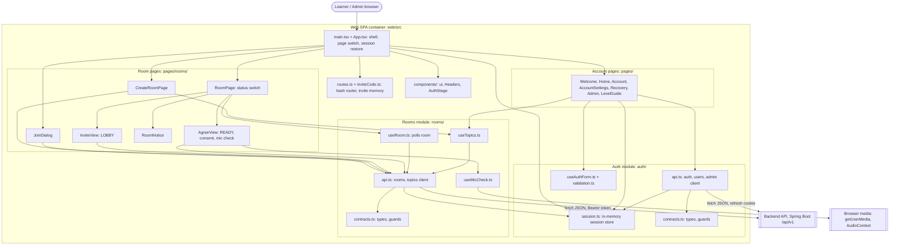
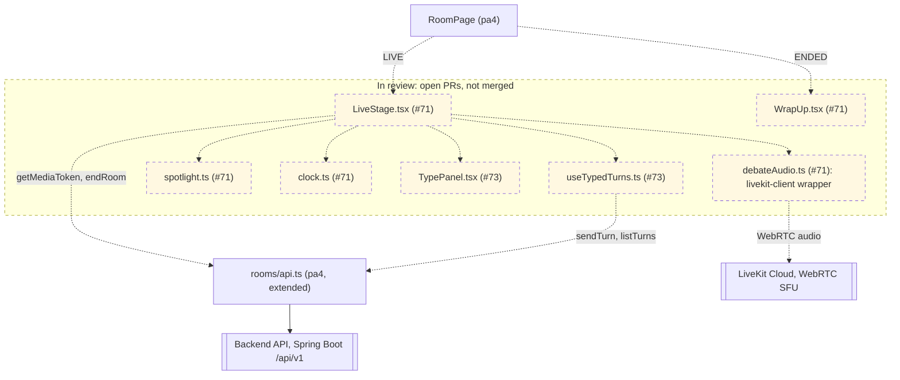

# C4 Level 3: Frontend Components
*Performed: Nguyễn Bảo Minh Triết (24125047) | Reviewed: Nguyễn Anh Khoa (24125058) | Edited: Nguyễn Đình Thiên Lộc (24125093)*

Jira: SCRUM-58. Container: the DebateSpeak web SPA (Vite + React TypeScript + Tailwind), under `web/src/`.

The diagrams reflect the merged `pa4` codebase across PR #70 (FG-03 room setup and lobby), PR #71 (FG-04 LiveKit live stage), PR #73 (typed debate turns and local mock API), and PR #82 (demo room-flow fixes). Diagram 1 covers the core FG-01/FG-03 shell and Diagram 2 covers the live-stage audio and typed-turn additions.

## Diagram 1: components on pa4

## Diagram 2: in review (PR #71 / #73), not on pa4

Solid arrows exist on `pa4`. Dashed nodes and arrows exist only in PR #71 or #73.

## Components on pa4

| Component | File | Responsibility |
|---|---|---|
| React root | `web/src/main.tsx` | Mounts `App` in `StrictMode`. |
| App shell | `web/src/App.tsx` | Picks the page for the current path, wraps protected pages in `RequireSession`, restores the session once on load, handles sign-in, sign-out and invite return. |
| Router | `web/src/routes.ts` | Hash router (`useRoute`), static route list, dynamic `/rooms/:id` and `/join/:code`, keeps a pending invite in memory only. |
| Invite code | `web/src/inviteCode.ts` | Normalises and validates invite codes. |
| UI kit | `web/src/components/ui.tsx` | Shared controls: `ActionLink`, `Field`, `Choices`, `Note`, `PageHeading`, `StepIndicator`. |
| Headers | `web/src/components/Headers.tsx` | `AppBar` (signed-in shell) and `StageBar`. |
| Auth stage | `web/src/components/AuthStage.tsx` | Layout for auth screens; `Podium` card. |
| Account pages | `web/src/pages/AccountPages.tsx` | Sign in, register, profile edit. |
| Settings pages | `web/src/pages/AccountSettingsPages.tsx` | `RequireSession` guard, active sessions, delete account. |
| Recovery page | `web/src/pages/RecoveryPage.tsx` | Forgot password, reset password, verify email. |
| Admin page | `web/src/pages/AdminPage.tsx` | Find a user, suspend or restore. |
| Welcome / Home | `web/src/pages/WelcomePage.tsx`, `web/src/pages/HomePage.tsx` | Landing page; signed-in home with topics and invite-code entry. |
| Level guide | `web/src/pages/LevelGuide.tsx` | CEFR self-assessment dialog used at registration. |
| Create room | `web/src/pages/rooms/CreateRoomPage.tsx` | Topic, side and format form; calls `createRoom`. |
| Join dialog | `web/src/pages/rooms/JoinDialog.tsx` | Looks up an invite code, then joins. |
| Room page | `web/src/pages/rooms/RoomPage.tsx` | Switches view on room status; on pa4 handles LOBBY, READY and CANCELLED. |
| Invite view | `web/src/pages/rooms/InviteView.tsx` | LOBBY: shows the code, lets the host cancel. |
| Agree view | `web/src/pages/rooms/AgreeView.tsx` | READY: dual consent, input mode, mic check, leave. |
| Room notice | `web/src/pages/rooms/RoomNotice.tsx` | Closed, left or unavailable messages. |
| Session store | `web/src/auth/session.ts` | Module-level store read through `useSyncExternalStore` (`useSession`); access token in memory only, expiry timer. |
| Auth API client | `web/src/auth/api.ts` | `fetch` to `/auth/*`, `/users/me`, `/admin/users`; base URL from `VITE_API_BASE_URL`; refresh token via HttpOnly cookie. |
| Auth form hook | `web/src/auth/useAuthForm.ts` | Submit state, abort and field errors for auth forms. |
| Auth validation | `web/src/auth/validation.ts` | Client-side field checks. |
| Auth contracts | `web/src/auth/contracts.ts` | Request/response types and runtime type guards. |
| useRoom | `web/src/rooms/useRoom.ts` | Polls `GET /rooms/:id` (2 s in LOBBY/READY, 5 s in LIVE, stops when ENDED/CANCELLED). |
| useTopics | `web/src/rooms/useTopics.ts` | Loads the topic list. |
| useMicCheck | `web/src/rooms/useMicCheck.ts` | Local mic test with `getUserMedia` and an `AnalyserNode`; no audio leaves the browser. |
| Rooms API client | `web/src/rooms/api.ts` | `fetch` to `/topics`, `/rooms`, `/rooms/lookup`, `/rooms/join`, `/rooms/:id/{cancel,leave,ready}`. |
| Rooms contracts | `web/src/rooms/contracts.ts` | Room, participant, topic types and guards. |

## Components in review

| Component | File | PR | Responsibility |
|---|---|---|---|
| Live stage | `web/src/pages/rooms/LiveStage.tsx` | #71 | LIVE view: countdown, clock, spotlight, mute, end debate. |
| Wrap-up | `web/src/pages/rooms/WrapUp.tsx` | #71 | ENDED view. |
| Debate audio | `web/src/rooms/debateAudio.ts` | #71 | Wraps `livekit-client`, loaded on demand; emits speaker events to the stage. |
| Spotlight | `web/src/rooms/spotlight.ts` | #71 | Pure state machine for who is highlighted. |
| Clock | `web/src/rooms/clock.ts` | #71 | Pure timing: server offset, phases (390 s timed turns). |
| Rooms API additions | `web/src/rooms/api.ts` | #71, #73 | `getMediaToken` (`/rooms/:id/token`), `endRoom`; #73 adds `sendTurn`, `listTurns`. |
| Type panel | `web/src/pages/rooms/TypePanel.tsx` | #73 | Typed-turn composer and list. |
| useTypedTurns | `web/src/rooms/useTypedTurns.ts` | #73 | Polls and sends typed turns. |

## Notes and gaps

- There is no React auth context. The session is a module-level external store (`auth/session.ts`), read with `useSession()`. The diagram shows it as such.
- No React Router: routing is a hash router in `routes.ts`.
- On pa4, a room in LIVE or ENDED only shows the motion as a heading; there is no live view or audio until #71 merges.
- `livekit-client` is already in `web/package.json` on pa4, but no pa4 source imports it.
- PR #73 is stacked on #71 (it carries the same LiveStage, clock, spotlight and debateAudio files) and also adds a local mock API under `web/mock-local/`, which is dev-only and not drawn.
- Room state is pulled by polling, not pushed. Live updates over WebSocket are not in the frontend yet.
