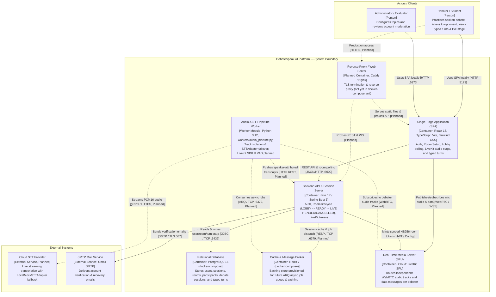

# C4 Architecture Model — Level 2: Container Diagram
*Performed: Nguyễn Anh Khoa (24125058) | Reviewed: Nguyễn Hồng Tấn Tài (24125078) | Edited: Nguyễn Anh Khoa (24125058), Nguyễn Đình Thiên Lộc (24125093)*

> **Context:** Project Assignment 4 (PA4-2026) — Part C: Software Architecture (20 Points)  
> **Target System:** DebateSpeak AI Platform  
> **Source Code Basis:** Verified against repository state (`web/`, `api/authify/`, `workers/`, `api/app/`, `docker-compose.yml`)

---

## 1. System Overview & Container Scope

The C4 Level 2 Container Diagram zooms into the **DebateSpeak AI System boundary**, decomposing it into its high-level runtime containers: deployable/runnable units executing code or storing data.

In strict adherence to the project invariants defined in `AGENTS.md` and the rubric warning (*"The architecture diagrams must accurately reflect your actual implementation at the time of submission"*), this model distinguishes **currently active containers and links** on `pa4` from **`[Planned]`** containers and links not yet present in `docker-compose.yml` or source code.

---

## 2. C4 Level 2 Container Diagram (Mermaid)

---

## 3. Container Technical Specifications

Each container in the system provides distinct, decoupled responsibilities and communicates across standardized protocols:

| # | Container Name | Status | Technology / Framework | Primary Responsibilities | Data Handled & Storage |
|---|---|---|---|---|---|
| **C1** | **Reverse Proxy** | `[Planned]` | Caddy / Nginx | Gateway routing, SSL/TLS termination, reverse proxying frontend routes and backend endpoints. Not yet defined in `docker-compose.yml`. | Stateless network routing |
| **C2** | **Frontend Web Application** | Active | React 18, TypeScript, Vite, Tailwind CSS, `livekit-client` | Browser SPA (`web/`). Renders Auth screens, Room Setup, Lobby/Ready polling, LiveKit audio stage, and typed-turn panel. | In-memory JWT access tokens, UI state |
| **C3** | **Backend API Server** | Active | Java 17, Spring Boot 3, Spring Security, Spring Data JPA | Central REST API (`api/authify/`, port `8000`): JWT auth, password hashing, Room state machine (`LOBBY` -> `READY` -> `LIVE` -> `ENDED` / `CANCELLED`), typed turns, and LiveKit HS256 token minting. | Users, auth sessions, rooms, participants, turns |
| **C4** | **Relational Database** | Active | PostgreSQL 16 (`debatespeak-db`) | Primary durable store in `docker-compose.yml` (port `5432`). Persists `users`, `topics`, `rooms`, `room_participants`, `debate_sessions`, and `transcript_segments`. | Persistent volume (`debatespeak_postgres_data`) |
| **C5** | **Cache & Queue Broker** | Provisioned | Redis 7 (`debatespeak-redis`) | Running in `docker-compose.yml` (port `6379`) to support future ARQ task queues and session caching; `api/authify/` does not yet connect to Redis. | Persistent volume (`debatespeak_redis_data`) |
| **C6** | **Real-Time Media Server (SFU)** | Active | LiveKit SFU (`debatespeak-livekit` or LiveKit Cloud) | Routes independent WebRTC audio tracks and LiveKit data messages (`turn` topic) between debaters. | Ephemeral WebRTC media streams |
| **C7** | **Audio & STT Pipeline Worker** | Partial | Python 3.12 (`workers/`, `STTAdapter`) | Track isolation (`AudioPipelineManager`) and `LocalMockSTTAdapter` failover (unit-tested); LiveKit Agents SDK subscriber, Silero VAD, and Cloud STT transport are `[Planned]`. | In-memory PCM16 frames, transcript segments |

---

## 4. Container Communication Protocols & Interfaces

### 4.1. Client to Platform Communication
1. **Frontend `<->` Backend API (`HTTP / HTTPS REST`)**:
   - **Protocol**: HTTP/1.1 JSON on `:8000` (direct in local dev; behind `[Planned]` Caddy TLS proxy in production).
   - **Authentication**: `Authorization: Bearer <jwt_access_token>`, `credentials: include` (HttpOnly refresh cookie), and `X-DebateSpeak-Client: web`.
   - **Endpoints**: `/api/v1/auth/*`, `/api/v1/topics`, `/api/v1/rooms/*`, `/api/v1/rooms/{id}/token`, `/api/v1/rooms/{id}/turns`.
   - **State Synchronization**: Frontend polls `GET /api/v1/rooms/{id}` every 2 s pre-debate and every 5 s during `LIVE`. Server-pushed `WebSocket / WSS` room events are `[Planned]`.
2. **Frontend `<->` LiveKit SFU (`WebRTC`)**:
   - **Signalling**: `ws://localhost:7880` (local Docker `--dev`) or `wss://*.livekit.cloud` (cloud).
   - **Media & Data Transport**: SRTP over UDP (`7882/udp`) with TCP fallback (`7881/tcp`), plus LiveKit data messages on topic `turn` to trigger immediate partner turn fetches.
   - **Security**: Ephemeral 5-minute HS256 JWT minted by `RoomService.token()` with `canPublish` enabled only when the participant's `input` is `VOICE`.

### 4.2. Internal Server-Side Communication
1. **Backend API `<->` PostgreSQL Database (`TCP / JDBC`)**:
   - **Protocol**: PostgreSQL Wire Protocol over TCP port `5432` (HikariCP + Spring Data JPA).
2. **Backend API / Worker `<->` Redis 7 (`TCP / RESP`, `[Planned]` application wiring)**:
   - **Protocol**: RESP over TCP port `6379` (Spring Data Redis / Python ARQ).
3. **Audio Worker `<->` LiveKit SFU & Cloud STT (`[Planned]` live wiring)**:
   - **Design**: Independent track subscription per `participant_identity` piped into `STTAdapter` (`api/app/adapters/stt.py`) with automatic fallback to `LocalMockSTTAdapter` (`workers/audio_pipeline.py`).
4. **Backend API `->` SMTP Mail Service (`SMTP / TLS`)**:
   - **Protocol**: Spring `JavaMailSender` over SMTP port `587` (`STARTTLS`).

---

## 5. Architectural Invariant Compliance Check

* **Zero Hardcoded Paths (`AGENTS.md` §1)**: Containers and workers resolve endpoints and secrets dynamically via environment variables (`DATABASE_URL`, `REDIS_URL`, `APP_JWT_SECRET`, `LIVEKIT_URL`, `LIVEKIT_API_KEY`, `LIVEKIT_API_SECRET`).
* **Deterministic Speaker Attribution (`AGENTS.md` §4.3)**: Realized through independent WebRTC tracks per participant in LiveKit SFU (`C6`) and `SpeakerAudioTrack` binding by `speaker_id` / `track_sid` in `workers/audio_pipeline.py` (`C7`).
* **Provider-Agnostic STT Adapter (`AGENTS.md` §4.4)**: Realized via `STTAdapter` (`api/app/adapters/stt.py`) and failover logic in `SpeakerAudioTrack`.
* **Dual-Consent Enforcement (`AGENTS.md` §7.3)**: LiveKit tokens are rejected (`409 room_not_live`) until both participants submit `PUT /api/v1/rooms/{id}/ready` with `consent: true`, and `canPublish` is `false` for `TYPE` participants.
