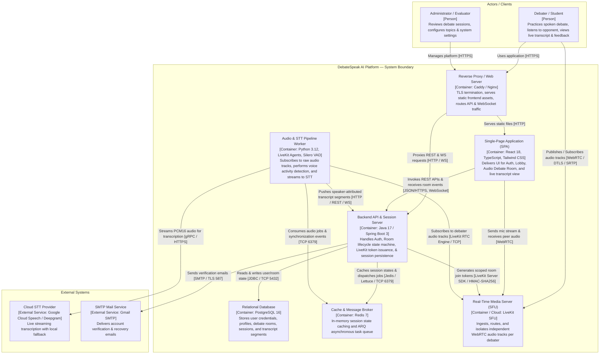

# C4 Architecture Model — Level 2: Container Diagram
*Performed: Nguyễn Anh Khoa (24125058) | Reviewed: Nguyễn Hồng Tấn Tài (24125078) | Edited: Nguyễn Anh Khoa (24125058)*

> **Context:** Project Assignment 4 (PA4-2026) — Part C: Software Architecture (20 Points)  
> **Target System:** DebateSpeak AI Platform  
> **Source Code Basis:** Verified against repository state (`web/`, `api/authify/`, `workers/`, `docker-compose.yml`)

---

## 1. System Overview & Container Scope

The C4 Level 2 Container Diagram zooms into the **DebateSpeak AI System boundary**, decomposing it into its high-level runtime containers: deployable/runnable units executing code or storing data. 

In strict adherence to the project invariants defined in `AGENTS.md` and the rubric warning (*"The architecture diagrams must accurately reflect your actual implementation at the time of submission"*), this model describes the **concrete operational containers** active in the project rather than speculative future services.

---

## 2. C4 Level 2 Container Diagram (Mermaid)

---

## 3. Container Technical Specifications

Each container in the system provides distinct, decoupled responsibilities and communicates across standardized protocols:

| # | Container Name | Technology / Framework | Primary Responsibilities | Data Handled & Storage |
|---|---|---|---|---|
| **C1** | **Reverse Proxy** | Caddy / Nginx | Gateway routing, SSL/TLS termination, reverse proxying frontend routes and backend REST/WS endpoints. | Stateless network routing |
| **C2** | **Frontend Web Application** | React 18, TypeScript, Vite, Tailwind CSS, LiveKit Client SDK | Single-Page Application (SPA) executed in the user's browser. Renders Auth screens, Room Setup, Lobby state synchronizer, and Debate Stage with WebRTC audio controls and active speaker indication. | Local client memory, JWT access tokens in memory |
| **C3** | **Backend API Server** | Java 17, Spring Boot 3, Spring Security, Spring Data JPA | Central business logic server: JWT token generation/validation, password hashing (Argon2id/BCrypt), Room state machine (`WAITING` $\rightarrow$ `READY` $\rightarrow$ `IN_DEBATE`), LiveKit room token signing. | Session data, Room state, Transactional business logic |
| **C4** | **Relational Database** | PostgreSQL 16 | Primary durable data store. Enforces relational integrity across users, profiles, debate rooms, and speech transcripts. | Persistent on disk (`debatespeak` database) |
| **C5** | **Cache & Queue Broker** | Redis 7 | In-memory key-value cache for low-latency session validation and message broker for the asynchronous audio pipeline queue (ARQ). | In-memory with optional RDB snapshots |
| **C6** | **Real-Time Media Server (SFU)** | LiveKit SFU (Cloud or local container) | Selective Forwarding Unit for low-latency real-time audio routing. Enforces independent audio tracks per participant for deterministic speaker attribution. | Ephemeral WebRTC audio streams (no disk persistence) |
| **C7** | **Audio & STT Pipeline Worker** | Python 3.12, LiveKit Agents SDK, Silero VAD, `STTAdapter` | Headless worker joining the LiveKit room. Subscribes to debater audio tracks, filters non-speech using Silero VAD, streams chunks to `STTAdapter`, and produces speaker-labeled segments. | In-memory PCM audio frames, structured transcript events |

---

## 4. Container Communication Protocols & Interfaces

To maintain strict boundaries between containers, communication relies on industry-standard protocols:

### 4.1. Client to Platform Communication
1. **Frontend $\leftrightarrow$ Reverse Proxy $\leftrightarrow$ Backend API (`HTTPS / REST`)**:
   - **Protocol**: HTTP/1.1 and HTTP/2 over TLS.
   - **Payload**: JSON format.
   - **Authentication**: `Authorization: Bearer <jwt_access_token>`.
   - **Endpoints**: `/api/v1/auth/*`, `/api/v1/rooms/*`, `/api/v1/rooms/{id}/token`.
2. **Frontend $\leftrightarrow$ Backend API (`WebSocket / WSS`)**:
   - **Protocol**: RFC 6455 WebSocket.
   - **Purpose**: Real-time room state notifications (e.g. peer joined, peer marked `READY`, debate countdown start) without polling.
3. **Frontend $\leftrightarrow$ LiveKit SFU (`WebRTC`)**:
   - **Signalling**: WebSocket over HTTPS (`wss://...`).
   - **Media Transport**: SRTP over UDP with ICE/STUN/TURN fallback.
   - **Security**: Ephemeral JWT signed by the Backend API containing explicit room permissions (publish audio = true, publish video = false).

### 4.2. Internal Server-Side Communication
1. **Backend API $\leftrightarrow$ PostgreSQL Database (`TCP / JDBC`)**:
   - **Protocol**: PostgreSQL Wire Protocol over TCP port 5432.
   - **Driver**: HikariCP connection pool with PostgreSQL JDBC Driver.
2. **Backend API $\leftrightarrow$ Redis 7 (`TCP / RESP`)**:
   - **Protocol**: REdis Serialization Protocol (RESP3) over TCP port 6379.
   - **Client**: Spring Data Redis (Lettuce driver).
3. **Audio Worker $\leftrightarrow$ LiveKit SFU (`WebRTC / RTC Engine`)**:
   - **Protocol**: Server-side WebRTC track subscription using LiveKit Python Agents SDK.
   - **Deterministic Attribution**: The worker hooks into track subscriptions by `participant_identity`, guaranteeing that audio frames from debater A are never conflated with debater B.
4. **Audio Worker $\leftrightarrow$ External Cloud STT / Local Fallback (`gRPC / Local Pipe`)**:
   - **Protocol**: Bi-directional streaming gRPC (Google Cloud Speech / Deepgram) or local asynchronous mock stream (`LocalMockSTTAdapter`).
   - **Design**: Strictly abstracted behind the `STTAdapter` protocol defined in `api/app/adapters/stt.py`.
5. **Audio Worker $\rightarrow$ Backend API (`REST / HTTP`)**:
   - **Protocol**: `POST /api/v1/rooms/{id}/transcripts` with payload containing `speaker_id`, `text`, `start_time`, `end_time`, `confidence`, and `is_final`.

---

## 5. Architectural Invariant Compliance Check

This container architecture explicitly enforces the core invariants from `AGENTS.md`:

* **Zero Hardcoded Paths**: Containers resolve hostnames and ports dynamically via environment variables (`DATABASE_URL`, `REDIS_URL`, `LIVEKIT_URL`, `LIVEKIT_API_KEY`, `LIVEKIT_API_SECRET`).
* **Deterministic Speaker Attribution (Section 4.3)**: Realized through container `C6` (LiveKit SFU) and `C7` (Audio Worker), where independent WebRTC audio tracks eliminate the error-prone clustering of traditional diarization.
* **Provider-Agnostic STT Adapter (Section 4.4)**: Realized within container `C7`, isolating cloud streaming vendors behind `STTAdapter` with seamless local transcription fallback.
* **Dual-Consent Enforcement (Section 7.3)**: Audio streams are neither opened by container `C2` nor subscribed to by `C7` until both debaters provide explicit consent in the room lobby.
