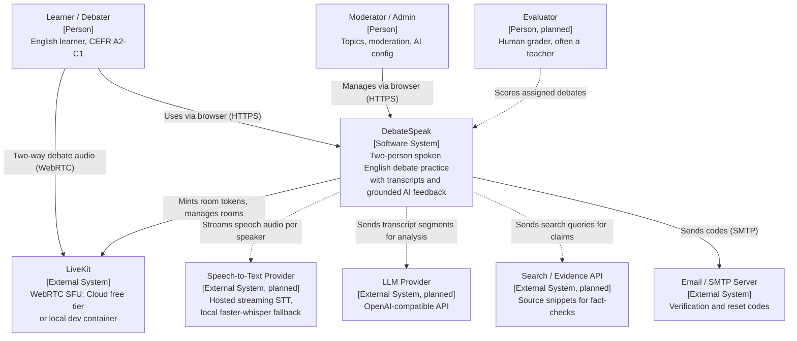

# PA4 Part B — C4 Level 1: System Context
*Performed: Nguyễn Hồng Tấn Tài (24125078) | Reviewed: Trần Lê Anh Tuấn (24125107) | Edited: Nguyễn Đình Thiên Lộc (24125093)*

This page shows DebateSpeak as one box, the people who use it, and the outside systems it depends on. Inside detail (containers, components) is in Part C. Sources: `docs/architecture/SOFTWARE_ARCHITECTURE_SPEC.md` (sections 2.2, 5 and 17), `docs/requirements/PROJECT_PROPOSAL.md`, `docker-compose.yml`, `.env.example`, `api/` and `web/src/` on `pa4`.

Status words used below:

- **Live**: code for it exists on `pa4` and runs today (including Build 3 FG-03 rooms and FG-04 LiveKit audio).
- **Planned**: later builds (PA5) or optional.

## 1. System Context Diagram

Solid lines exist on `pa4`. Dashed lines are planned. The SMTP server delivers the codes to the learner's mailbox; that hop is left off to keep the diagram readable.

## 2. Actors

| Actor | What they do with DebateSpeak | Status |
|---|---|---|
| **Learner / Debater** | Registers, verifies email, signs in, picks a topic, creates or joins a room with an 8-character invite code, gives consent, tests the mic, debates by voice, later reads the transcript and report. | Auth, rooms (FG-03), and LiveKit audio (FG-04): Live on `pa4`. AI reports: Planned |
| **Moderator / Admin** | Manages the topic library, reviews abuse reports, suspends accounts, configures AI providers and prompts. | Account suspension: Live (`AdminPage`, auth API). Topic and AI config: Planned |
| **Evaluator** | Human grader who scores assigned debates on the same rubric as the AI judge (FR-55). Cannot change system config or accounts. | Planned (Should) |

The spec also names an **Audience member** (FR-60, post-MVP). It is left off the diagram because nothing in Build 3 or the MVP depends on it.

Every debater is a Learner. The affirmative and negative debaters are the same actor in two room roles, not two actors.

## 3. External Systems

| System | Why DebateSpeak needs it | How it is reached | Status |
|---|---|---|---|
| **LiveKit** | Routes audio between the two debaters through an SFU, so NAT and firewalls do not break calls. Gives one audio track per speaker, which later makes speaker attribution exact. | Browser joins with a short-lived, room-scoped token minted by the API. `LIVEKIT_URL`, `LIVEKIT_API_KEY`, `LIVEKIT_API_SECRET` in `.env.example`. | Live on `pa4`: local dev container in `docker-compose.yml`, HS256 token endpoint (`POST /api/v1/rooms/{id}/token`) in `api/authify`, and `livekit-client` audio stage in `web/src/rooms/` |
| **Speech-to-Text provider** | Turns each speaker's audio into timestamped text for the live transcript. | Through `STTAdapter`. The proposal names Groq Whisper or Deepgram, with local `faster-whisper` as fallback. `STT_PROVIDER`, `STT_API_KEY`, `STT_MODEL`. | Planned (PA5, FG-05). `STTAdapter` interface (`api/app/adapters/stt.py`) and `AudioPipelineManager` (`workers/audio_pipeline.py`) exist on `pa4` |
| **LLM provider** | Language coach, argument coach, claim rewriting, evidence evaluation, report text. Every feedback item must quote the transcript verbatim. | Through `LLMAdapter`, any OpenAI-compatible endpoint. `LLM_PROVIDER`, `LLM_BASE_URL`, `LLM_API_KEY`, `LLM_MODEL`. | Planned. Adapter contract and quote-grounding check exist (`api/app/adapters/llm.py`, `api/app/domain/grounding.py`), no provider call |
| **Search / Evidence API** | Returns source snippets (title, URL, publisher, date) for check-worthy claims. The LLM may not invent sources. | Through `SearchAdapter`. The proposal names Serper or Tavily. `SEARCH_PROVIDER`, `SEARCH_API_KEY`. | Planned (FG-08). No adapter code yet |
| **Email / SMTP server** | Sends email verification and password reset codes. | Spring Mail, SMTP host set in `application.properties` (Gmail SMTP on 587). `SPRING_MAIL_USERNAME`, `SPRING_MAIL_PASSWORD`. | Live (`EmailService` in `api/authify`) |

PostgreSQL 16 and Redis 7 are not on this diagram. They are owned and run by the team, so they belong inside the system box and appear in the Level 2 container diagram.

Optional pronunciation assessment and a TTS service for solo practice (FR-59) are mentioned in the spec only as stretch or future items, so they are not shown.

## 4. Tech Stack

| Layer | Technology | Status on `pa4` |
|---|---|---|
| Web client | Vite + React + TypeScript + Tailwind CSS SPA; `livekit-client` SDK for audio | SPA and `livekit-client` audio stage (`LiveStage.tsx`, `debateAudio.ts`, `useMicCheck.ts`) Live on `pa4` |
| API | Java 17, Spring Boot 4.1 (Spring Security, JPA/Hibernate, Spring Mail, JWT) in `api/authify`, port 8000 | Auth, profile, sessions, admin suspension, FG-03 rooms, typed turns, and FG-04 LiveKit token endpoint (`POST /api/v1/rooms/{id}/token`) Live on `pa4` |
| Database | PostgreSQL 16 (Docker) | Live |
| Queue / cache | Redis 7 (Docker); ARQ for Python jobs | Container Live. Only a health worker (`workers/health.py`) uses it |
| Real-time media | LiveKit server (local `--dev` container) or LiveKit Cloud free tier | Local container Live |
| AI workers | Python: LiveKit Agents, Silero VAD, `STTAdapter`, `LLMAdapter`, `SearchAdapter` | Audio pipeline (`workers/audio_pipeline.py`) and `STTAdapter`/`LLMAdapter` contracts Live (166 unit tests passing); live streaming STT/LLM coaching Planned (PA5) |
| Deployment | Docker Compose for backing services; `--profile full` app containers | Docker Compose backing services (default) and `--profile full` app containers (`api/authify/Dockerfile`, `web/Dockerfile`) Live on `pa4`. Caddy TLS reverse proxy: Planned |

## 5. Known Gaps and Discrepancies

1. **Contract standardization across spec vs. implementation.** Spring Boot (`api/authify`) and the React frontend (`web/src/rooms/`) standardized on `LOBBY -> READY -> LIVE -> ENDED` (with `CANCELLED`) and `POST /api/v1/rooms/{id}/token` (merged in PR #78 and PR #82), while legacy route examples in `docs/architecture/SOFTWARE_ARCHITECTURE_SPEC.md` section 14 (`/debates/rooms/{id}/token`) await PA5 spec cleanup.
2. **Two backends in `api/`.** `api/authify` is the Spring Boot service the spec names. `api/app` is the earlier FastAPI skeleton (health endpoint, adapters, room state machine). Both default to port 8000. The spec still lists Python `Protocol` adapters, so the API-to-worker boundary must be Redis jobs and HTTP, not shared code.
3. **Email is not in the spec's actor table (section 2.2),** although the code sends mail. The spec table should add it.
4. **Spring Boot version.** Early Sprint 3/4 notes (`docs/pa4/tai/TODO.md`) mention Spring Boot 3; `api/authify/pom.xml` uses 4.1.2.
5. **LiveKit Cloud vs local.** `AGENTS.md` names LiveKit Cloud; Compose runs a local dev server. Which one is used depends only on `LIVEKIT_URL`.
