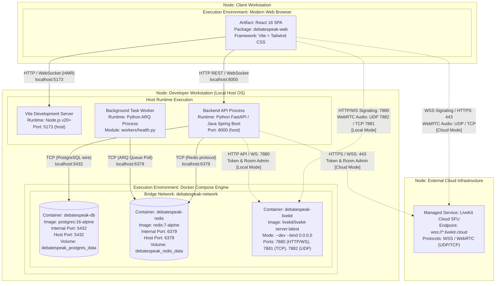

# Deployment Diagram — PA4
*Performed: Nguyễn Đình Thiên Lộc (24125093) | Reviewed: Nguyễn Anh Khoa (24125058) | Edited: Nguyễn Đình Thiên Lộc (24125093)*

| Metadata | Value |
|---|---|
| **Document** | UML Deployment Diagram Specification |
| **Sprint** | Sprint 4 (PA4) — Increment 2 |
| **Task** | SCRUM-59 |
| **Owner** | Nguyễn Đình Thiên Lộc (24125093) — DevOps & QA / Fact-Checking Lead |
| **Reviewer** | Nguyễn Anh Khoa (24125058) — AI Audio & Speech Pipeline Lead |
| **Date** | November 28, 2026 |
| **Status** | Complete |

---

## 1. Scope & Execution Context

This document specifies the UML deployment topology for DebateSpeak AI during Sprint 4 (PA4 / Build 3). It details the physical/virtual nodes, execution environments, runtime artifacts, networks, port bindings, and communication protocols currently active in the repository.

Per project guidelines and DevOps invariants, this specification reflects the actual topology existing in the codebase rather than idealized future architecture. Containerized services match `docker-compose.yml` exactly. Non-containerized processes are documented as they currently execute on the host developer workstation.

---

## 2. UML Deployment Diagram

The diagram below maps the runtime deployment topology across the Client Workstation, Developer Workstation, Docker Compose engine, and External Cloud services.

---

## 3. Node Inventory & Execution Environments

### 3.1 Node: Client Workstation (`<<device>>`)
* **Execution Environment:** Modern Web Browser (Chromium / Firefox / WebKit).
* **Artifact:** `debatespeak-web` Single-Page Application (SPA) built with React 18, TypeScript, and Tailwind CSS.
* **Responsibilities:** Renders room lobbies (`CreateRoomPage.tsx`, `InviteView.tsx`, `AgreeView.tsx`), performs local microphone checks via WebRTC `getUserMedia` (`useMicCheck.ts`), manages dual-consent audio activation, connects to the WebRTC SFU using `livekit-client` (`LiveStage.tsx`, `debateAudio.ts`), and provides a typed-turn fallback (`TypePanel.tsx`) when speaking is unavailable.

### 3.2 Node: Developer Workstation (`<<device>>`)
The local development machine hosts both uncontainerized developer runtime processes and containerized backing services.

#### 3.2.1 Host Runtime Processes
* **Vite Development Server:** Runs directly on the host using Node.js (`npm run dev` / `pnpm run dev` in `web/`). Binds to port `5173` (`host: true` in `web/vite.config.ts`) and serves assets and Hot Module Replacement (HMR). An optional local mock configuration (`web/mock-local/vite.mock.config.ts`, port `5174`) embeds an in-memory mock API (`mockApi.ts`) for two-browser room and audio-stage testing when the backend is offline.
* **Backend API Process:** Executes on the host binding to port `8000`:
  * Primary active implementation: Java 17 Spring Boot application in `api/authify/` (`./mvnw spring-boot:run`, `server.port=8000`), implementing Auth (`AuthController`), Room lifecycle (`RoomController` / `RoomService`), typed turns, and LiveKit HS256 token minting (`POST /api/v1/rooms/{id}/token`).
  * Legacy/shared Python package (`api/app/`): Hosts `STTAdapter` / `LLMAdapter` contracts and FastAPI health/domain modules (`uvicorn app.main:app --port 8000`, `api/pyproject.toml`).
* **Background Worker Process:** Python modules executing audio pipeline and health checks (`workers/audio_pipeline.py`, `workers/health.py`, ARQ job queue).

#### 3.2.2 Docker Compose Engine (`<<executionEnvironment>>`)
Manages containerized services defined in `docker-compose.yml`. All containers communicate across the custom bridge network `debatespeak-network`. Running `docker compose up -d` starts the three default stateful backing containers (`debatespeak-db`, `debatespeak-redis`, `debatespeak-livekit`); running `docker compose --profile full up -d --build` additionally builds and runs containerized `debatespeak-api` (`api/authify/Dockerfile`, port `8000`) and `debatespeak-web` (`web/Dockerfile` + `web/nginx.conf`, port `3000:80`, proxying `/api/` to `http://api:8000`).
1. **`debatespeak-db`:**
   * Image: `postgres:16-alpine`.
   * Host Port Binding: `5432:5432`.
   * Persistence: Named volume `debatespeak_postgres_data` mapped to `/var/lib/postgresql/data`.
   * Health Check: `pg_isready` interval 5s, timeout 5s, retries 5.
2. **`debatespeak-redis`:**
   * Image: `redis:7-alpine`.
   * Host Port Binding: `6379:6379`.
   * Persistence: Named volume `debatespeak_redis_data` mapped to `/data`.
   * Health Check: `redis-cli ping` interval 5s, timeout 3s, retries 5.
3. **`debatespeak-livekit`:**
   * Image: `livekit/livekit-server:latest`.
   * Execution Command: `["--dev", "--bind", "0.0.0.0"]`.
   * Host Port Bindings:
     * `7880:7880` — HTTP REST API & WebSocket signaling.
     * `7881:7881` — WebRTC over TCP fallback.
     * `7882:7882/udp` — WebRTC over UDP media transport.
   * Health Check: `wget -qO- http://localhost:7880/` interval 5s, timeout 5s, retries 5.

### 3.3 Node: External Cloud Services (`<<cloud>>`)
* **LiveKit Cloud SFU:** Managed cloud WebRTC Selective Forwarding Unit (`wss://*.livekit.cloud`).
* **Operational Mode Determination:**
  * When `LIVEKIT_URL=http://localhost:7880`, the client and backend route all media traffic to the local `debatespeak-livekit` container.
  * When `LIVEKIT_URL` is configured with cloud credentials (`wss://<project>.livekit.cloud`), LiveKit Cloud replaces the local container for WebRTC audio routing. This mode is used when testing across separate physical machines where local UDP hole punching is restricted.

---

## 4. Communication Protocols & Port Matrix

| Link Origin | Link Destination | Protocol | Port | Purpose / Traffic Description |
|---|---|---|---|---|
| Browser SPA | Vite Dev Server | HTTP / WebSocket | 5173 | Asset delivery, script bundling, and Vite HMR |
| Browser SPA | Backend API | HTTP / WebSocket | 8000 | Auth, room state sync, dual consent, LiveKit token acquisition |
| Browser SPA | Local LiveKit Container | HTTP / WebSocket | 7880 | WebRTC signaling in local development mode |
| Browser SPA | Local LiveKit Container | WebRTC (UDP) | 7882 | Real-time bidirectional audio stream exchange |
| Browser SPA | Local LiveKit Container | WebRTC (TCP) | 7881 | Fallback audio transport when UDP packets are blocked |
| Browser SPA | LiveKit Cloud SFU | HTTPS / WSS | 443 | WebRTC signaling in cloud deployment mode |
| Browser SPA | LiveKit Cloud SFU | WebRTC (UDP/TCP) | Dynamic / 443 | Low-latency cloud audio streaming |
| Backend API | `debatespeak-db` | TCP (PostgreSQL) | 5432 | User credentials, room metadata, session persistence |
| Backend API | `debatespeak-redis` | TCP (Redis) | 6379 | Session caching, lock management, pub/sub signaling |
| Backend API | Local LiveKit Container | HTTP / WebSocket | 7880 | Room creation, participant token minting, webhook events |
| Backend API | LiveKit Cloud SFU | HTTPS / WSS | 443 | Cloud room creation and token signing |
| Python Worker | `debatespeak-redis` | TCP (Redis) | 6379 | Polling and consumption of background ARQ tasks |

---

## 5. Planned, Not Yet Deployed Infrastructure

The following components are referenced in planning documents (`docs/pa4/loc/TODO.md`, `README.md`) but are not yet implemented in `docker-compose.yml` or repo code:

1. **Caddy Reverse Proxy & TLS Termination:**
   * *Status:* Planned. Not present in `docker-compose.yml`.
   * *Purpose:* Terminate TLS (HTTPS on 443) and proxy to frontend (5173) and API (8000). Modern browsers enforce `navigator.mediaDevices.getUserMedia` only on `localhost` or secure HTTPS contexts. Caddy with internal TLS is planned for multi-device LAN testing.
2. **Containerized API & Web Services:**
   * *Status:* Implemented (opt-in `--profile full`, PR #84).
   * *Details:* Multi-stage Dockerfiles (`api/authify/Dockerfile`, `web/Dockerfile`) and `web/nginx.conf` enable full-stack containerized runs via `docker compose --profile full up -d --build`, while host-run Vite (`5173`) and Spring Boot (`8000`) remain default for fast local HMR development.
3. **Dedicated Speech & AI Worker Containers:**
   * *Status:* Prototype only.
   * *Purpose:* Silero VAD, streaming speech-to-text (STT), and multi-agent LLM analysis services currently exist as prototype scripts (`workers/health.py`) rather than dedicated containerized daemons.

---

## 6. Discrepancies and Inconsistencies

In accordance with the Brutal Honesty invariant (AGENTS.md Section 8), this section documents every technical discrepancy between planning documentation, architecture invariants, and the codebase:

1. **TODO vs. `docker-compose.yml` Service Scope:**
   * `docs/pa4/loc/TODO.md` describes communication between "browser <-> Caddy reverse proxy <-> Spring Boot" and lists Docker Compose as managing these services.
   * *Fact:* `docker-compose.yml` defines three default backing services (`db`, `redis`, `livekit`) plus two opt-in `--profile full` application services (`api`, `web`); Caddy TLS reverse proxy is still not present.
2. **Backend Stack Duality (FastAPI vs. Spring Boot):**
   * AGENTS.md rule 4.2 states the backend is "Java (Spring Boot), chosen by Tài on 2026-11-14".
   * *Fact:* The codebase contains **two concurrent backend implementations**:
     * A Python package in `api/app/` (STT and LLM adapters, a room state machine in `domain/rooms.py`). No LiveKit token code exists there yet.
     * A Java 17 Spring Boot application in `api/authify/` with authentication controllers and JPA entities.
     Both configure port 8000. They cannot bind concurrently on the same host interface.
3. **Database Port, Credential, & LiveKit Property Defaults:**
   * `docker-compose.yml` binds PostgreSQL to host port `5432:5432` with default password `debatespeak_dev_password`.
   * *Fact:* PR #78 and PR #84 aligned `api/authify/src/main/resources/application.properties` to port `5432` (`jdbc:postgresql://localhost:5432/debatespeak`), default password `debatespeak_dev_password`, and non-circular `app.livekit.*` properties (`url`, `api-key`, `api-secret`).
4. **LiveKit Deployment Ambiguity (Local Container vs. Cloud):**
   * The architecture documents frequently emphasize LiveKit Cloud free tier as an invariant (AGENTS.md Section 4.3), while `docker-compose.yml` provisions a local `livekit/livekit-server:latest` container in `--dev` mode.
   * *Fact:* The active SFU endpoint is determined strictly by the `LIVEKIT_URL` environment variable. In local development without cloud API credentials, the local Docker container is active; in cloud mode, the container is redundant.
