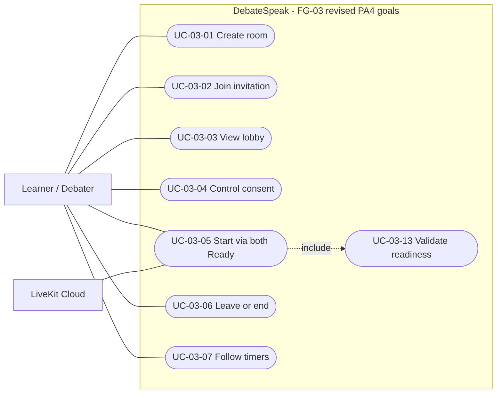
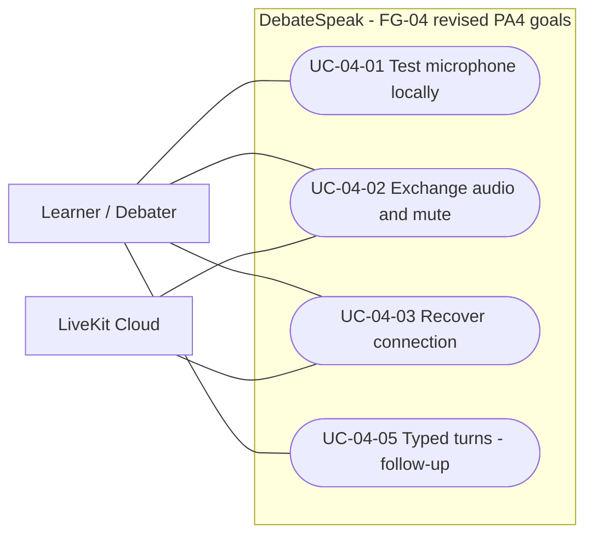
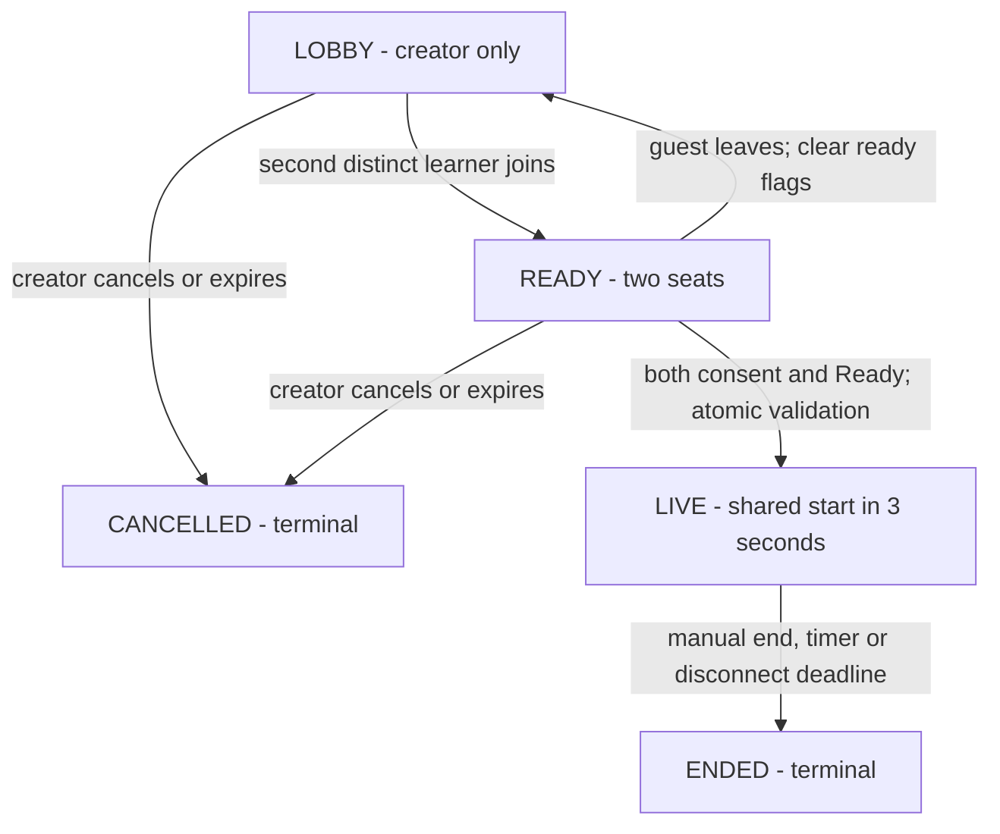

# PA4 — Revised Use-Case Model (Second Submission)
*Performed: Trần Lê Anh Tuấn (24125107) | Reviewer: Nguyễn Đình Thiên Lộc (24125093) | Edited: Trần Lê Anh Tuấn (24125107)*

Ticket: **SCRUM-54**, PA4 Part A. Revision date: **2026-11-23**. Owner: **Trần Lê Anh Tuấn (24125107), AI Orchestrator & Analysis Lead**. Assigned reviewer: **Nguyễn Đình Thiên Lộc (24125093), DevOps & QA / Fact-Checking Lead**.

## 1. Scope and baseline
*Performed: Trần Lê Anh Tuấn (24125107) | Reviewer: Nguyễn Đình Thiên Lộc (24125093) | Edited: Trần Lê Anh Tuấn (24125107)*

This second iteration retains all 54 PA3 identifiers and their original FR-01–60 mappings. Eleven FG-03/FG-04 use cases are revised for the current room design, and UC-04-05 is added for typed debate content. The complete index below contains 55 use cases across ten functional groups; it does not declare all ten groups implemented.

PA4's graded slice is FG-03 rooms and FG-04 audio, following [PA4 scope](README.md), not the older FG-04/FG-05 roadmap wording. FG-01 is the PA3 baseline. Typed participation is an approved follow-up after voice; STT, AI reports, video, audience, solo AI and side chat remain outside this ticket's delivery claims. Triết owns frontend implementation; this ticket revises the analysis documents.

Sources: [PA4 assignment, Part A](../assignments/PA4-2026.pdf); [PA3 model](../pa3/USE_CASE_MODEL.md), [specifications](../pa3/USE_CASE_SPECIFICATIONS.md) and [catalogue](../pa3/use_cases.json); [Vision](../requirements/VISION_DOCUMENT.md), §§4–5; [current room design](../superpowers/specs/2026-11-19-room-flow-design.md); and [merged room contracts](../../web/src/rooms/contracts.ts) at base commit `7676197`. The current design's explicit corrections govern the revised room interactions. [Detailed specifications](USE_CASE_SPECIFICATIONS.md), §§1, 6–7, disclose older-document discrepancies and current integration limits.

No specific PA3 TA feedback was supplied or found in the checked repository documents. Moodle/email were not accessed. These are evidence-based contract revisions; none is falsely attributed to a TA. The single [Changes.md](Changes.md) records this document separately from the specifications.

## 2. Actors and authorization
*Performed: Trần Lê Anh Tuấn (24125107) | Reviewer: Nguyễn Đình Thiên Lộc (24125093) | Edited: Trần Lê Anh Tuấn (24125107)*

The system boundary is DebateSpeak. Browsers/microphones are devices used by actors, not autonomous decision makers. Internal services are implementation components, not human actors. The server authenticates and authorizes every protected action.

| Actor ID | Actor | Permitted interaction / release boundary |
|---|---|---|
| USER | Authenticated user | abstract: Shared authenticated identity; general actor only, not a permission to access every role. |
| VISITOR | Visitor | core: Registers, signs in, or requests password recovery. |
| LEARNER | Learner / Debater | core: Practises with a partner and controls own learning data. |
| ADMIN | Moderator / Admin | core: Performs authorized moderation and operational tasks. |
| EVALUATOR | Human evaluator | should: Grades only assigned, ended debates under dual sharing consent. |
| TEACHER | Teacher | post-mvp: Reads explicitly shared student dashboards; no class-management workflows are designed. |
| AUDIENCE | Audience member | post-mvp: Receives only authorized room media; never publishes or grades. |
| MEDIA | LiveKit Cloud | external: Routes independent participant audio tracks. |
| STT | STT / diarization provider | external: Transcribes authorized audio through STTAdapter. |
| LLM | LLM provider | external: Returns schema-validated analysis through LLMAdapter; not the authorizing actor. |
| SEARCH | Search / evidence provider | external: Returns evidence snippets through SearchAdapter. |
| PRONUNCIATION | Pronunciation provider | stretch: Optional separate assessment provider. |

Learner, Admin, Evaluator and Teacher specialize the abstract authenticated User; this does not transfer one role's permissions to another. Visitor may sign in to become an authorized learner. Two learners must be distinct authenticated identities. Audience/Evaluator/Teacher features remain conditional future scope, never an invitation-code bypass. LiveKit routes media but does not decide participant consent. External STT, LLM and Search actors apply to retained future use cases; their presence in the model does not prove running integration.

## 3. Revised PA4 use-case diagrams
*Performed: Trần Lê Anh Tuấn (24125107) | Reviewer: Nguyễn Đình Thiên Lộc (24125093) | Edited: Trần Lê Anh Tuấn (24125107)*

These are goal/actor diagrams, not architecture or execution evidence. Solid lines associate actors with goals. A labelled include arrow identifies mandatory supporting behavior; sequence alone is not an include relationship. Unchanged/future goals remain in the complete index in §4 and the relationship table in §5.

\clearpage

### 3.1 FG-03 rooms and session control
*Performed: Trần Lê Anh Tuấn (24125107) | Reviewer: Nguyễn Đình Thiên Lộc (24125093) | Edited: Trần Lê Anh Tuấn (24125107)*

READY means two seats are occupied. Each learner separately agrees and selects VOICE/TYPE; the second accepted Ready performs one atomic start after mandatory validation. There is no independent Validate/Start endpoint. A mic check is conditional on VOICE, so it is not a mandatory include for all starts. LiveKit supports the voice portion of start; a fully typed session does not require audio publication. Reporting/moderation, private chat, solo AI and audiences retain their deferred priorities in §4.

\clearpage

### 3.2 FG-04 audio and typed participation
*Performed: Trần Lê Anh Tuấn (24125107) | Reviewer: Nguyễn Đình Thiên Lộc (24125093) | Edited: Trần Lê Anh Tuấn (24125107)*

Typing is an independent alternative participation goal: both learners may type without invoking audio exchange, so UC-04-05 is not modelled as a mandatory include or optional extension that requires UC-04-02. It persists attributed transcript content after explicit consent. It does not reuse UC-03-10 (FR-58), whose private side-chat messages stay outside analysis by default. UC-04-04 video remains stretch and is absent from the current audio-only scope.

\clearpage

### 3.3 State constraints shared by both diagrams
*Performed: Trần Lê Anh Tuấn (24125107) | Reviewer: Nguyễn Đình Thiên Lộc (24125093) | Edited: Trần Lê Anh Tuấn (24125107)*

No media token is issued before LIVE; no publication begins before the server's shared start. The room name is its ID, never the invite code. Before LIVE, leaving is different from ending a debate. During LIVE, consent withdrawal uses the End path and stops capture immediately. ENDED/CANCELLED never reopen. The state diagram is a supplementary lifecycle constraint, not a replacement for use-case relationships.

## 4. Complete catalogue and requirement traceability
*Performed: Trần Lê Anh Tuấn (24125107) | Reviewer: Nguyễn Đình Thiên Lộc (24125093) | Edited: Trần Lê Anh Tuấn (24125107)*

All original FR links are retained. The local requirement **PA4-TYPED-01** means that an explicitly consenting participant may replace voice with typed debate turns, saved with speaker/source attribution, without opening a microphone. It traces to the approved room design, “Typing instead of speaking”; it is not a new global FR-61 or a redefinition of FR-58. Backend/schema and Spec Kit adoption remain dependencies before implementation.

Delivery labels describe intended scope, not acceptance status. PA3 baseline notes are historical. The detailed specification with the same ID is the behavioral contract, including its preconditions, steps, branches and success/minimum guarantees.

### FG-01 — Account and profile
*Performed: Trần Lê Anh Tuấn (24125107) | Reviewer: Nguyễn Đình Thiên Lộc (24125093) | Edited: Trần Lê Anh Tuấn (24125107)*

| ID and goal | Actor IDs | Requirements | Revision / delivery scope |
|---|---|---|---|
| UC-01-01 — Register account | VISITOR | FR-01 | Retained; PA3 baseline |
| UC-01-02 — Sign in | VISITOR | FR-01 | Retained; PA3 baseline |
| UC-01-03 — Maintain learner profile | LEARNER | FR-02 | Retained; PA3 baseline |
| UC-01-04 — Sign out | USER | FR-03 | Retained; PA3 baseline |
| UC-01-05 — Recover forgotten password | VISITOR, LEARNER | FR-03 | Retained; PA3 baseline |
| UC-01-06 — Review active sessions | USER | FR-03 | Retained; PA3 baseline |
| UC-01-07 — Delete own account and data | LEARNER | FR-04 | Retained; PA3 baseline |
| UC-01-08 — Suspend or reactivate account | ADMIN | FR-05 | Retained; PA3 baseline |

### FG-02 — Topics and difficulty
*Performed: Trần Lê Anh Tuấn (24125107) | Reviewer: Nguyễn Đình Thiên Lộc (24125093) | Edited: Trần Lê Anh Tuấn (24125107)*

| ID and goal | Actor IDs | Requirements | Revision / delivery scope |
|---|---|---|---|
| UC-02-01 — Browse and select topics | LEARNER | FR-06 | Retained; PA3 baseline |
| UC-02-02 — Manage topic library | ADMIN | FR-07 | Retained; future-mvp |
| UC-02-03 — Get personalized topic recommendations | LEARNER | FR-08 | Retained; should |
| UC-02-04 — Propose a custom topic | LEARNER, ADMIN | FR-09 | Retained; stretch |

### FG-03 — Room and session management
*Performed: Trần Lê Anh Tuấn (24125107) | Reviewer: Nguyễn Đình Thiên Lộc (24125093) | Edited: Trần Lê Anh Tuấn (24125107)*

| ID and goal | Actor IDs | Requirements | Revision / delivery scope |
|---|---|---|---|
| UC-03-01 — Create debate room | LEARNER | FR-10, FR-12 | Revised; PA4 target |
| UC-03-02 — Join invited room | LEARNER | FR-11, FR-12 | Revised; PA4 target |
| UC-03-03 — View lobby and readiness | LEARNER | FR-12 | Revised; PA4 target |
| UC-03-04 — Give or withdraw processing consent | LEARNER | FR-13 | Revised; PA4 target |
| UC-03-05 — Start debate | LEARNER, MEDIA | FR-12, FR-13, FR-19 | Revised; PA4 target |
| UC-03-06 — Leave or end debate | LEARNER | FR-12, FR-15 | Revised; PA4 target |
| UC-03-07 — Follow debate and turn timers | LEARNER | FR-14 | Revised; PA4 target |
| UC-03-08 — Report abusive behavior | LEARNER | FR-16 | Retained; should |
| UC-03-09 — Review abuse and close room | ADMIN | FR-17 | Retained; should |
| UC-03-10 — Use private room text chat | LEARNER | FR-58 | Retained; post-mvp |
| UC-03-11 — Practise solo with an AI opponent | LEARNER, LLM | FR-59 | Retained; post-mvp |
| UC-03-12 — Authorize and join audience access | LEARNER, AUDIENCE, MEDIA | FR-60 | Retained; post-mvp |
| UC-03-13 — Validate start readiness | LEARNER | FR-12, FR-13, FR-19 | Revised; PA4 target; supporting include |

### FG-04 — Real-time audio
*Performed: Trần Lê Anh Tuấn (24125107) | Reviewer: Nguyễn Đình Thiên Lộc (24125093) | Edited: Trần Lê Anh Tuấn (24125107)*

| ID and goal | Actor IDs | Requirements | Revision / delivery scope |
|---|---|---|---|
| UC-04-01 — Select and test microphone | LEARNER | FR-19 | Revised; PA4 target |
| UC-04-02 — Exchange audio and control mute | LEARNER, MEDIA | FR-18, FR-20 | Revised; PA4 target |
| UC-04-03 — Recover a dropped connection | LEARNER, MEDIA | FR-15, FR-21 | Revised; PA4 target |
| UC-04-04 — Enable optional live video | LEARNER, MEDIA | FR-22 | Retained; stretch |
| UC-04-05 — Participate through typed debate turns | LEARNER | PA4-TYPED-01, FR-13, FR-15 | New; PA4 follow-up after voice |

### FG-05 — Transcription and attribution
*Performed: Trần Lê Anh Tuấn (24125107) | Reviewer: Nguyễn Đình Thiên Lộc (24125093) | Edited: Trần Lê Anh Tuấn (24125107)*

| ID and goal | Actor IDs | Requirements | Revision / delivery scope |
|---|---|---|---|
| UC-05-01 — View speaker-attributed live transcript | LEARNER, STT | FR-23, FR-24, FR-25, FR-26 | Retained; future-mvp |
| UC-05-02 — Review and export full transcript | LEARNER | FR-27 | Retained; should |
| UC-05-03 — Use mixed-audio diarization fallback | LEARNER, STT | FR-28 | Retained; stretch |

### FG-06 — English language analysis
*Performed: Trần Lê Anh Tuấn (24125107) | Reviewer: Nguyễn Đình Thiên Lộc (24125093) | Edited: Trần Lê Anh Tuấn (24125107)*

| ID and goal | Actor IDs | Requirements | Revision / delivery scope |
|---|---|---|---|
| UC-06-01 — Review language corrections | LEARNER, LLM | FR-30, FR-31 | Retained; future-mvp |
| UC-06-02 — Review speaking metrics | LEARNER | FR-29 | Retained; future-mvp |
| UC-06-03 — Review recurring language patterns | LEARNER | FR-32 | Retained; should |
| UC-06-04 — Review pronunciation assessment | LEARNER, PRONUNCIATION | FR-33 | Retained; stretch |
| UC-06-05 — Validate cited transcript evidence | LEARNER | FR-30, FR-37 | Retained; future-mvp |

### FG-07 — Argument analysis
*Performed: Trần Lê Anh Tuấn (24125107) | Reviewer: Nguyễn Đình Thiên Lộc (24125093) | Edited: Trần Lê Anh Tuấn (24125107)*

| ID and goal | Actor IDs | Requirements | Revision / delivery scope |
|---|---|---|---|
| UC-07-01 — Review argument structure and rebuttals | LEARNER, LLM | FR-34, FR-35, FR-36 | Retained; future-mvp |
| UC-07-02 — Review potential logical fallacies | LEARNER, LLM | FR-37 | Retained; should |

### FG-08 — Fact checking
*Performed: Trần Lê Anh Tuấn (24125107) | Reviewer: Nguyễn Đình Thiên Lộc (24125093) | Edited: Trần Lê Anh Tuấn (24125107)*

| ID and goal | Actor IDs | Requirements | Revision / delivery scope |
|---|---|---|---|
| UC-08-01 — Inspect claim verdicts and evidence | LEARNER, LLM, SEARCH | FR-38, FR-39, FR-40, FR-41, FR-43 | Retained; future-mvp |
| UC-08-02 — Show optional live fact-check overlay | LEARNER, LLM, SEARCH | FR-42 | Retained; stretch |

### FG-09 — Evaluation and consensus
*Performed: Trần Lê Anh Tuấn (24125107) | Reviewer: Nguyễn Đình Thiên Lộc (24125093) | Edited: Trần Lê Anh Tuấn (24125107)*

| ID and goal | Actor IDs | Requirements | Revision / delivery scope |
|---|---|---|---|
| UC-09-01 — Review debate evaluation and consensus | LEARNER, LLM | FR-44, FR-45 | Retained; future-mvp |
| UC-09-02 — Configure analysis and inspect usage | ADMIN | FR-46 | Retained; should |
| UC-09-03 — Run optional heterogeneous judge panel | ADMIN, LLM | FR-47 | Retained; stretch |
| UC-09-04 — Assign a human evaluator | LEARNER, EVALUATOR | FR-55, FR-56 | Retained; should |
| UC-09-05 — Submit human grading card | EVALUATOR | FR-55, FR-56 | Retained; should |
| UC-09-06 — View shared human grades | LEARNER | FR-55, FR-56 | Retained; should |

### FG-10 — History and learning reports
*Performed: Trần Lê Anh Tuấn (24125107) | Reviewer: Nguyễn Đình Thiên Lộc (24125093) | Edited: Trần Lê Anh Tuấn (24125107)*

| ID and goal | Actor IDs | Requirements | Revision / delivery scope |
|---|---|---|---|
| UC-10-01 — Review personalized learning report | LEARNER, LLM | FR-48, FR-49 | Retained; future-mvp |
| UC-10-02 — Browse own debate history | LEARNER | FR-50 | Retained; future-mvp |
| UC-10-03 — Review longitudinal progress | LEARNER | FR-51 | Retained; should |
| UC-10-04 — Track analysis status and retry | LEARNER | FR-52 | Retained; should |
| UC-10-05 — Export report PDF | LEARNER | FR-53 | Retained; stretch |
| UC-10-06 — Process deletion and retention requests | ADMIN | FR-54, FR-04 | Retained; future-mvp |
| UC-10-07 — View consented student dashboards | TEACHER, LEARNER | FR-57 | Retained; post-mvp |

## 5. Relationships and extension conditions
*Performed: Trần Lê Anh Tuấn (24125107) | Reviewer: Nguyễn Đình Thiên Lộc (24125093) | Edited: Trần Lê Anh Tuấn (24125107)*

The nine PA3 include/extend relationships are retained with the start trigger clarified. Actor generalization is stated in §2. Supporting includes are mandatory whenever the base behavior runs; optional extensions activate only under their stated condition and release scope.

| Base / source | Relationship and target | Condition / boundary |
|---|---|---|
| UC-03-05 | include UC-03-13 | Every second Ready that may start LIVE validates current room authority in the same atomic decision. |
| UC-06-01 | include UC-06-05 | Every retained language feedback item must pass citation validation. |
| UC-07-01 | include UC-06-05 | Every retained argument critique must pass citation validation. |
| UC-07-02 | include UC-06-05 | Every retained potential-fallacy critique must pass citation validation. |
| UC-02-03 | extend UC-02-01 | At topic discovery, when the learner requests personalized recommendations. |
| UC-04-04 | extend UC-04-02 | At media setup, when optional video is enabled and separately authorized. |
| UC-08-02 | extend UC-04-02 | During LIVE audio, when the learner opts into supported live evidence overlays. |
| UC-09-06 | extend UC-09-01 | At the evaluation view, when a human grade is submitted and both debaters still authorize sharing. |
| UC-10-05 | extend UC-10-01 | At report review, when the learner requests a supported PDF export. |

The video/overlay extensions remain future-only, not PA4 functionality. Consent is a prerequisite to publication and is maintained across the session; diagram sequencing must not suggest that a partner can consent for someone else. Typing remains independent of audio and never grants video/audience permissions.

## 6. Current evidence and review boundary
*Performed: Trần Lê Anh Tuấn (24125107) | Reviewer: Nguyễn Đình Thiên Lộc (24125093) | Edited: Trần Lê Anh Tuấn (24125107)*

At PA4 base `7676197`, source inspection finds room creation/invitation/agreement UI, a typed room client and browser test definitions that mock the HTTP boundary. The merged room page still renders only a motion heading for LIVE/ENDED. No Spring Boot room/token/typed-turn implementation is present in that base. These are observations of checked source, not freshly run browser/backend tests. The specifications' §§4–5 define acceptance scenarios and the concrete remaining integration work.

The complete index maps 55 unique IDs to 55 specifications, preserves FR-01–60 coverage and adds one local typed-content requirement. Those document checks and PDF-build results are recorded in Changes.md only after execution. Peer review by Lộc, TA feedback verification and real service acceptance remain separate; none is inferred from a document or a mocked test.
