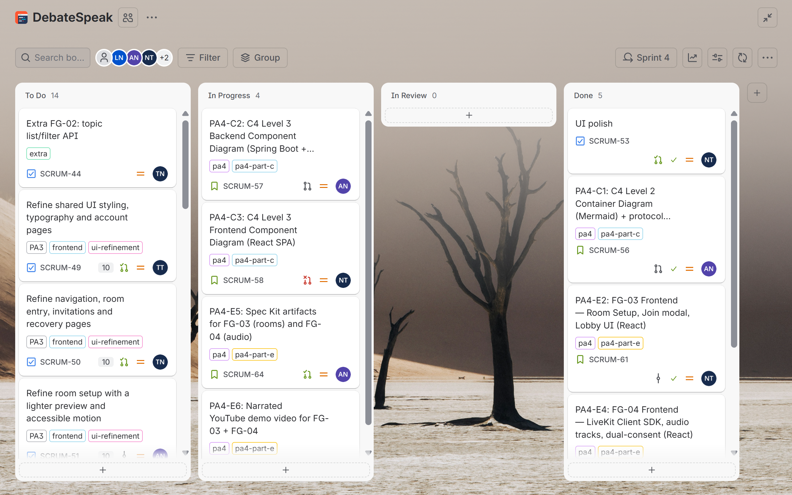

# Weekly Report (PA4)
*Performed: Nguyễn Đình Thiên Lộc (24125093); Review: Trần Lê Anh Tuấn (24125107), pending*

---

## 1. Sprint Goal
**Sprint 4 / PA4 Goal (Build 3):** Implement Functional Groups FG-03 (Room & Live Session Management) and FG-04 (Real-Time Audio Communication) using Spec Kit and record a narrated YouTube demo video, alongside comprehensive architectural models (C4 Level 1 System Context, C4 Level 2 Container, C4 Level 3 Component diagrams for backend and frontend, and Deployment diagram), revised Use-Case Specifications with `Changes.md`, and the Sprint 4 AI Usage Log and Weekly Report (Parts A–F, 75 points total).

---

## 2. Per-Member Task Table

Status is determined strictly by verified repository evidence as of **2026-11-28** (merged pull request = Done; active branch / open PR = In Review or In Progress; otherwise as recorded in member `TODO.md` files).

| Member | Jira Key | Task Summary | Status | Evidence / Notes |
|---|---|---|---|---|
| **Lộc** (24125093) | SCRUM-68 | Create `pa4` from `pa3`; merge `pa3` → `dev` | **Done** | Branch `pa4` created; PR #67 merged into `dev` (2026-11-14) |
| Lộc (24125093) | SCRUM-59 | Part D: Deployment Diagram + prose | In Review | Finalized + PDF built on PR #74 (`feature/SCRUM-68-graphify`); Khoa to review |
| Lộc (24125093) | SCRUM-67 | Part F2: Weekly Report & meeting minutes | In Progress | Planning, Check-in 1 & 2, Sprint Review minutes, and `jira-board.png` on PR #74; `burndown.png` pending |
| Lộc (24125093) | SCRUM-68 | Part S: Compile PA4 Markdown docs to PDF | In Progress | Lộc's docs & current drafts built via `report/pdf/build.py`; remaining Parts A/C1/C2/E7 await merges |
| Lộc (24125093) | SCRUM-68 | Freeze `CHECKLIST.md`, Git log, package `.zip` | In Progress | Checklist updated on PR #74; freeze & zip blocked until all rows are Complete (`AGENTS.md` §10) |
| Lộc (24125093) | SCRUM-52 | Refine waiting/ready lobbies & accessibility | Deferred / Closed | Dropped from PA4 (not in `PA4_OVERVIEW.md`; superseded by Triết's PR #70/#71/#73/#82) |
| **Triết** (24125047) | SCRUM-58 | Part C3: C4 Level 3 Frontend Components | In Progress | Draft by Lộc on PR #74; Triết to check and take over |
| Triết (24125047) | SCRUM-61 | Part E2: FG-03 Frontend (Setup, Join, Lobby) | **Done** | PR #70 merged into `pa4` (2026-11-21); demo fixes approved in PR #82 |
| Triết (24125047) | SCRUM-63 | Part E4: FG-04 Frontend (LiveKit, audio UI) | **Done** | PR #71 & PR #73 merged into `pa4`; PR #82 (210/210 Playwright tests) approved by Lộc (2026-11-28) |
| Triết (24125047) | SCRUM-65 | Part E6/E7: Narrated YouTube demo video | To Do | Two-browser test verified against backend (PR #82); recording & `docs/pa4/DEMO_VIDEO.md` pending |
| **Tài** (24125078) | SCRUM-55 | Part B: C4 Level 1 System Context + stack | In Progress | Draft by Lộc on PR #74; Tài to check and take over |
| Tài (24125078) | SCRUM-60 | Part E1: FG-03 Backend (Room API & DB) | In Review | Commit `e9601d9` pushed onto PR #78 (`CHANGES_REQUESTED`: restore `api/app/`, split branch) |
| Tài (24125078) | SCRUM-62 | Part E3: FG-04 Backend (LiveKit token API) | In Review | `POST /rooms/{id}/token` implemented in `RoomService.token()` on PR #78 (`CHANGES_REQUESTED`) |
| **Khoa** (24125058) | SCRUM-56 | Part C1: C4 Level 2 Container Diagram | In Review | PR #78 open into `pa4`; `CHANGES_REQUESTED` by Lộc (2026-11-28) |
| Khoa (24125058) | SCRUM-57 | Part C2: C4 Level 3 Backend Components | In Review | PR #79 open into `pa4`; `CHANGES_REQUESTED` by Lộc (2026-11-28) |
| Khoa (24125058) | SCRUM-64 | Part E5: Spec Kit (`specs/006-`, `specs/007-`) | **Done** | PR #80 merged into `pa4` (2026-11-28); PR #81 (`audio_pipeline.py`) merged (7 ruff errors to fix) |
| **Tuấn** (24125107) | SCRUM-54 | Part A: Revised Use Cases + `Changes.md` | In Review | PR #72 open into `pa4`; `CHANGES_REQUESTED` by Lộc (2026-11-27) |
| Tuấn (24125107) | SCRUM-66 | Part F1: AI Usage Log (all 5 members) | In Progress | Draft by Lộc on PR #74; Tuấn to confirm and complete |

---

## 3. Work Completed So Far (with Commit & PR Evidence)

1. **Sprint 4 Task Planning & Workspace Setup:**
   - Commit `a98d181` (2026-11-17, Khoa): Initialized `docs/pa4/README.md`, `docs/pa4/CHECKLIST.md`, `docs/pa4/create_pa4_jira_issues.py`, and member `TODO.md` files.
   - Commit `ef607a4` (2026-11-17, Khoa): Added `STTAdapter` protocol implementation and unit tests (`api/app/adapters/stt.py`, `tests/unit/test_stt_adapter.py`).

2. **Prototype Cleanup & UI Refresh:**
   - **PR #68** (merged 2026-11-17, `4bd5201`): Removed PA3 Part D clickable prototype per grading scope while retaining prototype UI screenshots (`docs/pa3/`).
   - **PR #69** (merged 2026-11-19, `3d3c3f8`): Merged UI refresh (`feature/SCRUM-53-ui-refresh`) into `pa4`.

3. **FG-03 & FG-04 Frontend, Spec Kit, and Audio Worker:**
   - **PR #70** (merged 2026-11-21, `7676197`): Merged FG-03 room flow (`CreateRoomPage.tsx`, `InviteView.tsx`, `AgreeView.tsx`, `JoinDialog.tsx`, `RoomPage.tsx`, `RoomNotice.tsx`, `web/src/rooms/`, Playwright specs).
   - **PR #71** (merged 2026-11-23, `d86968e`): Merged FG-04 LiveKit live debate stage (`LiveStage.tsx`, `debateAudio.ts`, `WrapUp.tsx`, `clock.ts`, `spotlight.ts`, Playwright audio/live specs).
   - **PR #73** (merged 2026-11-26, `97694af`): Merged typed-turn fallback (`TypePanel.tsx`, `useTypedTurns.ts`), local mock API (`web/mock-local/mockApi.ts`, `vite.mock.config.ts`), `web/DEV_GUIDE.md`, and `docs/api/` contract docs.
   - **PR #80** (merged 2026-11-28, `d81ddc6`): Merged Spec Kit artifacts `specs/006-fg03-rooms/` and `specs/007-fg04-audio/` into `pa4`.
   - **PR #81** (merged 2026-11-28): Merged WebRTC audio pipeline worker (`workers/audio_pipeline.py`, `tests/unit/test_audio_pipeline.py`).

4. **Sprint Management, Reviews & Open Pull Requests (as of 2026-11-28):**
   - **PR #74** (draft, `feature/SCRUM-68-graphify`, Lộc): Finalized `docs/pa4/DEPLOYMENT_DIAGRAM.md` (+ PDF), `docs/pa4/MEETINGS/SPRINT_PLANNING.md` (+ PDF), `docs/pa4/MEETINGS/SPRINT_REVIEW.md` (+ PDF), `docs/pa4/WEEKLY_REPORT.md` (+ PDF), `docs/reference/AI_SKILLS_GUIDE.md`, `docs/pa4/CHECKLIST.md`, `docs/pa4/screenshots/jira-board.png`, and handoff drafts for Parts B, C3, and F1.
   - **PR #82** (open, Triết): Room flow fixes for the PA4 demo (token renewal, Voice/Type lock, mic threshold `0.08`, partner `TrackPublished`, 210/210 Playwright tests); **approved by Lộc** on 2026-11-28.
   - **PR #72** (open, Tuấn): Part A revised use cases and `Changes.md`; `CHANGES_REQUESTED` by Lộc (2026-11-27).
   - **PR #78** (open, Khoa + Tài): Part C1 C4 Container diagram plus Tài's Spring Boot Room & LiveKit token API (`e9601d9`); `CHANGES_REQUESTED` by Lộc (2026-11-28).
   - **PR #79** (open, Khoa): Part C2 C4 Backend Component diagram; `CHANGES_REQUESTED` by Lộc (2026-11-28).

---

## 4. Risks and Blockers

- **Incomplete PA4 Deliverables Blocking Freeze (as of 2026-11-28):**
  - Only `E2`, `E4`, and `E5` are merged and complete on `pa4`. Per `AGENTS.md` §10, `PA4-Group02.zip` cannot be packaged until every row in `docs/pa4/CHECKLIST.md` is `Complete`.
- **Accidental `api/app/` Deletion & Mixed Scope in PR #78:**
  - Tài's Spring Boot Room + LiveKit token commit (`e9601d9`) deleted all 20 files under `api/app/` and was pushed onto Khoa's C4 Container branch (PR #78). Must restore `api/app/`, split backend into its own PR, and fix `liveKitToken()` JSON serialization (`ObjectMapper`) and port `5432` before merging.
- **Backend CI Broken on `pa4` (PR #81 Regression):**
  - PR #81 merged `workers/audio_pipeline.py` with 7 `ruff` lint errors (`F401`, `BLE001`), causing Backend CI to fail across open PRs (#74, #78, #79, #82) until patched.
- **Part A Rework (PR #72) & C4 Diagram Drift (PR #78, #79):**
  - PR #72 requires restoring dropped Mermaid diagrams (11 → 3), restoring Triết's PA3 credits, and adding the Moodle TA feedback check.
  - PR #78 and PR #79 require aligning diagram nodes, package names, HTTP method (`POST /rooms/{id}/token`), JWT TTL, and room states (`LOBBY/READY/LIVE`) with actual code.
- **Demo Video & Burndown Screenshot Pending:**
  - Triết's narrated YouTube demo (SCRUM-65) awaits backend PR merge and recording (`docs/pa4/DEMO_VIDEO.md`), and Jira burndown chart (`docs/pa4/screenshots/burndown.png`) remains to be captured.

---

## 5. Scrum Check-in 1

**Date & Time:** Tuesday 24 November 2026, 21:30, Google Meet  
**Team members present:** All five: Nguyễn Đình Thiên Lộc (24125093), Nguyễn Bảo Minh Triết (24125047), Nguyễn Hồng Tấn Tài (24125078), Nguyễn Anh Khoa (24125058), Trần Lê Anh Tuấn (24125107).  
**Team members absent:** None.  

### Status Reports
Status as of the meeting, from Git and GitHub.

| Member | Completed | To do | Obstacles |
|---|---|---|---|
| Lộc | Deployment diagram and weekly report drafts; graphify and Spec Kit guide (22 Nov) | Reviews, PDFs, checklist, package | Waits on the other parts |
| Triết | FG-03 frontend merged (PR #70, 21 Nov); live stage and typed turns built (PR #71 opened 23 Nov) | C4 frontend components; demo video | No room or token backend to connect to |
| Tài | FG-01 auth backend (before the sprint) | C4 system context; FG-03 room API; FG-04 token API | No sprint commits yet |
| Khoa | STTAdapter (SCRUM-46, 17 Nov); C4 container and backend component drafts pushed (24 Nov) | Spec Kit for FG-03 and FG-04; open PRs for the C4 drafts | None recorded |
| Tuấn | Reviewed and merged PR #69 (19 Nov) | Part A use cases and `Changes.md`; AI usage log | No PA3 TA feedback found |

### Summary of Meeting
- Khoa is Scrum master for this week.

---

## 6. Scrum Check-in 2

**Date & Time:** Friday 27 November 2026, 22:00, Google Meet  
**Team members present:** All five: Nguyễn Đình Thiên Lộc (24125093), Nguyễn Bảo Minh Triết (24125047), Nguyễn Hồng Tấn Tài (24125078), Nguyễn Anh Khoa (24125058), Trần Lê Anh Tuấn (24125107).  
**Team members absent:** None.  

### Status Reports
Status as of 2026-11-27 22:00, verified against Git and GitHub.

| Member | Completed | To do | Obstacles |
|---|---|---|---|
| Lộc | Reviewed PR #72 (`CHANGES_REQUESTED`); drafted C4 Context (Part B), C4 FE Components (Part C3), Spec Kit specs, and AI Usage Log on PR #74 | Sync PR #74 with `pa4`, finalize Check-in 2, compile PDFs, wait for freeze | Cannot freeze or build final PDFs until teammates' PRs merge |
| Triết | FG-04 live stage (PR #71, 23 Nov) and typed turns + mock API (PR #73, 26 Nov) merged into `pa4` | Review/take over C4 FE Components draft; record YouTube demo video | Backend room & LiveKit token APIs not merged yet |
| Tài | No merged commits or open PRs as of 22:00 | Review/take over C4 Context draft; deliver FG-03 Room API & FG-04 LiveKit Token API | Behind schedule on backend critical path |
| Khoa | C4 Container and BE Component branches pushed (24 Nov); preparing PRs and Spec Kit (`specs/006-`, `specs/007-`) | Open PRs for C4 Container, C4 BE Components, and Spec Kit artifacts | Needs Tài's backend alignment for C4/API consistency |
| Tuấn | Opened PR #72 (25 Nov) for Part A (`Changes.md`, Use Cases) | Address Lộc's blocking review comments on PR #72; finalize AI Usage Log | Needs Moodle check for PA3 TA feedback and diagram restoration |

### Summary of Meeting
- **Deadline alignment:** The team reviewed progress across all PA4 deliverables (Parts A–F) to meet the upcoming submission deadline.
- **Unblocking critical path:** Prioritized accelerating Tài's FG-03 Room API and FG-04 LiveKit Token API so Triết can verify end-to-end integration and record the narrated YouTube demo video.
- **Review & documentation follow-ups:** Agreed to push open C4 PRs (Khoa), resolve the blocking comments on PR #72 (Tuấn), and confirm/take over the draft documents prepared by Lộc on PR #74.

---

## 7. Sprint Review & Retrospective

**Date & Time:** Saturday 28 November 2026 (full minutes recorded in `docs/pa4/MEETINGS/SPRINT_REVIEW.md`, drafted for team sign-off before freeze)  
**Team members present:** All five: Nguyễn Đình Thiên Lộc (24125093), Nguyễn Bảo Minh Triết (24125047), Nguyễn Hồng Tấn Tài (24125078), Nguyễn Anh Khoa (24125058), Trần Lê Anh Tuấn (24125107).  
**Team members absent:** None.  

### Sprint Results & Increment Review
- **Delivered & Merged on `pa4`:** FG-03 & FG-04 frontend (PR #70, #71, #73; demo bugfixes approved in PR #82 with 210/210 Playwright tests), Spec Kit artifacts `specs/006-fg03-rooms/` & `specs/007-fg04-audio/` (PR #80), and WebRTC audio worker pipeline (PR #81).
- **In Review (Blocking Merge):** Part A use cases & `Changes.md` (PR #72, `CHANGES_REQUESTED`), Part C1 & Spring Boot Room/Token API (PR #78, `CHANGES_REQUESTED`), Part C2 Backend Components (PR #79, `CHANGES_REQUESTED`), and Lộc's Part D/F2/drafts (PR #74).
- **Remaining:** YouTube demo video recording (`docs/pa4/DEMO_VIDEO.md`), Jira burndown screenshot (`burndown.png`), owner sign-off on Part B/C3/F1 drafts, final PDF rebuilds, and freeze package (`PA4-Group02.zip`).

### Retrospective
- **What went well:** Contract-first frontend development (`web/API_CONTRACT.md` + local mock API) unblocked 210 Playwright tests early; Spec Kit & audio worker tests shipped; Tài implemented all 13 backend room/token/turn endpoints; peer reviews caught rubric-breaking gaps before merge.
- **What went wrong:** Backend code was pushed onto Khoa's C4 Container branch (PR #78) and accidentally deleted `api/app/`; C4 diagrams drifted from actual code and `docker-compose.yml`; PR #81 merged with 7 `ruff` lint errors breaking Backend CI; Part A rework (PR #72) and demo recording slipped to the end of the sprint; legacy PA3 cards remained on the Jira board.
- **Root causes:** `pa4` lacked a green-CI merge gate; pushing code onto another member's documentation branch without inspecting `git status`; diagramming from planning notes instead of merged files; single-owner backend bottleneck.
- **What to do differently in Sprint 5 / PA5:** Enforce green CI checks before merging into `pa5`; strictly one ticket per branch/PR; verify diagrams directly against live code; freeze backend APIs at least 3 days before deadline; clean up Jira carry-over items at Sprint Planning.

### Action Items for PA4 Freeze & Sprint 5
- **Khoa:** Fix 7 `ruff` errors in `workers/audio_pipeline.py` and align C4 Container/BE diagrams (PR #78, #79) with actual code.
- **Tài:** Restore `api/app/` in PR #78, move Spring Boot Room/Token API to its own branch, use Jackson `ObjectMapper` in `liveKitToken()`, and fix default JDBC port `5432`.
- **Tuấn:** Address PR #72 review comments (Part A) and confirm `AI_USAGE_LOG.md`.
- **Triết:** Confirm C4 FE Components draft and record the narrated YouTube demo (`docs/pa4/DEMO_VIDEO.md`) once backend merges.
- **Lộc:** Add `burndown.png`, build remaining PDFs after all merges, export `GIT_LOG.txt`, package `PA4-Group02.zip`, and merge `pa4` → `dev`.

---

## 8. Jira Board & Burndown Chart

### Jira Board Progression
{ width=100% }

*Captured on 2026-11-28 (`docs/pa4/screenshots/jira-board.png`). Board shows Sprint 4 columns: To Do (14, including carry-over PA3 items SCRUM-44, 49–51), In Progress (4: SCRUM-57, 58, 64, 65), In Review (0), and Done (5: SCRUM-53, 56, 61, 63, plus 1 additional item).*

### Sprint Burndown Chart
- **Status:** Pending capture by Lộc.
- **Expected artifact path:** `docs/pa4/screenshots/burndown.png` (Sprint 4 burndown chart exported from Jira).
