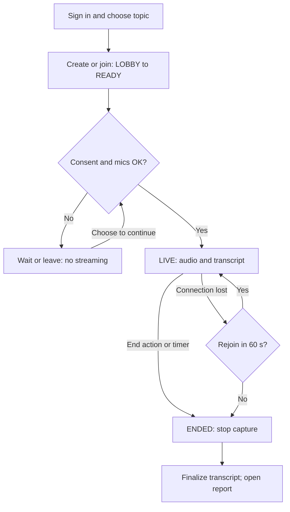
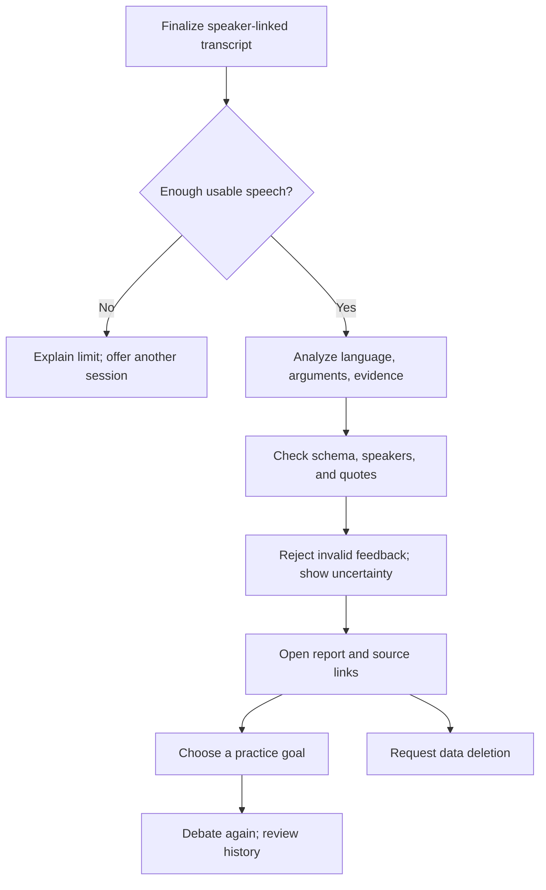

# DebateSpeak AI — Vision Document
*Performed: Codex, AI-assisted drafting for Nguyễn Bảo Minh Triết (24125047); Review: Trần Lê Anh Tuấn (24125107), pending; Edited: Codex, pending human verification.*

| Document control | Value |
|---|---|
| Course / team | CS300 / CSC13002 — Introduction to Software Engineering / Group 02 |
| Assignment | PA2-2026, Part B — Vision Document |
| Version / date | 0.1 / October 25, 2026 |
| Status | Initial draft for team review; revise in PA3 after TA feedback |
| Responsible owner | Nguyễn Bảo Minh Triết — 24125047 — Frontend & WebRTC/Audio Lead |
| Assigned reviewer | Trần Lê Anh Tuấn — 24125107 — AI Orchestrator & Analysis Lead |
| Work item | [SCRUM-21 — Vision Document](https://ndtloc0304.atlassian.net/browse/SCRUM-21) |

This document describes intended product behavior. Features, quality targets, and expected benefits are not claims of completed implementation or measured learning improvement. The ownership above records responsibility; it does not claim that human review or approval has occurred.

## 1. Introduction
*Performed: Codex for Nguyễn Bảo Minh Triết (24125047); Review: Trần Lê Anh Tuấn (24125107), pending; Edited: Codex.*

**Purpose.** Establish a shared product vision for DebateSpeak AI: a browser-based platform where two people practice spoken English through live debate and receive evidence-grounded feedback. The document defines the problem, intended users, product boundaries, major features, and measurable quality expectations. It guides subsequent use-case specifications, implementation priorities, and acceptance tests without replacing the Project Plan or detailed architecture specification.

**Audience.** The five-person engineering team, course instructors and teaching assistants, prospective learners, and the people responsible for moderation and operation.

**Terminology.** A *debate* is a two-person spoken exchange on a selected motion. A *transcript segment* is a timestamped utterance associated with a participant's audio track. *Grounding* means validating that a feedback item's cited words occur in the relevant speaker's transcript; it does not prove that the transcription or criticism is correct. CEFR levels A2, B1, B2, and C1 are self-selected personalization inputs, not certifications awarded by this product. MVP means the minimum complete product intended for the course demonstration; it does not mean the first development build.

**References and authority.** References are repository-relative so the document remains portable.

| Ref. | Source | Use in this vision |
|---|---|---|
| R1 | [PA2-2026 assignment](../assignments/PA2-2026.pdf), Part B and submission guidelines, pp. 2–5 | Required sections, feature paragraphs, Mermaid diagrams, attribution, Markdown and PDF deliverables |
| R2 | [Project Proposal](PROJECT_PROPOSAL.md), §§1–5 | Problem, audience, ten functional groups, scope |
| R3 | [Software Architecture Specification](../architecture/SOFTWARE_ARCHITECTURE_SPEC.md), §§1–4, 6–12, 15–16, 18 | Functional requirements, quality targets, consent, grounding, evaluation limits |
| R4 | [Existing App Survey](EXISTING_APP_SURVEY.md), §§2–5 | PA1 comparison and interaction patterns |
| R5 | [Testing Plan](../testing/TESTING_PLAN.md), §2 | Verification methods and planned learner pilot |
| R6 | [Development Roadmap](../ROADMAP.md), §§1–2 | Proposed course builds; schedule discrepancy recorded in §7 |
| R7 | [Repository operating guidelines](../../AGENTS.md), §§3–8 | Official roles, architecture, incremental delivery, human experience, evidence-based critique |
| R8 | [Jira work item SCRUM-21](https://ndtloc0304.atlassian.net/browse/SCRUM-21) | Assigned owner and reviewer; read on October 25, 2026 |

The assignment defines the deliverable format, and the repository guidelines govern engineering constraints. R2–R5 supply the product baseline. Unresolved differences between sources are recorded in §7 rather than silently treated as agreed decisions.

## 2. Positioning
*Performed: Codex for Nguyễn Bảo Minh Triết (24125047); Review: Trần Lê Anh Tuấn (24125107), pending; Edited: Codex.*

**Problem statement**

| Element | Statement |
|---|---|
| The problem of | Having too few accessible opportunities to practice spontaneous spoken English, defend an opinion, respond to disagreement, and obtain specific feedback on the same exchange |
| Affects | English learners across the intended A2–C1 range, particularly university students and non-native professionals who need extended speaking and reasoning practice |
| The impact of which is | Learners may know language rules but struggle to apply them while listening and responding; they cannot easily revisit their speech, identify recurring weaknesses, or distinguish weak reasoning from language mistakes |
| A successful solution would be | A repeatable browser-based peer debate experience with understandable consent, reliable audio, a speaker-attributed transcript, and a small set of actionable language and reasoning improvements linked to the learner's own words |

These needs are working hypotheses drawn from the PA1 proposal and survey, not findings from a completed learner study. The planned pilot in §6 will evaluate usability and perceived usefulness; it will not establish a causal improvement in language proficiency.

**Product position statement**

| Element | Statement |
|---|---|
| For | English learners who want to become more fluent and persuasive in unscripted discussions |
| Who | Need live practice responding to another person and concrete guidance on both expression and reasoning |
| The product name | DebateSpeak AI is an AI-assisted spoken-English learning web application |
| That | Connects two learners in a live audio debate and turns their exchange into personalized, quote-grounded language feedback, argument analysis, selected evidence checks, and follow-up practice |
| Unlike | Using separate solo speaking exercises, competitive debate scorecards, and general meeting tools to cover different parts of the learning process |
| Our product | Organizes peer interaction and post-debate reflection into one learning workflow, with explicit uncertainty, participant control, and feedback traceable to the transcript |

The intended value is the complete practice-to-reflection loop. A debate score is supporting feedback, not the product's primary measure of learner worth or progress.

## 3. Stakeholder and User Descriptions
*Performed: Codex for Nguyễn Bảo Minh Triết (24125047); Review: Trần Lê Anh Tuấn (24125107), pending; Edited: Codex.*

**Stakeholder summary**

| Stakeholder | Interest and responsibility | Expected value |
|---|---|---|
| Learners / debaters | Choose practice goals, consent to processing, participate, review feedback, manage their data | Accessible practice and useful corrections without public humiliation or unexpected recording |
| Moderators / administrators | Curate topics, handle abuse reports and account restrictions, oversee usage and deletion requests | Clear operational controls and enough context to investigate reported problems |
| Course instructors / TAs | Review deliverables and assess engineering quality | Traceable requirements, honest scope, reproducible builds, and observable end-to-end behavior |
| Engineering team | Deliver and maintain a working system within course time and service quotas | Explicit boundaries, measurable acceptance targets, and vendor-independent integration contracts |
| Pilot participants and feedback raters | Assess usability, transcript quality, and usefulness of suggestions | An informed, voluntary evaluation process with transparent limitations |

The engineering stakeholders retain the official responsibilities below; these roles do not imply that every member has reviewed this draft.

| Student ID | Full name | Official team role |
|---|---|---|
| 24125093 | Nguyễn Đình Thiên Lộc | DevOps & QA / Fact-Checking Lead |
| 24125047 | Nguyễn Bảo Minh Triết | Frontend & WebRTC/Audio Lead |
| 24125078 | Nguyễn Hồng Tấn Tài | Backend & Real-Time Media Lead |
| 24125058 | Nguyễn Anh Khoa | AI Audio & Speech Pipeline Lead |
| 24125107 | Trần Lê Anh Tuấn | AI Orchestrator & Analysis Lead |

**User summary**

| User profile | Context and needs | Product interaction |
|---|---|---|
| University learner, commonly B1–B2 | Practices extended opinions and rebuttals for academic discussion or speaking preparation | Selects an appropriate motion, debates with a peer, reviews quoted corrections and a short practice plan |
| Non-native professional, commonly B2–C1 | Needs clear claims, concessions, and evidence in workplace discussions | Practices defending a position and examines argument structure separately from language mechanics |
| Developing learner, commonly A2–B1 | Needs familiar topics, accessible vocabulary, and manageable feedback | Uses level-appropriate topics and focused corrections; may need more preparation time |
| Novice academic debater | Wants structured practice responding to opposing claims | Uses stance assignment and timed turns, then inspects missed rebuttals and supporting evidence |
| Moderator / administrator | Maintains a useful, safe practice environment | Manages topics, responds to abuse reports, and handles authorized operational actions |

Learner and moderator are the two primary human application roles. Teachers and TAs are stakeholders in this course project; a separate teacher dashboard is outside the MVP. An initial pilot should use consenting university participants; deployment to minors requires a separately reviewed participation and safeguarding approach.

**User environment.** Learners use a desktop or mobile browser, an Internet connection, a microphone, and preferably headphones to reduce echo. The core flow supports two authenticated participants on separate networks; the application supplies an invite code rather than assuming that an automatic matching service exists. The desktop acceptance matrix is the latest two stable releases of Chrome, Edge, and Firefox at test time. Responsive mobile layouts are intended, while mobile Chrome and Safari audio behavior is best effort until tested; denied microphone permission and unsupported browser capabilities must produce clear recovery guidance.

**Key needs and feature traceability**

| Need | Priority | Product response |
|---|---|---|
| N-01: Practice with a real person without complex setup | Must | Account/profile, topic selection, invite-based rooms, live audio: FG-01–04 |
| N-02: Understand and control capture, processing, and retention | Must | Dual consent, visible status, end/leave controls, deletion: FG-01, FG-03–05, FG-10 |
| N-03: Keep conversation intelligible and recover from interruptions | Must | Audio-first transport, mute, connection state, reconnection: FG-03–05 |
| N-04: Understand a language weakness and how to correct it | Must | Speaker-linked quotes, CEFR-aware explanations, focused practice: FG-05–06, FG-10 |
| N-05: Improve reasoning and assess factual support | Must | Rebuttal mapping, retrieved evidence, transparent uncertainty: FG-07–09 |
| N-06: Review previous sessions and choose what to practice next | Must | Saved reports and basic history; richer trends are Should: FG-10 |
| N-07: Manage inappropriate topics, abuse, and operating cost | Must | Topic moderation, reporting, restricted admin actions, bounded processing: FG-02–03, FG-08–10 |

**Alternatives and competition.** The following summarizes the PA1 survey (R4) as project research, not a fresh or exhaustive market audit. It identifies the workflows studied without asserting that a competitor lacks a feature today. No new competitor capability claims are introduced in this vision.

| Alternative studied in PA1 | Pattern relevant to this project | Implication for DebateSpeak |
|---|---|---|
| ArguFight | Structured debate and multiple evaluation perspectives | Make reasoning feedback understandable while keeping learner improvement ahead of winning |
| Luyennoi.com | Browser speaking practice and sentence-level feedback | Link corrections to specific transcript passages and keep entry simple |
| ELSA Speak | Detailed speech feedback and progress presentation | Provide focused practice and historical context; do not promise phoneme-level diagnosis in this MVP |
| Google Meet with Gemini | Live communication and post-session synthesis | Keep analysis out of the audio-critical path and organize the result after the exchange |
| Existing classroom or tutor-led practice | Human judgment and guided conversation | Support repeatable peer practice; do not claim to replace qualified teachers or official assessments |

## 4. Product Overview
*Performed: Codex for Nguyễn Bảo Minh Triết (24125047); Review: Trần Lê Anh Tuấn (24125107), pending; Edited: Codex.*

**Product perspective.** DebateSpeak is a standalone responsive web application. A Vite, React, TypeScript, and Tailwind CSS SPA communicates with a Python 3.11+ FastAPI backend, PostgreSQL 16 through SQLAlchemy 2 async ORM and Alembic, and Redis 7 with ARQ workers. LiveKit Cloud routes independent participant audio tracks. Streaming transcription and asynchronous analysis use `STTAdapter`, `LLMAdapter`, and `SearchAdapter` boundaries so a vendor change does not redefine the learning workflow.

**Core experience.** A learner signs in, selects a topic, and invites a partner. Both review the processing notice, explicitly consent, and complete a microphone check before the session enters `LIVE`. They debate with minimal visual interruption, then review a transcript and a personalized report. Heavy coaching and evidence retrieval run asynchronously; optional analysis must never delay or stop an otherwise healthy audio conversation.

**MVP boundary.** The intended complete MVP covers secure accounts, profiles, curated topics, two-person rooms, explicit consent, live audio, speaker-attributed transcription, grounded language and argument feedback, bounded fact-checking, transparent evaluation, and personalized reports with basic history. It also includes the administrative controls necessary for topic curation, abuse handling, and data deletion. Early builds deliver working subsets of this flow and must be described as such.

**Deferred scope.** Live video, audience rooms, tournaments, public rankings/ELO, automated partner matching, payments, teacher dashboards, advanced phoneme-level pronunciation scoring, multi-provider judging panels, sophisticated proficiency progression models, and multi-region infrastructure are outside the MVP. Basic historical metrics do not imply that the product can certify CEFR improvement. The MVP uses one debate judge and two claim-evaluation perspectives; a larger judge panel is a stretch feature.

**Assumptions and dependencies**

| Assumption or dependency | Consequence and planned response |
|---|---|
| Two willing participants are available | Invite-based joining is sufficient for the MVP; time waiting for a partner is excluded from onboarding measurements |
| Browser permissions and a usable network are available | Explain permission failures, offer a microphone check, show connection state, and support a 60-second reconnection grace period |
| Managed media and cloud STT/LLM/search quotas are available | Verify limits before load tests, bound jobs and claims, record usage, and return explicit partial or unavailable analysis when needed |
| Local STT fallback has adequate compute | Benchmark it separately; do not assume cloud latency targets remain achievable during fallback |
| Transcript text is imperfect | Flag uncertain recognition, permit correction as specified, preserve attribution, and avoid treating a matched quote as proof of an error |
| A single course deployment has sufficient capacity | Test the 10-room target on documented hardware; do not present a free service tier as a capacity guarantee |
| Learner benefits need validation | Run the planned pilot and report observations and limitations; do not claim validated proficiency gains |

**Human consequences.** Participation is voluntary: declining consent keeps the session out of `LIVE`, and either participant may end the session. A microphone test requires an explicit user action and browser permission; it must remain local before dual consent, without upload, storage, or transcription. Live controls prioritize audibility, presence, mute, and leaving; detailed criticism belongs in post-debate reflection. Feedback must state the specific failure, quote the evidence, and give a repair or practice exercise without insulting the person, attributing motives, or treating accent as weak reasoning.

## 5. Product Features and Workflows
*Performed: Codex for Nguyễn Bảo Minh Triết (24125047); Review: Trần Lê Anh Tuấn (24125107), pending; Edited: Codex.*

Feature identifiers preserve the ten functional groups in R2 and map to the detailed requirements in R3. Each paragraph describes intended behavior and its user value; priority labels identify the complete MVP rather than the current implementation state. A Must label applies to the group's core workflow; individual Should/Could requirements retain their detailed priorities in R3, including the explicitly deferred features below.

**FG-01 — User Account and Profile Management (Must; FR-01–05).** Learners register, sign in, and maintain their display name, native language, self-assessed CEFR level, and speaking goals. Secure authentication and access controls protect individual accounts and restrict administrative operations. Profile information helps the system choose understandable feedback and appropriate practice suggestions for each learner. Account and associated learning-data deletion give learners meaningful control over their participation.

**FG-02 — Debate Topic and Difficulty Management (Must; FR-06–09).** Learners browse and filter curated motions by theme and language difficulty before choosing a debate. Moderators create, revise, or retire topics and maintain difficulty labels and optional vocabulary support. This reduces the burden of inventing a topic and helps developing learners avoid a discussion they cannot reasonably participate in. Personalized recommendations are an enhancement after the basic catalog and moderation workflow work end to end.

**FG-03 — Debate Room and Session Management (Must; FR-10–17).** Two authenticated learners create or join a room through an invite code, choose opposing stances, and follow the `LOBBY → READY → LIVE → ENDED` lifecycle. The server enforces the two-person capacity, readiness, explicit dual consent, and synchronized timing rather than trusting client displays. Either participant can leave or end the debate, and a disconnection starts a visible 60-second recovery period. Predictable session rules and abuse-reporting controls benefit both learners and moderators while reducing uncertainty during a socially demanding activity.

**FG-04 — Real-Time Audio Communication (Must; FR-18–21).** Participants speak through independent LiveKit Cloud audio tracks after the consent gate allows transmission. An explicit local microphone test, mute controls, active-speaker indicators, and connection feedback help learners understand whether they can be heard. Reconnection attempts preserve the existing participant identity and room context when possible. Audio takes priority over analysis so learners can continue communicating when a coaching or transcription provider fails.

**FG-05 — Speech-to-Text and Speaker Attribution (Must; FR-23–28).** A transcription worker processes each consenting participant's track and produces timestamped partial and finalized transcript segments. Track identity associates segments with a participant, while confidence indicators and transcript correction support handling recognition mistakes. The provider-independent STT adapter permits a configured streaming service and a local fallback without changing the learner-facing report contract. Learners gain a reviewable record and the coaches gain attributable evidence, but recognition and attribution accuracy still require measurement.

**FG-06 — English Language Analysis (Must; FR-29–33).** The Language Coach combines speaking metrics such as words per minute, filler frequency, pauses, and vocabulary diversity with grammar and vocabulary suggestions. Every retained critique cites the learner's own transcript segment, explains the specific issue, and offers a correction or practice instruction appropriate to the selected CEFR level. The Grounding Guard discards feedback with an invalid quote or speaker reference, and uncertain transcription must not be presented as a confirmed learner error. Learners benefit from a prioritized set of actionable improvements instead of an overwhelming stream of live corrections.

**FG-07 — Argument and Debate Analysis (Must; FR-34–37).** The Argument Coach identifies claims, supporting reasons, counterarguments, concessions, and attempted rebuttals in the dialogue. Feedback explains unanswered points or weak reasoning with the relevant speaker's exact words and enough surrounding context to justify the criticism. The coach separates argument quality from grammar and accent, and pairs a substantiated problem with a concrete way to improve the response. Learners practice intellectual honesty and clearer reasoning without being assigned personal motives or unsupported labels.

**FG-08 — Fact-Checking and Evidence Analysis (Must; FR-38–42).** The system selects check-worthy factual claims within a bounded workload, initially up to eight claims per debate, and retrieves evidence through a search adapter. An evidence evaluator and a separate skeptical pass assess the retrieved material while treating external text as data rather than instructions. Reports show source links and distinguish Supported, Partially Supported, Contradicted, Insufficient Evidence, and Not Verifiable outcomes, with disagreement made visible. Learners can inspect why a claim is uncertain or unsupported instead of receiving an unexplained assertion of truth from a model.

**FG-09 — Evaluation and Consensus (Must core; FR-43–47).** A debate judge uses a versioned rubric to summarize reasoning performance, while deterministic rules combine available evaluation results and expose disagreement. The MVP labels the debate score as coming from a single evaluator and caps its self-reported confidence at 0.8, as specified in R3. Conflicting claim verdicts are marked contested; if multiple debate judges are later enabled, a score spread greater than 15 points on a 100-point scale triggers a contested flag. Learners receive an interpretable assessment whose uncertainty is visible, while a multi-provider judge panel remains outside the MVP commitment.

**FG-10 — Learning History and Personalized Reports (Must core; FR-48–54).** After a debate, each learner receives a report combining their transcript-linked feedback, language metrics, argument findings, selected evidence checks, and a short practice plan. Basic history lets learners revisit sessions and compare observations over time; richer trend interpretation follows only after the core reporting workflow is reliable. The interface displays progress and identifies incomplete analysis when a provider fails, rather than inventing a complete result. Learners can delete their debate data and use the report to choose their next practice goal without treating a score trend as certified proficiency improvement.

**Workflow 1 — Join and complete a live debate**

The room reaches `READY` only after both participants join. The decision requires explicit consent and a successful local microphone check from both learners; consent refusal prevents network audio transmission and transcription. If a disconnected session ends early, analysis uses the partial transcript only when the architecture's minimum of 60 seconds of speech is available; otherwise the interface explains that there is insufficient speech for an assessment.

**Workflow 2 — Turn a debate into follow-up practice**

These diagrams describe the intended user workflows, not proof that the implementation passes them. Fact-checking, detailed coaching, and judge evaluation run outside the live audio path.

## 6. Non-Functional Requirements and Success Measures
*Performed: Codex for Nguyễn Bảo Minh Triết (24125047); Review: Trần Lê Anh Tuấn (24125107), pending; Edited: Codex.*

The following requirements retain R3's identifiers and numeric targets. All are **unverified project targets**. Tests must record deployment resources, provider/model versions, browser versions, network conditions, sample size, and failures; median latency must not conceal poor tail performance.

| ID / quality | Target | Verification approach |
|---|---|---|
| NFR-01 — Audio latency | Median one-way mouth-to-ear delay at most 500 ms on the documented home-network test setup | Two-client audio timing; record median and p95 across separate networks |
| NFR-02 — Transcript delay | Median final-segment delay at most 3 s after speech stops; partial-text target at most 1.5 s | Timestamp utterance completion and UI receipt; use at least 20 utterances and report p50/p95 |
| NFR-03 — Transcript accuracy | Word error rate at most 20% on quiet, team-recorded B1–B2 accented-English speech | Compare at least 10 recorded debates with human reference transcripts; report results by speaker group |
| NFR-04 — Attribution | At least 98% of segments assigned to the correct participant | Compare track-linked output with human-labeled segments, including overlap and reconnect cases |
| NFR-05 — Report latency | Median report completion at most 3 min after a 10-min debate; visible processing status | Measure from session end to report readiness; count failures separately and report p95 |
| NFR-06 — Degraded service | Existing audio continues when AI services are unavailable | Inject STT, LLM, and search failures independently; verify continued audio and honest partial/unavailable results |
| NFR-07 — Recovery | Reconnect within 60 s in at least 90% of brief-drop tests, without duplicate transcript segments | Interrupt network connectivity, restore within grace, and inspect participant identity and event replay |
| NFR-08 — Concurrency | 10 simultaneous rooms / 20 participants on the demo deployment | Run a documented load scenario; verify isolation, latency, quota use, and explicit failures |
| NFR-09 — Privacy | No raw-audio persistence by default; consent before processing; 90-day default transcript retention; immediate hiding after deletion request and hard deletion within 7 days | Inspect storage and access; test missing consent, retention expiry, and deletion propagation in application-managed data |
| NFR-10 — Security | HTTPS/WSS and encrypted WebRTC transport; Argon2id password hashing; access control on protected operations; zero secrets in distributed client code or tracked source | Negative authorization and cross-room tests, transport inspection, secret scanning, and documented review against OWASP Top 10 categories |
| NFR-11 — Usability | First live debate within 3 min of sign-up, excluding partner wait; feedback understandable at selected CEFR level | Observe onboarding and report comprehension; separately report login-to-LIVE timing used by R5 |
| NFR-12 — Platforms | Pass core-flow tests on latest two stable desktop Chrome, Edge, and Firefox releases at test time | Record an explicit version matrix; test responsive layout and disclose unverified mobile audio behavior |
| NFR-13 — Grounding | 100% of retained language/argument feedback quotes match the referenced speaker's transcript | Validate every retained item; reject invented quotes and wrong-speaker references in adversarial fixtures |
| NFR-14 — Cost | Keep mean AI cost per 10-min debate below the configured budget; default fact-check cap of eight claims | Log usage and costs; enforce claim/job limits; document the budget value before acceptance testing |
| NFR-15 — Maintainability | Vendor adapters isolate integrations; CI lint/type checks pass; backend business-logic line coverage at least 70% | Exercise adapter contracts, inspect CI results, and publish coverage for the defined business-logic scope |

**Standards and operating constraints.** The solution uses browser WebRTC for media, HTTPS/WSS for application traffic, and the repository's SPA/async-backend architecture. Security review uses OWASP Top 10 categories as a checklist, not as a certification claim. Microphone controls, consent, and report navigation should remain usable with a keyboard and readable status text; no accessibility conformance level is claimed without an audit. Local and CI paths must be portable, secrets remain outside version control, and the PDF is built through `latexmk` from the Markdown-derived LaTeX source.

**Learner-oriented evaluation.** R5 proposes at least six pairs (12 participants), each completing a ten-minute debate and reviewing their report. Targets inherited from R3 and R5 are System Usability Scale at least 70, mean feedback usefulness at least 3.8/5, report clarity and actionability at least 4.0/5, and at least 85% of sampled grammar feedback judged correct by an English teacher or qualified rater. Recruitment, consent, and rater availability must be confirmed before this evaluation. Self-reported confidence and willingness to return are descriptive observations, not proof that the system improves speaking ability.

**Safety and interpretation.** A valid quote is necessary but insufficient for a correct critique; transcript errors and invalid reasoning can survive a string-match guard. Track-based attribution is a design strategy, with the measured 98% target retained instead of a promise of perfect speaker identification. Provider quotas, fallback hardware, and mobile network conditions may prevent a target from being met; such failures must be reported rather than hidden in aggregate results.

## 7. Source Alignment and Decisions for Review
*Performed: Codex for Nguyễn Bảo Minh Triết (24125047); Review: Trần Lê Anh Tuấn (24125107), pending; Edited: Codex.*

| Topic | Treatment in this draft | Required follow-up |
|---|---|---|
| Course schedule | R6 and Jira use five PA-aligned sprints; R7 and parts of R3/R5 describe a four-increment schedule with different milestone placement | Reconcile the Project Plan and delivery documents in SCRUM-20; this vision does not change dates or override engineering invariants |
| Grounding and attribution claims | R2/R4 use absolute language about hallucinations and speaker accuracy; this draft adopts R3's validation rule and measured attribution target | Align the stronger wording in the proposal and survey during the review revision |
| CEFR scope | Product range remains A2–C1; B1–B2 is the planned transcription test population | Do not generalize pilot accuracy to untested proficiency groups |
| Supported browsers | Use R3's rolling desktop test matrix rather than R2's older fixed minimum versions | Record actual versions and mobile limitations in test evidence |
| Consent and capture | Local mic testing is distinct from streaming; no remote audio or transcription before both participants consent | Verify server/token enforcement and stop behavior before enabling live rooms |
| Retention and deletion | Application targets are specified; service-side retention and copies require verification | Document provider retention and shared-debate deletion behavior before real learner use |
| Cost threshold | Keep the existing configurable budget instead of inventing a currency value | Choose and record a numeric budget against actual service pricing before load and cost acceptance tests |
| Evidence confidence | Grounding, rubric scores, and model confidence remain aids to reflection | Validate feedback with human raters and display uncertainty or insufficient evidence clearly |

**Review completion.** The assigned reviewer should check alignment with R1–R7, confirm scope and unresolved decisions, and record the review outcome before this document is approved. Jira status, human review attribution, and submission readiness must reflect actual evidence. This draft fulfills the writing task but does not certify completion of the product or its acceptance tests.

## 8. AI Assistance Record
*Performed: Codex for Nguyễn Bảo Minh Triết (24125047); Review: Trần Lê Anh Tuấn (24125107), pending; Edited: Codex.*

| Item | Record |
|---|---|
| Date / work item | October 25, 2026 / SCRUM-21 |
| Tool and requested assistance | OpenAI Codex; user requested creation of the Vision Document from the project documents |
| Inputs | Sources R1–R8, including the original PA2 PDF and the local proposal, architecture, survey, test plan, roadmap, and operating guidelines |
| Assistance performed | Source synthesis; English drafting; positioning and needs tables; ten feature paragraphs; two Mermaid workflows; quality-target traceability; Markdown-to-PDF preparation |
| Human responsibility | Nguyễn Bảo Minh Triết (24125047) owns verification and submission; Trần Lê Anh Tuấn (24125107) is the assigned reviewer; review remains pending |
| Limits | No learner research results, implementation completion, human approval, or new competitor capability claims were fabricated; outstanding source conflicts are recorded in §7 |

This entry supports the team's PA2 AI Usage Report. It is not a substitute for the full sprint-wide usage log, meeting records, training evidence, or submission checklist required by the course.
