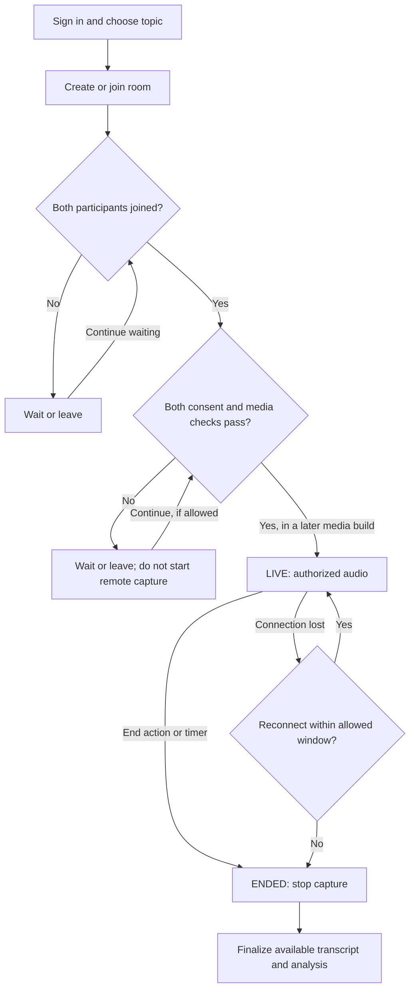
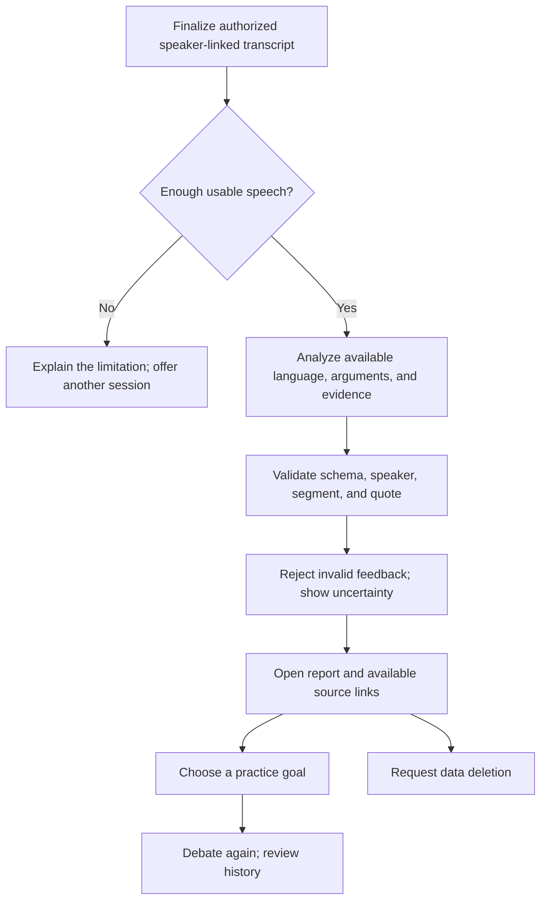

# DebateSpeak AI — Vision Document

| Document control | Value |
|---|---|
| Course / team | CS300 / CSC13002 — Introduction to Software Engineering / Group 02 |
| Assignment | PA3-2026, Part B — Revised Vision Document |
| Version / date | 0.2 / 2026-11-14 |
| Status | PA3 revision complete for owner review; reviewer sign-off pending |
| Responsible owner | Nguyễn Anh Khoa — 24125058 — AI Audio & Speech Pipeline Lead |
| Assigned reviewer | Nguyễn Đình Thiên Lộc — 24125093 — DevOps & QA / Fact-Checking Lead |
| Work item | [SCRUM-35 — Revised plan and Vision](https://ndtloc0304.atlassian.net/browse/SCRUM-35) |

This document describes the intended DebateSpeak AI product and its requirements. A feature described here is not necessarily implemented or verified. The product vision covers the intended learning experience; the PA3 implementation is a limited sprint slice, not the complete product.

## 1. Introduction
*Performed: Nguyễn Anh Khoa (24125058); Review: pending, Nguyễn Đình Thiên Lộc (24125093)*

**Purpose.** This document establishes the shared product vision for DebateSpeak AI: a browser-based platform where English learners practice spoken argument through peer debate and receive useful, evidence-grounded feedback. It describes the intended users, their needs, the product’s distinguishing value, its functional groups, workflows, quality targets, and scope boundaries.

**PA3 revision scope.** This is the second iteration of the Vision Document. The team’s PA3 change log records that no PA2 TA feedback had been received as of 2026-11-10. Accordingly, this revision does not invent TA comments. It clarifies the current sprint boundary and makes the requirements, alternatives, and user-environment descriptions explicit for review.

**PA3 implementation boundary.** The product vision remains the complete DebateSpeak experience. For PA3, the graded implementation focuses on FG-03, Room and Session Management. Registration and login support that flow; topic listing and filtering are identified as extra scope in the PA3 sprint notes. Live audio, streaming speech-to-text, and AI analysis are not claims of PA3 completion.

**Audience.** The five-person engineering team, course instructors and teaching assistants, prospective learners, and people responsible for moderation and operation.

**Terminology.** A *debate* is a two-person spoken exchange on a selected motion. A *transcript segment* is a timestamped utterance associated with a participant’s audio track. *Grounding* means validating that feedback refers to evidence in the correct learner’s transcript; a matching quote alone does not prove that the feedback is correct.

**References and authority.** Links are repository-relative so this document remains portable.

| Ref. | Source | Use in this vision |
|---|---|---|
| R1 | [Project Proposal](PROJECT_PROPOSAL.md) | Product problem, target users, ten functional groups, and product scope |
| R2 | [Software Architecture Specification](../architecture/SOFTWARE_ARCHITECTURE_SPEC.md) | Functional requirements, quality targets, consent, grounding, evaluation, and security constraints |
| R3 | [Existing App Survey](EXISTING_APP_SURVEY.md) | Alternatives studied and interaction patterns |
| R4 | [Testing Plan](../testing/TESTING_PLAN.md) | Planned verification and learner evaluation |
| R5 | [Development Roadmap](../ROADMAP.md) | Product build sequence and later-sprint boundaries |
| R6 | [Repository operating guidelines](../../AGENTS.md) | Official team roles, architecture, incremental delivery, human impact, and evidence-based feedback |
| R7 | [PA3 Changes](../pa3/Changes.md) | PA3 change tracking, repository cleanup, and scope notes |
| R8 | [PA3 sprint instructions](../pa3/README.md) | Current sprint scope, branch process, and PA3 deliverables |
| R9 | [SCRUM-35 — Revised plan and Vision](https://ndtloc0304.atlassian.net/browse/SCRUM-35) | Assigned PA3 work item; verify its current status in Jira |

The proposal and architecture describe the intended product, while the PA3 sprint notes define the current implementation slice. A use case, feature, or quality target in this vision is not evidence that it has been built, measured, or approved.

## 2. Positioning
*Performed: Nguyễn Anh Khoa (24125058); Review: pending, Nguyễn Đình Thiên Lộc (24125093)*

### Problem statement

| Element | Statement |
|---|---|
| The problem of | Having too few accessible opportunities to practice spontaneous spoken English, defend an opinion, respond to disagreement, and receive specific feedback on the same exchange |
| Affects | English learners across the intended A2–C1 range, particularly university students and non-native professionals who need extended speaking and reasoning practice |
| The impact of which is | Learners may know language rules but struggle to apply them while listening and responding. They may also lack a practical way to revisit what they said, recognize recurring weaknesses, or assess how well they supported and answered an argument. |
| A successful solution would be | A repeatable browser-based peer debate experience with understandable consent, reliable room management, and—when the relevant later features are available—a speaker-attributed transcript and actionable language and reasoning feedback |

These needs are working hypotheses based on the project proposal and app survey, not findings from a completed learner study. A future pilot should evaluate usability and perceived usefulness; it should not be represented as proof of improved proficiency without appropriate evidence.

### Product position statement

| Element | Statement |
|---|---|
| For | English learners who want to become more fluent and persuasive in unscripted discussions |
| Who | Need live practice responding to another person and concrete guidance on both expression and reasoning |
| The product name | DebateSpeak AI is an AI-assisted spoken-English learning web application |
| That | Is intended to connect two learners in a live debate and turn their exchange into personalized, transcript-grounded language feedback, argument analysis, selected evidence checks, and follow-up practice |
| Unlike | Using separate solo speaking exercises, competitive debate scorecards, and general meeting tools to cover different parts of the learning process |
| Our product | Organizes peer interaction and post-debate reflection into one learning workflow, with explicit uncertainty, participant control, and feedback that can be traced to transcript evidence |

The intended value is the complete practice-to-reflection loop. A debate score is supporting feedback, not the product’s primary measure of a learner’s worth or progress.

## 3. Stakeholder and User Descriptions
*Performed: Nguyễn Anh Khoa (24125058); Review: pending, Nguyễn Đình Thiên Lộc (24125093)*

### Stakeholder summary

| Stakeholder | Interest and responsibility | Expected value |
|---|---|---|
| Learners / debaters | Choose practice goals, control consent, participate, review feedback, and manage their data | Accessible practice and useful corrections without public humiliation or unsupported claims |
| Moderators / administrators | Curate topics, handle abuse reports and account restrictions, and oversee authorized operational actions | Clear controls and enough context to investigate reports responsibly |
| Course instructors / TAs | Review deliverables and assess engineering quality | Traceable requirements, honest scope, reproducible builds, and observable end-to-end behavior |
| Engineering team | Deliver and maintain a working system within course time and service quotas | Explicit boundaries, measurable acceptance targets, and vendor-independent integration contracts |
| Pilot participants and feedback raters | Assess usability, transcript quality, and usefulness of suggestions | An informed, voluntary evaluation process with transparent limitations |

The team’s official roles are listed below. A role assignment does not imply that the member has reviewed or approved this document.

| Student ID | Full name | Official team role |
|---|---|---|
| 24125093 | Nguyễn Đình Thiên Lộc | DevOps & QA / Fact-Checking Lead |
| 24125047 | Nguyễn Bảo Minh Triết | Frontend & WebRTC/Audio Lead |
| 24125078 | Nguyễn Hồng Tấn Tài | Backend & Real-Time Media Lead |
| 24125058 | Nguyễn Anh Khoa | AI Audio & Speech Pipeline Lead |
| 24125107 | Trần Lê Anh Tuấn | AI Orchestrator & Analysis Lead |

### User summary

| User profile | Context and needs | Product interaction |
|---|---|---|
| University learner, commonly B1–B2 | Practices extended opinions and rebuttals for academic discussion or speaking preparation | Selects an appropriate motion, debates with a peer, and reviews relevant feedback when available |
| Non-native professional, commonly B2–C1 | Needs clear claims, concessions, and evidence in workplace discussions | Practices defending a position and examines argument structure separately from grammar |
| Developing learner, commonly A2–B1 | Needs familiar topics, accessible vocabulary, and manageable feedback | Uses level-appropriate topics and focused corrections; may need additional preparation time |
| Novice academic debater | Wants structured practice responding to opposing claims | Uses a motion, stance, and timed turns where supported, then reviews missed rebuttals and evidence |
| Moderator / administrator | Maintains a useful and safe practice environment | Manages topics, responds to abuse reports, and performs authorized operational actions |

Learners and moderators are the primary human application roles. Teachers and TAs are stakeholders in this course project; a teacher dashboard is outside the current MVP scope. The intended learner range is A2–C1, but any transcription or quality evaluation applies only to the actual test population and conditions used.

**User environment.** Learners use a modern desktop or mobile browser, an Internet connection, and a microphone; headphones are recommended to reduce echo. The intended debate flow supports two authenticated participants. Live media features require suitable browser permissions and connectivity. PA3’s room-management slice must not be presented as a completed live-audio experience.

### Key needs and feature traceability

| Need | Priority | Product response |
|---|---|---|
| N-01: Practice with a real person without complex setup | Must | Accounts, topic selection, invite-based rooms, and live audio in the intended product: FG-01–04 |
| N-02: Understand and control capture, processing, and retention | Must | Clear consent, visible status, end/leave controls, and data controls: FG-01, FG-03–05, FG-10 |
| N-03: Keep conversation intelligible and recover from interruptions | Must | Audio-first transport, mute, connection state, and reconnection: FG-03–05 |
| N-04: Understand a language weakness and how to correct it | Must | Speaker-linked evidence, CEFR-aware explanations, and focused practice: FG-05–06, FG-10 |
| N-05: Improve reasoning and assess factual support | Must | Rebuttal mapping, retrieved evidence, and transparent uncertainty: FG-07–09 |
| N-06: Review previous sessions and choose what to practice next | Must | Saved reports and basic history; richer trends are lower-priority: FG-10 |
| N-07: Manage inappropriate topics, abuse, and operating cost | Must | Topic moderation, reporting, restricted admin actions, and bounded processing: FG-02–03, FG-08–10 |

### Alternatives and competition

This comparison summarizes the project’s existing-app survey. It is not a fresh or exhaustive market audit and makes no claims about current competitor capabilities beyond that survey.

| Alternative studied | Pattern relevant to this project | Implication for DebateSpeak |
|---|---|---|
| ArguFight | Structured debate and multiple evaluation perspectives | Make reasoning feedback understandable while keeping learner improvement ahead of winning |
| Luyennoi.com | Browser speaking practice and sentence-level feedback | Link corrections to specific transcript passages and keep entry simple |
| ELSA Speak | Detailed speech feedback and progress presentation | Provide focused practice and historical context; do not promise unsupported phoneme-level diagnosis |
| Google Meet with Gemini | Live communication and post-session synthesis | Keep analysis out of the audio-critical path and organize results after the exchange |
| Classroom or tutor-led practice | Human judgment and guided conversation | Support repeatable peer practice; do not claim to replace qualified teachers or official assessments |

## 4. Product Overview
*Performed: Nguyễn Anh Khoa (24125058); Review: pending, Nguyễn Đình Thiên Lộc (24125093)*

**Product perspective.** DebateSpeak is intended to be a standalone responsive web application. The planned architecture uses a Vite, React, TypeScript, and Tailwind CSS single-page application with a Python 3.11+ FastAPI backend, PostgreSQL, Redis, and provider adapters for real-time media, speech-to-text, language models, and search. These are design choices, not a claim that every service is currently implemented.

**Core experience.** In the intended full product, a learner signs in, selects a topic, and invites a partner. Both participants review the processing notice and provide explicit consent before any remote audio processing begins. They complete a microphone check and proceed only when required room conditions are satisfied. After the debate, the product may provide a transcript and available learning feedback, with limitations clearly shown.

**PA3 scope.** PA3’s graded implementation is the FG-03 room/session workflow. The PA3 sprint notes identify registration/login as necessary support for that workflow and topic listing/filtering as extra work. Room creation, invite-based joining, lobby/readiness, and capacity/state validation are relevant to the sprint slice. The existence of those requirements in this document does not establish that they are complete; implementation and verification must be demonstrated separately.

**Full-product MVP boundary.** The intended product MVP spans accounts and profiles, curated topics, two-person rooms, explicit consent, live audio, speaker-attributed transcription, grounded language and argument feedback, bounded fact-checking, evaluation, and learning reports. These capabilities are planned across multiple increments and are not all part of PA3.

**Deferred or optional scope.** Live video, audience rooms, tournaments, public rankings/ELO, automated partner matching, payments, teacher dashboards, advanced phoneme-level pronunciation scoring, and large judge panels are outside the current MVP boundary unless the team explicitly revises the scope.

### Assumptions and dependencies

| Assumption or dependency | Consequence and planned response |
|---|---|
| Two willing participants are available | Invite-based joining is sufficient for the MVP; time waiting for a partner is excluded from onboarding measurements |
| Browser permissions and a usable network are available | Explain permission failures, provide a microphone check when implemented, show connection state, and test reconnection behavior |
| Managed media and cloud STT/LLM/search quotas are available | Verify limits before load tests, bound jobs and claims, record usage, and return explicit partial or unavailable analysis when needed |
| Local STT fallback has adequate compute | Benchmark it separately; do not assume cloud latency targets remain achievable during fallback |
| Transcript text is imperfect | Identify uncertain recognition, permit correction where specified, preserve attribution, and avoid treating a matching quote as proof of an error |
| A single course deployment has sufficient capacity | Test the stated room target on documented hardware; do not present a free service tier as a capacity guarantee |
| Learner benefits need validation | Run the planned pilot and report observations and limitations; do not claim validated proficiency gains |

**Human consequences.** Participation is voluntary. Declining consent must not be treated as consent, and the product should provide an accessible way to wait or leave. A microphone test should require an explicit user action and remain local unless the user separately starts an authorized media flow. Feedback should be specific and evidence-based, not insulting. If transcript quality or analysis is insufficient, the product should say so rather than invent results.

## 5. Product Features and Workflows
*Performed: Nguyễn Anh Khoa (24125058); Review: pending, Nguyễn Đình Thiên Lộc (24125093)*

The feature identifiers preserve the ten functional groups in the proposal and map to the architecture’s functional requirements. These paragraphs describe intended product behavior and user value. They do not assert that a feature is implemented. PA3 work is scoped separately in §4 and in the PA3 sprint documents.

**FG-01 — User Account and Profile Management (FR-01–05).** Learners register, sign in, and manage the account information needed for practice. The intended profile includes a display name, native language, self-assessed CEFR level, and speaking goals where those capabilities are in scope. Authentication and access checks protect room and learner data. Registration and login support the PA3 room workflow; profile editing and other account features must be tracked according to their planned delivery scope.

**FG-02 — Debate Topic and Difficulty Management (FR-06–09).** Learners browse and filter curated debate motions by theme and language difficulty before choosing a topic. Moderators manage the topic catalogue and its availability. Topic selection should help learners find an appropriate challenge without presenting a difficulty tag as a certified proficiency assessment. PA3 notes identify topic listing/filtering as extra scope, not the central graded implementation.

**FG-03 — Debate Room and Session Management (FR-10–17).** Two authenticated learners create or join a room through an invitation and see authoritative room membership and readiness. The room enforces its capacity and allowed state transitions; retries should not silently create duplicate membership. Consent and readiness are separate concepts: a room’s lobby state must not be interpreted as permission to capture or process media. FG-03 is the main PA3 implementation focus, but each behavior is complete only when supported by working code and verification evidence.

**FG-04 — Real-Time Audio Communication (FR-18–21).** In a later product increment, participants communicate using independent audio tracks after required consent and media checks. Users can control mute and see connection status. Audio remains the priority if optional services fail; loss of AI services must not unnecessarily interrupt a healthy conversation.

**FG-05 — Speech-to-Text and Speaker Attribution (FR-23–28).** A later transcription worker processes authorized participant tracks and produces timestamped partial and finalized transcript segments. Track identity is the primary speaker-attribution source. Uncertain recognition should be visible, and persistence or retry behavior should avoid duplicate final segments.

**FG-06 — English Language Analysis (FR-29–33).** The Language Coach is intended to combine measurable speaking indicators—such as words per minute, filler frequency, pauses, and vocabulary diversity—with grammar and vocabulary feedback. Each retained criticism should identify the relevant learner and transcript evidence and offer a practical correction or exercise. Unavailable or uncertain analysis should be reported honestly.

**FG-07 — Argument and Debate Analysis (FR-34–37).** The Argument Coach identifies claims, supporting reasons, counterarguments, concessions, and attempted rebuttals in the dialogue. It assesses whether a learner addressed the other speaker’s points without conflating accent or grammar with argument quality. Potential fallacy feedback requires a contextual example and should not be generated from a label alone.

**FG-08 — Fact-Checking and Evidence Analysis (FR-38–42).** The product selects check-worthy factual claims within a bounded workload and retrieves supporting evidence through a search adapter. External snippets are evidence to assess, not trusted instructions. Verdicts should preserve uncertainty and link to sources where available; unavailable search results should not be represented as verified facts.

**FG-09 — Evaluation and Consensus (FR-43–47).** A debate judge uses a versioned rubric to summarize debate performance, while deterministic rules combine available evaluation results. The product should distinguish an individual judge’s assessment from optional multi-agent or human evaluation. A score is one aid to reflection, not a definitive measure of a learner’s ability.

**FG-10 — Learning History and Personalized Reports (FR-48–54).** After a supported debate, each learner receives a report combining available transcript-linked feedback, language metrics, argument observations, and practice suggestions. Learners can review prior sessions and observe trends where implemented. Reports must indicate missing or unavailable analysis and must not present observations as certified proficiency gains.

### Workflow 1 — Join and complete a live debate

The diagram describes the intended full-product workflow, not PA3 implementation status. A room being ready does not grant consent. Remote audio processing must not begin before required participant authorization and media checks are satisfied.

### Workflow 2 — Turn a debate into follow-up practice

These diagrams describe intended behavior, not evidence that the implementation passes the workflows. Detailed coaching, fact-checking, and judging should run outside the live audio-critical path.

## 6. Non-Functional Requirements and Success Measures
*Performed: Nguyễn Anh Khoa (24125058); Review: pending, Nguyễn Đình Thiên Lộc (24125093)*

The following are planned, **unverified project targets** inherited from the architecture. Tests must record deployment resources, provider and model versions, browser versions, test conditions, sample sizes, and failures. A target is not an achieved result until measurements are collected and reviewed.

| ID / quality | Target | Verification approach |
|---|---|---|
| NFR-01 — Audio latency | Median one-way mouth-to-ear delay at most 500 ms on the documented home-network test setup | Measure two-client audio timing; record median and p95 across separate networks |
| NFR-02 — Transcript delay | Median final-segment delay at most 3 s after speech stops; partial-text target at most 1.5 s | Timestamp utterance completion and UI receipt; test at least 20 utterances under documented conditions |
| NFR-03 — Transcript accuracy | Word error rate at most 20% on quiet, team-recorded B1–B2 accented-English speech | Compare at least 10 recorded debates with human reference transcripts; report the tested accents and conditions |
| NFR-04 — Attribution | At least 98% of segments assigned to the correct participant | Compare track-linked output with human-labeled segments, including overlap and reconnect cases |
| NFR-05 — Report latency | Median report completion at most 3 min after a 10-min debate; visible processing status | Measure from session end to report readiness; report failures and partial results separately |
| NFR-06 — Degraded service | Existing audio continues when AI services are unavailable | Inject STT, LLM, and search failures independently; verify audio continuity and honest partial/unavailable status |
| NFR-07 — Recovery | Reconnect within 60 s in at least 90% of brief-drop tests, without duplicate transcript segments | Interrupt and restore network connectivity; inspect participant state and persisted segments |
| NFR-08 — Concurrency | 10 simultaneous rooms / 20 participants on the demo deployment | Run a documented load scenario; verify isolation, latency, quota use, and explicit failure behavior |
| NFR-09 — Privacy | No raw-audio persistence by default; consent before processing; 90-day default transcript retention; immediate hiding after deletion request and hard deletion within 7 days | Inspect storage, consent enforcement, provider retention, deletion behavior, and relevant logs |
| NFR-10 — Security | HTTPS/WSS and encrypted WebRTC transport; Argon2id password hashing; access control on protected operations; no secrets in distributed client code or tracked source | Review configuration and authorization; run security checks and tests against protected operations |
| NFR-11 — Usability | First live debate within 3 min of sign-up, excluding partner wait; feedback understandable at selected CEFR level | Observe onboarding and report comprehension; record participant count, tasks, and limitations |
| NFR-12 — Platforms | Pass core-flow tests on the latest two stable desktop Chrome, Edge, and Firefox releases at test time | Record the actual version matrix; test responsive layout and disclose mobile limitations |
| NFR-13 — Grounding | 100% of retained language/argument feedback quotes match the referenced speaker’s transcript | Validate every retained item; reject invented quotes and wrong-speaker references; separately assess feedback correctness |
| NFR-14 — Cost | Keep mean AI cost per 10-min debate below the configured budget; default fact-check cap of eight claims | Log usage and costs; enforce claim/job limits; document the budget value before acceptance testing |
| NFR-15 — Maintainability | Vendor adapters isolate integrations; CI lint/type checks pass; backend business-logic line coverage at least 70% | Exercise adapter contracts, inspect CI results, and measure coverage using the documented tool |

**Standards and operating constraints.** The intended solution uses browser WebRTC for media, HTTPS/WSS for application traffic, and the repository’s SPA and asynchronous backend architecture. Security review should include access control, secrets handling, consent enforcement, and dependency checks. Provider quotas, retention terms, and costs must be verified before claims are made about production capacity.

**Learner-oriented evaluation.** The testing plan proposes a learner pilot. Any usability or perceived-usefulness results should identify the participant count, task, method, and limitations. Do not claim validated proficiency gains based solely on a short project pilot.

**Safety and interpretation.** A valid quote is necessary but insufficient to establish a correct critique. Transcript errors can survive string matching, and automated scores may be uncertain. Feedback should identify evidence, explain a concrete issue, and suggest a practical next step without insulting the learner or assigning motives.

## 7. PA3 Scope, Source Alignment, and Decisions
*Performed: Nguyễn Anh Khoa (24125058); Review: pending, Nguyễn Đình Thiên Lộc (24125093)*

| Topic | PA3 treatment in this revision | Follow-up |
|---|---|---|
| PA3 revision and TA feedback | The PA3 change log records that no PA2 TA feedback had been received by 2026-11-10; no TA comment is invented here | If new feedback is received, record the actual comment and resulting change in `docs/pa3/Changes.md` |
| Current implementation scope | FG-03 room/session management is the PA3 graded slice; registration/login support it; topic listing/filtering is noted as extra | Keep implementation and verification claims aligned with merged code and test evidence |
| Later product capabilities | Live audio, streaming STT, coaching, evidence checks, judging, and reports remain part of the intended product, but are not claimed as completed in PA3 | Track delivery in the later sprint plans and report actual completion separately |
| Functional and non-functional requirements | This revision states the intended functional groups and measurable, unverified quality targets | Confirm that identifiers and targets remain aligned with the current architecture specification |
| Alternatives and user environment | The comparison summarizes the existing-app survey; environment assumptions and browser/network dependencies are stated | Do not present the survey as a new or exhaustive market study |
| Consent and capture | Local microphone testing is distinct from remote streaming; remote processing requires the appropriate explicit consent | Verify enforcement in server-side behavior and media-token flows before claiming it works |
| Retention and deletion | Retention and deletion targets are product requirements, not verified provider behavior | Confirm provider retention and shared-debate deletion behavior before real learner data is used |
| Cost threshold | A configurable budget is retained; no currency value is invented | Choose and record a numeric budget using actual service pricing before cost acceptance testing |
| Evidence confidence | Grounding and rubric scores support reflection but are not ground truth | Validate feedback with human raters and display uncertainty or insufficient evidence clearly |

**Review completion.** The assigned reviewer should check this revision against the current architecture, proposal, PA3 scope, and `Changes.md`. Review status should be recorded only after the reviewer has actually completed the review. Jira status, implementation evidence, PDF generation, and submission status must be verified separately.

## 8. PA3 Revision and AI Assistance Record
*Performed: Nguyễn Anh Khoa (24125058); Review: pending, Nguyễn Đình Thiên Lộc (24125093)*

| Item | Record |
|---|---|
| Date / work item | November 14, 2026 / SCRUM-35 |
| Tool and requested assistance | OpenAI Codex; user requested refinement of the Vision Document from the project documents |
| Inputs | local proposal, architecture, survey, test plan, roadmap, and operating guidelines |
| Assistance performed | Grammar checking; Formatting; Markdown-to-PDF preparation |
| Human responsibility | Nguyễn Anh Khoa owns the revising, Nguyễn Bảo Minh Triết reviews and accepts |
| Limits | Not formatted well, lack of information |